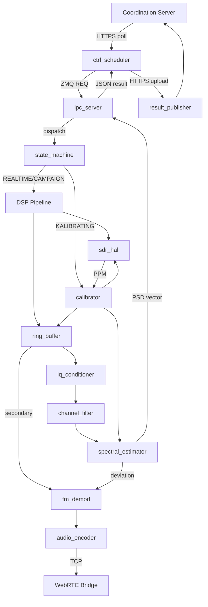

# Ctx 02 Design Synthesis — GT → Software Architecture

**FM Spectrum Monitor · Ctx 02 Design Stage · GCPDS / Universidad Nacional de Colombia**

> V-SIL | Ctx 02 → Gate H | AI-Assisted Design
>
> **Note (2026-10-22):** GT document names updated to the IEEE 29148:2018 family —
> the former SRS + HCS pair is now StRS (`G0_StRS.md`) + SyRS (`G0_SyRS.md`).
> Mentions of "SRS" in cited literature frameworks are unchanged.

This document synthesizes four AI-assisted software architecture design frameworks from the literature and maps them to V-SIL's Ctx 02 stage for the FM spectrum monitoring sensor. The goal: derive a multi-hypothesis software architecture from the Ground Truth documents (G0_StRS.md + G0_SyRS.md), evaluate candidates via trade study, and select one with written justification — as Ctx 02 requires.

---

## 1. Current Position in V-SIL

```
Ctx 00 → Ctx 01 → G0 Gate ✓ → [Ctx 02] → Gate H → Ctx 03
(Scoping)  (Reqs)   (Passed)    (Design)   (Human)  (Impl)
```

> **Ctx 02 mandate:** Resolve the design space — candidate DSP and classification architectures; alternative implementation pathways; hardware/software partitioning; the component dependency graph; trade studies and design decisions; and the selection rationale. The stage is explicitly *multi-hypothesis*: Pathway 1 through Pathway n are carried into an architecture trade study.

---

## 2. Researched Frameworks

### 2.1 MAAD — Multi-Agent Architecture Design

- **Origin:** Wuhan U / NTU · arxiv 2507.21382
- **Fit for Ctx 02:** ★★★ High

Multi-Agent Architecture Design. Four LLM agents (Analyst → Modeler → Designer → Evaluator) transform an SRS into architecture using "4+1" views with RAG-injected knowledge and ATAM evaluation.

#### Pipeline

```
Analyst (Parse SRS → ASRs) → Modeler (4+1 views) → Designer (Component design) → Evaluator (ATAM report)
```

#### Key Mechanisms

The Analyst agent extracts architecturally significant requirements from the SRS and classifies them by quality attribute. The Modeler generates Kruchten's "4+1" architectural views: Logical (modules and dependencies), Process (concurrency and data flow), Development (source organization), Physical (deployment to hardware), and a Scenarios view linking use cases to components. RAG injects domain-specific architectural patterns from a knowledge base.

The Evaluator runs a simulated ATAM (Architecture Tradeoff Analysis Method), producing sensitivity points, tradeoff points, and a risk catalog. This is the closest analog to V-SIL's multi-hypothesis mandate — MAAD generates a mismatch report identifying where the architecture fails to satisfy requirements.

#### Mapping to FM Monitor

For this system, the Analyst would extract ASRs such as: "bounded latency on Pi 5 with 3 OpenMP threads" (performance), "crash in either plane does not bring down the other" (availability), "no malloc on the hot path" (resource constraints). The Modeler's Process view maps directly to the dual-plane concurrency model. The Physical view captures the HackRF → Pi 5 → coordination server deployment. The Evaluator's ATAM analysis can identify tradeoffs like Welch vs PFB spectral estimation (resolution vs compute cost).

#### Strengths for Ctx 02

Natively multi-hypothesis. The mismatch report feeds directly into a trade study. ATAM is a well-understood evaluation method that produces the written justification Ctx 02 requires. The 4+1 views provide the component dependency graph V-SIL demands.

#### Gaps

No built-in hardware constraint integration — hardware constraints (HWC- blocks in the StRS) must be injected into the RAG knowledge base or the Analyst's prompt. No MCDA scoring framework — the ATAM produces qualitative risk/tradeoff analysis, not a quantitative ranking. Needs a human gate between Evaluator output and architecture selection to satisfy Gate H.

---

### 2.2 ARLO — Architecture from Requirements using LLMs and Optimization

- **Origin:** USC · arxiv 2504.06143
- **Fit for Ctx 02:** ★★★ High

Extracts Architecturally Significant Requirements, maps to ISO 25010 Quality Attributes, groups conditions, then uses Integer Linear Programming to select the optimal architecture.

#### Pipeline

```
Extract ASRs (from SRS) → Map to QAs (ISO 25010) → Condition Groups (+ Concurrent CGs) → ILP Solver (QA × arch matrix)
```

#### Key Mechanisms

ARLO extracts Architecturally Significant Requirements from the SRS, then maps each to ISO 25010 Quality Attributes (performance efficiency, reliability, security, maintainability, etc.). Requirements sharing the same QA profile are grouped into Condition Groups; groups that must be satisfied simultaneously form Concurrent Condition Groups.

A QA-to-architecture-choice matrix encodes how well each candidate architectural pattern satisfies each quality attribute (scored numerically). Integer Linear Programming then selects the combination of architecture choices that maximally satisfies the concurrent condition groups — a deterministic, reproducible optimization rather than an LLM's subjective judgment.

#### Mapping to FM Monitor

FM monitor QAs: Performance Efficiency (real-time PSD at 20 MSps), Reliability (fault tolerance table — SDR disconnect, stalled IPC, power loss), Maintainability (dual-plane separation), Portability (Pi 5 + HackRF HAL). Condition Groups emerge naturally: CG-Realtime = {bounded latency, no malloc, SPSC ring buffer}; CG-Resilience = {crash isolation, restart-always, write-temp-fsync-rename}. The ILP can compare: (a) monolithic C pipeline vs. (b) dual-plane C+Python vs. (c) microservice mesh, scoring each against the QA matrix.

#### Strengths for Ctx 02

Quantitative, deterministic architecture selection — directly produces the MCDA that V-SIL's gap table lists as unimplemented. The ILP's objective function and constraints are inspectable and reproducible, which satisfies the "selection justified in writing" requirement. Naturally multi-hypothesis: the matrix encodes all candidates and the solver picks optimally.

#### Gaps

The QA-to-architecture matrix must be populated by a domain expert or LLM — the quality of the selection is only as good as the scores. No component-level decomposition: ARLO selects architectural *style* (pipe-filter vs. layered vs. microkernel) but doesn't produce module definitions, interfaces, or dependency graphs. Needs a downstream step to decompose the selected style into the FM monitor's actual modules.

---

### 2.3 ADD + LLM — Attribute-Driven Design with Language Models

- **Origin:** Cervantes & Kazman · IEEE TSE Jun 2026; Designing '26 Workshop (ICSA)
- **Fit for Ctx 02:** ★★☆ Medium — needs adaptation

Gives the LLM an architect persona, the ADD methodology, and an iteration plan. Each iteration decomposes one element driven by its priority quality attributes.

#### Pipeline

```
Identify drivers (Priority QAs) → Choose element (to decompose) → Select patterns (+ tactics) → Instantiate (+ verify)
```

#### Key Mechanisms

Cervantes and Kazman's approach gives the LLM an explicit architect persona and the complete ADD methodology (from the SEI). Each iteration takes one architectural element, identifies its priority quality attribute drivers, selects patterns and tactics that address those drivers, and instantiates concrete design decisions. The LLM is prompted with an iteration plan that prevents it from trying to design everything at once.

#### Mapping to FM Monitor

- **Iteration 1:** System boundary — driven by Performance (real-time) and Availability (crash isolation) → selects Pipes-and-Filters (DSP pipeline) + Process Separation (dual-plane)
- **Iteration 2:** Data Plane — driven by Performance → selects Pre-allocated Memory Pool + Lock-free SPSC Ring Buffer + Condvar Signaling
- **Iteration 3:** Control Plane — driven by Modifiability → selects Plugin architecture for measurement scheduling + Strategy pattern for reporting modes
- **Iteration 4:** Hardware abstraction — driven by Testability → selects HAL + Mock pattern for SIL

#### Strengths for Ctx 02

Produces fine-grained module decomposition with explicit pattern rationale at each level — exactly the component dependency graph and design decisions Ctx 02 requires. The iterative nature maps well to V-SIL's stage-gated process.

#### Gaps

Single-hypothesis by default — each iteration picks one pattern, not a set of alternatives. Needs explicit modification to generate multiple candidates per iteration for the trade study. The evaluation is implicit (the LLM verifies against drivers) rather than structured (no ATAM, no ILP).

---

### 2.4 SDD / SGRM — Specification-Driven Development

- **Origin:** Specification-Driven Development
- **Fit for Ctx 02:** ★★☆ Medium — better for Ctx 03

Specs as executable contracts with a four-component framework (Spec, Guard, Runtime, Monitor). Generation/verification/governance closed loop — strong for CI+SIL integration but less for initial design exploration.

#### Pipeline

```
Spec (Executable contract) → Guard (Pre/post checks) → Runtime (Generation) → Monitor (Compliance loop)
```

#### Key Mechanisms

SDD treats specifications as executable contracts. The SGRM framework defines four components: Spec (the formal contract derived from requirements), Guard (pre/post-condition validators), Runtime (code generated to satisfy the spec), and Monitor (continuous compliance verification). The generation/verification/governance loop ensures the implementation never drifts from the specification.

#### Mapping to FM Monitor

The Spec component maps to formal assertions on DSP outputs: "PSD bin power ∈ [-180, +30] dBm", "IQ compensation reduces image rejection by ≥ 40 dB", "ring buffer never blocks the rx_callback". Guards become the SIL test assertions running in CI with Mock HAL + Synthetic I/Q. The Monitor maps to runtime health checks (SDR health, IPC timeout detection).

#### Strengths for Ctx 02

Directly feeds V-SIL Layer 2 (CI+SIL). The executable contracts become G1+ gate criteria. The Monitor component aligns with the FM monitor's existing fault tolerance table.

#### Gaps

SDD is primarily a *verification and governance* framework, not a design exploration one. It doesn't generate architecture candidates or produce trade studies. Best used as a complement to MAAD or ARLO in Ctx 03, not as the primary Ctx 02 method.

---

## 3. Framework Comparison

| Criterion | MAAD | ARLO | ADD+LLM | SDD |
|---|---|---|---|---|
| Multi-hypothesis | Native (mismatch report) | Native (ILP candidates) | Needs adaptation | No |
| Module decomposition | 4+1 views → components | Style only, no modules | Fine-grained per iteration | Contract-level only |
| Quantitative selection | Qualitative ATAM | ILP optimization (MCDA) | Implicit | N/A |
| HW constraint support | Via RAG injection | Via QA mapping | Via driver identification | Via spec contracts |
| Trade study output | Sensitivity/tradeoff/risk | Scored matrix + solution | Pattern rationale per iter | Pass/fail per contract |
| V-SIL gate readiness | Gate H (ATAM report) | Gate H (ILP justification) | Gate H (design decisions) | G1+ (CI contracts) |
| Ctx 02 coverage | Full | Selection only | Decomposition only | Verification only |

---

## 4. Proposed Approach: Hybrid MAAD + ARLO for FM Monitor Ctx 02

No single framework covers all Ctx 02 requirements. The proposed approach combines MAAD's multi-agent decomposition with ARLO's quantitative selection, adapted for V-SIL's gate structure and the FM monitor's hardware constraints.

### Step 1 — ASR Extraction from GT

Parse G0_StRS.md and G0_SyRS.md to extract Architecturally Significant Requirements. Classify each by ISO 25010 quality attribute. Input: validated GT documents. Output: ASR catalog with QA mapping. Agent: Analyst (MAAD).

### Step 2 — Architecture Candidate Generation

Generate 3–4 candidate architecture pathways using MAAD's Modeler with RAG-injected knowledge of embedded DSP patterns, SDR systems, and dual-plane architectures. Each candidate gets a full 4+1 view set. Candidates for FM monitor:

- **Pathway A:** Monolithic C pipeline — single process, maximum performance, minimal isolation
- **Pathway B:** Dual-plane C+Python (current reference) — crash isolation, modifiability, ZMQ IPC
- **Pathway C:** Microkernel — thin C core + loadable DSP modules, hot-swappable estimators
- **Pathway D:** Actor-model — message-passing concurrency, each DSP stage as an actor

### Step 3 — QA × Architecture Matrix (ARLO)

Build the scoring matrix: rows = quality attributes from ASRs, columns = candidate pathways. Score each cell [0–5]. Populate with domain knowledge from FM_MONITOR_DSP_REFERENCE.md and hardware constraints (Pi 5 thermal, HackRF USB bandwidth, 3-thread OpenMP). Run ILP to find optimal selection under concurrent condition groups.

### Step 4 — ATAM Evaluation (MAAD Evaluator)

Run simulated ATAM on the top 2 candidates from the ILP. Produce sensitivity points (where a small change in a parameter causes a large change in a QA), tradeoff points (where improving one QA degrades another), and risks. Output: structured trade study document.

### Step 5 — Module Decomposition (ADD iterations)

Take the winning architecture and decompose via ADD iterations. Each iteration addresses one quality-attribute driver and produces module definitions, interfaces, and pattern selections. Output: component dependency graph + interface contracts.

### Step 6 — Gate H Submission

Package for human review: ASR catalog, candidate architectures with 4+1 views, QA scoring matrix with ILP solution, ATAM trade study, module decomposition, and selection rationale. V-SIL Gate H is a human gate — the architect reviews and approves or returns with defects routed via R0–R3.

---

## 5. FM Monitor Module Map (from Reference Architecture)

Based on the dual-plane reference architecture (Pathway B) and FM_MONITOR_DSP_REFERENCE.md, the following module decomposition applies ADD iterations to produce the component dependency graph:

| Module | Description |
|---|---|
| `sdr_hal` | Hardware abstraction for HackRF One. Lazy open/close, PPM correction, health check, lazy tuning. Mockable for SIL testing with synthetic I/Q. |
| `ring_buffer` | Lock-free SPSC ring buffer with atomic cursors. Power-of-two sizing. 100 MB primary + secondary for audio path. Discard-to-head per request. |
| `iq_conditioner` | int8 → complex double conversion, DC offset removal, gain imbalance correction, phase imbalance correction. In-place, no allocation. |
| `channel_filter` | Optional frequency-domain brick-wall filter. FFT → anti-blooming → raised-cosine mask → IFFT. Cached FFT plans. |
| `spectral_estimator` | Strategy pattern: Welch (averaged periodogram) or PFB (8-tap polyphase filter bank). Parameter solver for RBW → nperseg/noverlap. Output in dBm/50Ω. |
| `fm_demod` | Concurrent audio thread. IIR bandpass → phase discriminator → de-emphasis → decimation → DC block → LPF → gain. Deviation EMA + peak-hold metrics. |
| `audio_encoder` | Opus encoding (48 kHz mono, 32 kbps CBR, 20 ms frames). TCP streaming with header framing. Reconnect-on-drop resilience. |
| `calibrator` | PPM self-correction via FM pilot tones. Wideband sweep → candidate detection → pilot SNR → fine symmetry search. EMA smoothing + outlier guard. |
| `state_machine` | Global FSM: IDLE ↔ REALTIME \| CAMPAIGN \| KALIBRATING. Mutual exclusion at intent level. Single-owner SDR access enforcement. |
| `ipc_server` | ZeroMQ REP socket over local IPC. JSON config → JSON results. Stalled handshake recovery (destroy + recreate socket). |
| `ctrl_scheduler` | Python control plane. Polls coordination server for measurement requests. Manages realtime vs campaign modes. Network resilience + local persistence. |
| `result_publisher` | Formats PSD vectors + metadata as JSON. HTTPS upload to coordination server. Store-and-forward for offline operation. |

---

## 6. Component Dependency Graph



---

## 7. Next Steps for Ctx 02 Completion

| Step | Deliverable | V-SIL Artifact | Status |
|---|---|---|---|
| ASR extraction from G0_StRS + G0_SyRS | ASR catalog with QA classification | Input to trade study | Next |
| Generate 3–4 architecture pathways | 4+1 view sets per candidate | Ctx 02 candidates | Pending |
| Build QA × Architecture matrix | Scored matrix + ILP formulation | MCDA (gap closure) | Pending |
| ATAM evaluation on top candidates | Sensitivity/tradeoff/risk report | Trade study | Pending |
| ADD decomposition of selected arch | Module definitions + interfaces | Component dependency graph | Pending |
| Gate H package | Complete design package for review | Gate H submission | Pending |
| SDD contracts for G1+ gates | Executable spec contracts | CI+SIL integration | Ctx 03 |

---

## Sources

- MAAD: Wang et al., "Multi-Agent Architecture Design," arxiv 2507.21382, 2025.
- ARLO: Castellanos et al., "Architecture from Requirements using LLMs and Optimization," arxiv 2504.06143, USC 2025.
- ADD+LLM: Cervantes & Kazman, "Attribute-Driven Design with LLMs," IEEE TSE, Jun 2026; Designing '26 Workshop (ICSA).
- SDD/SGRM: Specification-Driven Development, SGRM Framework, 2025.
- V-SIL: Ramírez-Betancourt, "V-SIL: Governed Lifecycle for AI-Assisted Sensor Development," GCPDS / Universidad Nacional de Colombia.
- FM Monitor DSP Reference: GCPDS project documentation.