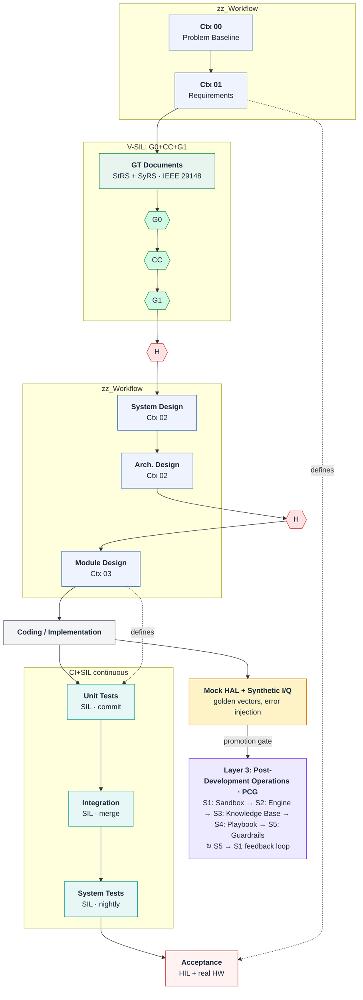
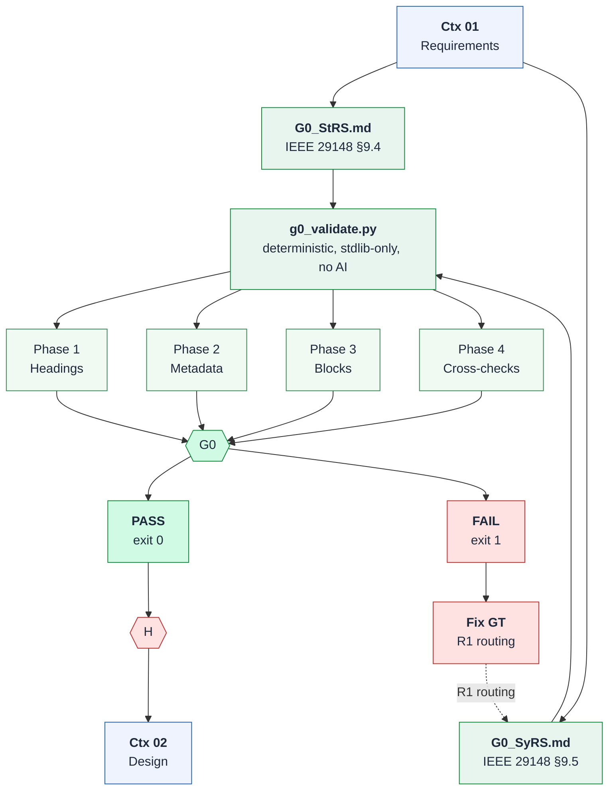
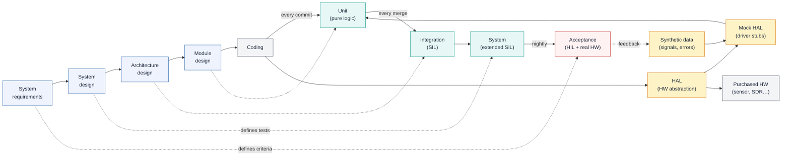
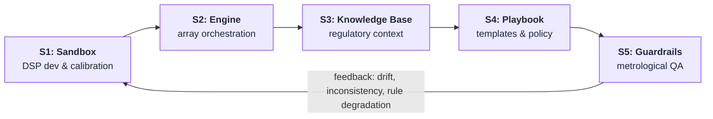

# V-SIL: A Three-Layer Governed Lifecycle for LLM-Assisted Development of SDR-Based FM Spectrum-Sensing Systems

David Ramírez-Betancourt — Universidad Nacional de Colombia, GCPDS

October 2026

## Abstract

Spectrum-sensing systems built on software-defined radio (SDR) must produce measurements that are traceable, reproducible, and defensible against regulatory criteria. When large language models (LLMs) are used to assist the engineering of such systems, the classical verification problem becomes harder: the generator is probabilistic, and its behaviour can drift without any change to the source tree, silently invalidating the evidence that once justified a prototype. This paper presents **V-SIL**, a three-layer governed lifecycle that integrates conceptual validation (the zz\_Workflow prototype-development engine), continuous software development (CI with Software-in-the-Loop), and post-development operations (the Production Pipeline, PCG) into a single, auditable pipeline for SDR FM broadcast compliance monitoring. Layer 1 defines and validates the concept through context-bounded stages, human readiness gates, a deterministic structural gate (G0) that validates Ground Truth documents against IEEE 29148 templates before any AI-driven gate runs, and six governing artefacts. Layer 2 makes the V-model's right arm continuous: the same test levels run on every commit, merge, and nightly build against a Mock HAL fed by synthetic I/Q, with deterministic acceptance gates. Layer 3 governs the deployed array through a circular five-stage production pipeline, a versioned promotion and rollback gate, capability-class maturation, GUM uncertainty propagation, and append-only evidence archiving. The coupling between layers is clean because each layer's terminal output is the next layer's input. Claims stay honest by construction: systems are *verified* at software-in-the-loop and *validated* only on real hardware, and the model never approves its own work.

---

## Contents

1. [Introduction](#1-introduction)
2. [V-SIL Overview](#2-v-sil-overview)
   - 2.1 [Governing principles](#21-governing-principles)
3. [Layer 1: Conceptual Validation Engine](#3-layer-1-conceptual-validation-engine)
   - 3.1 [Ctx 00 — Project Definition](#31-ctx-00--project-definition)
   - 3.2 [Ctx 01 — Requirements and Constraints](#32-ctx-01--requirements-and-constraints)
   - 3.3 [Ground Truth documents](#33-ground-truth-documents)
   - 3.4 [Gate G0 — Structural Validation of Ground Truth](#34-gate-g0--structural-validation-of-ground-truth)
   - 3.5 [Gate H (Ctx 01 → 02)](#35-gate-h-ctx-01--02)
   - 3.6 [Ctx 02 — Architecture and Design Resolution](#36-ctx-02--architecture-and-design-resolution)
   - 3.7 [Gate H (Ctx 02 → 03)](#37-gate-h-ctx-02--03)
   - 3.8 [Ctx 03 — Executable Implementation Contract](#38-ctx-03--executable-implementation-contract)
   - 3.9 [Build, verification, and defect routing](#39-build-verification-and-defect-routing)
   - 3.10 [Report-driven gate orchestration](#310-report-driven-gate-orchestration)
   - 3.11 [The six governing artefacts](#311-the-six-governing-artefacts)
   - 3.12 [The role of the model in Layer 1](#312-the-role-of-the-model-in-layer-1)
4. [Layer 2: Software Development (CI+SIL)](#4-layer-2-software-development-cisil)
   - 4.1 [The V-model right arm made continuous](#41-the-v-model-right-arm-made-continuous)
   - 4.2 [Mock HAL and synthetic I/Q](#42-mock-hal-and-synthetic-iq)
   - 4.3 [Artefact 3 as the regression harness](#43-artefact-3-as-the-regression-harness)
   - 4.4 [Triggers: not just commits](#44-triggers-not-just-commits)
   - 4.5 [Deterministic acceptance gate and telemetry](#45-deterministic-acceptance-gate-and-telemetry)
   - 4.6 [V-model versus CI+SIL](#46-v-model-versus-cisil)
5. [Layer 3: Post-Development Operations (PCG)](#5-layer-3-post-development-operations-pcg)
   - 5.1 [The five stages](#51-the-five-stages)
   - 5.2 [Production Promotion and Rollback Gate](#52-production-promotion-and-rollback-gate)
   - 5.3 [Capability-class lifecycle](#53-capability-class-lifecycle)
   - 5.4 [GUM uncertainty propagation](#54-gum-uncertainty-propagation)
   - 5.5 [Regulatory Decision Authority and dependency contract](#55-regulatory-decision-authority-and-dependency-contract)
   - 5.6 [The four feedback mechanisms](#56-the-four-feedback-mechanisms)
   - 5.7 [Audit-ready evidence archiving](#57-audit-ready-evidence-archiving)
6. [Inter-Layer Integration](#6-inter-layer-integration)
   - 6.1 [Layer 1 → Layer 2](#61-layer-1--layer-2)
   - 6.2 [Layer 2 → Layer 3](#62-layer-2--layer-3)
   - 6.3 [Artefact-to-stage mapping](#63-artefact-to-stage-mapping)
   - 6.4 [Extended defect routing](#64-extended-defect-routing)
7. [HITL and HIL Governance](#7-hitl-and-hil-governance)
8. [Gaps and Maturity Assessment](#8-gaps-and-maturity-assessment)
9. [Conclusion](#9-conclusion)
- [References](#references)

---

## 1 Introduction

Radio-spectrum monitoring for broadcast compliance is a measurement problem before it is a software problem. An SDR-based sensor sweeps the FM broadcast band, estimates power spectral density, and decides whether a channel is occupied by a licensed emitter, by an interferer, or by noise. Every one of those decisions can carry regulatory consequences, so the chain from raw I/Q samples to an occupancy declaration must be traceable: the configuration, the software version, the calibration state, and the uncertainty of the measurement all have to be reconstructable after the fact. At the same time, the engineering effort behind such a sensor is increasingly *LLM-assisted*: language models draft code, DSP block configurations, test cases, and even regulatory analyses under human supervision.

This assistance introduces a failure mode that classical software engineering did not have to treat as first-class. An LLM is probabilistic, not deterministic: outputs vary even at nominal zero temperature, because the inference stack itself contributes a background temperature [\[17\]](#ref17). Agent reliability decays roughly geometrically with the number of sequential steps [\[3\]](#ref3), and benchmark incentives reward confident guessing over abstention, so models are trained to hallucinate [\[2\]](#ref2). The practical consequence for a verification pipeline is severe: once a prototype exists, **every later change to code, prompt, model, or context document can silently invalidate the evidence that justified it**, even when the source tree is untouched [\[3, 2\]](#ref3). A verification strategy that assumes a fixed generator is therefore built on sand.

Two structural responses are already known from the systems-engineering literature. First, *structure beats instructions*: reliability gains come mainly from typed interfaces, gates, retries, and explicit state rather than from longer prompts [\[5\]](#ref5), and context engineering — what the model sees at each step, and nothing more — outranks prompt engineering [\[4\]](#ref4). Second, *an external oracle must decide*: the component that generates work must never be the component that approves it [\[9\]](#ref9), because optimization pressure readily exploits evaluator weaknesses in a self-evaluating system. Empirically the gap is real: roughly 83% of autonomous-research agents publish code, but only 38% provide reproducible artifacts [\[8\]](#ref8).

**Thesis.** V-SIL integrates three already-developed bodies of methodology into a single governed lifecycle for the SDR FM sensor:

- **Layer 1 — Conceptual Validation** (source: the zz\_Workflow prototype-development engine): four context-bounded stages (Ctx 00–03) that define and validate *what to build*, starting from Ground Truth documents (StRS and SyRS, structured per IEEE/ISO/IEC 29148:2018 [\[18\]](#ref18)), protected by a deterministic structural gate (G0) with cross-document consistency checking (G0-X), human readiness gates, and closed by a *Verified Prototype + Evidence*.
- **Layer 2 — Software Development** (source: CI+SIL): continuous integration with software-in-the-loop, which keeps the V-model's four test levels but makes the right arm continuous, triggering on every code, prompt, model, or context change.
- **Layer 3 — Post-Development Operations** (source: the Production Pipeline, PCG): a circular five-stage pipeline that governs the deployed array, its calibration, its uncertainty, and its audit-ready evidence.

The layers are not alternatives; they are complementary stages of one lifecycle. Layer 1 validates the concept and the design — not the software. Layer 2 implements and continuously verifies the software. Layer 3 operates the system in production under metrological and regulatory governance. Detail is deferred to Sections [3](#3-layer-1-conceptual-validation-engine), [4](#4-layer-2-software-development-cisil), and [5](#5-layer-3-post-development-operations-pcg); Section [2](#2-v-sil-overview) gives the integrated picture.

**Methodology scope.** V-SIL develops, tests, and validates *software on COTS hardware* — commercial off-the-shelf, not necessarily out-of-the-box. The Ground Truth informs what constraints the hardware imposes; V-SIL does not design hardware. Within this scope, the methodology applies at two levels: (1) the *target system* (e.g. the SDR FM sensor) and (2) the *harness itself* — the agent-agnostic tooling (skills, gates, scaffolds, MCP servers, and an agent sandbox for isolated methodology testing) that implements and enforces V-SIL. We call the second level **harness engineering**: the discipline of building the verification infrastructure so that it is itself traceable, testable, and governed by the same principles it enforces on the target. A harness gate (e.g. G0's deterministic validator) is both a tool *for* V-SIL and a deliverable *of* V-SIL — its own correctness is verified by the same pipeline it serves, preventing the common failure mode where the verification apparatus is trusted without evidence.

---

## 2 V-SIL Overview

Figure 1 shows the V-SIL lifecycle as a whole. The upper part is the classical V shape: a descending left arm that defines the system, an ascending right arm that tests it, and a valley where implementation happens. Each left-hand level *defines the tests* for the right-hand level that mirrors it (dashed links). Before the first human readiness gate, Gate G0 (green) performs a deterministic structural validation of the Ground Truth documents (StRS and SyRS) against IEEE 29148 templates, including G0-X cross-document consistency — no AI, pure script, binary pass/fail. Only after G0 passes does the human gate H decide whether requirements are complete, bounded, and verifiable. V-SIL re-reads the right arm as continuous software-in-the-loop: the unit, integration, and system levels run on every commit, merge, and nightly build respectively, against a Mock HAL fed by synthetic I/Q — no live RF is required. Only the apex, acceptance testing, remains at hardware-in-the-loop with the real device: it is the one level CI does not absorb, and the honest boundary of the whole verification apparatus. Below the V, the PCG pipeline (Layer 3) governs the deployed system as a closed loop of five stages, from the development sandbox to metrological guardrails and back.

### Figure 1: V-SIL lifecycle

**Figure 1.** Side brackets distinguish the conceptual methodology (zz\_Workflow, blue) from the concrete implementation (V-SIL, green: G0 structural validation, CC custody chain, and G1 design synthesis) and the continuous test arm (CI+SIL, teal). After Ctx 01 produces the requirements, the Ground Truth documents (StRS and SyRS, structured per IEEE 29148) pass through Gate G0 — a deterministic structural validator with cross-document consistency (green diamond) — then CC seals GT provenance, and G1 produces the multi-hypothesis design with individually auditable artefacts, before the first human readiness gate H (coral diamond) admits the project to design. The ascending right arm runs SIL tests on every commit, merge, and nightly build. Only acceptance (red) stays at HIL with real hardware. Below the V, the PCG pipeline (violet) governs the deployed array.

---

**Table 1:** The three layers of V-SIL and their terminal outputs.

| # | Name | Source | Purpose | Terminal output |
|---|------|--------|---------|-----------------|
| 1 | Conceptual Validation | zz\_Workflow | Define and validate what to build | Verified Prototype + Evidence |
| 2 | Software Development | CI+SIL | Implement and continuously verify | Regression-passing build |
| 3 | Post-Development Ops | PCG | Govern the deployed system | Audit-ready evidence archive |

### 2.1 Governing principles

Four principles govern every layer. They are stated once here and enforced everywhere.

**P1. HITL is an authorization barrier; HIL is a validation barrier.** Human-in-the-loop (HITL) means a person approves consequential actions — every readiness gate, every production promotion, every anomalous regulatory classification. Hardware-in-the-loop (HIL) means the control software is exercised against real hardware. The two are distinct barriers and neither substitutes for the other [\[7\]](#ref7).

**P2. Oracle ≠ generator — the model never approves its own work.** The LLM drafts within a stage; acceptance is decided by an external, pre-declared criterion. When the same component proposes and evaluates, optimization pressure exploits evaluator weaknesses [\[9\]](#ref9).

**P3. Mechanical rejection beats LLM approval, never the reverse.** A schema violation, a failed test, or a threshold exceedance rejects work mechanically. Human judgment is a fallback and an escalation path, not a default approval mechanism.

**P4. *Verified* ≠ *validated* — claims name the environment.** "Verified" means conformance to pre-declared criteria on recorded measurements in a given environment; "validated" means fitness for the monitoring objective in the field, on real hardware [\[16\]](#ref16). A system verified in simulation is not thereby validated; the claim must name the environment in which the evidence was produced.

---

## 3 Layer 1: Conceptual Validation Engine

**Source: the zz\_Workflow prototype-development engine.** Layer 1 is an LLM-assisted workflow for building the SDR-based FM spectrum-sensing sensor. Development proceeds through four stages, Ctx 00 through Ctx 03. Each stage is bounded by a context package — the content and rules the model works from at that stage — and ends in a named output. The requirements stage (Ctx 01) produces Ground Truth documents — the Stakeholder Requirements Specification (StRS, §9.4) and the System Requirements Specification (SyRS, §9.5) — structured per IEEE/ISO/IEC 29148:2018 [\[18\]](#ref18), which must pass a deterministic structural gate (G0), including cross-document consistency validation (G0-X), before any human or AI-driven gate runs. Two of the four stage transitions (Ctx 01→02 and Ctx 02→03) are additionally protected by an explicit human readiness gate. The Ctx 00 output freezes the project scope, and the Ctx 03 output is checked against acceptance criteria in the build and verification phase. At every transition, whether or not a gate diamond is drawn, the human reviewer decides whether to proceed: the model drafts within a stage but never approves its own output. Acceptance is decided by pre-declared criteria applied to recorded measurements, never by model judgement.

**This layer validates the concept and the design, not the software.** Its terminal output, *Verified Prototype + Evidence*, is verification of a build against a frozen contract; it is not field validation, and V-SIL never presents it as such.

### 3.1 Ctx 00 — Project Definition

Ctx 00 establishes what the project is for, before any requirement or architecture exists: project purpose and monitoring objective; intended users and operational environment; system boundary and declared scope; and the authoritative technical and regulatory sources the whole project will rely on. The output is the **Problem Baseline + Frozen Project Scope**. The problem baseline is the agreed, stable definition of the problem the project is intended to solve. Because the scope is frozen at this point, it can only be reopened through route R0 as a controlled change — a deliberate design decision that prevents scope drift from laundering itself as a requirement change.

### 3.2 Ctx 01 — Requirements and Constraints

Ctx 01 turns the baseline into engineering obligations: product and system requirements (functional and non-functional); regulatory, technical, and data-handling constraints; HackRF capability boundaries and the target compute platform; measurable acceptance criteria; and requirement identifiers with traceability. The output is the **Versioned Requirements Baseline**. Two properties matter for everything downstream. First, acceptance criteria are *measurable* — they will later drive the deterministic acceptance gate of Layer 2, so an unmeasurable criterion is not a criterion. Second, requirement identifiers exist from this point on, so any downstream failure can be routed to the requirement that failed rather than to a vague notion of "the spec".

### 3.3 Ground Truth documents

The output of Ctx 01 takes a concrete form: the **Ground Truth (GT)**, a set of pre-processed Markdown documents that define what "correct" means for the project. The GT follows the IEEE/ISO/IEC 29148:2018 [\[18\]](#ref18) document hierarchy. Two GT documents are validated at Gate G0; a third is produced downstream at Gate G1:

1. **G0\_StRS.md** — Stakeholder Requirements Specification (IEEE 29148 §9.4). System-level view covering all subsystems, frequency bands, and measurement types. Contains document metadata (ID, version, classification), the normative framework (ITU, ICNIRP, ANE, GUM), the COTS platform envelope (HackRF, RPi), stakeholder requirements, the operational concept, and system-level design decisions. Typed blocks: normative obligations (`NRM-*`), COTS constraints (`HWC-*`), and stakeholder requirements (`STK-*`), each carrying a unique ID, type, priority, status, verification method, description with SHALL/SHOULD keywords, numbered acceptance criteria, and inline compliance traceability (standard reference, clause, compliance status). Template follows §9.4.2 through §9.4.17. Merges the former SRS functional/non-functional requirements and the former HCS hardware constraints into one document.

2. **G0\_SyRS.md** — System Requirements Specification (IEEE 29148 §9.5). Detailed per-measurand technical specification. Contains method selection with rationale, parameter specification (window, overlap, NFFT, normalization), correction chains (antenna factor, cable loss, impedance matching), GUM uncertainty budgets per component, field measurement protocols, and measurand-specific acceptance criteria. Typed blocks: system requirements (`SYS-*`), each tracing back to StRS block IDs. Template follows §9.5 sections.

3. **G1\_SRS.md** — Software Requirements Specification (IEEE 29148 §9.6). Software design specification derived from the G0-validated StRS and SyRS. Contains software-specific SHALL statements, library/framework selections, implementation constraints, algorithms, data schemas, interfaces, error behaviour, and test specifications. Typed blocks: software requirements (`REQ-*`), each tracing back to SyRS block IDs. Template follows §9.6 sections. Produced as G1 output, validated by G1.

The GT documents are human-authored, not LLM-generated: they are the methodology's input contract, and every downstream gate, test, and acceptance criterion traces back to them.

### 3.4 Gate G0 — Structural Validation of Ground Truth

Gate G0 is the first gate in V-SIL and the only one that is fully implemented. It is **deterministic**: a Python script (`g0_validate.py`, stdlib-only, no network access, no filesystem writes) validates each GT document against the IEEE 29148 templates. No AI is involved. The gate answers two questions: *does each document follow the structure defined in its template?* and *are StRS and SyRS cross-document references consistent?* (the latter is the G0-X sub-gate). It does not evaluate requirement quality or constraint accuracy — those are later gates.

The validation runs in four phases:

1. **Phase 1 — Document-level structure.** Checks that all required headings exist per the document's template (e.g. §9.4.2–§9.4.17 for StRS; §9.5 sections for SyRS). Matching is by substring on normalized heading text.
2. **Phase 2 — Metadata table.** The `## Document Metadata` section must contain a table with Document ID, Project, Organization, Version (SemVer), and Classification (`PUBLIC` | `INTERNAL` | `CONFIDENTIAL`), none of which may be a placeholder.
3. **Phase 3 — Block parsing and field validation.** Typed blocks are parsed by their heading pattern: `NRM-*`, `HWC-*`, and `STK-*` for StRS; `SYS-*` for SyRS. Each block is checked for ID format and uniqueness, required fields, enumerated-value correctness, presence of a description, inline compliance traceability, and at least one numbered acceptance criterion. SyRS blocks additionally require a `traces_to` field referencing a valid StRS block ID.
4. **Phase 4 — Cross-checks.** Within each document: traceability coverage (every block ID appears in the traceability table) and acyclic dependency graph; for StRS, no orphan components (every referenced component exists in the hardware inventory). Across documents (G0-X): every StRS stakeholder requirement (`STK-*`) must have a corresponding SyRS specification (`SYS-*`); every SyRS measurand must trace to an StRS requirement and normative source; no block-ID collisions across StRS and SyRS.

The gate requires both StRS and SyRS to be present; a missing document is an immediate failure. The verdict is binary: exit code 0 (pass, no errors in either document or in G0-X) or exit code 1 (fail, at least one structural or cross-document error). Errors block; warnings (e.g. missing SHALL/SHOULD keyword, unresolved source references) do not. A G0 failure routes back to the GT author — the requirements must be structurally valid and cross-document consistent before a human reviewer even considers them for completeness.

### Figure 2: G0 validation flow

**Figure 2.** Ctx 01 (blue, zz\_Workflow) produces the Ground Truth documents (G0\_StRS.md and G0\_SyRS.md); the V-SIL implementation (green) validates each deterministically through four phases, including G0-X cross-document consistency. A pass admits the documents to human Gate H and then Ctx 02; a fail routes back to fix the GT structure (R1 routing). No AI is involved in G0.

### 3.5 Gate H (Ctx 01 → 02)

The first human readiness gate fires only after G0 has passed. It asks: *Requirements complete, bounded, and verifiable?* A **YES** admits the stage to Ctx 02; a **NO** returns the work to Ctx 01 for revision. The gate is decided by the human reviewer, on the recorded artefacts of Ctx 01. G0 is a precondition, not a substitute: a document can be structurally valid but contain wrong or incomplete requirements, which is what Gate H catches.

### 3.6 Ctx 02 — Architecture and Design Resolution

Ctx 02 resolves the design space: candidate DSP and classification architectures; alternative implementation pathways; hardware/software partitioning; the component dependency graph; trade studies and design decisions; and the selection rationale. The output is the **Selected Architecture + Implementation Plan**. The stage is explicitly multi-hypothesis [\[19\]](#ref19): Pathway 1 through Pathway n are carried into an architecture trade study, and the selection is justified in writing. This is the only place in the lifecycle where alternatives are compared; from Ctx 03 onward the chosen architecture is contract, and changes go through defect routing rather than reconsideration.

In the harness, Gate G1 implements Ctx 02 as a ten-job pipeline. Job 0 verifies GT integrity against the custody-chain seal (`source_snapshot.py verify --strict`) — no interactive approval, since CC already locked the GT. Job 1 extracts Architecturally Significant Requirements (ASRs) [\[22\]](#ref22) from StRS and SyRS blocks, grouping them into Condition Groups. Job 2 asks the user how many architecture candidates to generate (minimum 3, default 4). Jobs 3–6 produce the multi-hypothesis trade study: N candidate architectures, each addressing every Condition Group; a QA×Architecture matrix scored against ISO/IEC 25010 quality attributes [\[23\]](#ref23); an ATAM-style [\[20\]](#ref20) sensitivity and tradeoff analysis on the top two candidates; and an iterative Attribute-Driven Design [\[21\]](#ref21) decomposition with a complete dependency graph. Job 7 authors the SRS (`GT/G1_SRS.md`) per IEEE 29148 §9.6 [\[18\]](#ref18), and Job 8 validates it structurally. Job 9 assembles the review package. Each intermediate artefact is written to a separate file under `G1_artifacts/` alongside the iterative HITL report, so that every design decision is individually auditable and overwritten — not appended — on rework.

### 3.7 Gate H (Ctx 02 → 03)

The second readiness gate asks: *All implementation-critical design choices resolved?* **YES** admits the stage to Ctx 03; **NO** returns it to Ctx 02 for resolution. Its purpose is to stop implementation from absorbing design decisions that were never made — the most common way an implementation plan quietly becomes an architecture.

### 3.8 Ctx 03 — Executable Implementation Contract

Ctx 03 is the only stage that looks like software engineering, and it produces a contract, not code: software component contracts; the SDR acquisition and configuration contract; DSP and classification algorithms with their processing sequence; interfaces and versioned data schemas; configuration parameters and units; error and state behaviour (dropped samples, receiver saturation, local-oscillator tuning delay); and the unit, integration, and acceptance tests. The output is the **Executable Prototype Build Package**. The SDR instantiation is concrete: a hardware sweep (for example via `hack_rf_sweep`), FFT and power spectral density estimation, and classification, with declared fallback behaviour for each non-ideality. Layer 2 consumes this package as an executable specification (Section [6.1](#61-layer-1--layer-2)).

### 3.9 Build, verification, and defect routing

The build package is built and integrated (configure HackRF → acquire I/Q → process DSP and classification → generate measurements → store, transport, visualize), exercised in a **reproducible verification run** (execute the declared test configuration, measure outputs against acceptance criteria, record logs, configurations, measurements, and test evidence), and assembled into a **Verification Evidence Package**: requirement ID → test ID → result; configuration and software versions; RF measurement evidence; observed deviations and uncertainty; and a reproducible execution record. The final gate asks: *All mandatory acceptance criteria satisfied?*

- **YES** → **Verified SDR Prototype + Traceable Verification Evidence** → **Critical Reflection**: validation against the monitoring objective, residual limitations, lessons learned, next-version requirements, and research questions.
- **NO** → **Failure Classification**: the defect is classified by root cause and routed to the stage responsible for it (Table 2).

**Table 2:** R0–R3 defect routing: every failure returns to the stage that owns its root cause.

| Route | Returns to | Root-cause class |
|-------|-----------|------------------|
| R0 | Ctx 00 | Problem/scope defect — reopened only through change control |
| R1 | Ctx 01 | Requirement defect (missing, wrong, or unverifiable criterion) |
| R2 | Ctx 02 | Design/architecture defect |
| R3 | Ctx 03 | Implementation defect |

The routing discipline is what makes defect data actionable: a recurring R1 pattern is evidence that the requirements process is weak, not that the code is unlucky. G0 failures are a special case of R1: the GT document is structurally defective and must be fixed before any further gate runs. Layer 2 reuses the same routing for CI failures (Section [4](#4-layer-2-software-development-cisil)), and Layer 3's Stage 5 feedback loop is its operational counterpart (Section [5](#5-layer-3-post-development-operations-pcg)).

### 3.10 Report-driven gate orchestration

The gate chain is *report-driven*, not orchestrator-driven. Each gate produces a structured report; the next gate's precondition is the previous gate's report containing a terminal `HITL: PASS` iteration. No central orchestrator tracks state or sequences gates — the reports *are* the state, and each skill is self-sufficient: it reads the prerequisite report, verifies the precondition, and either proceeds or exits with a message naming the missing prerequisite. The orchestration document (e.g. `AGENTS.md` in the harness) becomes a passive reference — listing available skills, folders, and tools — rather than an imperative script.

**Iterative reports.** Each gate writes one report file per gate, not per run. Iterations are appended as sections within the same file. Each iteration carries structured metadata: human-readable and machine-safe timestamps (for audit reconstruction), an iteration counter (starting at 1), a human-in-the-loop verdict (`HITL: PASS` or `HITL: FEEDBACK`), and a description field carrying either user feedback or, for deterministic gates like G0, the full script output. A gate is complete when its latest iteration has `HITL: PASS`. There is no `DENIED` state — rejection is expressed as `FEEDBACK` with the user's comments, which triggers a new iteration. For deterministic gates, a script failure forces `HITL: FEEDBACK` automatically.

**Cycle identity.** A *cycle* is one complete run of the V-SIL pipeline against a GT baseline. All reports within a cycle are scoped to a named subdirectory (e.g. `.codeanvil/report/01_initial_design/`). Starting a new cycle — for instance after a major requirements refactor — creates a fresh report directory; previous cycles are preserved and read-only. The cycle name is requested from the user at project start, normalized to a directory-safe slug with a zero-padded sequence prefix, and recorded in the project manifest. This makes the methodology *re-entrant*: the same project can run multiple V-SIL cycles, each with full traceability, without overwriting prior evidence.

**The chain.** The prerequisite graph is declared in the harness configuration and rendered in the skill table:

| Gate | Skill | Prerequisite | Report / Artefacts |
|------|-------|-------------|-------------------|
| G0 | Structural validation | None (entry point) | `G0.md` |
| CC | Custody chain | G0 latest `PASS` | `CC.md` |
| G1 | Design synthesis | CC latest `PASS` | `G1.md` + `G1_artifacts/` (ASR, candidates, QA matrix, ATAM, ADD, review package) |

When a skill finds its prerequisite missing or in `FEEDBACK` state, it does not fail — it exits cleanly and tells the agent which prerequisite skill to run first. This produces a natural chain of returns: the agent loads G1, G1 sends it to CC, CC sends it to G0, G0 runs and produces a report, and the chain unwinds forward. The orchestrator need not know the sequence; it follows wherever the skills direct it.

This design has three consequences for the methodology. First, adding a new gate requires only a new skill with its prerequisite declared — no orchestration logic changes. Second, the report files constitute a complete, portable audit trail of every gate run, every user decision, and every iteration. Third, the same report schema works in environments without file access (e.g. web-based chat): the LLM produces the report as structured text output, the user carries it forward by pasting it into the next skill invocation, and the prerequisite check parses the pasted content identically.

### 3.11 The six governing artefacts

Six artefacts govern how the model is used within the engine (Table 3). Each states why the artefact is needed, its role in the workflow, and how it is instantiated for the SDR FM sensor.

**Table 3:** The six governing artefacts of Layer 1 and where each applies.

| # | Artefact | Where it applies | SDR instantiation |
|---|----------|-----------------|-------------------|
| 1 | System & Prompt Architecture Map | Ctx 00–03 (concrete at Ctx 02–03); failure routing | Ctx 03 contract fixes the chain (sweep → FFT/PSD → classification) and fallbacks for drops, saturation, tuning delay |
| 2 | Context & Retrieval Specs | Sources declared in Ctx 00; populates every Ctx package | ITU and national allocation databases, modulation standards, HackRF capability/calibration data, local noise-floor baselines |
| 3 | Eval & Benchmarking Suites | Acceptance criteria (Ctx 01); tests (Ctx 03); verification run; regression after any model, prompt, or Ctx change | Golden synthetic/controlled-source I/Q at known SNR; metrics: P_d, P_fa, accuracy under multipath and phase noise, inference latency |
| 4 | Safety & Guardrail Design Rules | Constraints (Ctx 01); error/state behaviour (Ctx 03); all gates | Below an SNR threshold the sensor reports "Uncertain" rather than "Free"; behaviour tested in verification |
| 5 | AI Feedback & Telemetry Specs | Evidence package; failure classification (R0–R3) | Deviations (missed detections, false alarms, re-tuning) logged with configuration and software versions, linked to failure class |
| 6 | Data Privacy, Governance & Compliance Specs | System boundary (Ctx 00); constraints (Ctx 01); anything leaving the local environment | Sensor constrained to un-demodulated features (PSD, spectrograms); retained I/Q is synthetic or locally governed |

Two artefacts deserve emphasis because they carry the coupling to the other layers. **Artefact 3** (eval and benchmarking suites) exists because conventional unit testing cannot detect semantic drift, hallucination, or regression when the model, a prompt, or a context package changes; its golden test vectors are synthetic or controlled-source I/Q samples at known signal-to-noise ratios, and it already serves double duty as the acceptance suite defined in Ctx 01. In Layer 2, this artefact *is* the CI regression harness — the coupling requires no new concept, only automation. **Artefact 6** is the sharpest constraint on an LLM-assisted pipeline: specifications, code, and derived metrics may be shared with third-party model providers, but captured I/Q and any demodulated content stay local; if any stage demodulates, audio and payload data are redacted on the device before storage or transmission so that private communications are never recorded.

### 3.12 The role of the model in Layer 1

The LLM's role is bounded by construction. It drafts within a stage, from the context package that stage declares; it never approves its own output, because every gate decision is reserved for the human reviewer. Artefact 4 enforces that no model output enters a baseline without a traceable source or test, and marks unsupported statements as unverified. Artefact 5 turns reviewer behaviour — edits, rejected drafts, retry counts, gate outcomes, defect classes — into an operational dataset for refining prompts and context packages, so that recurring failure classes point to the Ctx package that needs revision. What emerges is a discipline that does not trust the model's self-assessment: self-reported correctness is weak evidence when benchmarks reward hallucination [\[2\]](#ref2), so the workflow substitutes recorded measurements under pre-declared criteria.

---

## 4 Layer 2: Software Development (CI+SIL)

**Source: CI+SIL.** Layer 1 produces a contract and a prototype; it does not keep them verified. Once a prototype exists, every later change to code, prompt, model, or context document can invalidate the evidence that justified it. Layer 2 is the answer: continuous integration with software-in-the-loop, which is best understood not as a rival to the V-model but as *the V-model's right arm made continuous* [\[11\]](#ref11).

### 4.1 The V-model right arm made continuous

The classic V-model pairs a descending design/verification arm with an ascending testing/validation arm [\[10, 16\]](#ref10). Each left-hand level defines the tests for the right-hand level that mirrors it: requirements ↔ acceptance, system design ↔ system test, architecture ↔ integration, module design ↔ unit test. The model is strong on traceability and on separating verification from validation, but in its classic form the entire right arm is a single, late pass: tests run once, after the full descent and ascent, and the oracle arrives at the end.

CI+SIL keeps the same four test levels and changes *when* and *against what* they run (Figure 3). Instead of one late pass, the levels execute automatically and continuously against a software-modelled plant — the SIL rung of the MIL→SIL→PIL→HIL ladder [\[7, 11\]](#ref7):

- **Unit** (pure logic) runs *on every commit*;
- **Integration** (SIL) runs *on every merge*;
- **System** (extended SIL) runs *nightly*;
- **Acceptance** stays at the apex as **HIL + real hardware** — the one level CI+SIL does not absorb, and the shared downstream gap (Section [8](#8-gaps-and-maturity-assessment)).

### Figure 3: The V-model re-read as CI+SIL

**Figure 3.** The descending design arm (blue) is unchanged; the ascending test arm (teal) keeps the same four levels but runs continuously as SIL, triggered on commit, merge, and nightly, against a Mock HAL fed by synthetic I/Q (amber). Only acceptance stays at real hardware (red, HIL). The dashed horizontals are the V-model's "defines-its-tests" links.

### 4.2 Mock HAL and synthetic I/Q

To run the lower arm without RF, CI+SIL adds a thin substitution layer (Figure 1, amber). A **HAL** abstracts the device behind an interface; a **Mock HAL** of driver stubs implements that interface in software; and **synthetic data** — golden I/Q vectors at known SNR and injected error cases — feeds the mock. Purchased hardware sits behind the *same* HAL, so the swap from mock to real device is transparent to the code under test: the same code path that runs in CI runs on the bench, which is what makes SIL evidence transferable rather than merely available. The substitution is honest about its limits. It verifies logic, DSP behaviour against known vectors, and regression stability; it cannot validate RF front-end behaviour, and V-SIL never claims it does.

### 4.3 Artefact 3 as the regression harness

The coupling to Layer 1 costs no new concept. The evaluation and benchmarking suites that zz\_Workflow already requires (Artefact 3) *are* a CI harness: they contain golden datasets, performance metrics (latency versus accuracy), and evaluation metrics (factual accuracy against sources, schema and traceability checks, detection performance against known I/Q). Coupling CI to them means the suites run automatically instead of manually, and the evidence produced at the end of Layer 1 seeds the regression baseline. The Ctx 03 contract, together with the code, serves as an executable specification under version control.

### 4.4 Triggers: not just commits

For a probabilistic generator, a code commit is the least interesting trigger. The CI pipeline fires on four classes of change:

1. **Code change** — the classical trigger;
2. **Prompt change** — rewording alters model behaviour without touching code;
3. **Model change** — upgrading or swapping the model shifts the generator itself;
4. **Context change** — editing a Ctx package or a retrieval corpus changes what the model sees, and context engineering outranks prompt engineering [\[4\]](#ref4).

Each trigger replays golden I/Q through the SIL pipeline and compares the result — P_d, P_fa, classification accuracy, inference latency — against the evidence baseline. Regression is intrinsic: every trigger re-runs the full suite.

### 4.5 Deterministic acceptance gate and telemetry

The acceptance gate is deterministic. Its criteria are the measurable criteria declared in Ctx 01, applied to recorded outputs of the SIL replay; a mechanical comparison decides pass or fail. On failure, the R0–R3 routing of Layer 1 is reused: CI states *which* stage receives the defect, and telemetry (Artefact 5) records the failure class and points to the Ctx to revise. This preserves the engine's central rule end-to-end: the model never approves its own work, and omitting LLM-as-judge from acceptance is a strength, not a gap — when the same component proposes and evaluates, optimization pressure exploits the evaluator [\[9\]](#ref9). Where a judge is used at all (for example to triage drafts), it is calibrated against human raters (Cohen's κ ≥ 0.6, with explicit controls for position, verbosity, and self-preference bias) [\[14, 9\]](#ref14) and it never gates acceptance.

### 4.6 V-model versus CI+SIL

Table 4 contrasts the two on the dimensions that matter for zz\_Workflow. The V-model's structure already resembles Layer 1 — gated stages, each defining its own acceptance — which is why it scores as a high-to-medium alternative; but its single late test pass and heavy traceability apparatus are a poor match for a generator whose behaviour can drift on any model, prompt, or context change. CI+SIL preserves the level structure while making the right arm continuous and triggering on exactly those changes.

**Table 4:** V-model versus CI+SIL on the dimensions relevant to zz\_Workflow.

| Dimension | V-model | CI+SIL |
|-----------|---------|--------|
| Test cadence | One late pass after full descent | Continuous: commit / merge / nightly |
| Oracle timing | Arrives at the end | Fires on every change, early |
| Hardware need | Right arm tends to assume the device | Lower arm runs on Mock HAL + synthetic I/Q; no RF |
| Traceability | Explicit and heavy; its main cost | Lighter; encoded in the suite and version control |
| Regression | Not intrinsic; re-runs are manual | Intrinsic: every trigger re-runs the full suite |
| Fit to zz\_Workflow | Matches the gated, traceable stages, but adds ceremony | Matches Artefact 3 (already a regression harness) and the trigger-on-any-change reality |

The two agree on the two structural rules Layer 1 depends on: an oracle distinct from the generator, and a clean verification-versus-validation split, with live validation (HIL and field) left to the apex. They differ on cadence and cost. Live-RF HIL remains the downstream gap that Layer 3's governance makes explicit rather than papering over.

---

## 5 Layer 3: Post-Development Operations (PCG)

**Source: the Production Pipeline, PCG.** Everything so far concerns building the system. Layer 3 concerns running it: after promotion to production, the deployed sensor array is a *measurement organism* whose calibration ages, whose detection rules degrade, whose nodes disagree, and whose decisions must survive technical or legal review. The PCG pipeline transforms a static sensor array into a self-correcting, ever-improving monitoring system through five circular stages, each feeding the next and the final stage looping back to refine the whole system (Figure 4).

### Figure 4: PCG (Layer 3) — five circular stages

**Figure 4.** Stage 5 outputs feed Stage 1, closing the loop; the numbered labels identify functional ownership, not a mandatory chronological order for regulatory decision execution.

### 5.1 The five stages

1. **Stage 1 — RF/DSP Development & Calibration Sandbox (the Sandbox).** A safe, collaborative space for building and testing DSP algorithms, calibration procedures, and measurement pipelines before field deployment: signal-analysis notebooks (GNU Radio Companion, Python/SciPy) for rapid prototyping on captured I/Q; hardware-in-the-loop IDEs for production DSP code on embedded hosts; version control for block diagrams, calibration coefficients, and detection rules; containerization for reproducible environments across workstations and field targets. *Output:* validated DSP blocks, calibrated measurement procedures, and feature prototypes, which enter Stage 2 as deployment candidates; Stage 1 also receives Stage 5 drift reports, validation failures, and uncertainty anomalies as prioritized inputs for the next cycle.

2. **Stage 2 — Array Orchestration & Multi-Node Coordination (the Engine).** Coordination of distributed SDR nodes, measurement workflows, and multi-node data fusion: an array orchestrator scheduling wideband acquisitions and cross-node campaigns; workflow orchestrators (GNU Radio, Apache Airflow, custom DSP schedulers); multi-node coordination roles (acquisition scheduler, calibration manager, timing supervisor, fusion arbiter); and data-routing gateways with local buffering during link outages. *Output:* structured measurement decisions, capability-eligibility records, eligibility-gated decision records, synchronized observation epochs, and traceable chains from node-level results to array-level regulatory conclusions. Formal compliance decisions are produced only after the regulatory context and measurand-specific decision rule have been resolved and the applicable gate has been passed (Section [5.5](#55-regulatory-decision-authority-and-dependency-contract)).

3. **Stage 3 — Regulatory & Spectral Knowledge Base (the Knowledge Base).** Authoritative regulatory context, licensed-station parameters, and historical spectral reference data grounding every measurement in validated information: regulatory and spectral data retrieval, where sources used for formal compliance carry an applicability record (jurisdiction, competent authority, service, station, effective date, source version, precedence rule); historical spectrum embeddings for trend comparison and anomaly fingerprinting; and knowledge graphs of station relationships, propagation characteristics, array topology, and inter-node calibration histories. *Output:* contextual regulatory grounding and versioned measurand-specific decision definitions (rule type, limits or permitted region, reference quantities, rule parameters, regulatory source).

4. **Stage 4 — Measurement Configuration & Policy Playbook (the Playbook).** Standardization and version control of measurement configurations, calibration profiles, and regulatory decision rules: measurement templates (parameterized channel plans, detection rules, spectral configurations); calibration-profile versioning (primary, secondary, and relative states, coefficients, validity periods across nodes); A/B testing of DSP variants against controlled reference signals with versioned acceptance criteria and rollback thresholds; and policy enforcement for gain limits, metadata formats, capability-eligibility requirements, and decision-rule integrity. *Output:* consistent, governed, optimized measurement configurations deployable to the array with full traceability to regulatory rule sets and calibration states.

5. **Stage 5 — Metrological QA & Array Health Guardrails (the Guardrails).** Measurement of RF and DSP performance, detection of metrological drift, validation of cross-node consistency, and enforcement of array-health boundaries: evaluation metrics (carrier-frequency error, calibrated power accuracy, occupied-bandwidth containment, false occupancy rate, missed detection rate, cross-node consistency score); human-in-the-loop review of anomalous regulatory classifications; observability (sample-loss events, I/Q residuals, DC contamination, timing skew, calibration validity, reference-lock state, drift, processing load, memory, ADC dynamic-range utilization); and alerting on threshold exceedances and health degradation. *Output:* performance reports, calibration-drift logs, uncertainty scores, and health-state classifications, consumed by Stage 1 to initiate the next improvement cycle — closing the loop.

The numbered stage labels identify *functional ownership*, not a mandatory chronological order. Governed handoffs bind the stages: Stage 1 outputs become deployment candidates for Stage 2 under a versioned Stage 4 configuration; Stage 3 supplies regulatory grounding to Stage 4 before rules are activated; Stage 4 publishes the versioned template, calibration profile, capability class, and decision configuration consumed by Stage 2; Stage 2 executes acquisitions, eligibility gating, and (only for eligible measurands) the configured formal decision logic; and Stage 5 evaluates performance, uncertainty, drift, and cross-node consistency, feeding Stage 1 while also constraining or downgrading Stage 4 configurations and Stage 2 execution.

### 5.2 Production Promotion and Rollback Gate

This gate is the Layer 2/Layer 3 contract (Section [6.2](#62-layer-2--layer-3)). A Stage 1 deployment candidate shall not enter governed Stage 2 production execution until a versioned promotion record confirms:

1. the Stage 1 validation package and candidate identifier;
2. the active Controlled Source Specification Baseline and Stage 3 regulatory-rule version;
3. the Stage 4 measurement template, calibration profile, capability state, acceptance criteria, and rollback thresholds;
4. a valid Stage 5 metrological and node-health state;
5. approval by the deployment authority identified in the Stage 4 policy record.

Initial activation uses the node subset or rollout scope authorized by that record. Stage 5 then evaluates the configured post-deployment acceptance metrics over the defined evaluation interval. Exceedance of a rollback threshold, loss of calibration validity, invalidation of the regulatory baseline, or a safety/health gate failure suspends the candidate and restores the last approved compatible configuration. Promotion, rejection, rollback, and restoration events are preserved as versioned evidence records.

### 5.3 Capability-class lifecycle

Four capability classes — **Unsupported** → **Screening-Grade** → **Conditional Compliance-Grade** → **Compliance-Grade** — each add a layer of validation obligation on top of the last rather than forming a separate track. A new measurand or algorithm enters in Stage 1 as Unsupported or Screening-Grade; Stage 3 resolves the applicable regulatory context; Stage 4 versions the screening template and profile with formal compliance output disabled; after the Promotion Gate confirms the authorized screening rollout, Stage 2 deploys to the approved node subset; Stage 5 accumulates the uncertainty, repeatability, consistency, and health evidence required by the Capability Qualification Record. Promotion to Conditional Compliance-Grade requires approval of that record; promotion to Compliance-Grade requires that all measurand-specific preconditions in the Controlled Source Specification Baseline be implemented, independently validated, and recorded. Each transition is controlled by a versioned record (measurand, current and proposed states, required evidence, acceptance criteria, validation method, validator identity and independence, approving authority, resulting configuration version), and the validation authority must be independent of whoever produced the candidate evidence — the organizational expression of the oracle-≠-generator principle. Promotion and demotion events are themselves logged as Stage 5 outputs feeding Stage 1.

### 5.4 GUM uncertainty propagation

The GUM uncertainty framework is embedded at each measurement-relevant stage boundary, and each stage's contribution to (or exclusion from) the uncertainty budget is explicitly identified:

- **Stage 1:** each uncertainty component is classified by its *method of evaluation*, not by its physical source. **Type A** evaluation is used when the standard uncertainty comes from statistical analysis of measured quantity values; **Type B** when it comes from calibration certificates, specifications, prior data, or documented scientific judgment. Algorithmic, hardware, timing, and environmental effects may therefore contribute through either category according to the evidence used. The evaluation method, source data, statistical model, sensitivity coefficient, and resulting standard uncertainty are attached to the applicable DSP block or calibration coefficient.
- **Stage 2:** timing skew, sample-loss effects, and inter-node residual mismatch are quantified when they influence a reported measurand, classified Type A or Type B by evaluation method, and — including covariance terms where input quantities are correlated — propagated into the node-level uncertainty budget.
- **Stage 3:** the regulatory decision reference is represented by its governing mathematical form (one-sided limit, two-sided tolerance interval, permitted range, frequency-dependent limit or emission mask T(f), relative reference, or temporal/occupancy criterion). These are authoritative *decision inputs*, not measurement-error contributions to the budget; the source version, retrieval timestamp, decision-rule type, and active parameters are logged as configuration metadata so the rule applied to each determination can be reconstructed.
- **Stage 4:** measurement-template versioning captures which uncertainty contributions were active at the time of configuration deployment.
- **Stage 5:** the combined standard uncertainty u_c(y) and expanded uncertainty U are validated from the aggregated contributions; drift detection compares current uncertainty envelopes against the calibration record. Stage 2 computes real-time measurement uncertainty using Stage 5-approved models, so Stage 1 receives not only *what* degraded, but with *what confidence* the degradation was detected.

Related to this, the Ground-Truth Reference Contract constrains how performance is measured at all: false-occupancy and missed-detection rates used for Stage 5 acceptance or feedback are computed only over observations carrying a qualified Ground-Truth Reference Record (reference source and authority, labelled state, time/frequency bounds, alignment tolerances, review status, dataset version). Ambiguous labels are excluded or reported separately as indeterminate, and Stage 5 reports the numerator, denominator, reference identifiers, and excluded cases with every result used to trigger a production change.

### 5.5 Regulatory Decision Authority and dependency contract

The circular architecture shall not be read as a temporal sequence in which Stage 2 may issue a formal regulatory decision before Stages 3–5 have supplied the control information the framework requires. For each measurand and decision cycle: Stage 3 provides the authoritative regulatory context and measurand-specific decision definition; Stage 4 binds it to the deployed measurement template, calibration profile, capability class, and versioned decision configuration; Stage 5 provides the current metrological-validity and health information; and only then does Stage 2 execute the measurement workflow, apply active Stage 4 calibration coefficients to raw I/Q, and pass the measurand through the Capability Eligibility & Regulatory-Use Gate before formal decision logic. The rule itself must define how the measured value and its uncertainty enter acceptance, rejection, and any indeterminate or guard-band outcome. Screening-grade results may generate screening or review events but remain distinct from formal compliance determinations, and unsupported measurands are blocked from regulatory decision processing entirely.

### 5.6 The four feedback mechanisms

The loop closes through four primary mechanisms, all Stage 5 → Stage 1:

1. **Calibration drift detection:** Stage 5 identifies frequency-reference offset or gain bias beyond Tier 2 limits → Stage 1 executes recalibration experiments → Stage 4 updates calibration-profile versions.
2. **Cross-node inconsistency:** Stage 5 flags persistent disagreement beyond the uncertainty budget → Stage 1 investigates propagation-model or DSP-algorithm errors → Stage 3 updates the knowledge graph or station records.
3. **Detection rule degradation:** Stage 5 evaluates false-occupancy and missed-detection rates against qualified ground-truth records → Stage 1 prototypes improved detection algorithms → Stage 4 evaluates the candidate against the Promotion Gate → Stage 2 deploys only an approved update to the authorized rollout scope.
4. **Resource optimization:** Stage 5 analyses ADC dynamic-range utilization and processing load → Stage 1 prototypes efficient DSP implementations → Stage 4 simplifies measurement configurations.

Health-driven degradation is the guardrail counterpart: a node flagged *operational for screening only* has its Stage 4 templates automatically downgraded and is excluded from compliance fusion; a *degraded* node is suspended from fusion and locked pending Stage 1 investigation; an *unavailable* node is removed from the orchestration schedule while Stage 5 continues to log absence events.

### 5.7 Audit-ready evidence archiving

Every completed loop through the five stages produces a controlled evidence record. For formal compliance determinations the repository provides append-only or write-once protection, authenticated access control, a cryptographic content digest for each retained artefact, an integrity-protected manifest, a trusted acquisition timestamp, and a retention identifier; corrections create a new linked record without overwriting the preserved predecessor. The record covers acquisition metadata (centre frequency, sample rate, gain state, timestamp reference); the DSP pipeline version, sandbox commit, container-image digest, and dependency manifest needed to reproduce the executed DSP path; the orchestration log and node-eligibility list; the regulatory rule set version and baseline identifier; the measurement-configuration version, calibration profiles, capability state, and policy checks; estimated measurands, uncertainty budgets, decision outcomes, health states, fusion weights, and ground-truth identifiers; and, for each formal decision, the raw I/Q interval — or another lossless source artefact that documented replay validation has demonstrated sufficient to recompute every reported measurand. Reconstructability is demonstrated by replay or equivalent deterministic verification for each production DSP release before that release is authorized for formal compliance use. This is the Layer 1 evidence discipline, industrialized: the same principle (recorded measurements, pre-declared criteria, reproducible execution) now applies to every production decision.

---

## 6 Inter-Layer Integration

The three layers compose because each layer's terminal output is the next layer's input. This section states both couplings and the artefact-to-stage mapping that implements them.

### 6.1 Layer 1 → Layer 2

The **Ctx 03 Build Package** becomes the executable specification for CI+SIL: component contracts, schemas, error behaviour, and the declared unit/integration/acceptance tests are exactly what the pipeline executes. The Ground Truth documents (StRS and SyRS) that passed G0's structural and cross-document validation carry forward as the authoritative reference: the acceptance criteria in the StRS and SyRS become the deterministic gate's thresholds, the SRS (produced at G1 from the validated StRS and SyRS) supplies software-level specifications, and any change to a GT document triggers G0 re-validation, custody-chain re-sealing, and a full CI re-run. **Artefact 3** (eval and benchmarking suites) seeds the CI regression baseline — the suites zz\_Workflow already requires *are* the CI harness, so the coupling adds automation and not concepts. Three artefacts complete the interface: the Ctx 01 measurable acceptance criteria become the deterministic gate's thresholds; Artefact 4's guardrail rules become expected behaviours in the suite (e.g. the "Uncertain"-below-threshold rule must be tested); and Artefact 5's telemetry continues uninterrupted into CI, where failure classes route via R0–R3 to the Ctx stage that must revise. The name of the handoff output stays honest: Layer 2 terminates in a *regression-passing build*, which is *verified*, not *validated*.

### 6.2 Layer 2 → Layer 3

The coupling is the **Production Promotion and Rollback Gate** (Section [5.2](#52-production-promotion-and-rollback-gate)), a versioned contract with five prerequisites that bind the CI world to the operations world: the Stage 1 validation package (fed by Layer 2 evidence); the Stage 3 regulatory baseline; the Stage 4 measurement template and calibration profile; the Stage 5 metrological-validity state; and human approval by the deployment authority. In the other direction, Stage 5 feedback re-enters Layer 2 as ordinary CI triggers: a calibration-coefficient change is a code change, a regulatory-rule update is a context change, and a model or prompt change in any LLM-assisted component fires the full suite — the four trigger classes of Section [4.4](#44-triggers-not-just-commits) apply unchanged in production.

### 6.3 Artefact-to-stage mapping

Table 5 maps each zz\_Workflow governing artefact to the PCG stage it feeds. The mapping is one-to-many for the artefacts that carry governance (3 and 6), and it shows that no artefact dies at the layer boundary: everything Layer 1 defines, Layer 3 operationalizes.

**Table 5:** Which Layer 1 artefact feeds which Layer 3 stage.

| Layer 1 artefact | Feeds PCG stage(s) |
|-----------------|-------------------|
| 1. System & Prompt Architecture Map | Stage 2 orchestration logic (roles, routing, fallbacks) |
| 2. Context & Retrieval Specs | Stage 3 knowledge base (indexing, grounding, applicability records) |
| 3. Eval & Benchmarking Suites | Stage 1 sandbox validation; Stage 5 acceptance metrics against ground truth |
| 4. Safety & Guardrail Design Rules | Stage 5 guardrails (thresholds, "Uncertain" behaviour, HITL escalation) |
| 5. AI Feedback & Telemetry Specs | Stage 5 observability (failure classes, drift logs, anomaly records) |
| 6. Data Privacy, Governance & Compliance Specs | All stages (what may leave the environment, retention, redaction) |

### 6.4 Extended defect routing

Layer 1 routes a failed verification to the responsible Ctx stage (R0–R3). Layer 3 has an analogous but circular mechanism: Stage 5 findings return to Stage 1 as prioritized validation or refactoring targets. The two are structurally identical — a failure is classified by root cause and sent to the stage that owns that cause — but differ in what "the stage" means. In Layer 1 the stages are *definition stages* (problem, requirements, design, contract); in Layer 3 they are *operational functions* (sandbox, engine, knowledge base, playbook, guardrails). The R0 analogue in operations is the invalidation of the regulatory baseline, which suspends the pipeline and forces a documented dependency-impact analysis before reactivation.

---

## 7 HITL and HIL Governance

V-SIL's governance rests on two distinct human-and-hardware barriers, and conflating them is the most common way a verification pipeline overstates its claims [\[7, 16\]](#ref7).

**HITL is an authorization barrier.** A person approves consequential actions. In Layer 1 this is every gate: the two readiness gates H, the scope freeze, and the final acceptance decision. In Layer 2 it is the human review of routed defects and of any change to the criteria themselves. In Layer 3 it is the deployment-authority approval in the Promotion Gate, the human-in-the-loop review of anomalous regulatory classifications in Stage 5, and the independence requirement on the validating authority in each Capability Qualification Record. Authorization is a decision about *permission*; it is made by a person, on recorded artefacts, and it is itself archived.

**HIL is a validation barrier.** The control software is exercised against real hardware: acceptance testing at the apex of the V (Figure 1), where the Mock HAL is swapped for the real device behind the same interface. HIL is the boundary of V-SIL's claims. Below the apex, the system is *verified* against pre-declared criteria on synthetic or replayed I/Q; only at the apex — and ultimately in the field — does it become *validated* [\[16\]](#ref16). Simulation has a ceiling, and HIL enters precisely when the restriction is hardware [\[7\]](#ref7); reported experience with LLM-assisted engineering shows that humans detect idealizations and inconsistencies that automated evaluation misses entirely [\[12, 13\]](#ref12).

**LLM governance rules.** Four rules bind model use across all three layers:

**G1. The model never approves its own work.** Every gate in V-SIL is human-decided, and every acceptance decision is made by an external oracle.

**G2. Mechanical rejection beats LLM approval, never the reverse.** Schema violations, failed tests, and threshold exceedances reject work mechanically [\[6, 1\]](#ref6); a model's approval cannot override a mechanical rejection, but a human may escalate one.

**G3. Acceptance by pre-declared criteria on recorded measurements, never by model judgement.** This is stated verbatim in Layer 1 and enforced by the deterministic gate of Layer 2 and the Promotion Gate of Layer 3.

**G4. Self-reported correctness is weak evidence.** Benchmarks that score accuracy alone reward confident guessing, so models are trained to hallucinate [\[2\]](#ref2); where an LLM judge is used, it is calibrated against human raters with κ ≥ 0.6 and bias controls [\[14, 9\]](#ref14), and it never gates acceptance.

The LLM's legitimate roles are drafting, translation between artefacts, anomaly triage, and telemetry summarization — all upstream of a gate, none at a gate. Two-level control operationalizes this: the model plans at the slow level; a deterministic controller executes the fast loop; the model never sits inside a real-time loop, and physical limits declared in a tool's JSON schema are the first line of defence, since a call violating the schema is rejected before it reaches the device [\[1, 6\]](#ref1). Where autonomous chains are used, their length is bounded: reliability decays roughly geometrically with sequential steps, with a practical ceiling near 16 [\[3\]](#ref3), which is why every stage in V-SIL is short, bounded, and human-gated.

---

## 8 Gaps and Maturity Assessment

Honesty about maturity is part of the method. Three gates are now fully implemented: Gate G0 (deterministic structural validation of GT documents against IEEE 29148 templates), Gate CC (custody chain: HMAC-signed hash-chain provenance sealing GT after G0 passes), and Gate G1 (AI-driven design synthesis: a ten-job pipeline from ASR extraction through multi-hypothesis architecture, ATAM trade study, and SRS authoring, with intermediate artefacts written to individually auditable files). All subsequent gates (G2+) remain unimplemented. Table 6 lists the components V-SIL depends on that are not yet implemented or instantiated, with the gap each one leaves.

**Table 6:** Maturity assessment: explicit gaps.

| Component | Status | Gap |
|-----------|--------|-----|
| Gates G2+ | Not implemented | G0, CC, and G1 are implemented as agent-agnostic skills (see Section [3.6](#36-ctx-02--architecture-and-design-resolution)); implementation and integration gates remain unspecified |
| HIL bench | Not implemented | No live-RF validation infrastructure; the apex of the V cannot yet be exercised, so all claims remain at the SIL level of verification |
| MCDA [\[15\]](#ref15) | Partially implemented | G1 formalizes the trade study as a QA×Architecture matrix with ATAM analysis; repeatable but not yet validated against a formal MCDA framework |
| Controlled Source Specification Baseline | Not instantiated | Stage 2 formal compliance execution remains disabled until the Stage 4 baseline record is populated and approved |
| Single-to-array scaling | Not covered | The pipeline assumes a sensor array, but no methodology exists for scaling the Layer 1/2 single-node results to array level |
| LLM governance in production | Not specified | Use constraints for LLMs inside Stage 2 (orchestration) and Stage 5 (review support) are undefined |

None of these gaps is structural. Gates G0, CC, and G1 demonstrate the pattern: each gate is a skill with a contract, a script or agent, and a binary verdict — and the report-driven orchestration (Section [3.10](#310-report-driven-gate-orchestration)) means adding a gate requires only a new skill with its prerequisite declared, not new orchestration logic. Gates G2+ follow the same pattern. The harness engineering effort (Section [1](#1-introduction)) treats these gates as its own deliverables under the same V-SIL discipline. The HIL bench is an infrastructure project that the Mock HAL already anticipates through its same-interface swap; MCDA is partially formalized within G1's QA×Architecture matrix and ATAM trade study, but not yet validated against a formal framework; the Controlled Source Specification Baseline is a document-binding task with a defined record schema; single-to-array scaling is a research programme rather than a methodology gap; and production LLM governance can be written as an extension of the four rules in Section [7](#7-hitl-and-hil-governance), constrained by the same gates.

---

## 9 Conclusion

V-SIL unifies three bodies of methodology — conceptual validation (zz\_Workflow), continuous software development (CI+SIL), and post-development operations (PCG) — into a single governed lifecycle for LLM-assisted SDR FM spectrum-sensing systems. Each layer has a distinct role: Layer 1 *defines* what to build and validates the concept and design; Layer 2 *implements* it and verifies it continuously; Layer 3 *operates* the deployed system under metrological and regulatory governance.

The coupling is clean because each layer's terminal output is the next layer's input: the Ctx 01 Ground Truth documents (StRS and SyRS, structured per IEEE 29148 and validated by the deterministic G0 gate with G0-X cross-document consistency) feed the design stages; the Ctx 03 Build Package is Layer 2's executable specification; Artefact 3 is already the CI regression harness; and the Promotion Gate binds the regression-passing build to the production pipeline as a versioned, revocable contract. Three gates are now implemented: G0 (deterministic structural validation), CC (custody-chain provenance), and G1 (AI-driven design synthesis with individually auditable artefacts). The gate chain is report-driven: each gate produces a structured iterative report, and the next gate's precondition is the previous gate's terminal `PASS` — no central orchestrator is required, and adding a gate means adding a skill, not rewriting control flow. Cycle identity makes the methodology re-entrant: the same project can run multiple V-SIL cycles, each with full traceability. The methodology applies at two levels — the target system and the harness itself — so that the verification infrastructure is governed by the same principles it enforces. Nothing is invented at the boundaries, which is why the methodology can be adopted incrementally.

The claims stay honest by construction. The system is *verified* at software-in-the-loop and *validated* only at hardware-in-the-loop and in the field; every claim names the environment in which its evidence was produced. The model drafts but never approves: mechanical rejection beats LLM approval, never the reverse, and acceptance is decided by pre-declared criteria applied to recorded measurements. Five gaps remain — gates G2+, a HIL bench, formal MCDA validation, an instantiated Controlled Source Specification Baseline, a single-to-array scaling methodology, and production LLM governance — and each is explicit, bounded, and tractable.

---

## References

[1] Harbin Institute of Technology & Harvard, "The Evolution of Tool Use in LLM Agents," arXiv:2603.22862, Mar. 2026.

[2] A. T. Kalai *et al.*, "Evaluating LLMs for accuracy incentivizes hallucinations," *Nature*, vol. 653, Apr. 2026.

[3] Mittal, "How Fast Do Agents Rot?," arXiv:2609.01660, Sep. 2026.

[4] Anthropic, "Effective context engineering for AI agents," 2026.

[5] Nerd Level Tech, "AI Agent Reliability 2026: Structure Beats Instructions," 2026.

[6] Model Context Protocol Specification, rev. 2025-06-18, modelcontextprotocol.io.

[7] OPAL-RT, "Guide to HIL Testing," updated Sep. 2026.

[8] "Autonomous Research Agents: Verification Gap," arXiv:2608.05179, Jun. 2026.

[9] "LLM-as-a-Judge Is Not an Oracle," arXiv:2609.02246, Sep. 2026.

[10] QMSdoc, "Traceability in V-Model," Jan. 2026.

[11] Sheridan, "Testing Embedded Systems 2026," Apr. 2026.

[12] Heinrichs *et al.*, "From Prompt to Prototype: LLM-Driven RF Workflow," arXiv:2608.31006, Aug. 2026.

[13] Sadeqi Bajestani *et al.*, "HITL+LLM in smart manufacturing," *J. Manufacturing Systems*, vol. 86, Jun. 2026.

[14] FutureAGI, "LLM-as-a-Judge in 2026," updated Aug. 2026.

[15] *Sustainable Futures*, "MCDA reliability," Jun. 2026.

[16] Sheridan Tech, "Design Validation vs Verification," Mar. 2026.

[17] Pith, "Introducing Background Temperature," arXiv:2604.22411, 2026.

[18] IEEE/ISO/IEC 29148:2018, "Systems and software engineering — Life cycle processes — Requirements engineering," 2018.

[19] L. Bass, P. Clements, and R. Kazman, *Software Architecture in Practice*, 4th ed. Addison-Wesley, 2021.

[20] R. Kazman, M. Klein, and P. Clements, "ATAM: Method for Architecture Evaluation," CMU/SEI-2000-TR-004, Software Engineering Institute, 2000. https://resources.sei.cmu.edu/library/asset-view.cfm?assetid=5177

[21] R. Wojcik *et al.*, "Attribute-Driven Design (ADD), Version 2.0," CMU/SEI-2006-TR-023, Software Engineering Institute, 2006. https://resources.sei.cmu.edu/library/asset-view.cfm?assetid=8145

[22] L. Chen, M. Ali Babar, and B. Nuseibeh, "Characterizing Architecturally Significant Requirements," *IEEE Software*, vol. 30, no. 2, pp. 38–45, Mar./Apr. 2013.

[23] ISO/IEC 25010:2023, "Systems and software engineering — Systems and software Quality Requirements and Evaluation (SQuaRE) — Product quality model," 2023.
