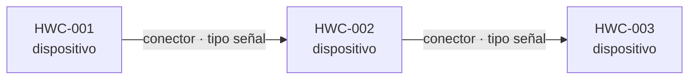
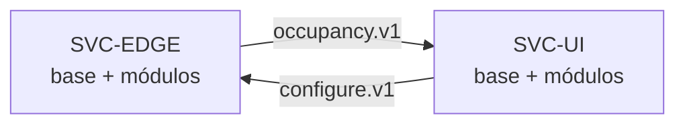
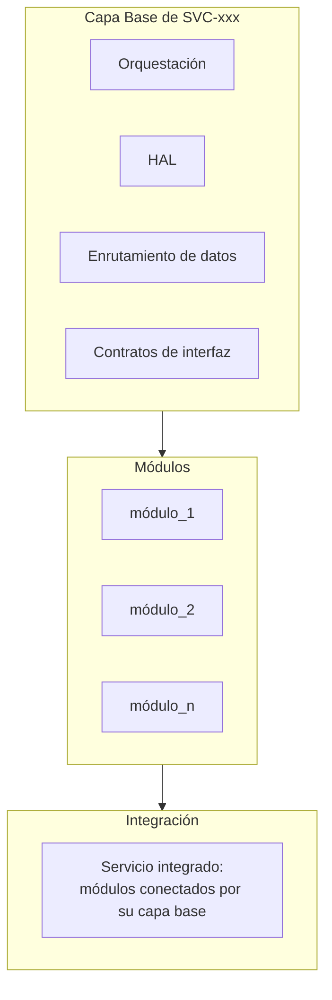
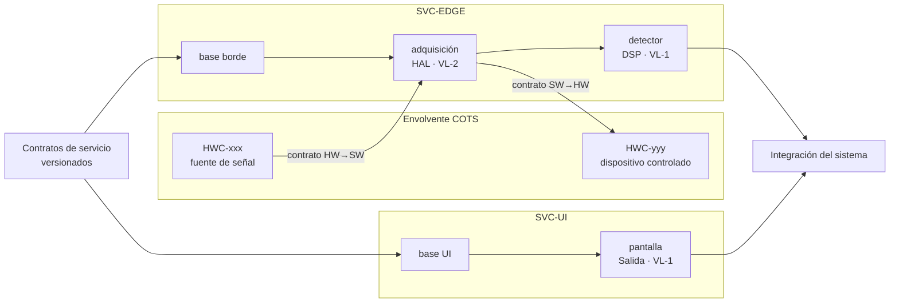
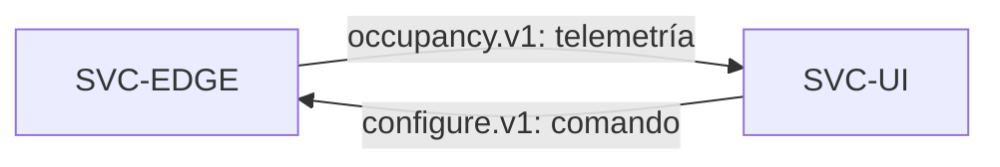

# S1 — Diseño de un Sistema de Servicios en Capas

<!-- ================================================================
     V-SIL v3 · Etapa S1 + Compuerta G1
     
     Estructura basada en:
       - arc42 §5 Building Block View (Starke & Hruschka)
       - IEEE 1016™-2009 / ISO/IEC/IEEE 42010:2022 viewpoints
         (composition, dependency, interface)
       - IEEE/ISO/IEC 29148:2018 (trazabilidad de requisitos)
       - MADR (Architecture Decision Records)
     
     Extensiones V-SIL v3:
       - Envolvente COTS con topología física e interfaces HW↔HW
       - Topología y despliegue de servicios; una capa base por servicio
       - Perfil de verificación por módulo y ruta de sistema (VL-0/1/2)
       - Stub recipe por contrato
       - Clasificación de contratos: HW→SW, SW→SW, SW→HW, servicio→servicio
       - Paquete de modelo ML suministrado: apartado opcional, solo si se usa
       - Modo HAL (`mock-only` | `mock+real`): Mock HAL siempre;
         Real HW HAL solo en `mock+real` (§1.6)
       - Telemetry companion obligatorio, nunca se entrega (§1.7)
       - Toolchain por servicio, con el que S2 construye (Meta)
       - Sección de riesgos e inviabilidades conocidas (pre-RFD)
     
     Entrada: G0_StRS.md + G0_SyRS.md (aprobados por G0 + Gate H)
     Salida:  Este documento, evaluado en G1
     
     Principios rectores (del paper):
       P1. HITL es barrera de autorización; HIL es barrera de validación
       P2. Oráculo ≠ generador (quien diseña no es quien aprueba)
       P3. G0 es la única compuerta determinista; su rechazo mecánico
           prevalece. Los demás veredictos de compuerta son humanos (HITL)
       P4. Verificado ≠ validado (las afirmaciones nombran el entorno)
     ================================================================ -->

## Meta

| Campo              | Valor                                            |
|--------------------|--------------------------------------------------|
| Proyecto           | {{nombre del proyecto}}                          |
| Ciclo              | {{identificador del ciclo, e.g. pre_release_01}} |
| Fecha              | {{YYYY-MM-DD}}                                   |
| Autor              | {{nombre / rol}}                                 |
| G0 aprobado        | {{ref al commit o hash de G0_StRS + G0_SyRS}}    |
| Gate H aprobado    | {{fecha + quién autorizó}}                       |
| Servicios          | {{IDs de servicios; un solo servicio es válido}} |
| Modelo ML          | {{omitir si no aplica; si se usa, ref. al paquete}} |
| HAL mode           | {{mock-only / mock+real}}                        |
| Toolchain          | {{una entrada por servicio: `SVC-xxx: <package> · <language> · <package manager> · <test runner>`; e.g. `SVC-001: fm_edge · Python 3.12 · uv · pytest; SVC-002: dashboard · TypeScript · pnpm · vitest`}} |
| Estado             | borrador / en revisión G1 / aprobado G1          |

---

## 0. Envolvente COTS

<!-- ================================================================
     IEEE 29148 HWC-* blocks.
     
     Cada dispositivo COTS es un nodo en la arquitectura física.
     Asignar también los dispositivos y enlaces a servicios.
     Cada conexión física es una interfaz con restricciones medibles.
     Estas restricciones fluyen hacia los contratos de software:
     un budget de ruido, una precisión de frecuencia, un throughput
     de bus, un settling time de un switch — todo eso condiciona
     lo que el software puede prometer.
     
     Esta sección NO existía en arc42 ni en IEEE 1016. Es necesaria
     cuando el hardware no es solo "infraestructura de despliegue"
     sino parte activa del pipeline de datos.
     ================================================================ -->

### 0.1 Inventario de dispositivos

| ID      | Dispositivo | Rol | Restricciones clave |
|---------|-------------|-----|---------------------|
| HWC-001 |             |     |                     |
| HWC-002 |             |     |                     |
| HWC-003 |             |     |                     |

<!-- Guía:
     - Un dispositivo COTS = un ítem que se compra, no se diseña.
     - "Restricciones clave" = lo que condiciona al software:
       rango de frecuencia, tasa de muestreo, resolución ADC,
       pérdida de inserción, precisión de reloj, throughput de bus,
       RAM disponible, interfaces físicas disponibles.
     - El ID HWC-* debe trazar a los bloques HWC-* de G0_StRS.md.
-->

### 0.2 Topología física

<!-- Diagrama de cómo se conectan los dispositivos entre sí.
     Cada flecha es una conexión física con conector, tipo de señal
     y dirección.
     
     Este diagrama responde: si desconecto un cable, ¿qué se rompe?
-->

### 0.3 Interfaces físicas (contratos HW ↔ HW)

<!-- Cada conexión del diagrama anterior se documenta aquí.
     Estas interfaces son la "verdad física" que el software
     no puede cambiar — solo respetar.
-->

#### PHY-001: {{origen}} → {{destino}}

| Campo             | Valor |
|-------------------|-------|
| Conector          |       |
| Impedancia        |       |
| Banda / rango     |       |
| Pérdida esperada  |       |
| Restricción clave |       |

<!-- Repetir PHY-NNN para cada conexión física.

     Guía:
     - "Restricción clave" = lo que el software hereda.
       Ejemplo: "IL ≤ 2.3 dB → el budget de NF asume esto"
       Ejemplo: "Settling time 5 ms → flush buffer después de switch"
     - Si la restricción afecta un contrato de software,
       nombrar cuál en la sección 3.
-->

### 0.4 Despliegue y enlaces entre servicios

| Servicio ID | Proceso / destino de despliegue | HWC-* que utiliza | Enlace(s) con otros servicios | Reinicio / operación desconectada |
|-------------|----------------------------------|-------------------|--------------------------------|-----------------------------------|
| SVC-EDGE    |                                  |                   |                                |                                   |
| SVC-UI      |                                  |                   |                                |                                   |

<!-- Una máquina puede alojar varios servicios; un servicio también puede
     carecer de HWC-* propio. Indicar los límites reales de proceso, red y
     fallo. No tratar un módulo en el mismo proceso como otro servicio. -->

### 0.5 Punto de entrada ejecutable del sistema

| Campo | Valor |
|-------|-------|
| Comando desde la raíz del proyecto | {{un comando que arranca el sistema completo}} |
| Modo HAL de demostración | {{Mock HAL o Real HW HAL}} |
| Servicios que arranca | {{procesos y servicios}} |
| URL o endpoint local | {{dirección y puerto}} |
| Resultado visible | {{qué debe actualizarse al funcionar}} |
| Apagado | {{cómo se detienen todos los procesos}} |

<!-- S2 implementa este contrato y G2 ejecuta su prueba de arranque. En modo
     mock-only, el Mock HAL necesario para la demostración debe estar en el
     paquete ejecutable o en un bundle de demostración; no puede depender
     únicamente del kit verification/ que no se entrega. -->

---

## 1. Vista de Bloques de Construcción (Building Block View)

<!-- ================================================================
     arc42 §5: Building Block View.
     
     S1 primero define los servicios del sistema. Cada servicio produce:
       1. Capa base: orquestación + HAL + enrutamiento + contratos
       2. Módulos: unidades plug-in, una por responsabilidad
       3. Integración: módulos conectados a través de su capa base
     
     Restricción fundamental:
       Los módulos se comunican EXCLUSIVAMENTE a través de las
       interfaces declaradas de la capa base de su servicio.
       No hay llamadas directas módulo → módulo.
       Los servicios se comunican mediante contratos versionados.
     ================================================================ -->

### 1.1 Vista de servicios del sistema (Nivel 0)

| Servicio ID | Responsabilidad única | Estado que posee | Entradas / salidas externas | Destino de despliegue |
|-------------|------------------------|-----------------|-----------------------------|-----------------------|
| SVC-EDGE    |                        |                 |                             |                       |
| SVC-UI      |                        |                 |                             |                       |

**Motivación de las fronteras de servicio:**

<!-- ¿Por qué procesos o despliegues distintos? ¿Qué se reinicia por separado?
     ¿Quién posee el estado compartido y qué ocurre si el enlace se interrumpe?
     Con un solo servicio, declarar aquí ese servicio y omitir las aristas. -->

### 1.2 White Box: cada servicio (Nivel 1)

<!-- arc42: "the white box description of the overall system 
     together with black box descriptions of all contained 
     building blocks" -->

<!-- Repetir 1.2–1.4 para cada servicio. La integración del producto completo
     se describe mediante los contratos y rutas entre servicios de §3–4. -->

**Motivación de la descomposición:**

<!-- AQUÍ VA LA DECISIÓN DE DISEÑO MÁS IMPORTANTE DE S1.
     
     ¿Por qué estos módulos y no otros?
     ¿Qué criterio de particionamiento se usó?
     ¿Por qué las fronteras están donde están?
     
     Esto es juicio de diseño.
     Es lo que un revisor necesita evaluar en G1.
     
     Ejemplo:
     "Los módulos se particionan por etapa del pipeline de
     procesamiento de señal: adquisición → espectro → features →
     decisión → salida. La frontera entre fft_engine y
     feature_extractor existe porque el PSD es reutilizable
     por otros consumidores futuros (e.g., un detector de
     modulación), mientras que channel_features es específico
     de la tarea de ocupación FM."
-->

### 1.3 Capa Base

<!-- White box de la capa base DE CADA SERVICIO: sus responsabilidades
     y cómo se implementarán. La HAL puede estar vacía si no toca HW.
-->

**Servicio ID:** {{SVC-xxx}}

#### 1.3.1 Orquestación

| Campo                   | Valor |
|-------------------------|-------|
| Mecanismo               | <!-- e.g., GNU Radio top block + scheduler, asyncio event loop, ROS 2 executor --> |
| Modelo de ejecución     | <!-- e.g., dataflow push, pull, event-driven, periódico --> |
| Restricciones de tiempo | <!-- e.g., hard real-time, soft real-time, best-effort --> |

<!-- Justificar la elección del mecanismo de orquestación.
     ¿Por qué este y no otro? ¿Qué restricción del proyecto
     lo impone?
-->

#### 1.3.2 HAL (Hardware Abstraction Layer)

| Campo                      | Valor |
|----------------------------|-------|
| Dispositivos que abstrae   | <!-- lista de HWC-* que la HAL envuelve --> |
| Interfaz expuesta          | <!-- qué ve el resto del software: un port, un API, un topic --> |
| Aislamiento                | <!-- ¿qué pasa si se cambia un dispositivo COTS por otro? ¿qué cambia y qué no? --> |

<!-- La HAL es el ÚNICO punto que toca el hardware.
     Si mañana cambias un dispositivo COTS, solo la HAL debería
     cambiar. Si eso no es cierto, explicar por qué.
-->

#### 1.3.3 Enrutamiento de datos

| Señal de entrada | Consumidores | Mecanismo |
|------------------|--------------|-----------|
| <!-- e.g., raw_iq --> | <!-- e.g., [fft_engine, audio_demod] --> | <!-- e.g., fan-out por GNU Radio, pub/sub, broadcast --> |

<!-- Documentar cada punto donde una señal se bifurca
     o se enruta condicionalmente.
-->

### 1.4 Black Boxes: Módulos

<!-- arc42: "black box descriptions of all contained building blocks"
     + V-SIL verification profile.
     
     Cada módulo se describe como una caja negra: qué consume,
     qué produce, qué responsabilidad tiene, y cómo se verificará.
     El "cómo funciona internamente" es tema de S2.
-->

#### {{SVC-xxx/módulo_id}}

| Campo            | Valor |
|------------------|-------|
| service_id       | <!-- SVC-xxx dueño del módulo; usar SVC-xxx/módulo_id en trazas --> |
| Capa funcional   | <!-- HAL / DSP / Decisión / Salida / Control / otra --> |
| Responsabilidad  | <!-- UNA oración: qué hace este módulo --> |
| depends_on       | <!-- [lista de contratos que consume] --> |
| provides         | <!-- [lista de contratos que produce] --> |
| hw_dependency    | <!-- true / false --> |
| required_vl      | <!-- VL-0 / VL-1 / VL-2 --> |

**Justificación del VL requerido:**

<!-- ¿Por qué este nivel y no otro?
     
     - Si hw_dependency = true → required_vl DEBE ser VL-2.
       No hay discusión (regla de consistencia del perfil).
     
     - Si hw_dependency = false y required_vl = VL-1:
       ¿qué riesgo justifica ir más allá de VL-0?
       Ejemplo: "El fft_engine opera sobre datos I/Q con
       dinámica real. Errores de normalización o windowing
       solo se manifiestan con señales representativas,
       no con vectores triviales."
     
     - Si hw_dependency = false y required_vl = VL-0:
       ¿por qué basta con lógica pura?
       Ejemplo: "El classifier aplica un umbral fijo.
       Su corrección es verificable exhaustivamente con
       vectores deterministas."
-->

<!-- ============================================================
     REPETIR esta sección para CADA módulo.
     ============================================================ -->

### 1.5 Modelo de ML suministrado (opcional)

<!-- OMITIR esta sección completa en el diseño final si no hay módulo ML.
     Un requisito de resultado no obliga a usar ML si otra arquitectura
     lo satisface. Si se elige ML, el modelo se suministra como entrada
     controlada, entrenado con datos del Mock HAL más etiquetado o, en su
     defecto, con datos del Real HW HAL más etiquetado; S1 diseña su
     integración.
     ESTADO: incierto. La conexión con S2 y G2 es trabajo futuro
     (V-SIL v3 §5.4, FW-005). -->

| Campo | Valor |
|-------|-------|
| Módulo consumidor | <!-- SVC-xxx/módulo_id --> |
| SYS-* que satisface | <!-- requisitos de resultado, no solo elección técnica --> |
| Proveedor y procedencia | <!-- quién entrega modelo y datos de procedencia --> |
| Artefacto y pesos | <!-- ruta/URI controlada, formato, versión, SHA-256 --> |
| Datos de entrenamiento y etiquetado | <!-- Mock HAL o, en su defecto, Real HW HAL; procedimiento de etiquetado; versión y SHA-256 del dataset --> |
| Runtime de inferencia | <!-- versión, dependencias, compatibilidad COTS --> |
| Entradas | <!-- forma, tipo, unidades, tasa y preprocesamiento exacto --> |
| Salidas | <!-- forma, etiquetas, umbrales, confianza, posprocesamiento --> |
| Rendimiento suministrado | <!-- métricas, dataset, tamaño, condiciones, límites --> |
| Presupuesto COTS | <!-- latencia p95/p99, RAM, CPU/GPU, energía si aplica --> |
| Perfil de verificación | <!-- required_vl y entorno donde se medirá en G2 --> |
| Fallos y versión incompatible | <!-- respuesta segura ante ausencia, error o cambio --> |

**Contrato de inferencia y respuesta simulada:**

<!-- Entrada concreta → salida esperada; definir respuesta simulada
     determinista para VL-0. Esa respuesta prueba la integración del
     módulo, no la calidad del modelo. G2 mide con los pesos identificados. -->

**Decisión de diseño:** {{DEC-NNN que justifica usar este modelo y su ubicación}}

### 1.6 Escalera de sustitución HAL

<!-- ================================================================
     V-SIL v3 §5.5: el modo HAL de Meta decide qué HAL se diseñan.
     
     Mock HAL: obligatorio en todo modo; generador de datos
     sintéticos para VL-0 y VL-1.
     Real HW HAL: solo en `mock+real`; interfaz con hardware COTS
     real para datasets de laboratorio y pruebas de campo VL-2.
     Puede declararse en VL-0 (API de dispositivo simulada) durante
     un ciclo; G2.2 entonces no se activa.
     
     En `mock-only`: sin Real HW HAL, sin procedimientos de lab,
     calibración ni tolerancias, sin módulos con hw_dependency: true;
     toda afirmación queda limitada a VL-1. Eliminar la subsección
     Real HW HAL y la verificación de sustitución.
     En `mock+real`: ambas se conectan al mismo puerto de la capa
     base; la sustitución HAL es lo que mueve entre niveles.
     ================================================================ -->

| Campo | Valor |
|-------|-------|
| HAL mode | <!-- mock-only / mock+real; el mismo valor de Meta --> |

#### Mock HAL

| Campo | Valor |
|-------|-------|
| Puerto de capa base | <!-- el mismo contrato de interfaz que Real HW HAL --> |
| VL-0: vectores deterministas | <!-- descripción de los vectores: longitud, tipo, cobertura de casos límite --> |
| VL-1: I/Q sintético | <!-- SNR, modulación, condiciones de canal, herramienta de generación --> |
| Herramienta de generación | <!-- e.g., sintetizador FM por software, captura grabada --> |

**Vectores dorados (gobernanza):**

<!-- Cada vector dorado es un artefacto controlado.
     Listar los vectores iniciales con su gobernanza. -->

| Vector ID | Condición simulada | Digest SHA-256 | Parámetros de generación | Salida esperada en consumidor |
|-----------|-------------------|----------------|--------------------------|-------------------------------|
| GV-001    |                   |                |                          |                               |
| GV-002    |                   |                |                          |                               |

<!-- Cambiar un vector invalida toda evidencia que lo haya usado.
     El conjunto de vectores se versiona junto con el código fuente. -->

#### Real HW HAL (solo en `mock+real`)

| Campo | Valor |
|-------|-------|
| Puerto de capa base | <!-- mismo contrato que Mock HAL --> |
| Dispositivo COTS | <!-- HWC-NNN --> |
| Procedimientos de laboratorio | <!-- PROTO-* de la SyRS §6 Field Measurement Protocols --> |
| Grado de calibración | <!-- términos de la SyRS §4 Correction Chains; grado de tamizaje del equipo de desarrollo, no normativo --> |
| Tolerancias declaradas | <!-- SyRS §5 Uncertainty Budgets; ±X.X dBi, declaradas por el equipo de desarrollo --> |
| Propósito VL-2 | <!-- generación de datasets reales + pruebas de campo finales --> |

<!-- El grado de calibración y las tolerancias son entradas registradas
     en la SyRS, no afirmaciones de V-SIL. El Real HW HAL se usa en S2 para:
     (a) generar datasets reales siguiendo procedimientos de lab, y
     (b) ejecutar las pruebas de campo finales en VL-2. -->

**Verificación de sustitución (solo en `mock+real`):**

<!-- Documentar cómo se verifica que ambas HAL son intercambiables
     en el mismo puerto de la capa base. ¿Qué prueba confirma
     que el Mock HAL y el Real HW HAL producen salidas compatibles
     con el contrato de interfaz? -->

### 1.7 Telemetry companion

<!-- ================================================================
     V-SIL v3 §5.5: proceso ligero y no intrusivo que monitorea
     la unidad de cómputo durante todas las ejecuciones de prueba.
     
     Obligatorio en todo diseño y en toda ejecución de pruebas.
     Es infraestructura de verificación, NO un módulo del sistema:
     vive en el kit de verificación y nunca se entrega con el software.
     No tiene SYS-*, no aparece en el DAG de implementación.
     ================================================================ -->

| Campo | Valor |
|-------|-------|
| Señales monitoreadas | <!-- CPU, memoria, temperatura, buffers perdidos, latencia de planificación --> |
| Intervalo de muestreo | <!-- e.g., 1 s, 100 ms --> |
| Presupuesto de recursos | <!-- CPU máx %, memoria máx --> |
| Umbral de huella declarado | <!-- el companion no debe superar este consumo --> |
| Formato de salida | <!-- e.g., CSV con timestamp, JSON lines --> |
| Integración con evidencia | <!-- cómo se adjuntan las lecturas a cada registro de evidencia --> |

**Envolvente de operación de la UC:**

<!-- Definir los umbrales fuera de los cuales la evidencia se marca
     como potencialmente inválida. -->

| Señal | Umbral nominal | Acción si se excede |
|-------|----------------|---------------------|
| Temperatura | <!-- e.g., ≤ 80 °C --> | <!-- marcar evidencia --> |
| CPU | <!-- e.g., ≤ 90% sostenido --> | <!-- marcar evidencia --> |
| Buffers perdidos | <!-- e.g., 0 --> | <!-- marcar evidencia --> |
| Latencia de planificación | <!-- e.g., ≤ X ms --> | <!-- marcar evidencia --> |

<!-- El telemetry companion NO interfiere con el sistema bajo prueba.
     Si su propia huella supera el umbral declarado, es un defecto
     de infraestructura, no del sistema. -->

---

## 2. Vista de Dependencias (Dependency Viewpoint)

<!-- ================================================================
     IEEE 1016 §2.2.6: relationships and dependencies among
     design elements.
     
     Separar dependencias de implementación e interacción en ejecución.
     El DAG de implementación incluye contratos, bases, módulos, hardware
     como fuente/sumidero y la integración final. DEBE ser acíclico para
     que S2 construya con stubs. La interacción en ejecución puede tener
     mensajes bidireccionales entre servicios; se revisa como protocolo,
     no se usa para ordenar la implementación.
     ================================================================ -->

### 2.1 Grafo de Dependencias de Implementación (DAG)

<!-- Guía para el diagrama:
     - Los nodos HW van en un subgraph separado.
     - Las aristas de dependencia nombran contratos u orden de construcción.
     - Cada nodo SW muestra: servicio, id, capa funcional, VL requerido.
     - Un contrato entre servicios se define antes de ambos servicios;
       NO se representa como una dependencia mutua entre ellos.
     - Los datos y comandos en ejecución se muestran en §2.3.
-->

### 2.2 Orden topológico de implementación

<!-- Derivado del DAG.
     Este es el orden en que S2 implementará los módulos
     después de la capa base.
     
     El primer módulo de cada servicio solo depende de contratos, base
     y, si aplica, HW. El último paso integra los servicios reales.
-->

| Paso | Servicio | Módulo / integración | Depende de (contratos) | Justificación del orden |
|------|----------|----------------------|------------------------|-------------------------|
| 1    |          |                      |                        |                         |
| 2    |          |                      |                        |                         |
| n    |          |                      |                        |                         |

### 2.3 Grafo de Interacción en Ejecución

<!-- Un bucle de mensajes es válido si cada arista tiene contrato §3.4.
     Para cada bucle: ¿quién posee el estado?, ¿qué confirma un comando?,
     ¿cuándo vence?, ¿cómo se evita un reintento duplicado?, ¿qué ocurre
     si un servicio cae o se reconecta? -->

---

## 3. Vista de Interfaces (Interface Viewpoint)

<!-- ================================================================
     IEEE 1016 §2.2.8: contracts between components or with
     external systems.
     
     V-SIL clasifica los contratos en cuatro tipos:
     
       HW → SW:  lo que el hardware entrega al software
                  (restringido por las interfaces PHY-*)
     
       SW → SW:  lo que un módulo de software entrega a otro
                  (los contratos "clásicos" del paper)
     
       SW → HW:  lo que el software envía al hardware
                  (comandos de control, configuración)

       Servicio → servicio: mensajes que cruzan procesos o red
                  con esquema, versión y semántica de fallos
     
     CADA contrato debe ser suficiente para derivar un stub
     determinista. Si no puedes escribir el stub recipe,
     el contrato está incompleto.
     ================================================================ -->

### 3.1 Contratos HW → SW

#### {{contrato_id}}

| Campo               | Valor |
|----------------------|-------|
| Origen físico        | <!-- PHY-NNN (ref a sección 0.3) --> |
| Dispositivo COTS     | <!-- HWC-NNN --> |
| Módulo consumidor    | <!-- módulo que recibe esta señal --> |
| Tipo de dato         | <!-- e.g., complex64, float32[N], record, enum --> |
| Shape / estructura   | <!-- e.g., [4096], stream, {f_c, power, snr} --> |
| Unidades             | <!-- e.g., full-scale ±1, dBFS, MHz, bool --> |
| Tasa / frecuencia    | <!-- e.g., 20 MS/s, 1 Hz, por evento --> |
| Latencia máxima      | <!-- e.g., ≤ 5 ms --> |
| Schema version       | <!-- e.g., v1 --> |
| Budget heredado      | <!-- restricciones que vienen de PHY-*, e.g., NF ≤ 4 dB --> |

**Stub recipe:**

<!-- Descripción CONCRETA de cómo generar un stub determinista
     para este contrato. El stub reemplaza al hardware real
     durante VL-0 y VL-1.
     
     Debe incluir:
     - Qué tipo de fuente (Vector Source, File Source, generador)
     - Qué datos produce (valores concretos o cómo generarlos)
     - Qué condiciones simula (nominal, degradado, edge case)
     
     Ejemplo:
     "Vector Source: 8192 muestras complex64.
      Tono a +1 MHz de offset, amplitud 0.5 FS.
      Ruido AWGN con NF = 4 dB (simulando cadena RF completa).
      SNR resultante ≈ 20 dB."
-->

**Vectores de prueba de referencia:**

<!-- Datos de entrada → salida esperada que el stub debe
     reproducir. Estos vectores se reusan en VL-0 (unit tests).
     
     | Entrada                   | Salida esperada             |
     |---------------------------|-----------------------------|
     | tono puro a 98 MHz        | pico en bin central ± 1 bin |
     | silencio (solo ruido)     | piso plano ± 3 dB           |
-->

### 3.2 Contratos SW → SW

#### {{contrato_id}}

| Campo               | Valor |
|----------------------|-------|
| Productor            | <!-- SVC-xxx/módulo que genera; mismo servicio --> |
| Consumidor(es)       | <!-- [SVC-xxx/módulos que consumen]; mismo servicio --> |
| Tipo de dato         |       |
| Shape / estructura   |       |
| Unidades             |       |
| Tasa / frecuencia    |       |
| Latencia máxima      |       |
| Schema version       |       |

**Stub recipe:**

<!-- Mismo criterio: concreto, determinista, reproducible. -->

**Vectores de prueba de referencia:**

<!-- Entrada → salida esperada. -->

### 3.3 Contratos SW → HW

#### {{contrato_id}}

| Campo                | Valor |
|----------------------|-------|
| Módulo emisor        | <!-- módulo que envía el comando --> |
| Destino físico       | <!-- PHY-NNN / HWC-NNN --> |
| Tipo de dato         | <!-- e.g., uint8, enum, struct --> |
| Significado          | <!-- e.g., 0=FM, 1=ADS-B, 2=reservado --> |
| Latencia             |       |
| Efectos colaterales  | <!-- e.g., "cambio de posición invalida el buffer de iq_acquisition" --> |

**Stub recipe:**

<!-- Ejemplo: "Mock GPIO que registra llamadas y reporta
     posición actual. No controla hardware real." -->

### 3.4 Contratos servicio → servicio

#### {{contrato_id}}: {{SVC-origen}} → {{SVC-destino}}

| Campo | Valor |
|-------|-------|
| Productor / consumidor | <!-- SVC-xxx + puerto de cada extremo --> |
| Propietario del estado | <!-- un servicio; la réplica del otro se identifica --> |
| Operación / mensaje | <!-- e.g., occupancy.v1 o configure.v1 --> |
| Transporte / dirección | <!-- HTTP, evento, WebSocket, etc. --> |
| Esquema y versión | <!-- campos, tipos, compatibilidad vN/vN+1 --> |
| Unidades y tiempo | <!-- unidades, reloj, marca de tiempo, caducidad --> |
| Orden / tasa / tamaño | <!-- garantías, límites y backpressure --> |
| Latencia / disponibilidad | <!-- presupuesto y condiciones medibles --> |
| Autorización | <!-- quién puede leer o emitir comandos --> |
| Confirmación y reintentos | <!-- timeout, idempotencia, duplicados --> |
| Desconexión / reinicio | <!-- estado seguro, cola, resincronización --> |
| SYS-* / NRM-* afectados | <!-- requisitos que cruzan esta frontera --> |

**Receta de par simulado:**

<!-- Respuestas deterministas nominales y de error, versión incompatible,
     mensaje duplicado, retraso, desconexión y reconexión aplicables. -->

**Vectores de contrato y prueba:**

<!-- Mensaje concreto → respuesta/estado esperado en productor y consumidor.
     S2 usa el mismo vector para ambos lados del contrato en VL-0. -->

---

## 4. Trazabilidad

<!-- ================================================================
     IEEE 29148: cada requisito SYS-* de G0_SyRS.md debe trazar
     a un módulo o a una ruta entre servicios con módulos responsables.
     
     Un SYS-* sin módulo = requisito no cubierto.
     Un módulo sin SYS-* = código huérfano (cuestionar).
     ================================================================ -->

### 4.1 Requisitos → Servicios, Módulos y Rutas

| Requisito | Texto (resumen) | Servicio(s) | Módulo(s) | Ruta / contrato(s) | Responsable de aceptación |
|-----------|-----------------|-------------|-----------|---------------------|---------------------------|
| SYS-001   |                 |             |           |                     |                           |
| SYS-002   |                 |             |           |                     |                           |

### 4.2 Módulos → Requisitos (vista inversa)

<!-- Útil para detectar módulos huérfanos. -->

| Servicio | Módulo (SVC-xxx/módulo_id) | Requisito(s) que satisface |
|----------|----------------------------|----------------------------|
|          |                            |                            |

### 4.3 Restricciones normativas → Contratos

<!-- Los NRM-* de G0_StRS.md pueden imponer restricciones
     directas sobre contratos (latencia, precisión, probabilidad).
-->

| Normativa | Restricción                        | Contrato afectado | Valor impuesto |
|-----------|------------------------------------|-------------------|----------------|
| NRM-001   |                                    |                   |                |

### 4.4 Rutas de Sistema y Evidencia de Extremo a Extremo

| Ruta ID | SYS-* | Servicios y contratos en orden | Entrada → resultado observable | Presupuesto extremo a extremo | required_vl | Entorno / criterio de aceptación |
|---------|-------|--------------------------------|--------------------------------|-------------------------------|-------------|----------------------------------|
| PATH-001 |       |                                |                                |                               | VL-0/1/2    |                                  |

<!-- Cada SYS-* que cruza servicios necesita una PATH-* y un presupuesto
     medible. S2 prueba la ruta con servicios conectados y entradas externas
     simuladas en VL-0. VL-1 y VL-2 añaden el entorno declarado. Una prueba
     aislada por servicio no demuestra el requisito de extremo a extremo. -->

---

## 5. Decisiones de Diseño

<!-- ================================================================
     arc42 §9 / MADR (Markdown Architecture Decision Records).
     
     Aquí van las decisiones que un revisor necesita cuestionar:
     - ¿Por qué este particionamiento de módulos?
     - ¿Por qué esta FFT size y no otra?
     - ¿Por qué separar feature_extractor de fft_engine?
     - ¿Por qué audio_demod no pasa por el clasificador?
     - ¿Por qué este mecanismo de orquestación?
     - ¿Por qué separar estos servicios y quién posee el estado compartido?
     - ¿Qué enlace y protocolo sostienen las rutas PATH-*?
     
     Cada decisión sigue el formato MADR.
     Ref: https://adr.github.io/madr/
     ================================================================ -->

### DEC-001: {{título de la decisión}}

- **Estado:** propuesta / aceptada / deprecada / reemplazada por DEC-NNN
- **Contexto:** <!-- ¿Qué problema de diseño se enfrenta? -->
- **Alternativas consideradas:**
  1. <!-- alternativa A -->
  2. <!-- alternativa B -->
  3. <!-- alternativa C -->
- **Decisión:** <!-- cuál se eligió -->
- **Justificación:** <!-- por qué esta y no las otras -->
- **Consecuencias:** <!-- qué implica: positivo y negativo -->
- **Requisitos afectados:** <!-- SYS-*, NRM-*, STK-* -->

<!-- ============================================================
     REPETIR para cada decisión significativa.
     ============================================================ -->

---

## 6. Riesgos e Inviabilidades Conocidas

<!-- ================================================================
     Si algo huele a RFD potencial, se documenta aquí ANTES de
     llegar a G2. Esto no es pesimismo — es honestidad de diseño.
     
     Una RFD desde S1 significa: "bajo cualquier particionamiento
     posible sobre esta envolvente COTS, este requisito no se puede
     cumplir." No es un defecto de diseño — es una restricción
     física del hardware.
     
     Si el riesgo es manejable, se documenta con su mitigación.
     Si es inviable, se escala como RFD formal (ver paper §9.2–9.3).
     ================================================================ -->

| ID      | Riesgo                            | Requisitos / PATH-* afectados | Evidencia / estimación | Mitigación propuesta | ¿RFD potencial? |
|---------|-----------------------------------|-------------------------------|-----------------------|----------------------|------------------|
| RSK-001 |                                   |                               |                       |                      | sí / no          |

<!-- Una mejora para otra versión puede anotarse como candidata de trabajo
     futuro solo si está fuera del alcance aprobado del ciclo. La salida
     terminal registra las propuestas FW-*; un SYS-* vigente que falla sigue
     la ruta de defecto o RFD, nunca pasa a FW-* para aprobar G1/G2. La
     automatización CI/CD puede ser candidata posterior, no requisito aquí.
     El autor del Build Package decide su inclusión en otro ciclo S0/G0. -->

---
---

# G1 — Validación del Diseño de Arquitectura

<!-- ================================================================
     G1 responde UNA pregunta:
     
       ¿Están resueltas todas las decisiones de diseño
       críticas para la implementación?
     
     G1 NO es un script determinista como G0.
     G1 es una REVISIÓN de diseño (design review).

     G1 no ejecuta scripts. El agente valida por sí mismo: lee el
     diseño completo y el GT, rederiva cada fila desde las secciones
     fuente (no confía en los resúmenes del diseño) y ejecuta el
     toolchain en la máquina (G1.14). Gasta los tokens que una
     revisión exhaustiva necesita.
     
     El veredicto es humano (HITL). Un agente puede preparar la
     revisión, derivar el orden del DAG, cruzar trazas y recomendar
     un veredicto, incluida una RFD, pero no decide. Lo que el agente
     encuentre informa al revisor; no es un veredicto automático.
     
     Principio P2: quien diseñó S1 NO es quien aprueba G1.
     Principio P3: la única compuerta determinista es G0; aquí
     decide el humano.
     ================================================================ -->

## G1.1 — Aciclicidad del DAG de implementación

<!-- REVISIÓN.
     Construir el grafo desde la sección 2.1 y obtener su orden topológico.
     Los mensajes de §2.3 no son aristas de dependencia; revisar sus
     bucles en G1.9.
-->

| Verificación              | Resultado       |
|---------------------------|-----------------|
| ¿El DAG es acíclico?     | PASS / FAIL     |
| Orden topológico obtenido | (listar orden)  |
| Ciclos detectados         | (listar si hay) |

## G1.2 — Completitud de interfaces

<!-- REVISIÓN: cada arista interna tiene contrato §3.1–3.3;
     cada intercambio entre servicios tiene contrato §3.4. La suficiencia
     del contenido y la semántica de fallo son juicio de diseño.
-->

| Contrato        | ¿Existe en §3? | Campos completos | ¿Stub recipe presente? |
|-----------------|-----------------|------------------|------------------------|
|                 | sí / no         | sí / faltan: ... | sí / no                |

**Pregunta de revisión:** para cada contrato, ¿los campos son suficientes
para escribir un stub o par simulado determinista y probar ambos extremos
SIN preguntarle nada al diseñador?

## G1.3 — Cobertura de requisitos

<!-- REVISIÓN contra G0_SyRS.md. -->

| Verificación                             | Resultado   |
|------------------------------------------|-------------|
| SYS-* sin módulo o ruta (sección 4.1)    | (listar)    |
| Módulos sin SYS-* (sección 4.2)          | (listar)    |
| NRM-* sin contrato afectado (sección 4.3)| (listar)    |
| SYS-* entre servicios sin PATH-* (§4.4) | (listar)    |

## G1.4 — Viabilidad de stubs

<!-- JUICIO DE DISEÑO.
     
     Para cada stub recipe o receta de par simulado en la sección 3:
     ¿Un implementador puede generar ese stub a partir de
     lo que dice el contrato?
     
     Señales de alerta:
     - Stub recipe dice "datos razonables" (¿qué es razonable?)
     - Stub recipe no menciona edge cases
     - Stub recipe asume acceso a datos que solo existen en VL-2
     - Contrato dice "stream" pero no dice tasa ni tamaño de buffer
-->

| Contrato        | ¿Stub recipe es suficiente? | Observaciones |
|-----------------|------------------------------|---------------|
|                 | sí / insuficiente            |               |

## G1.5 — Consistencia del perfil de verificación

<!-- REVISIÓN. -->

| Módulo          | hw_dependency | required_vl | ¿Consistente? |
|-----------------|---------------|-------------|----------------|
|                 | true/false    | VL-n        | sí / FAIL: ... |

**Regla:** `hw_dependency: true` → `required_vl: VL-2` (obligatorio).
El perfil incluye `service_id`. En §4.4, cada PATH-* declara `required_vl`,
entorno y criterio medible. Ejecutarse en un equipo físico no implica por sí
solo `hw_dependency: true`; la corrección debe depender de ese hardware.

## G1.6 — Calidad de las decisiones de diseño

<!-- JUICIO DE DISEÑO.
     
     Para cada decisión en la sección 5:
     
     1. ¿El contexto es claro?
        ¿Se entiende qué problema se resuelve?
     
     2. ¿Se consideraron alternativas reales?
        ¿O solo se listó la elegida como "la obvia"?
     
     3. ¿Las consecuencias son honestas?
        ¿Se nombran las desventajas?
     
     4. ¿La justificación resiste cuestionamiento?
        ¿Qué pasaría si se eligiera otra alternativa?
-->

| Decisión | ¿Contexto claro? | ¿Alternativas reales? | ¿Consecuencias honestas? | Observaciones |
|----------|-------------------|-----------------------|--------------------------|---------------|
| DEC-001  |                   |                       |                          |               |

## G1.7 — Coherencia de la envolvente COTS

<!-- JUICIO DE DISEÑO.
     
     1. ¿La topología física (§0.2) y el despliegue (§0.4) son
     consistentes con el inventario (§0.1)?
     
     2. ¿Cada interfaz física (§0.3) tiene las restricciones
        que el software necesita conocer?
     
     3. ¿Los budgets heredados en los contratos HW→SW (§3.1)
        son coherentes con las interfaces físicas?
        
        Ejemplo: si PHY-002 dice IL = 2.3 dB y el contrato
        raw_iq dice "budget NF = 3 dB", hay una contradicción.
     
     4. ¿La HAL (§1.3.2) abstrae TODOS los dispositivos que
        el software toca? ¿Hay algún módulo que accede a
        hardware directamente sin pasar por la HAL?
-->

| Verificación                                        | Resultado       |
|-----------------------------------------------------|-----------------|
| ¿Topología (§0.2) vs inventario (§0.1) consistente? |                 |
| ¿PHY-* cubren todas las conexiones del diagrama?    |                 |
| ¿Budgets HW→SW coherentes con PHY-*?                |                 |
| ¿La HAL es el único punto de contacto con HW?       |                 |
| ¿Los enlaces de §0.4 soportan los contratos §3.4?   |                 |

## G1.8 — Riesgos evaluados

<!-- JUICIO DE DISEÑO.
     
     Para cada riesgo en la sección 6:
     ¿La evidencia es creíble?
     ¿La mitigación es viable?
     ¿Alguno debería escalarse a RFD ahora en lugar de
     esperar a que G2 lo descubra?

     Criterio del paper §9: si el requisito es alcanzable, es un defecto
     y vuelve a S1; si es inviable sobre la COTS declarada, es una RFD.
     El agente puede sugerirla; decide el humano. En G1 aún no hay
     mediciones: la evidencia es de análisis y no nombra ningún VL.
-->

| RSK-ID  | ¿Evidencia creíble? | ¿Mitigación viable? | ¿Escalar a RFD? |
|---------|---------------------|----------------------|------------------|
|         |                     |                      |                  |

## G1.9 — Topología, estado y bucles entre servicios

<!-- JUICIO DE DISEÑO. Un solo servicio pasa si no hay aristas externas. -->

| Verificación | Resultado |
|--------------|-----------|
| ¿Cada servicio de §1.1 tiene responsabilidad, despliegue y puertos definidos? | |
| ¿Cada mensaje de §2.3 tiene contrato versionado en §3.4? | |
| ¿La propiedad del estado y la compatibilidad de versiones están claras? | |
| ¿Los bucles de comandos/telemetría tienen timeout, confirmación e idempotencia? | |
| ¿Desconexión y reinicio conservan un estado seguro y recuperable? | |

## G1.10 — Cobertura de rutas de extremo a extremo

| Verificación | Resultado |
|--------------|-----------|
| ¿Cada SYS-* entre servicios tiene PATH-* en §4.4 y responsable? | |
| ¿El presupuesto de cada PATH-* se reparte entre módulos y enlace? | |
| ¿Existe prueba VL-0 con procesos conectados y entradas simuladas? | |
| ¿required_vl y entorno permiten comprobar el criterio de aceptación? | |

<!-- La suma de pruebas aisladas por servicio no sustituye una prueba
     de la ruta completa. G2 debe citar evidencia por módulo y PATH-*. -->

## G1.11 — Escalera de sustitución HAL

<!-- REVISIÓN.
     Verificar que el Mock HAL expone el contrato de interfaz de la
     capa base y que los vectores dorados tienen gobernanza completa.
     Las filas del Real HW HAL aplican solo en `mock+real`; en
     `mock-only` se marcan "No aplica (mock-only)".
-->

| Verificación | Resultado |
|--------------|-----------|
| ¿Meta declara `HAL mode` (mock-only / mock+real)? | |
| ¿El Mock HAL expone el contrato de interfaz de la capa base? | |
| ¿Los vectores dorados llevan ID, SHA-256, parámetros y salida esperada? | |
| Solo en `mock+real`: ¿el Real HW HAL expone el mismo contrato de interfaz? | |
| Solo en `mock+real`: ¿el Real HW HAL referencia los `PROTO-*`, las cadenas de corrección (§4) y las tolerancias (§5) de la SyRS? | |
| Solo en `mock+real`: ¿el grado de calibración y las tolerancias en dBi están declarados? | |
| Solo en `mock+real`: ¿la prueba de sustitución entre HALs está definida? | |

## G1.12 — Telemetry companion

<!-- REVISIÓN.
     Verificar que la especificación del companion es completa
     y que su huella no compromete las pruebas.
-->

| Verificación | Resultado |
|--------------|-----------|
| ¿Se declara qué señales monitorea y con qué intervalo? | |
| ¿El presupuesto de recursos del companion está declarado y acotado? | |
| ¿La envolvente de operación de la UC tiene umbrales definidos? | |
| ¿Se define cómo se adjuntan las lecturas a cada registro de evidencia? | |
| ¿La huella del companion está por debajo del umbral declarado? | |

## G1.13 — Preparación del modelo ML (solo si §1.5 existe)

<!-- OMITIR esta comprobación en el informe G1 si el diseño no usa ML.
     Revisar la preparación para implementar, no aprobar las métricas
     suministradas como si ya fueran evidencia de G2. -->

| Verificación condicional | Resultado |
|--------------------------|-----------|
| ¿Artefacto y pesos disponibles, versionados y con digest? | |
| ¿Fuente de datos de entrenamiento (Mock HAL o Real HW HAL) y etiquetado identificados? | |
| ¿Runtime y recursos compatibles con la COTS declarada? | |
| ¿Entradas, preprocesamiento, salidas y umbrales son implementables? | |
| ¿Métricas incluyen dataset y condiciones de medición? | |
| ¿Existe respuesta simulada determinista y plan para medir el modelo real en G2? | |

**Si faltan pesos o metadata necesarios:** FAIL → completar entrada/diseño en S1.
**Si se demuestra inviabilidad del requisito en la COTS declarada:** RFD.

## G1.14 — Disponibilidad del toolchain

<!-- REVISIÓN EN LA MÁQUINA.
     El agente ejecuta él mismo el `--version` del runtime y del gestor
     de paquetes de cada entrada de `Toolchain` (p. ej. `python3`, `uv`,
     `node`, `pnpm`; `tsc` para TypeScript). Si falta una herramienta,
     pregunta brevemente al usuario y solo instala tras un sí, a nivel
     de usuario y nunca con `sudo` sin permiso.
-->

| Verificación | Resultado |
|--------------|-----------|
| ¿Responde el runtime de cada servicio (versión registrada)? | |
| ¿Responde el gestor de paquetes de cada servicio (versión registrada)? | |
| ¿Las versiones cumplen lo que exige el diseño? | |
| Herramientas instaladas tras el sí del usuario, o rechazadas | |

## G1.15 — Punto de entrada ejecutable

| Verificación | Resultado |
|--------------|-----------|
| ¿§0.5 define un comando desde la raíz que arranca todos los servicios? | |
| ¿Se identifica el HAL, la URL, el resultado visible y el apagado? | |
| ¿Puede ejecutarse sin importar el kit `verification/` no entregado? | |

**Hallazgo abierto:** el comando solo escribe instrucciones o falta una
dependencia de ejecución para poner el sistema en marcha.

---

## Veredicto G1

| Resultado | Significado                                          |
|-----------|------------------------------------------------------|
| **PASS**  | → S2. Todas las decisiones críticas están resueltas. |
| **FAIL**  | → S1. Listar las secciones que necesitan retrabajo.  |
| **RFD**   | → RFD formal. Requisitos inviables sobre esta COTS.  |

**Veredicto:** {{PASS / FAIL / RFD}}

**Secciones que requieren retrabajo (si FAIL):**

<!-- Listar las secciones específicas con las observaciones
     concretas de qué falta o qué está mal. -->

**Revisor (humano):** {{nombre / rol}}
**Fecha:** {{YYYY-MM-DD}}

<!-- ================================================================
     Nota sobre P2 (Oráculo ≠ Generador):
     
     El veredicto de G1 lo emite un humano que no produjo S1.
     Un agente puede preparar la revisión y recomendar un
     veredicto, pero un LLM nunca aprueba un diseño.
     ================================================================ -->
