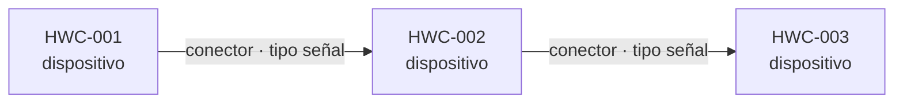
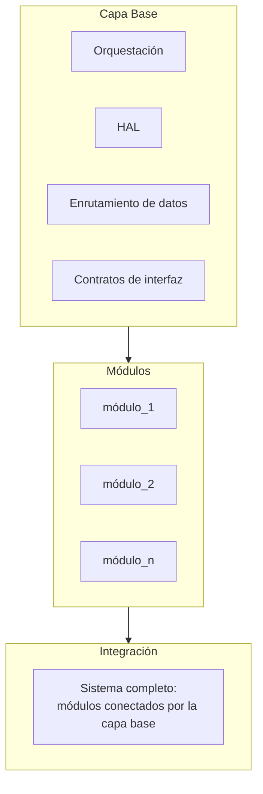
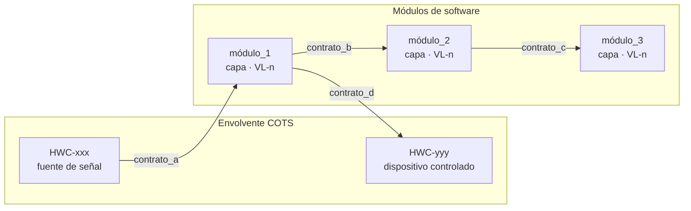

# S1 — Diseño de Arquitectura en Capas

<!-- ================================================================
     V-SIL v3 · Etapa S1 + Compuerta G1
     
     Estructura basada en:
       - arc42 §5 Building Block View (Starke & Hruschka)
       - IEEE 1016™-2009 / ISO/IEC/IEEE 42010:2022 viewpoints
         (composition, dependency, interface)
       - IEEE/ISO/IEC 29148:2018 (trazabilidad de requisitos)
       - MADR (Architecture Decision Records)
     
     Extensiones V-SIL v3:
       - Envolvente COTS con topología física e interfaces HW↔HW
       - Perfil de verificación por módulo (VL-0/1/2, hw_dependency)
       - Stub recipe por contrato
       - Clasificación de contratos: HW→SW, SW→SW, SW→HW
       - Sección de riesgos e inviabilidades conocidas (pre-RFD)
     
     Entrada: G0_StRS.md + G0_SyRS.md (aprobados por G0 + Gate H)
     Salida:  Este documento, evaluado en G1
     
     Principios rectores (del paper):
       P1. HITL es barrera de autorización; HIL es barrera de validación
       P2. Oráculo ≠ generador (quien diseña no es quien aprueba)
       P3. Rechazo mecánico prevalece sobre aprobación del LLM
       P4. Verificado ≠ validado (las afirmaciones nombran el entorno)
     ================================================================ -->

## Meta

| Campo              | Valor                                            |
|--------------------|--------------------------------------------------|
| Proyecto           | {{nombre del proyecto}}                          |
| Ciclo              | {{identificador del ciclo, e.g. pre_release_01}} |
| Fecha              | {{YYYY-MM-DD}}                                   |
| Autor              | {{nombre / rol}}                                 |
| G0 aprobado        | {{ref al commit o hash de G0_StRS + G0_SyRS}}    |
| Gate H aprobado    | {{fecha + quién autorizó}}                       |
| Estado             | borrador / en revisión G1 / aprobado G1          |

---

## 0. Envolvente COTS

<!-- ================================================================
     IEEE 29148 HWC-* blocks.
     
     Cada dispositivo COTS es un nodo en la arquitectura física.
     Cada conexión física es una interfaz con restricciones medibles.
     Estas restricciones fluyen hacia los contratos de software:
     un budget de ruido, una precisión de frecuencia, un throughput
     de bus, un settling time de un switch — todo eso condiciona
     lo que el software puede prometer.
     
     Esta sección NO existía en arc42 ni en IEEE 1016. Es necesaria
     cuando el hardware no es solo "infraestructura de despliegue"
     sino parte activa del pipeline de datos.
     ================================================================ -->

### 0.1 Inventario de dispositivos

| ID      | Dispositivo | Rol | Restricciones clave |
|---------|-------------|-----|---------------------|
| HWC-001 |             |     |                     |
| HWC-002 |             |     |                     |
| HWC-003 |             |     |                     |

<!-- Guía:
     - Un dispositivo COTS = un ítem que se compra, no se diseña.
     - "Restricciones clave" = lo que condiciona al software:
       rango de frecuencia, tasa de muestreo, resolución ADC,
       pérdida de inserción, precisión de reloj, throughput de bus,
       RAM disponible, interfaces físicas disponibles.
     - El ID HWC-* debe trazar a los bloques HWC-* de G0_StRS.md.
-->

### 0.2 Topología física

<!-- Diagrama de cómo se conectan los dispositivos entre sí.
     Cada flecha es una conexión física con conector, tipo de señal
     y dirección.
     
     Este diagrama responde: si desconecto un cable, ¿qué se rompe?
-->

### 0.3 Interfaces físicas (contratos HW ↔ HW)

<!-- Cada conexión del diagrama anterior se documenta aquí.
     Estas interfaces son la "verdad física" que el software
     no puede cambiar — solo respetar.
-->

#### PHY-001: {{origen}} → {{destino}}

| Campo             | Valor |
|-------------------|-------|
| Conector          |       |
| Impedancia        |       |
| Banda / rango     |       |
| Pérdida esperada  |       |
| Restricción clave |       |

<!-- Repetir PHY-NNN para cada conexión física.

     Guía:
     - "Restricción clave" = lo que el software hereda.
       Ejemplo: "IL ≤ 2.3 dB → el budget de NF asume esto"
       Ejemplo: "Settling time 5 ms → flush buffer después de switch"
     - Si la restricción afecta un contrato de software,
       nombrar cuál en la sección 3.
-->

---

## 1. Vista de Bloques de Construcción (Building Block View)

<!-- ================================================================
     arc42 §5: Building Block View.
     
     S1 produce tres capas, en este orden:
       1. Capa base: orquestación + HAL + enrutamiento + contratos
       2. Módulos: unidades plug-in, una por responsabilidad
       3. Integración: módulos conectados a través de la capa base
     
     Restricción fundamental:
       Los módulos se comunican EXCLUSIVAMENTE a través de las
       interfaces declaradas de la capa base.
       No hay llamadas directas módulo → módulo.
     ================================================================ -->

### 1.1 White Box: Sistema completo (Nivel 1)

<!-- arc42: "the white box description of the overall system 
     together with black box descriptions of all contained 
     building blocks" -->

**Motivación de la descomposición:**

<!-- AQUÍ VA LA DECISIÓN DE DISEÑO MÁS IMPORTANTE DE S1.
     
     ¿Por qué estos módulos y no otros?
     ¿Qué criterio de particionamiento se usó?
     ¿Por qué las fronteras están donde están?
     
     Esto es juicio de diseño, no verificable mecánicamente.
     Es lo que un revisor necesita evaluar en G1.
     
     Ejemplo:
     "Los módulos se particionan por etapa del pipeline de
     procesamiento de señal: adquisición → espectro → features →
     decisión → salida. La frontera entre fft_engine y
     feature_extractor existe porque el PSD es reutilizable
     por otros consumidores futuros (e.g., un detector de
     modulación), mientras que channel_features es específico
     de la tarea de ocupación FM."
-->

### 1.2 Capa Base

<!-- White box de la capa base: sus tres responsabilidades
     y cómo se implementarán.
-->

#### 1.2.1 Orquestación

| Campo                   | Valor |
|-------------------------|-------|
| Mecanismo               | <!-- e.g., GNU Radio top block + scheduler, asyncio event loop, ROS 2 executor --> |
| Modelo de ejecución     | <!-- e.g., dataflow push, pull, event-driven, periódico --> |
| Restricciones de tiempo | <!-- e.g., hard real-time, soft real-time, best-effort --> |

<!-- Justificar la elección del mecanismo de orquestación.
     ¿Por qué este y no otro? ¿Qué restricción del proyecto
     lo impone?
-->

#### 1.2.2 HAL (Hardware Abstraction Layer)

| Campo                      | Valor |
|----------------------------|-------|
| Dispositivos que abstrae   | <!-- lista de HWC-* que la HAL envuelve --> |
| Interfaz expuesta          | <!-- qué ve el resto del software: un port, un API, un topic --> |
| Aislamiento                | <!-- ¿qué pasa si se cambia un dispositivo COTS por otro? ¿qué cambia y qué no? --> |

<!-- La HAL es el ÚNICO punto que toca el hardware.
     Si mañana cambias un dispositivo COTS, solo la HAL debería
     cambiar. Si eso no es cierto, explicar por qué.
-->

#### 1.2.3 Enrutamiento de datos

| Señal de entrada | Consumidores | Mecanismo |
|------------------|--------------|-----------|
| <!-- e.g., raw_iq --> | <!-- e.g., [fft_engine, audio_demod] --> | <!-- e.g., fan-out por GNU Radio, pub/sub, broadcast --> |

<!-- Documentar cada punto donde una señal se bifurca
     o se enruta condicionalmente.
-->

### 1.3 Black Boxes: Módulos

<!-- arc42: "black box descriptions of all contained building blocks"
     + V-SIL verification profile.
     
     Cada módulo se describe como una caja negra: qué consume,
     qué produce, qué responsabilidad tiene, y cómo se verificará.
     El "cómo funciona internamente" es tema de S2.
-->

#### {{módulo_id}}

| Campo            | Valor |
|------------------|-------|
| Capa funcional   | <!-- HAL / DSP / Decisión / Salida / Control / otra --> |
| Responsabilidad  | <!-- UNA oración: qué hace este módulo --> |
| depends_on       | <!-- [lista de contratos que consume] --> |
| provides         | <!-- [lista de contratos que produce] --> |
| hw_dependency    | <!-- true / false --> |
| required_vl      | <!-- VL-0 / VL-1 / VL-2 --> |

**Justificación del VL requerido:**

<!-- ¿Por qué este nivel y no otro?
     
     - Si hw_dependency = true → required_vl DEBE ser VL-2.
       No hay discusión (regla de consistencia del perfil).
     
     - Si hw_dependency = false y required_vl = VL-1:
       ¿qué riesgo justifica ir más allá de VL-0?
       Ejemplo: "El fft_engine opera sobre datos I/Q con
       dinámica real. Errores de normalización o windowing
       solo se manifiestan con señales representativas,
       no con vectores triviales."
     
     - Si hw_dependency = false y required_vl = VL-0:
       ¿por qué basta con lógica pura?
       Ejemplo: "El classifier aplica un umbral fijo.
       Su corrección es verificable exhaustivamente con
       vectores deterministas."
-->

<!-- ============================================================
     REPETIR esta sección para CADA módulo.
     ============================================================ -->

---

## 2. Vista de Dependencias (Dependency Viewpoint)

<!-- ================================================================
     IEEE 1016 §2.2.6: relationships and dependencies among
     design elements.
     
     El DAG incluye TANTO los nodos de hardware (como fuentes
     y sumideros) como los módulos de software.
     
     Restricción: el grafo DEBE ser acíclico.
     Si hay un ciclo, el diseño no es implementable módulo por
     módulo con stubs → el diseño debe cambiar.
     ================================================================ -->

### 2.1 Grafo de Dependencias (DAG)

<!-- Guía para el diagrama:
     - Los nodos HW van en un subgraph separado.
     - Cada arista lleva el nombre del contrato.
     - Cada nodo SW muestra: id, capa funcional, VL requerido.
     - No debe haber aristas directas módulo→módulo que no
       pasen por un contrato declarado.
-->

### 2.2 Orden topológico de implementación

<!-- Derivado del DAG.
     Este es el orden en que S2 implementará los módulos
     después de la capa base.
     
     El primer módulo es el que no tiene dependencias de SW
     (solo depende de HW). El último es el terminal.
-->

| Paso | Módulo | Depende de (contratos) | Justificación del orden |
|------|--------|------------------------|-------------------------|
| 1    |        |                        |                         |
| 2    |        |                        |                         |
| n    |        |                        |                         |

---

## 3. Vista de Interfaces (Interface Viewpoint)

<!-- ================================================================
     IEEE 1016 §2.2.8: contracts between components or with
     external systems.
     
     V-SIL clasifica los contratos en tres tipos:
     
       HW → SW:  lo que el hardware entrega al software
                  (restringido por las interfaces PHY-*)
     
       SW → SW:  lo que un módulo de software entrega a otro
                  (los contratos "clásicos" del paper)
     
       SW → HW:  lo que el software envía al hardware
                  (comandos de control, configuración)
     
     CADA contrato debe ser suficiente para derivar un stub
     determinista. Si no puedes escribir el stub recipe,
     el contrato está incompleto.
     ================================================================ -->

### 3.1 Contratos HW → SW

#### {{contrato_id}}

| Campo               | Valor |
|----------------------|-------|
| Origen físico        | <!-- PHY-NNN (ref a sección 0.3) --> |
| Dispositivo COTS     | <!-- HWC-NNN --> |
| Módulo consumidor    | <!-- módulo que recibe esta señal --> |
| Tipo de dato         | <!-- e.g., complex64, float32[N], record, enum --> |
| Shape / estructura   | <!-- e.g., [4096], stream, {f_c, power, snr} --> |
| Unidades             | <!-- e.g., full-scale ±1, dBFS, MHz, bool --> |
| Tasa / frecuencia    | <!-- e.g., 20 MS/s, 1 Hz, por evento --> |
| Latencia máxima      | <!-- e.g., ≤ 5 ms --> |
| Schema version       | <!-- e.g., v1 --> |
| Budget heredado      | <!-- restricciones que vienen de PHY-*, e.g., NF ≤ 4 dB --> |

**Stub recipe:**

<!-- Descripción CONCRETA de cómo generar un stub determinista
     para este contrato. El stub reemplaza al hardware real
     durante VL-0 y VL-1.
     
     Debe incluir:
     - Qué tipo de fuente (Vector Source, File Source, generador)
     - Qué datos produce (valores concretos o cómo generarlos)
     - Qué condiciones simula (nominal, degradado, edge case)
     
     Ejemplo:
     "Vector Source: 8192 muestras complex64.
      Tono a +1 MHz de offset, amplitud 0.5 FS.
      Ruido AWGN con NF = 4 dB (simulando cadena RF completa).
      SNR resultante ≈ 20 dB."
-->

**Vectores de prueba de referencia:**

<!-- Datos de entrada → salida esperada que el stub debe
     reproducir. Estos vectores se reusan en VL-0 (unit tests).
     
     | Entrada                   | Salida esperada             |
     |---------------------------|-----------------------------|
     | tono puro a 98 MHz        | pico en bin central ± 1 bin |
     | silencio (solo ruido)     | piso plano ± 3 dB           |
-->

### 3.2 Contratos SW → SW

#### {{contrato_id}}

| Campo               | Valor |
|----------------------|-------|
| Productor            | <!-- módulo que genera --> |
| Consumidor(es)       | <!-- [módulos que consumen] --> |
| Tipo de dato         |       |
| Shape / estructura   |       |
| Unidades             |       |
| Tasa / frecuencia    |       |
| Latencia máxima      |       |
| Schema version       |       |

**Stub recipe:**

<!-- Mismo criterio: concreto, determinista, reproducible. -->

**Vectores de prueba de referencia:**

<!-- Entrada → salida esperada. -->

### 3.3 Contratos SW → HW

#### {{contrato_id}}

| Campo                | Valor |
|----------------------|-------|
| Módulo emisor        | <!-- módulo que envía el comando --> |
| Destino físico       | <!-- PHY-NNN / HWC-NNN --> |
| Tipo de dato         | <!-- e.g., uint8, enum, struct --> |
| Significado          | <!-- e.g., 0=FM, 1=ADS-B, 2=reservado --> |
| Latencia             |       |
| Efectos colaterales  | <!-- e.g., "cambio de posición invalida el buffer de iq_acquisition" --> |

**Stub recipe:**

<!-- Ejemplo: "Mock GPIO que registra llamadas y reporta
     posición actual. No controla hardware real." -->

---

## 4. Trazabilidad

<!-- ================================================================
     IEEE 29148: cada requisito SYS-* de G0_SyRS.md debe trazar
     a al menos un módulo.
     
     Un SYS-* sin módulo = requisito no cubierto.
     Un módulo sin SYS-* = código huérfano (cuestionar).
     ================================================================ -->

### 4.1 Requisitos → Módulos

| Requisito | Texto (resumen)                   | Módulo(s)       | Contrato(s) involucrado(s) |
|-----------|-----------------------------------|-----------------|----------------------------|
| SYS-001   |                                   |                 |                            |
| SYS-002   |                                   |                 |                            |

### 4.2 Módulos → Requisitos (vista inversa)

<!-- Útil para detectar módulos huérfanos. -->

| Módulo         | Requisito(s) que satisface |
|----------------|----------------------------|
|                |                            |

### 4.3 Restricciones normativas → Contratos

<!-- Los NRM-* de G0_StRS.md pueden imponer restricciones
     directas sobre contratos (latencia, precisión, probabilidad).
-->

| Normativa | Restricción                        | Contrato afectado | Valor impuesto |
|-----------|------------------------------------|-------------------|----------------|
| NRM-001   |                                    |                   |                |

---

## 5. Decisiones de Diseño

<!-- ================================================================
     arc42 §9 / MADR (Markdown Architecture Decision Records).
     
     Aquí van las decisiones que un revisor necesita cuestionar:
     - ¿Por qué este particionamiento de módulos?
     - ¿Por qué esta FFT size y no otra?
     - ¿Por qué separar feature_extractor de fft_engine?
     - ¿Por qué audio_demod no pasa por el clasificador?
     - ¿Por qué este mecanismo de orquestación?
     
     Cada decisión sigue el formato MADR.
     Ref: https://adr.github.io/madr/
     ================================================================ -->

### DEC-001: {{título de la decisión}}

- **Estado:** propuesta / aceptada / deprecada / reemplazada por DEC-NNN
- **Contexto:** <!-- ¿Qué problema de diseño se enfrenta? -->
- **Alternativas consideradas:**
  1. <!-- alternativa A -->
  2. <!-- alternativa B -->
  3. <!-- alternativa C -->
- **Decisión:** <!-- cuál se eligió -->
- **Justificación:** <!-- por qué esta y no las otras -->
- **Consecuencias:** <!-- qué implica: positivo y negativo -->
- **Requisitos afectados:** <!-- SYS-*, NRM-*, STK-* -->

<!-- ============================================================
     REPETIR para cada decisión significativa.
     ============================================================ -->

---

## 6. Riesgos e Inviabilidades Conocidas

<!-- ================================================================
     Si algo huele a RFD potencial, se documenta aquí ANTES de
     llegar a G2. Esto no es pesimismo — es honestidad de diseño.
     
     Una RFD desde S1 significa: "bajo cualquier particionamiento
     posible sobre esta envolvente COTS, este requisito no se puede
     cumplir." No es un defecto de diseño — es una restricción
     física del hardware.
     
     Si el riesgo es manejable, se documenta con su mitigación.
     Si es inviable, se escala como RFD formal (ver paper §9.2–9.3).
     ================================================================ -->

| ID      | Riesgo                            | Requisitos afectados | Evidencia / estimación       | Mitigación propuesta         | ¿RFD potencial? |
|---------|-----------------------------------|----------------------|------------------------------|------------------------------|------------------|
| RSK-001 |                                   |                      |                              |                              | sí / no          |

---
---

# G1 — Validación del Diseño de Arquitectura

<!-- ================================================================
     G1 responde UNA pregunta:
     
       ¿Están resueltas todas las decisiones de diseño
       críticas para la implementación?
     
     G1 NO es un script determinista como G0.
     G1 es una REVISIÓN de diseño (design review).
     
     Algunas propiedades son verificables mecánicamente
     (aciclicidad del DAG). La mayoría son juicio de diseño
     (¿la descomposición tiene sentido? ¿los contratos son
     suficientes?). Lo mecánico es necesario pero no suficiente.
     
     Principio P2: quien diseñó S1 NO es quien aprueba G1.
     Principio P3: si hay algo mecánicamente verificable y falla,
     eso prevalece sobre cualquier opinión de que "se ve bien".
     ================================================================ -->

## G1.1 — Aciclicidad del DAG

<!-- MECÁNICAMENTE VERIFICABLE.
     Construir el grafo desde la sección 2.1 y verificar
     con toposort (graphlib.TopologicalSorter o equivalente).
-->

| Verificación              | Resultado       |
|---------------------------|-----------------|
| ¿El DAG es acíclico?     | PASS / FAIL     |
| Orden topológico obtenido | (listar orden)  |
| Ciclos detectados         | (listar si hay) |

## G1.2 — Completitud de interfaces

<!-- PARCIALMENTE MECÁNICO: se puede verificar que cada arista
     del DAG tiene un contrato en la sección 3 con los campos
     requeridos. Pero la SUFICIENCIA del contenido es juicio.
-->

| Contrato        | ¿Existe en §3? | Campos completos | ¿Stub recipe presente? |
|-----------------|-----------------|------------------|------------------------|
|                 | sí / no         | sí / faltan: ... | sí / no                |

**Pregunta de revisión:** para cada contrato, ¿los campos son
suficientes para que un implementador escriba un stub determinista
SIN preguntarle nada al diseñador?

## G1.3 — Cobertura de requisitos

<!-- MECÁNICAMENTE VERIFICABLE contra G0_SyRS.md. -->

| Verificación                             | Resultado   |
|------------------------------------------|-------------|
| SYS-* sin módulo (sección 4.1)           | (listar)    |
| Módulos sin SYS-* (sección 4.2)          | (listar)    |
| NRM-* sin contrato afectado (sección 4.3)| (listar)    |

## G1.4 — Viabilidad de stubs

<!-- JUICIO DE DISEÑO.
     
     Para cada stub recipe en la sección 3:
     ¿Un implementador puede generar ese stub a partir de
     lo que dice el contrato?
     
     Señales de alerta:
     - Stub recipe dice "datos razonables" (¿qué es razonable?)
     - Stub recipe no menciona edge cases
     - Stub recipe asume acceso a datos que solo existen en VL-2
     - Contrato dice "stream" pero no dice tasa ni tamaño de buffer
-->

| Contrato        | ¿Stub recipe es suficiente? | Observaciones |
|-----------------|------------------------------|---------------|
|                 | sí / insuficiente            |               |

## G1.5 — Consistencia del perfil de verificación

<!-- MECÁNICAMENTE VERIFICABLE. -->

| Módulo          | hw_dependency | required_vl | ¿Consistente? |
|-----------------|---------------|-------------|----------------|
|                 | true/false    | VL-n        | sí / FAIL: ... |

**Regla:** `hw_dependency: true` → `required_vl: VL-2` (obligatorio).

## G1.6 — Calidad de las decisiones de diseño

<!-- JUICIO DE DISEÑO.
     
     Para cada decisión en la sección 5:
     
     1. ¿El contexto es claro?
        ¿Se entiende qué problema se resuelve?
     
     2. ¿Se consideraron alternativas reales?
        ¿O solo se listó la elegida como "la obvia"?
     
     3. ¿Las consecuencias son honestas?
        ¿Se nombran las desventajas?
     
     4. ¿La justificación resiste cuestionamiento?
        ¿Qué pasaría si se eligiera otra alternativa?
-->

| Decisión | ¿Contexto claro? | ¿Alternativas reales? | ¿Consecuencias honestas? | Observaciones |
|----------|-------------------|-----------------------|--------------------------|---------------|
| DEC-001  |                   |                       |                          |               |

## G1.7 — Coherencia de la envolvente COTS

<!-- JUICIO DE DISEÑO.
     
     1. ¿La topología física (§0.2) es consistente con
        el inventario (§0.1)?
     
     2. ¿Cada interfaz física (§0.3) tiene las restricciones
        que el software necesita conocer?
     
     3. ¿Los budgets heredados en los contratos HW→SW (§3.1)
        son coherentes con las interfaces físicas?
        
        Ejemplo: si PHY-002 dice IL = 2.3 dB y el contrato
        raw_iq dice "budget NF = 3 dB", hay una contradicción.
     
     4. ¿La HAL (§1.2.2) abstrae TODOS los dispositivos que
        el software toca? ¿Hay algún módulo que accede a
        hardware directamente sin pasar por la HAL?
-->

| Verificación                                        | Resultado       |
|-----------------------------------------------------|-----------------|
| ¿Topología (§0.2) vs inventario (§0.1) consistente? |                 |
| ¿PHY-* cubren todas las conexiones del diagrama?    |                 |
| ¿Budgets HW→SW coherentes con PHY-*?                |                 |
| ¿La HAL es el único punto de contacto con HW?       |                 |

## G1.8 — Riesgos evaluados

<!-- JUICIO DE DISEÑO.
     
     Para cada riesgo en la sección 6:
     ¿La evidencia es creíble?
     ¿La mitigación es viable?
     ¿Alguno debería escalarse a RFD ahora en lugar de
     esperar a que G2 lo descubra?
-->

| RSK-ID  | ¿Evidencia creíble? | ¿Mitigación viable? | ¿Escalar a RFD? |
|---------|---------------------|----------------------|------------------|
|         |                     |                      |                  |

---

## Veredicto G1

| Resultado | Significado                                          |
|-----------|------------------------------------------------------|
| **PASS**  | → S2. Todas las decisiones críticas están resueltas. |
| **FAIL**  | → S1. Listar las secciones que necesitan retrabajo.  |
| **RFD**   | → RFD formal. Requisitos inviables sobre esta COTS.  |

**Veredicto:** {{PASS / FAIL / RFD}}

**Secciones que requieren retrabajo (si FAIL):**

<!-- Listar las secciones específicas con las observaciones
     concretas de qué falta o qué está mal. -->

**Revisor:** {{nombre / rol}}
**Fecha:** {{YYYY-MM-DD}}

<!-- ================================================================
     Nota sobre P2 (Oráculo ≠ Generador):
     
     El revisor de G1 NO debe ser la misma persona/agente
     que produjo S1. Si S1 fue generado por un LLM,
     G1 lo revisa un humano o un agente diferente con
     contexto independiente.
     ================================================================ -->
