# V-SIL v3: Ciclo de Vida Stage-Gate Adaptativo para el Desarrollo de Prototipos Verificados Restringidos por Hardware COTS

**David Ramírez-Betancourt** — Universidad Nacional de Colombia, GCPDS  
**Versión:** 3.0-draft  
**Fecha:** Octubre de 2026

---

## Resumen

V-SIL v3 es una metodología de desarrollo de software que recibe un Build Package finalizado (PRD con restricciones medibles, envolvente de hardware COTS, criterios de aceptación y, de forma opcional, procedimientos de laboratorio, calibración de hardware al grado de tamizaje del equipo de desarrollo y tolerancias en dBi) y entrega un Prototipo Verificado con evidencia por módulo y de extremo a extremo — o, cuando los requisitos son inviables sobre la plataforma COTS declarada, una Solicitud de Desviación (Request for Deviation, RFD) formal con análisis de compromisos. S1 puede diseñar un subsistema o un sistema de subsistemas: cada subsistema tiene su propia capa base y sus módulos, y los subsistemas se conectan mediante contratos versionados. S1 declara un modo HAL, `mock-only` o `mock+real`. Siempre diseña un **Mock HAL** que genera datos deterministas y sintéticos para VL-0 y VL-1, y un **telemetry companion** obligatorio que monitorea silenciosamente la unidad de cómputo durante todas las ejecuciones de prueba y nunca se entrega. Solo en `mock+real` añade un **Real HW HAL** que interactúa con el hardware físico para la generación de datasets de laboratorio y las pruebas de campo en VL-2. Un modelo de ML es una entrada opcional de S1 cuando el diseño lo utiliza; se entrena con datos del Mock HAL más etiquetado o, en su defecto, con datos del Real HW HAL más etiquetado. La implementación avanza módulo por módulo dentro de cada subsistema y después cruza sus fronteras. La profundidad de verificación es adaptativa por módulo, con un piso obligatorio de pruebas unitarias, integración sándwich, contratos entre subsistemas y rutas de sistema. Cada afirmación nombra el nivel y el entorno de verificación en que se produjo; el telemetry companion adjunta el estado de la unidad de cómputo (CPU, memoria, temperatura, salud de buffers, latencia de planificación) a cada registro de evidencia. La salida terminal puede registrar trabajo futuro acotado para próximas versiones del software, sin aplazar criterios de aceptación vigentes. La terminología está alineada con IEEE/ISO/IEC 29119, ISO 26262, SDAD [6], el patrón Coordinator-Implementor-Verifier [10], la escalera de sustitución HAL mock→SIL→HIL para sistemas embebidos [11] y el proceso de Request for Deviation de ECSS/MIL-HDBK-61A [16][17].

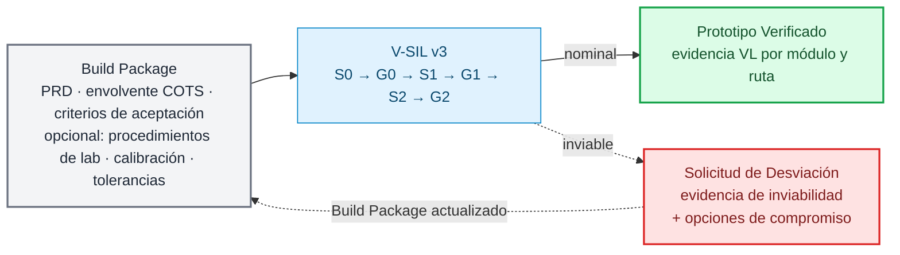

---

## 1 Terminología

| Término informal | Término estándar | Fuente |
|---|---|---|
| Prueba de propagación (base → módulos con marcadores de posición) | **Prueba de integración descendente (top-down) con stubs** | IEEE 29119; Pressman [1] |
| Prueba de retropropagación (módulo → base) | **Prueba de integración ascendente (bottom-up) con drivers** | IEEE 29119; Pressman [1] |
| Propagación + retropropagación combinadas | **Prueba de integración sándwich (híbrida)** | IEEE 29119 [2] |
| Marcadores de posición | **Stubs** (invocados por la unidad bajo prueba) | SE estándar |
| Arneses de prueba que simulan a los invocadores | **Drivers** (invocan la unidad bajo prueba) | SE estándar |
| Validación del enrutador | **Verificación de contrato de interfaz** | Pruebas de contrato [3]; Bass et al. [4] |
| Diseño por capas | **Arquitectura en capas** con **grafo de dependencias de componentes** (DAG) | Bass et al. [4] |
| Niveles N0 / N1 / N2 | **Niveles de verificación** (VL-0, VL-1, VL-2) | Adaptado de ISO 26262 [5] |
| Realimentación al Build Package con compromisos | **Solicitud de Desviación (RFD)** | ECSS [16]; MIL-HDBK-61A [17]; NASA NPR 7150.2 [18] |

---

## 2 Vista General de Etapas y Compuertas (Stage-Gate)

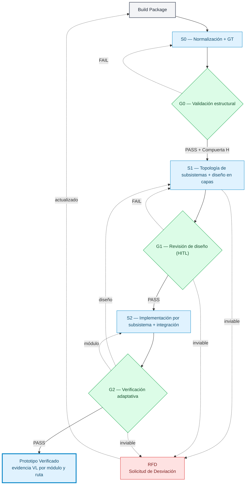

**Principios rectores.**
**P1.** HITL es una barrera de autorización; HIL es una barrera de validación.
**P2.** Oráculo ≠ generador — el modelo nunca aprueba su propio trabajo [7].
**P3.** G0 es la única compuerta determinista: su rechazo mecánico prevalece sobre cualquier aprobación [8]. Todos los demás veredictos de compuerta son humanos (HITL).
**P4.** *Verificado* ≠ *validado* — las afirmaciones nombran el entorno [9].

---

## 3 S0 — Normalización y Ground Truth

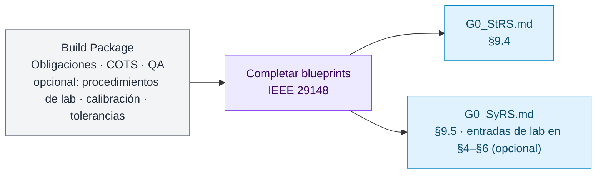

S0 **solo normaliza** — vierte el contenido del Build Package en los blueprints documentales de IEEE 29148 [12] y no emite ningún juicio conceptual sobre suficiencia o alcance. Siguiendo la Fase 1 de SDAD (cristalización de la especificación) [6], completa los blueprints:

- **G0_StRS.md** — Especificación de Requisitos de las Partes Interesadas (Stakeholder Requirements Specification, §9.4): bloques `NRM-*`, `HWC-*`, `STK-*`.
- **G0_SyRS.md** — Especificación de Requisitos del Sistema (System Requirements Specification, §9.5): bloques `SYS-*` que trazan a la StRS.

Los procedimientos de laboratorio, la calibración y las tolerancias son contenido opcional del Build Package. Cuando existen, S0 los vierte en las secciones de la SyRS que ya existen para ellos: los procedimientos en §6 Field Measurement Protocols (`PROTO-*`: montaje, calibración, ejecución), los términos de calibración en §4 Correction Chains y las tolerancias en §5 Uncertainty Budgets. Los tres encabezados siguen siendo obligatorios para G0; sin entradas de laboratorio, cada uno contiene exactamente `Not applicable: no lab inputs in the Build Package.`

Cualquier iteración ocurre después en G0, que valida el contenido del Build Package contra la compuerta determinista (el blueprint) — no mediante un juicio de revisión aquí.

---

## 4 G0 — Validación Estructural

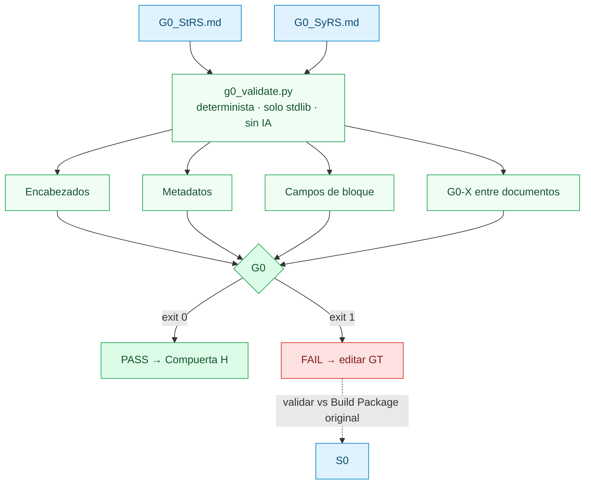

Determinista. Sin IA. Veredicto binario. Tras aprobar G0, la Compuerta humana H pregunta: *¿Los requisitos están completos, acotados y son verificables?*

---

## 5 S1 — Sistema de Subsistemas en Capas

S1 primero divide el producto en subsistemas desplegables por separado cuando los requisitos lo justifican. Un solo subsistema sigue siendo un caso válido. Cada **subsistema** posee un proceso de ejecución, destino de despliegue, capa base, módulos y puertos externos. Sus módulos se comunican mediante su propia capa base; los intercambios entre subsistemas pasan por contratos de subsistema declarados y versionados. Separar la interfaz de usuario del proceso de borde se justifica cuando se despliegan o reinician independientemente, usan una red o tienen dominios de fallo distintos.

### 5.1 Topología del sistema y asignación de requisitos

Las flechas siguientes son **mensajes en ejecución**, no dependencias de implementación.

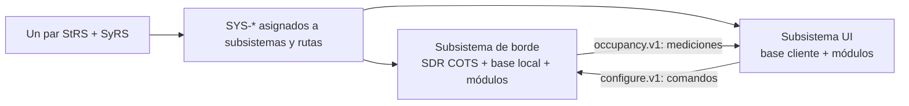

La vista del sistema registra la responsabilidad, el destino de despliegue, los recursos COTS, el enlace de red y el ciclo de vida de cada subsistema. Un requisito puede asignarse a un subsistema o a una **ruta de extremo a extremo** que abarque varios. Una sola tabla de trazabilidad de sistema controla la asignación; los diseños de subsistema no duplican el Ground Truth. Los contratos entre subsistemas especifican productor y consumidor, esquema y versión, unidades, marcas de tiempo, orden, tasa, latencia, autenticación, reintentos, duplicados y comportamiento ante desconexión o reinicio cuando corresponda.

### 5.2 Arquitectura en capas dentro de cada subsistema

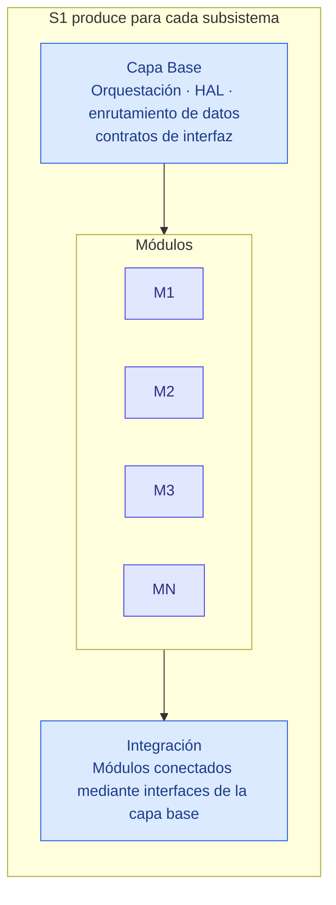

Los módulos son unidades enchufables (plug-in) que se comunican únicamente a través de la capa base y las interfaces declaradas de su subsistema. No hay llamadas directas entre módulos ni llamadas entre subsistemas que eludan un contrato de subsistema. Un subsistema sin hardware físico puede tener una HAL vacía; su base sigue encargándose de la orquestación y el enrutamiento.

### 5.3 Grafo de dependencias de componentes (ejemplo SDR FM en borde)

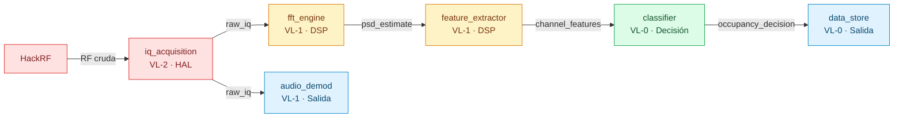

Cada arista transporta un **contrato de interfaz** (tipo de dato, versión de esquema, unidades, latencia). El grafo de dependencias de implementación de cada subsistema debe ser acíclico. Cada nodo lleva un **perfil de verificación**: `module_id`, `subsystem_id`, `layer`, `depends_on`, `provides`, `hw_dependency`, `required_vl`. `hw_dependency` significa que la corrección depende de un dispositivo o comportamiento físico específico, no simplemente que el código se ejecuta en una computadora.

El **grafo de dependencias de implementación** ordena la definición de contratos, las bases, los módulos y la integración del sistema. Debe ser acíclico para permitir la construcción con stubs en S2. El **grafo de interacción en ejecución** describe los mensajes reales y puede contener bucles intencionales, como telemetría del borde → UI → control del borde, siempre que los contratos definan propiedad del estado, confirmación, tiempos de espera y comportamiento seguro. Un bucle de mensajes no crea un ciclo de dependencias de implementación.

| Módulo | Capa | Dep. HW | VL requerido |
|---|---|---|---|
| `iq_acquisition` | HAL | **sí** | VL-2 (HIL) |
| `fft_engine` | DSP | no | VL-1 (SIL) |
| `feature_extractor` | DSP | no | VL-1 (SIL) |
| `classifier` | Decisión | no | VL-0 (unidad) |
| `audio_demod` | Salida | no | VL-1 (SIL) |
| `data_store` | Salida | no | VL-0 (unidad) |

### 5.4 Modelo de ML suministrado (opcional)

**Estado: incierto.** Esta versión define el modelo de ML solo como entrada opcional de S1 y una comprobación de preparación en G1. Su conexión con S2 y G2 (generación de datos de entrenamiento, adaptador de inferencia, medición en G2) no está implementada y es trabajo futuro, junto con MLOps (FW-005).

El diseño S1 incluye esta caja **solo si elige un módulo basado en ML o el Ground Truth lo exige explícitamente**. En los demás casos no aparecen ni la caja ni su comprobación G1. El modelo suministrado es una entrada controlada de un módulo de subsistema, no un subsistema por sí mismo. Se entrena con datos del Mock HAL más etiquetado o, en su defecto, con datos del Real HW HAL más etiquetado. S1 no entrena ni selecciona un modelo por cuenta del autor del Build Package.

Cuando se utiliza, S1 identifica el archivo y los pesos por versión y digest; nombra al proveedor y la procedencia; registra la fuente de los datos de entrenamiento y el procedimiento de etiquetado; especifica runtime de inferencia, esquema de entradas y salidas, unidades, preprocesamiento, etiquetas o umbrales y posprocesamiento; y registra las métricas suministradas con su conjunto de evaluación y condiciones. Presupuesta latencia de inferencia, memoria y cualquier dependencia de dispositivos en la COTS declarada. Una respuesta simulada determinista permite integrar en VL-0; los niveles posteriores ejercitan el modelo suministrado real.

La metadata de rendimiento recibida es evidencia previa, no un veredicto de G2. Si S1 elige ML pero faltan el paquete del modelo o datos necesarios para implementarlo, G1 devuelve **FAIL** para completar la entrada o el diseño. La inviabilidad demostrada frente a los requisitos sobre la COTS declarada sigue la ruta RFD. Automatizar este ciclo de vida del modelo con MLOps es trabajo futuro (FW-005).

### 5.5 Escalera de sustitución HAL y telemetry companion

S1 declara el **modo HAL** en la Meta del diseño: `HAL mode: mock-only` o `HAL mode: mock+real`. Cada etapa posterior lo lee del diseño. Las implementaciones de HAL comparten el mismo contrato de interfaz de la capa base pero difieren en lo que produce `raw_iq`:

- **Mock HAL** (obligatorio en todo modo). Un generador de señales puramente software. En VL-0 emite vectores deterministas (cortos, repetibles, cobertura de casos límite). En VL-1 produce archivos I/Q sintéticos a SNR, modulación y condiciones de canal conocidas usando un sintetizador FM por software o capturas doradas grabadas. Cada vector dorado se versiona con un digest SHA-256, parámetros de generación, la condición que simula y la salida esperada. El Mock HAL es la fuente de datos por defecto para todas las pruebas de integración sándwich y SIL.

- **Real HW HAL** (solo en `mock+real`). La HAL de producción que interactúa con el SDR COTS declarado. Tiene dos propósitos: (a) ejecutar los procedimientos de laboratorio registrados en la SyRS (§6 `PROTO-*`) para generar **datasets reales** con la calidad de calibración del equipo de desarrollo (grado de tamizaje, no normativo, SyRS §4 Correction Chains) y las tolerancias declaradas en dBi (SyRS §5 Uncertainty Budgets); y (b) ejecutar las pruebas de campo finales en VL-2. El grado de calibración y las tolerancias son entradas registradas en la SyRS, no afirmaciones de V-SIL. El Real HW HAL puede declararse en VL-0 (API de dispositivo simulada) durante un ciclo, de modo que el software para el hardware real se construye sin validar métricas sobre él; G2.2 entonces no se activa y la declaración de honestidad lo indica.

En `mock-only`, el diseño no tiene Real HW HAL, ni procedimientos de laboratorio, calibración o tolerancias, ni módulos con `hw_dependency: true`; ignora las §4–§6 de la SyRS y toda afirmación queda limitada a VL-1 (§8.2). En `mock+real`, ambas HAL se conectan al mismo puerto de la capa base; intercambiar una por la otra es la **sustitución HAL** que mueve entre niveles de verificación [11].

S1 también especifica un **telemetry companion**, obligatorio en todo diseño y en toda ejecución de pruebas: un proceso ligero y no intrusivo que se ejecuta junto a cada ejecución de prueba y registra el estado de la unidad de cómputo — utilización de CPU, memoria disponible, temperatura, buffers perdidos y latencia de planificación. No debe interferir con el sistema bajo prueba; su propia huella de recursos se declara y se acota. El companion adjunta sus lecturas a cada registro de evidencia para que G2 pueda determinar si la unidad de cómputo estaba dentro de su envolvente de operación durante una prueba. El telemetry companion es infraestructura de verificación, no un módulo del sistema: pertenece a la metodología, no al software. No tiene `SYS-*`, no aparece en el DAG de implementación, está ausente de la evidencia por módulo del Prototipo Verificado y nunca se entrega con el software.

El Mock HAL, los vectores dorados con su manifiesto, el telemetry companion, los stubs, los pares simulados y los drivers forman el **kit de verificación**. S2 construye el kit en su capa inicial, antes de cualquier módulo, junto con el Real HW HAL y su API de dispositivo simulada en `mock+real` (§7).

La Meta del diseño de S1 declara además una entrada **`Toolchain`** por subsistema: `SUB-xxx: <package> · <language> · <package manager> · <test runner>`, por ejemplo `SUB-001: fm_edge · Python 3.12 · uv · pytest; SUB-002: dashboard · TypeScript · pnpm · vitest`. `<package>` es un identificador válido y nombra `src/<package>/`. Esta versión admite Python con uv y pytest, y TypeScript con pnpm y vitest. S2 construye con el toolchain declarado y nunca elige otro; un `Toolchain` vacío o incompleto es un defecto de diseño.

---

## 6 G1 — Validación de Subsistemas, Dependencias y Contratos

G1 responde: *¿Están resueltas todas las decisiones de diseño críticas para la implementación?*

G1 es una revisión de diseño humana (HITL), no una compuerta determinista. Un agente puede preparar la revisión y recomendar un veredicto, incluida una RFD; decide el humano.

G1 no ejecuta scripts. El agente que la prepara valida por sí mismo: lee el diseño completo y el GT, rederiva cada comprobación desde las secciones fuente en lugar de confiar en los resúmenes del propio diseño, y ejecuta el toolchain declarado en la máquina de desarrollo. Una revisión exhaustiva justifica su costo en tokens. Los hallazgos del agente informan al humano; nunca se convierten en un veredicto automático.

1. **Topología de subsistemas.** Cada subsistema tiene responsabilidad, destino de despliegue, dueño del estado y puertos externos; la red y la envolvente COTS sustentan la topología.
2. **Aciclicidad del DAG de implementación.** Sin ciclos dentro de los subsistemas ni entre unidades de construcción. Los bucles de mensajes en ejecución se revisan aparte.
3. **Completitud de interfaces.** Cada arista interna tiene contrato tipado; cada intercambio entre subsistemas tiene contrato versionado y comportamiento ante fallos.
4. **Cobertura.** Cada `SYS-*` traza a módulos o a una ruta entre subsistemas, con responsable y evidencia de aceptación medible.
5. **Viabilidad de stubs.** Cada contrato interno o entre subsistemas permite escribir un stub o par simulado determinista.
6. **Consistencia del perfil de verificación.** `hw_dependency: true` → `required_vl: VL-2`; las rutas de sistema declaran nivel y entorno de verificación.
7. **Escalera de sustitución HAL.** El Mock HAL expone la interfaz de la capa base; los vectores dorados llevan digest, parámetros y salidas esperadas. En `mock+real`, el Real HW HAL expone la misma interfaz y referencia los `PROTO-*`, las cadenas de corrección y las tolerancias de la SyRS.
8. **Telemetry companion.** La especificación del companion declara qué monitorea, su intervalo de muestreo, su presupuesto de recursos y que su huella está acotada por debajo de un umbral declarado.
9. **Modelo de ML suministrado, si se utiliza.** Los pesos, la metadata, la fuente de los datos de entrenamiento y el procedimiento de etiquetado están identificados, el contrato de inferencia es implementable y el presupuesto COTS es creíble. Se omite esta comprobación cuando el diseño no tiene modelo de ML.

10. **Disponibilidad del toolchain.** En la máquina de desarrollo, el runtime del lenguaje y el gestor de paquetes de cada entrada de `Toolchain` responden a su comando de versión. El agente instala una herramienta faltante solo tras un breve sí del usuario; una instalación rechazada o fallida es un hallazgo abierto.

**PASS** → S2. **FAIL** → S1. **RFD** → §9.2, cuando los requisitos son inviables sobre la plataforma COTS declarada.

La [plantilla de diseño S1/G1](S1_G1_template.md) desarrolla estas familias en trece puntos generales de revisión y uno condicional de ML, incluidos decisiones de diseño, coherencia COTS, escalera HAL, telemetry companion, disponibilidad del toolchain y evaluación de riesgos.

---

## 7 S2 — Implementación por Subsistema e Integración del Sistema

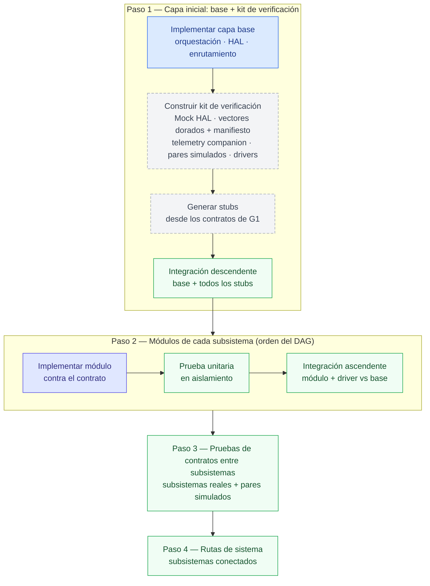

Descendente (base → stubs) + ascendente (módulo → driver → base) = **prueba de integración sándwich** [1][2][13].

El Paso 1 es la **capa inicial**: antes de cualquier módulo, S2 construye la base de cada subsistema y deja listas todas las herramientas — el kit de verificación de §5.5 y, en `mock+real`, el Real HW HAL con su API de dispositivo simulada. S2 escribe todas las pruebas, incluidas las pruebas VL-1 de los módulos y rutas con `required_vl` VL-1 o superior, sin afirmarlas; G2 solo las ejecuta (§8.3).

Cada subsistema vive en `src/<subsystem>/` y se construye con su toolchain declarado; el kit de verificación, pruebas incluidas, vive en `verification/` y nunca se entrega; un comando ejecuta cada nivel de verificación (`verification/run.sh vl0`, `verification/run.sh vl1`); y el código entregado no depende de CodeAnvil.

Se definen primero los contratos entre subsistemas para construir cada subsistema independientemente contra un par simulado determinista. Los subsistemas reales se conectan después de superar su piso local VL-0. Para cada `SYS-*` asignado a varios subsistemas se ejecuta una prueba determinista de la ruta entre los procesos reales, con entradas externas simuladas. Así se comprueban serialización, enrutamiento, transferencia de estado y recuperación en la frontera declarada; VL-1 y VL-2 añaden entornos y mediciones más exigentes.

*Trabajo futuro (FW-005, §5.4).* Si un subsistema utiliza un modelo de ML suministrado, S2 implementa su adaptador de inferencia y prueba el preprocesamiento, la interpretación de salidas y el comportamiento ante fallos declarados. La respuesta simulada ejercita el contrato del módulo circundante en VL-0; las pruebas que afirman comportamiento del modelo utilizan los pesos identificados.

### Fuentes de datos por nivel de verificación

La escalera de sustitución HAL determina qué alimenta el pipeline en cada nivel. El **telemetry companion** se ejecuta durante cada prueba en todos los niveles. VL-2 requiere `HAL mode: mock+real`.

| Nivel | Fuente de datos | HAL utilizada | Telemetry companion |
|---|---|---|---|
| **VL-0** | Vectores dorados deterministas (cortos, repetibles, casos límite) | Mock HAL | Registra estado de UC; adjunto a evidencia |
| **VL-1** | I/Q sintético a SNR, modulación y canal conocidos | Mock HAL | Registra estado de UC; adjunto a evidencia |
| **VL-2** | RF real vía SDR COTS; datasets generados siguiendo los procedimientos de lab de la SyRS (`PROTO-*`) con calibración y tolerancias declaradas; solo en `mock+real` | Real HW HAL | Registra estado de UC; adjunto a evidencia |

### Gobernanza de vectores dorados

Cada vector dorado o captura sintética utilizado por el Mock HAL es un artefacto controlado: lleva un identificador único, digest SHA-256, parámetros de generación, la condición que simula (nominal, caso límite, degradado) y la salida esperada en el contrato del módulo consumidor. Cambiar un vector invalida todo registro de evidencia que lo haya utilizado. El conjunto de vectores dorados se versiona junto con el código fuente.

### Piso obligatorio (VL-0) — no se puede omitir

| Componente | Siempre requerido |
|---|---|
| **Capa base** | Prueba unitaria + integración descendente con stubs |
| **Cada módulo** | Prueba unitaria + integración ascendente con driver |
| **Cada contrato entre subsistemas** | Pruebas del productor y consumidor con un par simulado, incluidos casos de versión y fallo |
| **Cada ruta SYS-* entre subsistemas** | Prueba determinista entre procesos conectados con entradas externas simuladas |
| **Telemetry companion** | Ejecutándose y registrando durante todas las pruebas anteriores; estado de UC adjunto a cada registro de evidencia |

---

## 8 G2 — Compuerta de Verificación Adaptativa

### 8.1 Niveles de verificación

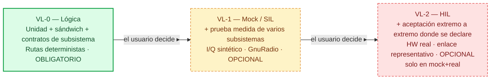

Cada nivel incluye todas las pruebas de los niveles inferiores. La escalera de sustitución HAL (§5.5) determina qué alimenta el pipeline: Mock HAL en VL-0 y VL-1, Real HW HAL en VL-2 (solo en `mock+real`). El telemetry companion se ejecuta en todos los niveles.

### 8.2 Regla adaptativa

El usuario elige el nivel de verificación por módulo y por ruta de sistema, por ciclo. Cuatro restricciones:

1. **Piso.** Cada módulo, contrato entre subsistemas y ruta de sistema declarada alcanza VL-0 en cada ciclo.
2. **Honestidad.** Ninguna afirmación por módulo o de extremo a extremo supera el entorno realmente probado. Aprobar subsistemas por separado no demuestra un requisito entre subsistemas.
3. **Contexto de telemetría.** Todo registro de evidencia incluye las lecturas del telemetry companion para la unidad de cómputo durante esa prueba. La evidencia producida mientras la UC estaba fuera de su envolvente de operación declarada (temperatura, saturación de CPU, buffers perdidos) se marca y puede ser invalidada por el revisor.
4. **Techo por modo HAL.** `mock-only` limita toda afirmación a VL-1. `mock+real` admite VL-2, pero cada módulo y ruta sigue declarando su nivel por ciclo: el Real HW HAL puede declararse en VL-0 (API de dispositivo simulada) durante un ciclo, en cuyo caso G2.2 no se activa y la declaración de honestidad lo indica.

| Escenario | El usuario declara | G2 verifica |
|---|---|---|
| Iteración rápida | VL-0 en todos | Unidad + sándwich por módulo; contratos y rutas deterministas entre subsistemas |
| Validación de DSP | VL-1 para DSP; VL-0 el resto | Mock/SIL para DSP; piso VL-0 para cada ruta de sistema |
| Pre-lanzamiento (`mock+real`) | VL-1 para la ruta borde → UI; VL-2 para `iq_acquisition` | Ruta multisubsistema medida y adquisición HIL |
| Lanzamiento completo | Módulos y rutas en su `required_vl` | Cada afirmación en el nivel declarado en S1 |

### 8.3 Sub-compuertas

G2 ejecuta las pruebas que escribió S2 y no escribe ninguna; un nivel declarado sin prueba es un defecto de módulo que se enruta a S2. Las ejecuciones ocurren en un contexto verificador separado y de solo lectura — un subagente cuando el runtime lo admite; en otro caso, una sesión nueva —, que implementa P2: el oráculo no es el generador.

| Sub-compuerta | Se activa cuando | Verifica |
|---|---|---|
| **G2.0** | Siempre | Pasan unidad, sándwich, contratos entre subsistemas y rutas deterministas; vectores dorados del Mock HAL; telemetry companion confirma UC nominal |
| **G2.1** | VL-1+ declarado para módulo o ruta | I/Q sintético del Mock HAL; pasan pruebas Mock/SIL entre subsistemas afectados; métricas dentro de umbrales; telemetry companion confirma UC nominal |
| **G2.2** | VL-2 declarado para módulo o ruta | Real HW HAL sobre SDR COTS (solo en `mock+real`); datasets de los procedimientos de lab de la SyRS (`PROTO-*`) con calibración y tolerancias declaradas; para rutas entre subsistemas, enlace representativo; mediciones dentro de los criterios; telemetry companion confirma UC nominal |

*Trabajo futuro (FW-005, §5.4).* Para un módulo o una ruta basados en ML, G2 mide el modelo suministrado *dentro del sistema implementado* en el nivel declarado y comprueba los criterios `SYS-*` correspondientes. La metadata de rendimiento recibida en S1 orienta el diseño de pruebas, pero no sustituye estas mediciones.

---

## 9 Enrutamiento de la Realimentación

V-SIL produce dos tipos de realimentación. Son estructuralmente diferentes y no deben confundirse.

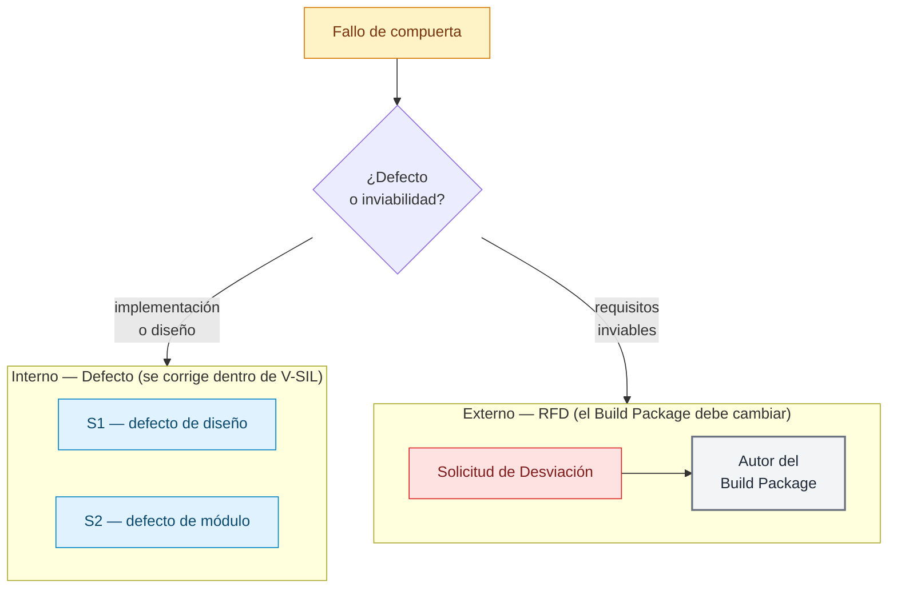

### 9.1 Enrutamiento de defectos internos

Un **defecto** significa que V-SIL puede corregirlo internamente. La implementación o el diseño está mal, pero los requisitos son alcanzables.

| Clase de defecto | Se enruta a | Ejemplo |
|---|---|---|
| Defecto de diseño | S1 | El DAG tiene una dependencia no declarada; falta propiedad del estado o un contrato entre subsistemas |
| Defecto de módulo o integración | S2 | La FFT produce un valor incorrecto; la UI interpreta mal un mensaje válido del borde |

**Autodiagnóstico:** si un módulo que *no* fue modificado falla durante la re-prueba → dependencia no declarada → defecto de diseño → S1.

### 9.2 Solicitud de Desviación (RFD)

Una **RFD** significa que los requisitos del Build Package son **inviables sobre la plataforma COTS declarada**. V-SIL no puede corregirlo internamente — las restricciones mismas deben cambiar. V-SIL **se suspende** hasta que el Build Package se actualice y reingresa en S0.

Una RFD puede emitirse desde **S1, G1 o cualquier subcompuerta de G2**. S0 y G0 no la emiten: S0 no hace ningún juicio de viabilidad y G0 solo comprueba la estructura. La inviabilidad descubierta al implementar en S2 se reporta a través de G2.

| Descubierta en | Ejemplo |
|---|---|
| S1 | La latencia del pipeline excede el requisito bajo cualquier particionamiento sobre este HW |
| G1 | La revisión de diseño concluye que un presupuesto de latencia no se puede cumplir sobre este HW, ni con el diseño revisado ni con otro particionamiento |
| G2.0 | Las pruebas unitarias revelan que dos requisitos normativos entran en conflicto matemáticamente |
| G2.1 | Las métricas SIL muestran que P_d y P_fa no pueden cumplir simultáneamente los umbrales |
| G2.2 | HIL muestra que el piso de ruido del hardware real excede el presupuesto asumido |

En S1 y G1 aún no se ha medido nada, así que la evidencia es de análisis y no nombra ningún nivel de verificación (P4).

### 9.3 Contenido de la RFD

Según ECSS [16], MIL-HDBK-61A [17] y NASA NPR 7150.2 [18]:

```
Solicitud de Desviación — RFD-001

  Requisitos en conflicto:
    STK-007: Latencia ≤ 100 ms    (fuente: ITU-R SM.1880)
    STK-012: P_d ≥ 0.95 @ 10 dB   (fuente: regulador nacional)

  Evidencia (de G2.1, VL-1):
    FFT 4096 → P_d 0.96, latencia 142 ms  — STK-012 cumplido, STK-007 violado
    FFT 2048 → P_d 0.91, latencia 71 ms   — STK-007 cumplido, STK-012 violado

  Opciones de compromiso:
    A) Relajar latencia a ≤ 150 ms                → ambos cumplidos
    B) Relajar P_d a ≥ 0.92                       → ambos cumplidos
    C) Modo dual: rápido (2048) + profundo (4096) → ambos cumplidos, añade complejidad

  Análisis de impacto:
    Opción A: requiere exención normativa de ITU-R SM.1880 §4.3
    Opción B: solo grado de tamizaje (screening), no grado de cumplimiento
    Opción C: nuevo módulo, nuevo contrato de interfaz, retrabajo de S1

  Recomendación: C
```

### 9.4 Resumen de la distinción

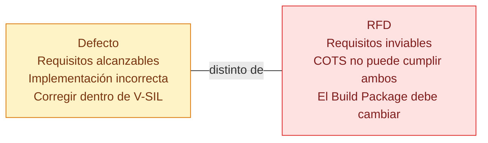

---

## 10 Salida Terminal

El Prototipo Verificado presenta el árbol entregado (`src/<subsystem>/`) separado del kit de verificación (`verification/`) y nombra el contexto verificador en el que G2 ejecutó las pruebas.

```
Prototipo Verificado — V-SIL v3
  Ciclo: pre_release_01
  Modo HAL: mock+real

  Software entregado:
    src/fm_edge/, src/dashboard/ — sin dependencia de CodeAnvil
  Kit de verificación (no se entrega):
    verification/ — Mock HAL, vectores dorados + manifiesto, telemetry
                    companion, stubs, pares simulados, drivers, pruebas
  Contexto verificador: subagente verificador de solo lectura (contexto nuevo)

  Evidencia por módulo:
    iq_acquisition:    VL-2 (HIL)  — Real HW HAL, HackRF One, FM 88–108 MHz
    fft_engine:        VL-1 (SIL)  — Mock HAL, I/Q dorado (vectores v1.2, SHA bc3f…)
    feature_extractor: VL-1 (SIL)  — Mock HAL, PSD sintético a SNR conocida
    classifier:        VL-0 (lógica)— Mock HAL, vectores deterministas
    audio_demod:       VL-1 (SIL)  — Mock HAL, I/Q sintético modulado en FM
    data_store:        VL-0 (lógica)— Mock HAL, vectores deterministas
    dashboard:         VL-1 (SIL)  — mensajes del borde en enlace simulado
    controls:          VL-0 (lógica)— vectores de comandos y confirmaciones
    alerts:            VL-0 (lógica)— unidad + integración sándwich
    history:           VL-0 (lógica)— unidad + integración sándwich

  Evidencia por subsistema y ruta de sistema:
    borde -> UI occupancy.v1: VL-1 — esquema + latencia en enlace simulado
    UI -> borde configure.v1: VL-0 — comandos, reintentos y duplicados
    PATH-001 / SYS-002 pantalla de ocupación: VL-1 — borde + UI, Mock HAL RF sintética

  Reporte del telemetry companion:
    Todas las pruebas: UC dentro de envolvente de operación
    CPU pico: 63%  |  Temp pico: 68 °C  |  Buffers perdidos: 0
    Ninguna evidencia invalidada por condiciones de UC.

  Declaración de honestidad:
    Módulos VL-1: VERIFICADOS contra datos sintéticos (Mock HAL).
    Módulos VL-2: VALIDADOS en hardware real (Real HW HAL);
                  calibración: grado de tamizaje según SyRS §4;
                  tolerancias: ±2.1 dBi declaradas por el equipo de desarrollo (SyRS §5).
    Módulos VL-0: VERIFICADOS solo a nivel de lógica.
    SYS-002: VERIFICADO entre subsistemas conectados con entrada sintética;
             sin afirmación de latencia en enlace real o HIL.
    Telemetry companion: UC nominal durante todas las ejecuciones de prueba.

  RFD emitidas: 0
```

### 10.1 Registro opcional de trabajo futuro

Después de G2, el prototipo puede incluir propuestas para próximas **versiones del software**. Cada entrada registra ID, capacidad o mejora propuesta, origen y evidencia, versión candidata, responsable de decidir, dependencias y criterio de aceptación propuesto. Si no hay entradas, se omite el registro. El autor del Build Package decide si una propuesta entra en otra versión; una propuesta aceptada se convierte en entrada nueva para S0 y G0. Automatizar CI/CD en el futuro es una posible entrada de infraestructura para una versión posterior; construir ese pipeline queda fuera de esta versión de V-SIL.

Aquí solo entra trabajo expresamente fuera del alcance aprobado del ciclo actual. Un `SYS-*` vigente que falla sigue siendo un defecto por corregir o, si es inviable en la COTS declarada, una RFD; el registro no lo convierte en una afirmación aprobada.

```text
FW-001 — Automatizar la evidencia de verificación V-SIL en CI/CD
  Categoría: infraestructura de verificación
  Origen: ejecución manual repetida de G2 en este ciclo
  Versión candidata: versión posterior del software
  Responsable de decidir: autor del Build Package
  Dependencia: comandos de prueba y formato de informe estables
  Aceptación propuesta: un pipeline reproduce las comprobaciones G2
                       declaradas y vincula los informes al ciclo y revisión fuente

FW-002 — Processor-in-the-Loop (PIL) como nivel intermedio
  Categoría: profundidad de verificación
  Origen: revisión SOTA; cuando la UC ≠ host de desarrollo, el código
          compilado en el procesador objetivo puede comportarse diferente
          bajo restricciones de temporización
  Versión candidata: versión posterior del software
  Responsable de decidir: autor del Build Package
  Dependencia: UC objetivo identificada y accesible para compilación cruzada
  Aceptación propuesta: nivel PIL definido entre VL-1 y VL-2 con
                       verificaciones de temporización y planificación en el procesador objetivo

FW-003 — Inyección formal de fallos en VL-2
  Categoría: profundidad de verificación
  Origen: revisión SOTA (ISO 26262-5 §10; IEC 61508-3 Tabla A.5);
          las pruebas VL-2 actuales solo prueban operación nominal
  Versión candidata: versión posterior del software
  Responsable de decidir: autor del Build Package
  Dependencia: escenarios de fallo definidos por módulo (desconexión USB,
              desbordamiento de buffer, desviación de reloj SDR, fallo de energía UC)
  Aceptación propuesta: escenarios de fallo declarados ejecutados en VL-2;
                       respuesta del sistema documentada por escenario

FW-004 — Medición de correlación SIL ↔ HIL
  Categoría: confianza en la verificación
  Origen: revisión SOTA; los resultados VL-1 y VL-2 se reportan independientemente
          sin correlación medida entre ellos
  Versión candidata: versión posterior del software
  Responsable de decidir: autor del Build Package
  Dependencia: tanto VL-1 como VL-2 ejecutados para los mismos módulos
  Aceptación propuesta: desviación cuantificada entre resultados Mock HAL y
                       Real HW HAL para los casos de prueba superpuestos

FW-005 — MLOps para el modelo de ML opcional
  Categoría: ciclo de vida del modelo
  Origen: el modelo de ML opcional se entrena y etiqueta fuera de un
          pipeline automatizado, y su integración con S2 y G2 aún no
          está implementada (§5.4)
  Versión candidata: versión posterior del software
  Responsable de decidir: autor del Build Package
  Dependencia: datasets versionados del Mock HAL o del Real HW HAL y un
               procedimiento de etiquetado declarado
  Aceptación propuesta: un pipeline reproduce el entrenamiento a partir de
                       datos y etiquetas versionados y vincula cada versión
                       del modelo con su evidencia de G2
```

---

## 11 Referencias

[1] R. S. Pressman, B. R. Maxim, *Software Engineering*, 9.ª ed., 2020.
[2] ISO/IEC/IEEE 29119-1:2022, "Software testing — Part 1."
[3] Codeburst, "The Basics of Contract Tests," 2024.
[4] L. Bass, P. Clements, R. Kazman, *Software Architecture in Practice*, 4.ª ed., 2021.
[5] ISO 26262:2018, "Road vehicles — Functional safety."
[6] V. H. Nguyen, T. Nguyen, "SDAD," arXiv:2608.20341, mayo de 2026.
[7] "LLM-as-a-Judge Is Not an Oracle," arXiv:2609.02246, sep. de 2026.
[8] V. Reddy et al., "Reason Less, Verify More," arXiv:2607.07405, jul. de 2026.
[9] Sheridan Tech, "Design Validation vs Verification," mar. de 2026.
[10] Augment Code, "Coordinator-Implementor-Verifier Pattern," jun. de 2026.
[11] OPAL-RT, "Guide to HIL Testing," sep. de 2026.
[12] IEEE/ISO/IEC 29148:2018, "Requirements engineering."
[13] V. Lavecchia, "Sandwich testing strategies," 2024.
[14] B. Trinnes, "Test Architecture Patterns," GitHub, abr. de 2026.
[15] "Spec-Driven Development," arXiv:2602.00180, feb. de 2026.
[16] ECSS-Q-ST-10-09C, "Nonconformance control system," European Cooperation for Space Standardization. — Define la Request for Deviation (RFD) como una «desviación planificada» de los requisitos.
[17] MIL-HDBK-61A, "Configuration Management Guidance," U.S. DoD, 2001. — Procesamiento de desviaciones: se solicita cuando un producto no puede cumplir requisitos técnicos; incluye análisis de impacto y opciones de compromiso.
[18] NASA NPR 7150.2, "NASA Software Engineering Requirements." — Evaluación de desviación/exención: justificación técnica, evaluación de riesgos, impacto en la seguridad y alternativas propuestas.
