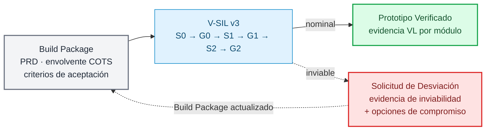
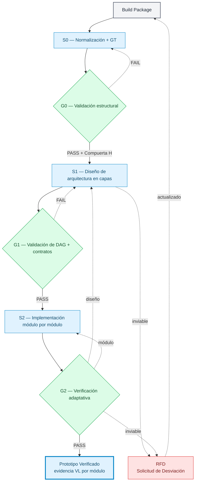
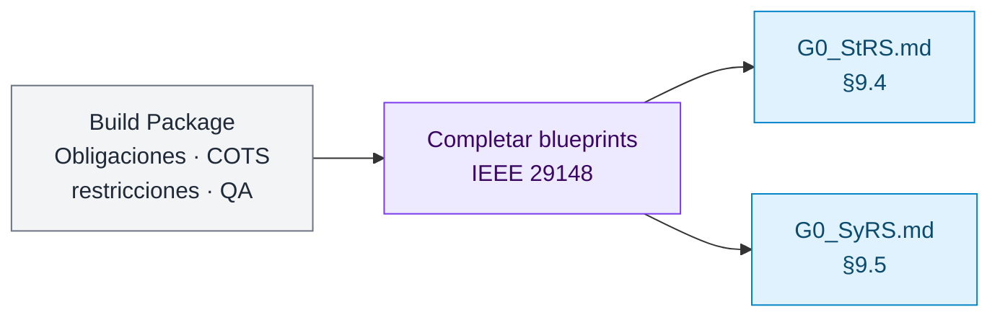
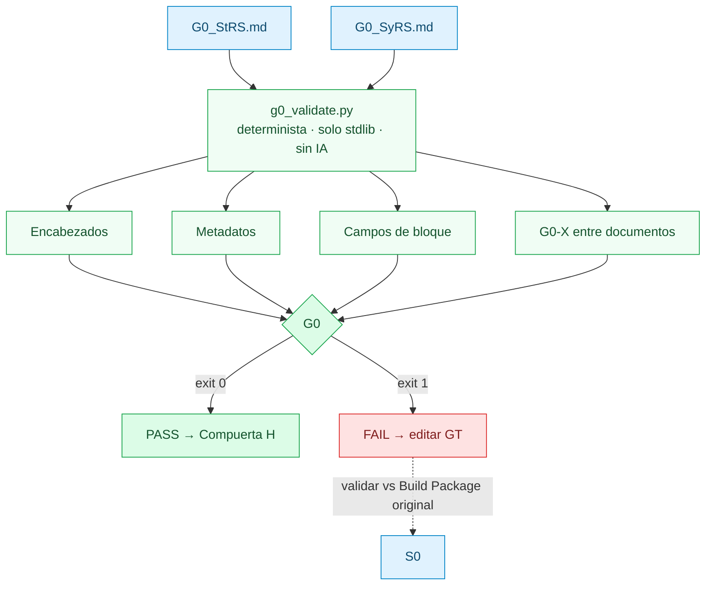
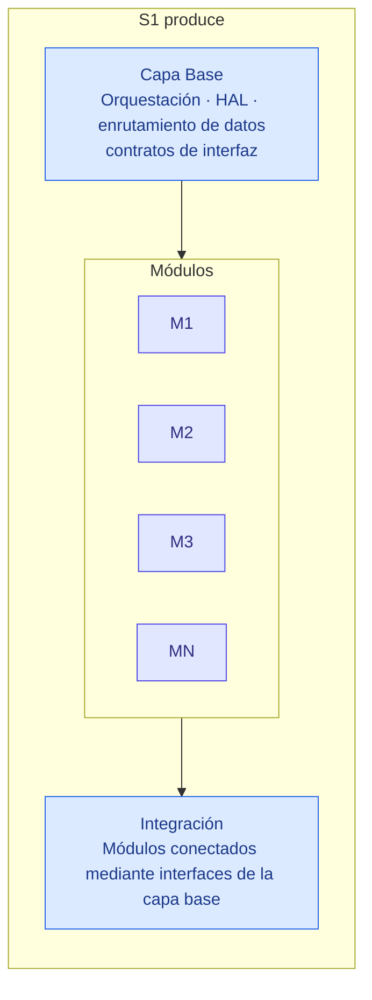
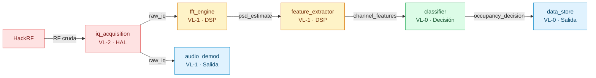
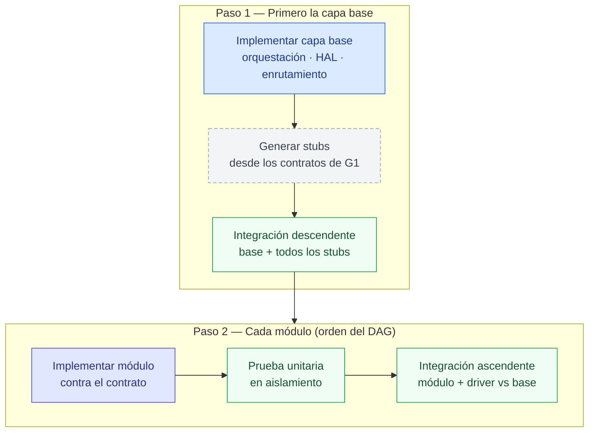
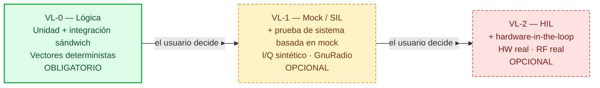
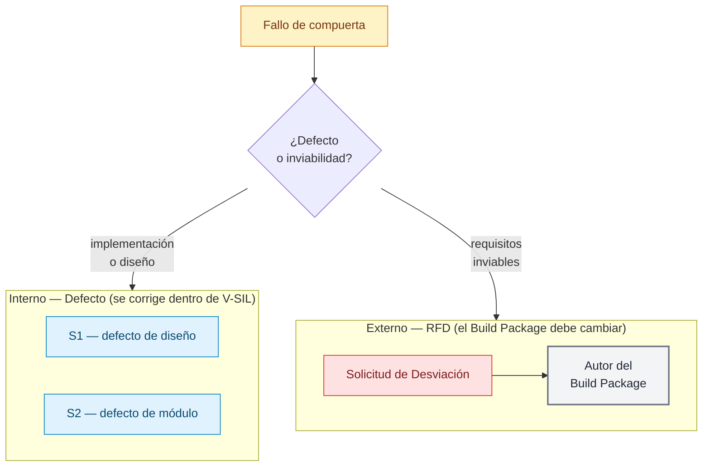
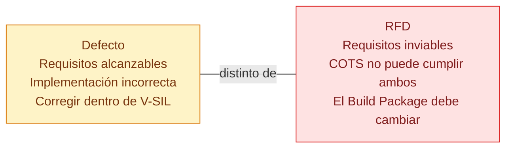

# V-SIL v3: Ciclo de Vida Stage-Gate Adaptativo para el Desarrollo de Prototipos Verificados Restringidos por Hardware COTS

**David Ramírez-Betancourt** — Universidad Nacional de Colombia, GCPDS  
**Versión:** 3.0-draft  
**Fecha:** Octubre de 2026

---

## Resumen

V-SIL v3 es una metodología de desarrollo de software que recibe un Build Package finalizado (PRD con restricciones medibles, envolvente de hardware COTS y criterios de aceptación) y entrega un Prototipo Verificado con evidencia por módulo — o, cuando los requisitos son inviables sobre la plataforma COTS declarada, una Solicitud de Desviación (Request for Deviation, RFD) formal con análisis de compromisos. La metodología se sustenta en tres principios: (1) la implementación avanza módulo por módulo dentro de una arquitectura en capas; (2) la profundidad de verificación es adaptativa por módulo — siempre se exige un piso obligatorio de pruebas unitarias más integración sándwich, mientras que los niveles Mock/SIL y HIL se alcanzan según la conveniencia del proyecto; y (3) la evidencia es honesta — cada afirmación nombra el nivel de verificación en el que fue producida. La terminología está alineada con IEEE/ISO/IEC 29119, ISO 26262, SDAD [6], el patrón Coordinator-Implementor-Verifier [10], la escalera de sustitución HAL mock→SIL→HIL para sistemas embebidos [11] y el proceso de Request for Deviation de ECSS/MIL-HDBK-61A [16][17].



---

## 1 Terminología

| Término informal | Término estándar | Fuente |
|---|---|---|
| Prueba de propagación (base → módulos con marcadores de posición) | **Prueba de integración descendente (top-down) con stubs** | IEEE 29119; Pressman [1] |
| Prueba de retropropagación (módulo → base) | **Prueba de integración ascendente (bottom-up) con drivers** | IEEE 29119; Pressman [1] |
| Propagación + retropropagación combinadas | **Prueba de integración sándwich (híbrida)** | IEEE 29119 [2] |
| Marcadores de posición | **Stubs** (invocados por la unidad bajo prueba) | SE estándar |
| Arneses de prueba que simulan a los invocadores | **Drivers** (invocan la unidad bajo prueba) | SE estándar |
| Validación del enrutador | **Verificación de contrato de interfaz** | Pruebas de contrato [3]; Bass et al. [4] |
| Diseño por capas | **Arquitectura en capas** con **grafo de dependencias de componentes** (DAG) | Bass et al. [4] |
| Niveles N0 / N1 / N2 | **Niveles de verificación** (VL-0, VL-1, VL-2) | Adaptado de ISO 26262 [5] |
| Realimentación al Build Package con compromisos | **Solicitud de Desviación (RFD)** | ECSS [16]; MIL-HDBK-61A [17]; NASA NPR 7150.2 [18] |

---

## 2 Vista General de Etapas y Compuertas (Stage-Gate)



**Principios rectores.**
**P1.** HITL es una barrera de autorización; HIL es una barrera de validación.
**P2.** Oráculo ≠ generador — el modelo nunca aprueba su propio trabajo [7].
**P3.** El rechazo mecánico prevalece sobre la aprobación del LLM, nunca al revés [8].
**P4.** *Verificado* ≠ *validado* — las afirmaciones nombran el entorno [9].

---

## 3 S0 — Normalización y Ground Truth



S0 **solo normaliza** — vierte el contenido del Build Package en los blueprints documentales de IEEE 29148 [12] y no emite ningún juicio conceptual sobre suficiencia o alcance. Siguiendo la Fase 1 de SDAD (cristalización de la especificación) [6], completa los blueprints:

- **G0_StRS.md** — Especificación de Requisitos de las Partes Interesadas (Stakeholder Requirements Specification, §9.4): bloques `NRM-*`, `HWC-*`, `STK-*`.
- **G0_SyRS.md** — Especificación de Requisitos del Sistema (System Requirements Specification, §9.5): bloques `SYS-*` que trazan a la StRS.

Cualquier iteración ocurre después en G0, que valida el contenido del Build Package contra la compuerta determinista (el blueprint) — no mediante un juicio de revisión aquí.

---

## 4 G0 — Validación Estructural



Determinista. Sin IA. Veredicto binario. Tras aprobar G0, la Compuerta humana H pregunta: *¿Los requisitos están completos, acotados y son verificables?*

---

## 5 S1 — Diseño de Arquitectura en Capas

### 5.1 Arquitectura en capas



Los módulos son unidades enchufables (plug-in) que se comunican únicamente a través de las interfaces declaradas de la capa base. No hay llamadas directas entre módulos.

### 5.2 Grafo de dependencias de componentes (ejemplo SDR FM)



Cada arista transporta un **contrato de interfaz** (tipo de dato, versión de esquema, unidades, latencia). El grafo debe ser acíclico. Cada nodo lleva un **perfil de verificación**: `module_id`, `layer`, `depends_on`, `provides`, `hw_dependency`, `required_vl`.

| Módulo | Capa | Dep. HW | VL requerido |
|---|---|---|---|
| `iq_acquisition` | HAL | **sí** | VL-2 (HIL) |
| `fft_engine` | DSP | no | VL-1 (SIL) |
| `feature_extractor` | DSP | no | VL-1 (SIL) |
| `classifier` | Decisión | no | VL-0 (unidad) |
| `audio_demod` | Salida | no | VL-1 (SIL) |
| `data_store` | Salida | no | VL-0 (unidad) |

---

## 6 G1 — Validación del Grafo de Dependencias y Contratos de Interfaz

G1 responde: *¿Están resueltas todas las decisiones de diseño críticas para la implementación?*

1. **Aciclicidad del DAG.** Sin ciclos.
2. **Completitud de interfaces.** Cada arista lleva un contrato tipado.
3. **Cobertura.** Cada `SYS-*` traza al menos a un módulo.
4. **Viabilidad de stubs.** Cada contrato es lo bastante completo para escribir un stub determinista.
5. **Consistencia del perfil de verificación.** `hw_dependency: true` → `required_vl: VL-2`.

**PASS** → S2. **FAIL** → S1.

---

## 7 S2 — Implementación Módulo por Módulo



Descendente (base → stubs) + ascendente (módulo → driver → base) = **prueba de integración sándwich** [1][2][13].

### Piso obligatorio (VL-0) — no se puede omitir

| Componente | Siempre requerido |
|---|---|
| **Capa base** | Prueba unitaria + integración descendente con stubs |
| **Cada módulo** | Prueba unitaria + integración ascendente con driver |

---

## 8 G2 — Compuerta de Verificación Adaptativa

### 8.1 Niveles de verificación



Cada nivel incluye todas las pruebas de los niveles inferiores.

### 8.2 Regla adaptativa

El usuario elige el nivel de verificación por módulo, por ciclo. Dos restricciones:

1. **Piso.** Cada módulo alcanza VL-0 en cada ciclo.
2. **Honestidad.** Ninguna afirmación por encima de lo que se probó.

| Escenario | El usuario declara | G2 verifica |
|---|---|---|
| Iteración rápida | VL-0 en todos | Unidad + sándwich para cada módulo |
| Validación de DSP | VL-1 para DSP; VL-0 el resto | Mock/SIL para DSP; unidad para los demás |
| Pre-lanzamiento | VL-1 en todos; VL-2 para `iq_acquisition` | Mock en todos; HIL para la adquisición |
| Lanzamiento completo | Todos en su `required_vl` | Cada módulo en el máximo declarado en S1 |

### 8.3 Sub-compuertas

| Sub-compuerta | Se activa cuando | Verifica |
|---|---|---|
| **G2.0** | Siempre | Pasan unidad + integración sándwich |
| **G2.1** | VL-1+ declarado | Pasan las pruebas de sistema Mock/SIL; métricas dentro de umbrales |
| **G2.2** | VL-2 declarado | Aceptación HIL en HW real; mediciones dentro de los criterios |

---

## 9 Enrutamiento de la Realimentación

V-SIL produce dos tipos de realimentación. Son estructuralmente diferentes y no deben confundirse.



### 9.1 Enrutamiento de defectos internos

Un **defecto** significa que V-SIL puede corregirlo internamente. La implementación o el diseño está mal, pero los requisitos son alcanzables.

| Clase de defecto | Se enruta a | Ejemplo |
|---|---|---|
| Defecto de diseño | S1 | El DAG tiene una dependencia no declarada; contrato de interfaz incompleto |
| Defecto de módulo | S2 | El módulo FFT produce una normalización incorrecta; error de lógica del clasificador |

**Autodiagnóstico:** si un módulo que *no* fue modificado falla durante la re-prueba → dependencia no declarada → defecto de diseño → S1.

### 9.2 Solicitud de Desviación (RFD)

Una **RFD** significa que los requisitos del Build Package son **inviables sobre la plataforma COTS declarada**. V-SIL no puede corregirlo internamente — las restricciones mismas deben cambiar. V-SIL **se suspende** hasta que el Build Package se actualice y reingresa en S0.

Una RFD puede emitirse desde **cualquier etapa**:

| Descubierta en | Ejemplo |
|---|---|
| S1 | La latencia del pipeline excede el requisito bajo cualquier particionamiento sobre este HW |
| G2.0 | Las pruebas unitarias revelan que dos requisitos normativos entran en conflicto matemáticamente |
| G2.1 | Las métricas SIL muestran que P_d y P_fa no pueden cumplir simultáneamente los umbrales |
| G2.2 | HIL muestra que el piso de ruido del hardware real excede el presupuesto asumido |

### 9.3 Contenido de la RFD

Según ECSS [16], MIL-HDBK-61A [17] y NASA NPR 7150.2 [18]:

```
Solicitud de Desviación — RFD-001

  Requisitos en conflicto:
    STK-007: Latencia ≤ 100 ms    (fuente: ITU-R SM.1880)
    STK-012: P_d ≥ 0.95 @ 10 dB   (fuente: regulador nacional)

  Evidencia (de G2.1, VL-1):
    FFT 4096 → P_d 0.96, latencia 142 ms  — STK-012 cumplido, STK-007 violado
    FFT 2048 → P_d 0.91, latencia 71 ms   — STK-007 cumplido, STK-012 violado

  Opciones de compromiso:
    A) Relajar latencia a ≤ 150 ms                → ambos cumplidos
    B) Relajar P_d a ≥ 0.92                       → ambos cumplidos
    C) Modo dual: rápido (2048) + profundo (4096) → ambos cumplidos, añade complejidad

  Análisis de impacto:
    Opción A: requiere exención normativa de ITU-R SM.1880 §4.3
    Opción B: solo grado de tamizaje (screening), no grado de cumplimiento
    Opción C: nuevo módulo, nuevo contrato de interfaz, retrabajo de S1

  Recomendación: C
```

### 9.4 Resumen de la distinción



---

## 10 Salida Terminal

```
Prototipo Verificado — V-SIL v3
  Ciclo: pre_release_01

  Evidencia por módulo:
    iq_acquisition:    VL-2 (HIL)    — HackRF One, FM 88–108 MHz
    fft_engine:        VL-1 (SIL)    — mock de GnuRadio, I/Q dorado (golden)
    feature_extractor: VL-1 (SIL)    — PSD sintético a SNR conocida
    classifier:        VL-0 (lógica) — unidad + integración sándwich
    audio_demod:       VL-1 (SIL)    — I/Q sintético modulado en FM
    data_store:        VL-0 (lógica) — unidad + integración sándwich

  Declaración de honestidad:
    Módulos VL-1: VERIFICADOS contra datos sintéticos.
    Módulos VL-2: VALIDADOS en hardware real.
    Módulos VL-0: VERIFICADOS solo a nivel de lógica.

  RFD emitidas: 0
```

---

## 11 Referencias

[1] R. S. Pressman, B. R. Maxim, *Software Engineering*, 9.ª ed., 2020.
[2] ISO/IEC/IEEE 29119-1:2022, "Software testing — Part 1."
[3] Codeburst, "The Basics of Contract Tests," 2024.
[4] L. Bass, P. Clements, R. Kazman, *Software Architecture in Practice*, 4.ª ed., 2021.
[5] ISO 26262:2018, "Road vehicles — Functional safety."
[6] V. H. Nguyen, T. Nguyen, "SDAD," arXiv:2608.20341, mayo de 2026.
[7] "LLM-as-a-Judge Is Not an Oracle," arXiv:2609.02246, sep. de 2026.
[8] V. Reddy et al., "Reason Less, Verify More," arXiv:2607.07405, jul. de 2026.
[9] Sheridan Tech, "Design Validation vs Verification," mar. de 2026.
[10] Augment Code, "Coordinator-Implementor-Verifier Pattern," jun. de 2026.
[11] OPAL-RT, "Guide to HIL Testing," sep. de 2026.
[12] IEEE/ISO/IEC 29148:2018, "Requirements engineering."
[13] V. Lavecchia, "Sandwich testing strategies," 2024.
[14] B. Trinnes, "Test Architecture Patterns," GitHub, abr. de 2026.
[15] "Spec-Driven Development," arXiv:2602.00180, feb. de 2026.
[16] ECSS-Q-ST-10-09C, "Nonconformance control system," European Cooperation for Space Standardization. — Define la Request for Deviation (RFD) como una «desviación planificada» de los requisitos.
[17] MIL-HDBK-61A, "Configuration Management Guidance," U.S. DoD, 2001. — Procesamiento de desviaciones: se solicita cuando un producto no puede cumplir requisitos técnicos; incluye análisis de impacto y opciones de compromiso.
[18] NASA NPR 7150.2, "NASA Software Engineering Requirements." — Evaluación de desviación/exención: justificación técnica, evaluación de riesgos, impacto en la seguridad y alternativas propuestas.
