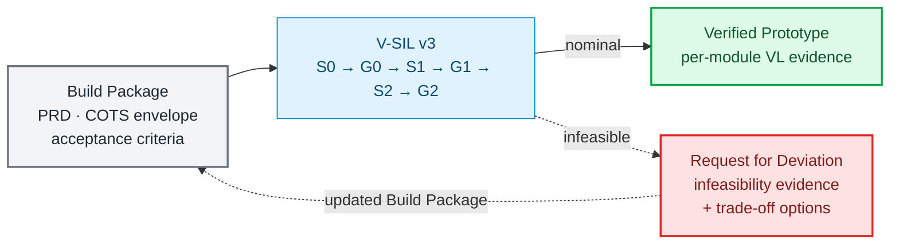
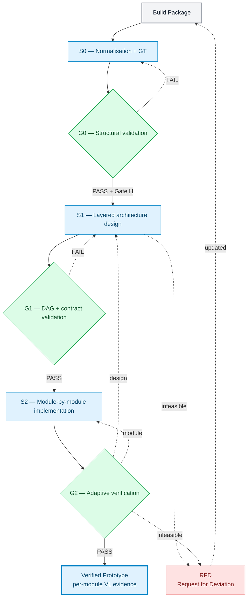
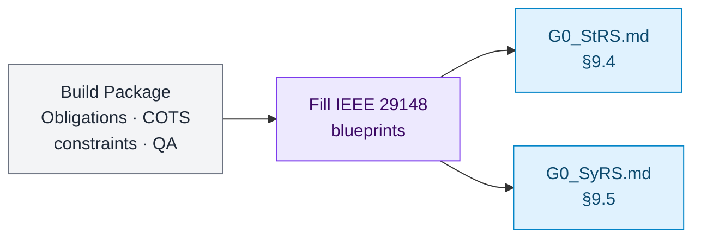
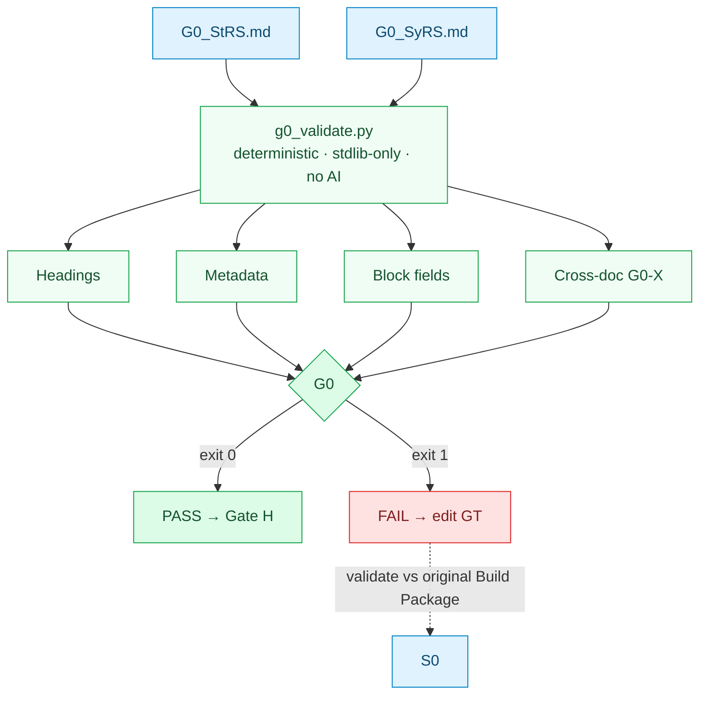
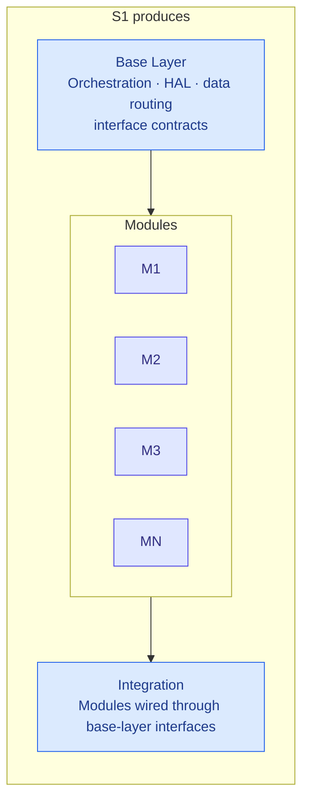
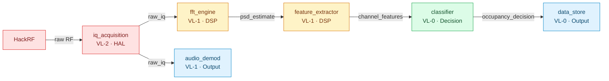
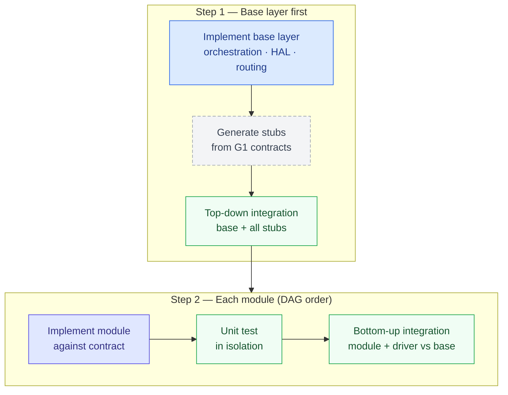
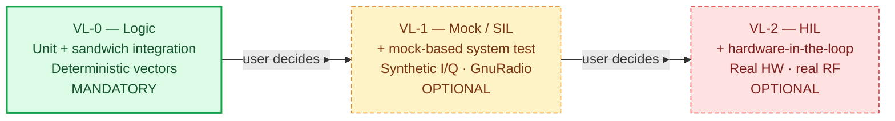
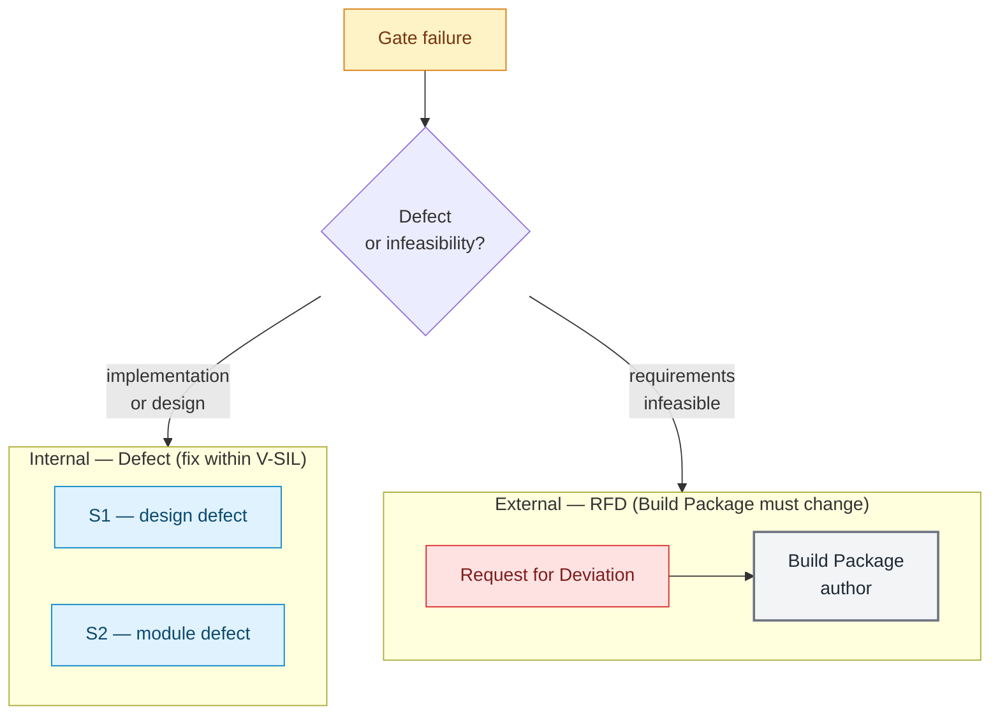
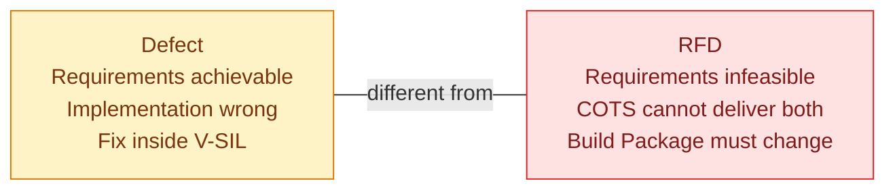

# V-SIL v3: Adaptive Stage-Gate Lifecycle for COTS-Constrained Verified Prototype Development

**David Ramírez-Betancourt** — Universidad Nacional de Colombia, GCPDS  
**Version:** 3.0-draft  
**Date:** October 2026

---

## Abstract

V-SIL v3 is a software development methodology that receives a finalised Build Package (PRD with measurable constraints, COTS hardware envelope, and acceptance criteria) and delivers a Verified Prototype with per-module evidence — or, when the requirements are infeasible on the declared COTS platform, a formal Request for Deviation (RFD) with trade-off analysis. The methodology is built on three principles: (1) implementation proceeds module by module within a layered architecture; (2) verification depth is adaptive per module — a mandatory floor of unit testing plus sandwich integration is always enforced, while Mock/SIL and HIL levels are reached at the project's convenience; and (3) evidence is honest — every claim names the verification level at which it was produced. Terminology is aligned with IEEE/ISO/IEC 29119, ISO 26262, SDAD [6], the Coordinator-Implementor-Verifier pattern [10], the embedded HAL mock→SIL→HIL substitution ladder [11], and the ECSS/MIL-HDBK-61A Request for Deviation process [16][17].



---

## 1 Terminology

| Informal term | Standard term | Source |
|---|---|---|
| Propagation test (base → modules with placeholders) | **Top-down integration test with stubs** | IEEE 29119; Pressman [1] |
| Backpropagation test (module → base) | **Bottom-up integration test with drivers** | IEEE 29119; Pressman [1] |
| Combined propagation + backpropagation | **Sandwich (hybrid) integration testing** | IEEE 29119 [2] |
| Placeholders | **Stubs** (called by the unit under test) | Standard SE |
| Test harnesses simulating callers | **Drivers** (call the unit under test) | Standard SE |
| Router validation | **Interface-contract verification** | Contract testing [3]; Bass et al. [4] |
| Design by layers | **Layered architecture** with **component dependency graph** (DAG) | Bass et al. [4] |
| Levels N0 / N1 / N2 | **Verification levels** (VL-0, VL-1, VL-2) | Adapted from ISO 26262 [5] |
| Feedback to Build Package with trade-off | **Request for Deviation (RFD)** | ECSS [16]; MIL-HDBK-61A [17]; NASA NPR 7150.2 [18] |

---

## 2 Stage-Gate Overview



**Governing principles.**
**P1.** HITL is an authorisation barrier; HIL is a validation barrier.
**P2.** Oracle ≠ generator — the model never approves its own work [7].
**P3.** Mechanical rejection beats LLM approval, never the reverse [8].
**P4.** *Verified* ≠ *validated* — claims name the environment [9].

---

## 3 S0 — Normalisation and Ground Truth



S0 **normalises only** — it casts the Build Package content into the IEEE 29148 [12] document blueprints and makes no conceptual judgement about sufficiency or scope. Following SDAD Phase 1 (spec crystallisation) [6], it populates the blueprints:

- **G0_StRS.md** — Stakeholder Requirements Specification (§9.4): `NRM-*`, `HWC-*`, `STK-*` blocks.
- **G0_SyRS.md** — System Requirements Specification (§9.5): `SYS-*` blocks tracing to StRS.

Any iteration happens afterwards at G0, which validates the Build Package content against the deterministic gate (the blueprint) — not by a review judgement here.

---

## 4 G0 — Structural Validation



Deterministic. No AI. Binary verdict. After G0 passes, human Gate H asks: *Requirements complete, bounded, and verifiable?*

---

## 5 S1 — Layered Architecture Design

### 5.1 Layered architecture



Modules are plug-in units communicating only through the base layer's declared interfaces. No direct module-to-module calls.

### 5.2 Component dependency graph (SDR FM example)



Each edge carries an **interface contract** (data type, schema version, units, latency). The graph must be acyclic. Each node carries a **verification profile**: `module_id`, `layer`, `depends_on`, `provides`, `hw_dependency`, `required_vl`.

| Module | Layer | HW dep. | Required VL |
|---|---|---|---|
| `iq_acquisition` | HAL | **yes** | VL-2 (HIL) |
| `fft_engine` | DSP | no | VL-1 (SIL) |
| `feature_extractor` | DSP | no | VL-1 (SIL) |
| `classifier` | Decision | no | VL-0 (unit) |
| `audio_demod` | Output | no | VL-1 (SIL) |
| `data_store` | Output | no | VL-0 (unit) |

---

## 6 G1 — Dependency-Graph and Interface-Contract Validation

G1 answers: *Are all implementation-critical design choices resolved?*

1. **DAG acyclicity.** No cycles.
2. **Interface completeness.** Every edge carries a typed contract.
3. **Coverage.** Every `SYS-*` traces to at least one module.
4. **Stub feasibility.** Every contract is complete enough to write a deterministic stub.
5. **Verification-profile consistency.** `hw_dependency: true` → `required_vl: VL-2`.

**PASS** → S2. **FAIL** → S1.

---

## 7 S2 — Module-by-Module Implementation



Top-down (base → stubs) + bottom-up (module → driver → base) = **sandwich integration testing** [1][2][13].

### Mandatory floor (VL-0) — cannot be skipped

| Component | Always required |
|---|---|
| **Base layer** | Unit test + top-down integration with stubs |
| **Each module** | Unit test + bottom-up integration with driver |

---

## 8 G2 — Adaptive Verification Gate

### 8.1 Verification levels



Each level includes all tests from the levels below.

### 8.2 Adaptive rule

The user chooses the verification level per module, per cycle. Two constraints:

1. **Floor.** Every module reaches VL-0 in every cycle.
2. **Honesty.** No claim higher than what was tested.

| Scenario | User declares | G2 checks |
|---|---|---|
| Fast iteration | VL-0 all | Unit + sandwich for every module |
| DSP validation | VL-1 for DSP; VL-0 rest | Mock/SIL for DSP; unit for others |
| Pre-release | VL-1 all; VL-2 for `iq_acquisition` | Mock all; HIL for acquisition |
| Full release | All at `required_vl` | Every module at S1-declared max |

### 8.3 Sub-gates

| Sub-gate | Fires when | Checks |
|---|---|---|
| **G2.0** | Always | Unit + sandwich integration pass |
| **G2.1** | VL-1+ declared | Mock/SIL system tests pass; metrics within thresholds |
| **G2.2** | VL-2 declared | HIL acceptance on real HW; measurements within criteria |

---

## 9 Feedback Routing

V-SIL produces two types of feedback. They are structurally different and must not be conflated.



### 9.1 Internal defect routing

A **defect** means V-SIL can fix it internally. The implementation or the design is wrong, but the requirements are achievable.

| Defect class | Routes to | Example |
|---|---|---|
| Design defect | S1 | DAG has undeclared dependency; interface contract incomplete |
| Module defect | S2 | FFT module outputs wrong normalisation; classifier logic error |

**Self-diagnosis:** if a module that was *not* changed fails during re-testing → undeclared dependency → design defect → S1.

### 9.2 Request for Deviation (RFD)

An **RFD** means the Build Package requirements are **infeasible on the declared COTS platform**. V-SIL cannot fix it internally — the constraints themselves must change. V-SIL **suspends** until the Build Package is updated and re-enters at S0.

An RFD can be emitted from **any stage**:

| Discovered at | Example |
|---|---|
| S1 | Pipeline latency exceeds requirement under any partitioning on this HW |
| G2.0 | Unit tests reveal that two normative requirements conflict mathematically |
| G2.1 | SIL metrics show P_d and P_fa cannot simultaneously meet thresholds |
| G2.2 | HIL shows real hardware noise floor exceeds assumed budget |

### 9.3 RFD contents

Per ECSS [16], MIL-HDBK-61A [17], and NASA NPR 7150.2 [18]:

```
Request for Deviation — RFD-001

  Conflicting requirements:
    STK-007: Latency ≤ 100 ms    (source: ITU-R SM.1880)
    STK-012: P_d ≥ 0.95 @ 10 dB  (source: national regulator)

  Evidence (from G2.1, VL-1):
    FFT 4096 → P_d 0.96, latency 142 ms  — STK-012 met, STK-007 violated
    FFT 2048 → P_d 0.91, latency 71 ms   — STK-007 met, STK-012 violated

  Trade-off options:
    A) Relax latency to ≤ 150 ms         → both met
    B) Relax P_d to ≥ 0.92               → both met
    C) Dual-mode: fast (2048) + deep (4096) → both met, adds complexity

  Impact analysis:
    Option A: requires normative waiver from ITU-R SM.1880 §4.3
    Option B: screening-grade only, not compliance-grade
    Option C: new module, new interface contract, S1 rework

  Recommendation: C
```

### 9.4 Distinction summary



---

## 10 Terminal Output

```
Verified Prototype — V-SIL v3
  Cycle: pre_release_01

  Module evidence:
    iq_acquisition:    VL-2 (HIL)  — HackRF One, FM 88–108 MHz
    fft_engine:        VL-1 (SIL)  — GnuRadio mock, golden I/Q
    feature_extractor: VL-1 (SIL)  — synthetic PSD at known SNR
    classifier:        VL-0 (logic)— unit + sandwich integration
    audio_demod:       VL-1 (SIL)  — synthetic FM-modulated I/Q
    data_store:        VL-0 (logic)— unit + sandwich integration

  Honesty declaration:
    VL-1 modules: VERIFIED against synthetic data.
    VL-2 modules: VALIDATED on real hardware.
    VL-0 modules: VERIFIED at logic level only.

  RFDs issued: 0
```

---

## 11 References

[1] R. S. Pressman, B. R. Maxim, *Software Engineering*, 9th ed., 2020.
[2] ISO/IEC/IEEE 29119-1:2022, "Software testing — Part 1."
[3] Codeburst, "The Basics of Contract Tests," 2024.
[4] L. Bass, P. Clements, R. Kazman, *Software Architecture in Practice*, 4th ed., 2021.
[5] ISO 26262:2018, "Road vehicles — Functional safety."
[6] V. H. Nguyen, T. Nguyen, "SDAD," arXiv:2608.20341, May 2026.
[7] "LLM-as-a-Judge Is Not an Oracle," arXiv:2609.02246, Sep. 2026.
[8] V. Reddy et al., "Reason Less, Verify More," arXiv:2607.07405, Jul. 2026.
[9] Sheridan Tech, "Design Validation vs Verification," Mar. 2026.
[10] Augment Code, "Coordinator-Implementor-Verifier Pattern," Jun. 2026.
[11] OPAL-RT, "Guide to HIL Testing," Sep. 2026.
[12] IEEE/ISO/IEC 29148:2018, "Requirements engineering."
[13] V. Lavecchia, "Sandwich testing strategies," 2024.
[14] B. Trinnes, "Test Architecture Patterns," GitHub, Apr. 2026.
[15] "Spec-Driven Development," arXiv:2602.00180, Feb. 2026.
[16] ECSS-Q-ST-10-09C, "Nonconformance control system," European Cooperation for Space Standardization. — Defines Request for Deviation (RFD) as a "planned departure" from requirements.
[17] MIL-HDBK-61A, "Configuration Management Guidance," U.S. DoD, 2001. — Deviation processing: request when a product cannot meet technical requirements; includes impact analysis and trade-off options.
[18] NASA NPR 7150.2, "NASA Software Engineering Requirements." — Deviation/waiver evaluation: technical justification, risk assessment, impact to safety, and proposed alternatives.
