# V-SIL v3: Adaptive Stage-Gate Lifecycle for COTS-Constrained Verified Prototype Development

**David Ramírez-Betancourt** — Universidad Nacional de Colombia, GCPDS  
**Version:** 3.0-draft  
**Date:** October 2026

---

## Abstract

V-SIL v3 is a software development methodology that receives a finalised Build Package (PRD with measurable constraints, COTS hardware envelope, acceptance criteria and, optionally, laboratory procedures, hardware calibration at the development team's screening grade, and tolerances in dBi) and delivers a Verified Prototype with per-module and end-to-end evidence — or, when the requirements are infeasible on the declared COTS platform, a formal Request for Deviation (RFD) with trade-off analysis. S1 may design one subsystem or a system of subsystems: each subsystem has its own layered base and modules, and subsystems meet through versioned contracts. S1 declares a HAL mode, `mock-only` or `mock+real`. It always designs a **Mock HAL** that generates deterministic and synthetic data for VL-0 and VL-1, and a mandatory **telemetry companion** that silently monitors the compute unit during all test executions and is never shipped. Only in `mock+real` does it add a **Real HW HAL** that interfaces with the physical hardware for laboratory dataset generation and field tests at VL-2. An ML model is an optional S1 input when the chosen design uses one; it is trained with Mock HAL data plus labelling or, failing that, with Real HW HAL data plus labelling. Implementation proceeds module by module within each subsystem and then across subsystem boundaries. Verification depth is adaptive per module, while a mandatory floor of unit, sandwich-integration, cross-subsystem contract, and system-path tests applies. Every claim names the verification level and environment at which it was produced; the telemetry companion attaches compute-unit state (CPU, memory, temperature, buffer health, scheduling latency) to every evidence record. The terminal output may record scoped future work for later software versions; this does not defer current acceptance criteria. Terminology is aligned with IEEE/ISO/IEC 29119, ISO 26262, SDAD [6], the Coordinator-Implementor-Verifier pattern [10], the embedded HAL mock→SIL→HIL substitution ladder [11], and the ECSS/MIL-HDBK-61A Request for Deviation process [16][17].

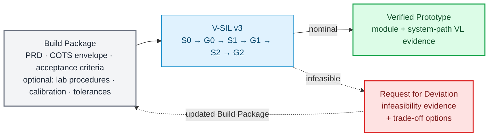

---

## 1 Terminology

| Informal term | Standard term | Source |
|---|---|---|
| Propagation test (base → modules with placeholders) | **Top-down integration test with stubs** | IEEE 29119; Pressman [1] |
| Backpropagation test (module → base) | **Bottom-up integration test with drivers** | IEEE 29119; Pressman [1] |
| Combined propagation + backpropagation | **Sandwich (hybrid) integration testing** | IEEE 29119 [2] |
| Placeholders | **Stubs** (called by the unit under test) | Standard SE |
| Test harnesses simulating callers | **Drivers** (call the unit under test) | Standard SE |
| Router validation | **Interface-contract verification** | Contract testing [3]; Bass et al. [4] |
| Design by layers | **Layered architecture** with **component dependency graph** (DAG) | Bass et al. [4] |
| Levels N0 / N1 / N2 | **Verification levels** (VL-0, VL-1, VL-2) | Adapted from ISO 26262 [5] |
| Feedback to Build Package with trade-off | **Request for Deviation (RFD)** | ECSS [16]; MIL-HDBK-61A [17]; NASA NPR 7150.2 [18] |

---

## 2 Stage-Gate Overview

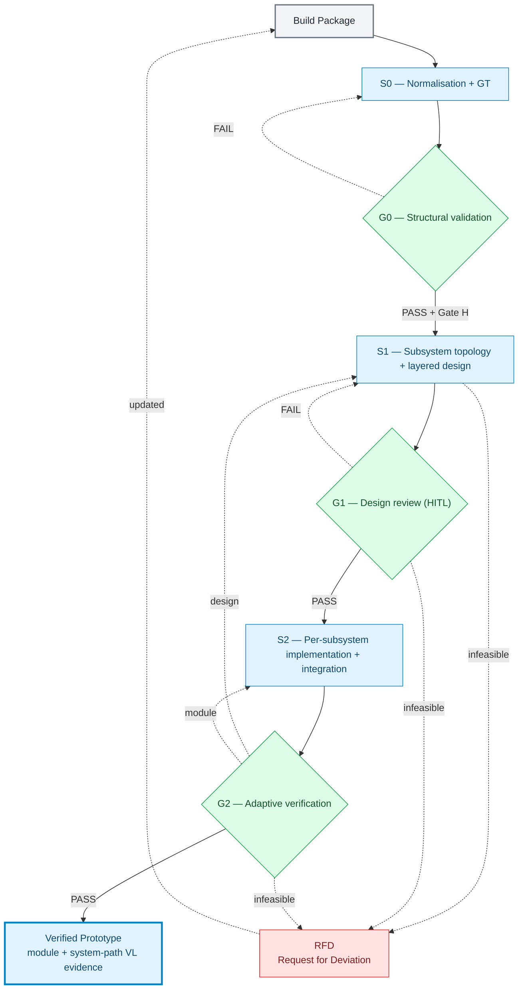

**Governing principles.**
**P1.** HITL is an authorisation barrier; HIL is a validation barrier.
**P2.** Oracle ≠ generator — the model never approves its own work [7].
**P3.** G0 is the only deterministic gate: its mechanical rejection beats any approval [8]. Every other gate verdict is human (HITL).
**P4.** *Verified* ≠ *validated* — claims name the environment [9].

---

## 3 S0 — Normalisation and Ground Truth

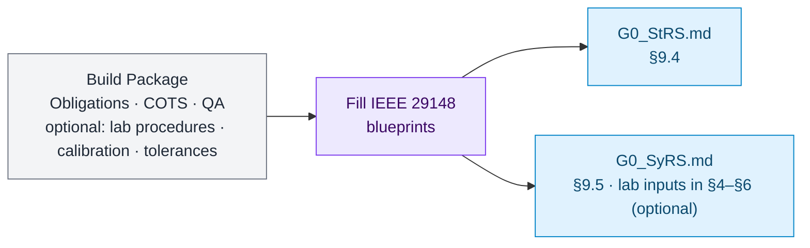

S0 **normalises only** — it casts the Build Package content into the IEEE 29148 [12] document blueprints and makes no conceptual judgement about sufficiency or scope. The produced documents carry only the filled specification, not the blueprint's author-guidance sections or empty placeholder rows, so a template example block is never read as a requirement. Following SDAD Phase 1 (spec crystallisation) [6], it populates the blueprints:

- **G0_StRS.md** — Stakeholder Requirements Specification (§9.4): `NRM-*`, `HWC-*`, `STK-*` blocks.
- **G0_SyRS.md** — System Requirements Specification (§9.5): `SYS-*` blocks tracing to StRS.

Laboratory procedures, calibration, and tolerances are optional Build Package content. When present, S0 casts them into the SyRS sections that already exist for them: procedures into §6 Field Measurement Protocols (`PROTO-*`: setup, calibration, execution), calibration terms into §4 Correction Chains, and tolerances into §5 Uncertainty Budgets. The three headings stay required by G0; with no lab inputs, each holds exactly `Not applicable: no lab inputs in the Build Package.`

Any iteration happens afterwards at G0, which validates the Build Package content against the deterministic gate (the blueprint) — not by a review judgement here.

---

## 4 G0 — Structural Validation

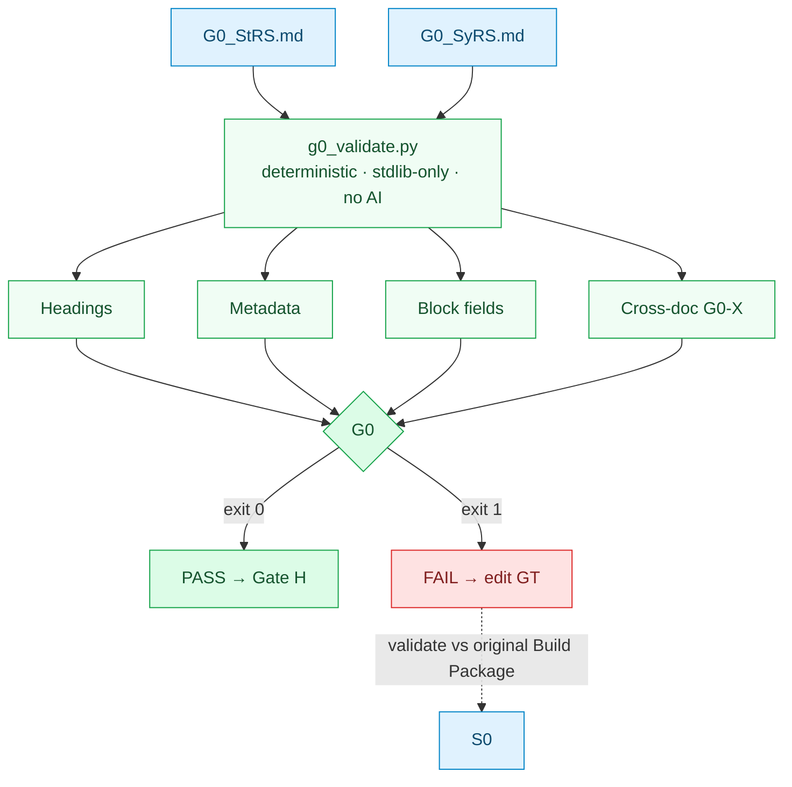

Deterministic. No AI. Binary verdict. After G0 passes, human Gate H asks: *Requirements complete, bounded, and verifiable?*

---

## 5 S1 — System of Layered Subsystems

S1 first divides the product into independently deployed subsystems when the requirements call for them. One subsystem remains a valid special case. A **subsystem** owns a runtime, deployment target, base layer, modules, and externally visible ports. Its modules communicate through its own base-layer interfaces; a cross-subsystem exchange goes through a declared, versioned subsystem contract. Splitting a UI from an edge process is justified when they deploy or restart independently, communicate over a network, or have distinct failure domains.

### 5.1 System topology and requirement allocation

The arrows below are **runtime messages**, not implementation dependencies.

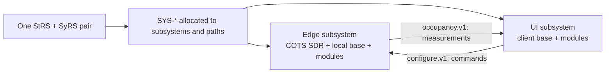

The system view records each subsystem's responsibility, deployment target, COTS resources, network link, and lifecycle. A requirement may map to one subsystem or to an **end-to-end path** spanning several subsystems. One system-level trace table owns this allocation; subsystem designs do not duplicate the Ground Truth. Cross-subsystem contracts specify producer and consumer, schema and version, units, timestamps, ordering, rate, latency, authentication, retries, duplicate handling, and behavior on disconnect or restart where applicable.

### 5.2 Layered architecture within each subsystem

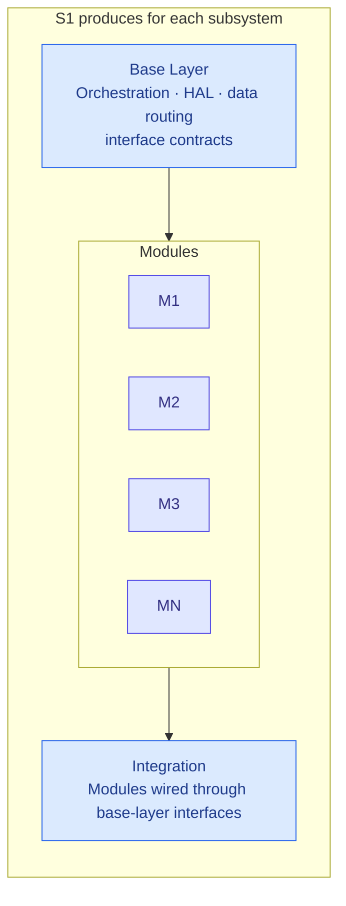

Modules are plug-in units communicating only through their subsystem's base layer and declared interfaces. No direct module-to-module calls, and no cross-subsystem calls that bypass a subsystem contract. A subsystem without physical hardware can have an empty HAL; its base still owns orchestration and routing.

### 5.3 Component dependency graph (edge SDR FM example)

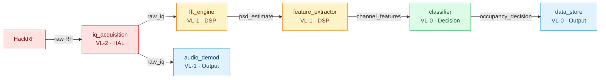

Each edge carries an **interface contract** (data type, schema version, units, latency). Each subsystem's implementation dependency graph must be acyclic. Each node carries a **verification profile**: `module_id`, `subsystem_id`, `layer`, `depends_on`, `provides`, `hw_dependency`, `required_vl`. `hw_dependency` means correctness requires a specific physical device or behavior, rather than merely that the code runs on a computer.

The **implementation dependency graph** orders contract definition, subsystem bases, modules, and system integration. It must be acyclic so S2 can build with stubs. The separate **runtime interaction graph** describes live messages. It may contain intentional loops, such as edge telemetry → UI → edge control, provided the contracts define ownership of state, acknowledgement, timeouts, and safe behavior. Runtime message loops do not create implementation dependency cycles.

| Module | Layer | HW dep. | Required VL |
|---|---|---|---|
| `iq_acquisition` | HAL | **yes** | VL-2 (HIL) |
| `fft_engine` | DSP | no | VL-1 (SIL) |
| `feature_extractor` | DSP | no | VL-1 (SIL) |
| `classifier` | Decision | no | VL-0 (unit) |
| `audio_demod` | Output | no | VL-1 (SIL) |
| `data_store` | Output | no | VL-0 (unit) |

### 5.4 Optional supplied ML model

**Status: uncertain.** This version defines the ML model only as an optional S1 input and a G1 readiness check. Its connection to S2 and G2 (training data generation, inference adapter, measurement at G2) is not implemented and is future work, together with MLOps (FW-005).

An S1 design includes this box **only when it chooses an ML-based module or the Ground Truth explicitly requires one**. Otherwise the box and its G1 check are absent. The supplied model is a controlled input to a subsystem module, not a subsystem by itself. It is trained with Mock HAL data plus labelling or, failing that, with Real HW HAL data plus labelling. S1 does not train or select a model on behalf of the Build Package author.

When used, S1 identifies the model file and weights by version and digest; names its supplying owner and provenance; records the training data source and labelling procedure; specifies the inference runtime, input and output schema, units, preprocessing, labels or thresholds, and postprocessing; and records the supplied performance metadata with its evaluation dataset and conditions. It budgets inference latency, memory, and any device dependency on the declared COTS target. A deterministic fake model response supports VL-0 integration, while later levels exercise the actual supplied model.

Supplied performance metadata is prior evidence, not a G2 verdict. If S1 chooses ML but the model package or the fields needed to implement it are missing, G1 returns **FAIL** for completion of the input or design. Demonstrated infeasibility against the declared COTS requirements follows the RFD route. Automating this model lifecycle with MLOps is future work (FW-005).

### 5.5 HAL substitution ladder and telemetry companion

S1 declares the **HAL mode** in the design Meta: `HAL mode: mock-only` or `HAL mode: mock+real`. Every later stage reads it from the design. The HAL implementations share the same base-layer interface contract but differ in what produces `raw_iq`:

- **Mock HAL** (mandatory in every mode). A software-only signal generator. At VL-0 it emits deterministic vectors (short, repeatable, edge-case coverage). At VL-1 it produces synthetic I/Q files at known SNR, modulation, and channel conditions using an FM-modulated software synthesiser or recorded golden captures. Each golden vector is versioned with a SHA-256 digest, generation parameters, the condition it simulates, and its expected output. The Mock HAL is the default data source for all sandwich-integration and SIL tests.

- **Real HW HAL** (only in `mock+real`). The production HAL that interfaces with the declared COTS SDR. It serves two purposes: (a) executing the laboratory procedures recorded in the SyRS (§6 `PROTO-*`) to generate **real datasets** with the development team's calibration quality (screening grade, not normative, SyRS §4 Correction Chains) and declared tolerances in dBi (SyRS §5 Uncertainty Budgets); and (b) running the final field tests at VL-2. The calibration grade and tolerances are inputs recorded in the SyRS, not claims of V-SIL. The Real HW HAL may be declared at VL-0 (fake device API) for a cycle, so the software for the real hardware is built without validating metrics on it; G2.2 then does not fire and the honesty declaration states it.

In `mock-only`, the design has no Real HW HAL, no lab procedures, calibration, or tolerances, and no module with `hw_dependency: true`; it ignores SyRS §4–§6, and every claim is capped at VL-1 (§8.2). In `mock+real`, both HALs plug into the same base-layer port; swapping one for the other is the **HAL substitution** that moves between verification levels [11].

S1 also specifies a **telemetry companion**, mandatory in every design and every test run: a lightweight, non-intrusive process that runs alongside every test execution and records compute-unit state — CPU utilisation, available memory, temperature, dropped buffers, and scheduling latency. It must not interfere with the system under test; its own resource footprint is declared and bounded. The companion attaches its readings to every evidence record so that G2 can determine whether the compute unit was within its operating envelope during a test. The telemetry companion is verification infrastructure, not a system module: it belongs to the methodology, not to the software. It has no `SYS-*`, does not appear in the implementation DAG, is absent from the Verified Prototype's module evidence, and is never shipped in the delivered software.

The Mock HAL, the golden vectors with their manifest, the telemetry companion, the stubs, the fake peers, and the drivers form the **verification kit**. S2 builds the kit in its initial layer, before any module, together with the Real HW HAL and its fake device API in `mock+real` (§7).

S1's design Meta also declares one **`Toolchain`** entry per subsystem: `SUB-xxx: <package> · <language> · <package manager> · <test runner>`, for example `SUB-001: fm_edge · Python 3.12 · uv · pytest; SUB-002: dashboard · TypeScript · pnpm · vitest`. `<package>` is a valid identifier and names `src/<package>/`. This version allows Python with uv and pytest, and TypeScript with pnpm and vitest. S2 builds with the declared toolchain and never chooses another; an empty or incomplete `Toolchain` is a design defect.

---

## 6 G1 — Subsystem, Dependency, and Contract Validation

G1 answers: *Are all implementation-critical design choices resolved?*

G1 is a human (HITL) design review, not a deterministic gate. An agent may prepare the review and recommend a verdict, including an RFD; the human decides.

G1 runs no script. The agent that prepares it validates by itself: it reads the whole design and the GT, re-derives every check from the source sections instead of trusting the design's own summaries, and runs the declared toolchain on the development machine. A thorough review is worth its token cost. The agent's findings inform the human; they never become an automatic verdict.

1. **Subsystem topology.** Every subsystem has one responsibility, deployment target, owner of state, and declared external ports; the network and COTS envelope support the topology.
2. **Implementation DAG acyclicity.** No dependency cycle within or between subsystem build units. Runtime message loops are reviewed separately for bounded behavior.
3. **Interface completeness.** Every internal edge has a typed contract; every cross-subsystem exchange has a versioned contract and failure behavior.
4. **Coverage.** Every `SYS-*` traces to module(s) or an end-to-end subsystem path, with an owner and measurable acceptance evidence.
5. **Stub feasibility.** Every internal and cross-subsystem contract is complete enough to write a deterministic stub or fake peer.
6. **Verification-profile consistency.** `hw_dependency: true` → `required_vl: VL-2`; system paths have a declared verification level and environment.
7. **HAL substitution ladder.** Mock HAL exposes the base-layer interface; golden vectors carry digest, parameters and expected outputs. In `mock+real`, the Real HW HAL exposes the same interface and references the SyRS `PROTO-*`, correction chains and tolerances.
8. **Telemetry companion.** The companion spec declares what it monitors, its sampling interval, its resource budget, and that its footprint is bounded below a declared threshold.
9. **Supplied ML model, when used.** The weights, metadata, training data source, and labelling procedure are identified, the inference contract is implementable, and the COTS budget is credible. This check is omitted when the design has no ML model.

10. **Toolchain availability.** On the development machine, the language runtime and package manager of every `Toolchain` entry answer their version command. The agent installs a missing tool only after a brief yes from the user; a refused or failed install is an open finding.

**PASS** → S2. **FAIL** → S1. **RFD** → §9.2, when the requirements are infeasible on the declared COTS platform.

The [S1/G1 design template](S1_G1_template.md) expands these check families into thirteen general review items and one conditional ML item, including design decisions, COTS coherence, HAL ladder, telemetry companion, toolchain availability, and risk assessment.

---

## 7 S2 — Per-Subsystem Implementation and System Integration

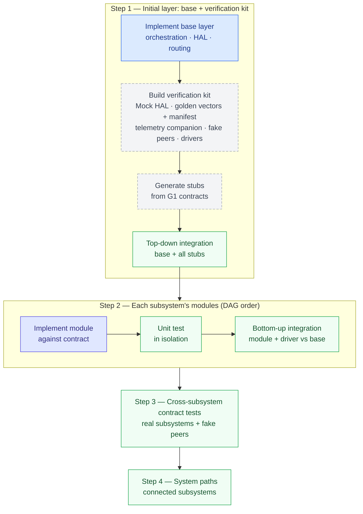

Top-down (base → stubs) + bottom-up (module → driver → base) = **sandwich integration testing** [1][2][13].

Step 1 is the **initial layer**: before any module, S2 builds each subsystem base and makes every tool ready — the verification kit of §5.5 and, in `mock+real`, the Real HW HAL with its fake device API. S2 writes every test, including the VL-1 tests for modules and paths with `required_vl` VL-1 or higher, without claiming them; G2 only runs them (§8.3).

Each subsystem lives in `src/<subsystem>/` and is built with its declared toolchain; the verification kit, tests included, lives in `verification/` and is never shipped; one command runs each verification level (`verification/run.sh vl0`, `verification/run.sh vl1`); and the delivered code has no dependency on CodeAnvil.

Define cross-subsystem contracts first so each subsystem can be built independently against a deterministic fake peer. Connect real subsystems after their local VL-0 floor passes. For each `SYS-*` allocated across subsystems, execute a deterministic system-path test across the real subsystem processes with simulated external inputs. This checks serialization, routing, state handoff, and recovery at the declared boundary; VL-1 and VL-2 add stronger environments and measurements.

*Future work (FW-005, §5.4).* If a subsystem uses a supplied ML model, S2 implements its inference adapter and tests the declared preprocessing, output mapping, and failure behavior. The fake response exercises the surrounding module contract at VL-0; tests claiming model behavior use the identified weights.

### Data sources by verification level

The HAL substitution ladder determines what feeds the pipeline at each level. The **telemetry companion** runs during every test at every level. VL-2 needs `HAL mode: mock+real`.

| Level | Data source | HAL used | Telemetry companion |
|---|---|---|---|
| **VL-0** | Deterministic golden vectors (short, repeatable, edge-case) | Mock HAL | Records UC state; attached to evidence |
| **VL-1** | Synthetic I/Q at known SNR, modulation, channel conditions | Mock HAL | Records UC state; attached to evidence |
| **VL-2** | Real RF via COTS SDR; datasets generated following the SyRS lab procedures (`PROTO-*`) with declared calibration and tolerances; only in `mock+real` | Real HW HAL | Records UC state; attached to evidence |

### Golden vector governance

Each golden vector or synthetic capture used by the Mock HAL is a controlled artefact: it carries a unique identifier, SHA-256 digest, generation parameters, the condition it simulates (nominal, edge-case, degraded), and the expected output at the consuming module's contract. Changing a vector invalidates every evidence record that used it. The golden-vector set is versioned alongside the source code.

### Mandatory floor (VL-0) — cannot be skipped

| Component | Always required |
|---|---|
| **Base layer** | Unit test + top-down integration with stubs |
| **Each module** | Unit test + bottom-up integration with driver |
| **Each cross-subsystem contract** | Producer and consumer contract tests using a fake peer, including version and failure cases |
| **Each cross-subsystem SYS-* path** | Deterministic test across the connected subsystem processes with simulated external inputs |
| **Telemetry companion** | Running and recording during all tests above; UC state attached to every evidence record |

---

## 8 G2 — Adaptive Verification Gate

### 8.1 Verification levels

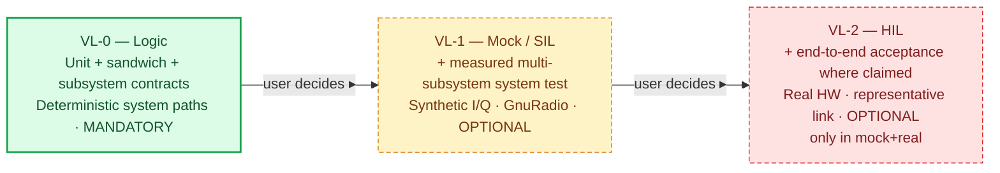

Each level includes all tests from the levels below. The HAL substitution ladder (§5.5) determines what feeds the pipeline: Mock HAL at VL-0 and VL-1, Real HW HAL at VL-2 (only in `mock+real`). The telemetry companion runs at every level.

### 8.2 Adaptive rule

The user chooses the verification level per module and per system path, per cycle. Four constraints:

1. **Floor.** Every module and every declared cross-subsystem contract and system path reaches VL-0 in every cycle.
2. **Honesty.** No module or end-to-end claim is higher than the environment actually tested. Passing subsystems individually does not prove a cross-subsystem requirement.
3. **Telemetry context.** Every evidence record includes the telemetry companion's readings for the compute unit during that test. Evidence produced while the UC was outside its declared operating envelope (temperature, CPU saturation, dropped buffers) is flagged and may be invalidated by the reviewer.
4. **HAL mode ceiling.** `mock-only` caps every claim at VL-1. `mock+real` allows VL-2, but each module and path still declares its level per cycle: the Real HW HAL may be declared at VL-0 (fake device API) for a cycle, in which case G2.2 does not fire and the honesty declaration states it. PIL (Processor-in-the-Loop) uses the actual target processor with Mock HAL inputs; every PIL claim stays VERIFIED, not VALIDATED.

| Scenario | User declares | G2 checks |
|---|---|---|
| Fast iteration | VL-0 all | Unit + sandwich for every module; contract and deterministic path tests for connected subsystems |
| DSP validation | VL-1 for DSP; VL-0 rest | Mock/SIL for DSP; VL-0 floor for every subsystem path |
| Pre-release (`mock+real`) | VL-1 for the edge → UI display path; VL-2 for `iq_acquisition` | Measured multi-subsystem path plus HIL acquisition |
| Full release | All modules and system paths at `required_vl` | Every claim at its S1-declared level |

### 8.3 Sub-gates

G2 runs the tests S2 wrote and writes none; a declared level with no test is a module defect routed to S2. The runs happen in a separate read-only verifier context — a subagent where the runtime supports it, otherwise a fresh session — which implements P2: the oracle is not the generator.

**Hardware enrollment.** Before G2.2 can fire, the target must be enrolled in `.codeanvil/project.yaml` via `codeanvil credential-setup -u <admin-user> -i <host> --port 22`. G2.0 and G2.1 may proceed locally while enrollment is pending; G2.2 blocks until a valid `targets:` entry exists.

| Sub-gate | Fires when | Checks |
|---|---|---|
| **G2.0** | Always | Unit + sandwich, cross-subsystem contract, and deterministic system-path tests pass; Mock HAL golden vectors; telemetry companion confirms UC nominal |
| **G2.1** | VL-1+ declared for a module or path | Mock HAL synthetic I/Q; Mock/SIL system tests across affected subsystems pass; metrics within thresholds; telemetry companion confirms UC nominal |
| **G2.2** | VL-2 declared for a module or path | Real HW HAL on COTS SDR (only in `mock+real`); enrollment required (see above); datasets from the SyRS lab procedures (`PROTO-*`) with declared calibration and tolerances; for cross-subsystem paths, a representative link; measurements within criteria; telemetry companion confirms UC nominal |

**Operational vs defect.** Before routing a G2 failure, classify it. A permission, driver, group, udev, or USB-access problem on the target DUT is **operational** — it must be fixed on the DUT and G2 re-run; it is never a module or design defect and must not route to S2 or S1. A transient SSH, clock, or setup fault is operational in the same way. Only a genuine behavioral failure of the delivered code under correct operating conditions is a **module defect** (→ S2) or **design defect** (→ S1). The four first-class G2 outcomes are: **operational-fix**, **module defect**, **design defect**, and **RFD**.

*Future work (FW-005, §5.4).* For an ML-based module or path, G2 measures the supplied model *inside the implemented system* at the declared level and checks the relevant `SYS-*` criteria. The performance metadata received at S1 is context for test design, not a substitute for those measurements.

---

## 9 Feedback Routing

V-SIL produces two types of feedback. They are structurally different and must not be conflated.

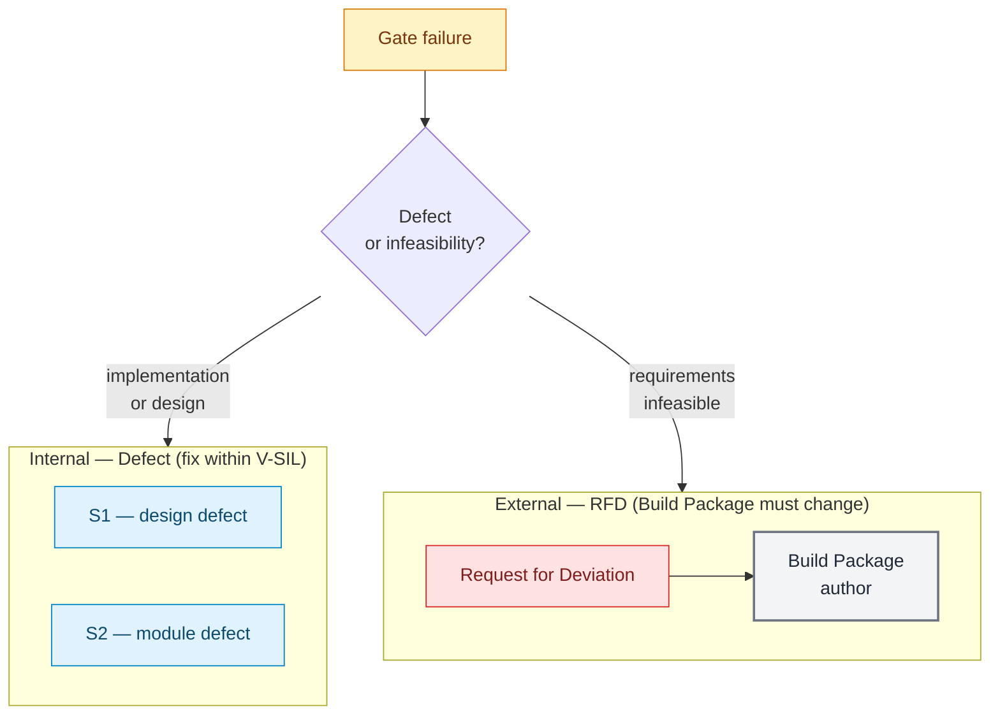

### 9.1 Internal defect routing

A **defect** means V-SIL can fix it internally. The implementation or the design is wrong, but the requirements are achievable. An **operational problem** is not a defect: it is a DUT/environment issue that blocks measurement; fix it and re-run G2 without touching S1 or S2.

| Class | Routes to | Example |
|---|---|---|
| Operational problem | Fix DUT → re-run G2 | `codeanvil-agent` cannot open the HackRF; SSH auth failure; missing udev rule |
| Design defect | S1 | DAG has undeclared dependency; cross-subsystem contract or state ownership is incomplete |
| Module or integration defect | S2 | FFT output is wrong; UI deserializes a valid edge message incorrectly |

**Self-diagnosis:** if a module that was *not* changed fails during re-testing → undeclared dependency → design defect → S1.

### 9.2 Request for Deviation (RFD)

An **RFD** means the Build Package requirements are **infeasible on the declared COTS platform**. V-SIL cannot fix it internally — the constraints themselves must change. V-SIL **suspends** until the Build Package is updated and re-enters at S0.

An RFD can be emitted from **S1, G1, or any G2 sub-gate**. S0 and G0 do not emit one: S0 makes no judgement about feasibility and G0 checks structure only. Infeasibility discovered while implementing in S2 is reported through G2.

| Discovered at | Example |
|---|---|
| S1 | Pipeline latency exceeds requirement under any partitioning on this HW |
| G1 | Design review concludes that a latency budget cannot be met on this HW, by the reviewed design or by any other partitioning |
| G2.0 | Unit tests reveal that two normative requirements conflict mathematically |
| G2.1 | SIL metrics show P_d and P_fa cannot simultaneously meet thresholds |
| G2.2 | HIL shows real hardware noise floor exceeds assumed budget |

At S1 and G1 nothing has been measured yet, so the evidence is analysis and names no verification level (P4).

### 9.3 RFD contents

Per ECSS [16], MIL-HDBK-61A [17], and NASA NPR 7150.2 [18]:

```
Request for Deviation — RFD-001

  Conflicting requirements:
    STK-007: Latency ≤ 100 ms    (source: ITU-R SM.1880)
    STK-012: P_d ≥ 0.95 @ 10 dB  (source: national regulator)

  Evidence (from G2.1, VL-1):
    FFT 4096 → P_d 0.96, latency 142 ms  — STK-012 met, STK-007 violated
    FFT 2048 → P_d 0.91, latency 71 ms   — STK-007 met, STK-012 violated

  Trade-off options:
    A) Relax latency to ≤ 150 ms         → both met
    B) Relax P_d to ≥ 0.92               → both met
    C) Dual-mode: fast (2048) + deep (4096) → both met, adds complexity

  Impact analysis:
    Option A: requires normative waiver from ITU-R SM.1880 §4.3
    Option B: screening-grade only, not compliance-grade
    Option C: new module, new interface contract, S1 rework

  Recommendation: C
```

### 9.4 Distinction summary

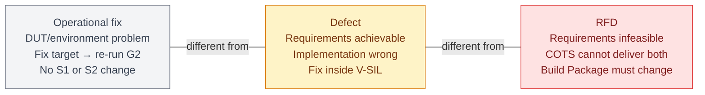

### 9.5 Failure triage and draft mode (S0 · G0 · G1)

The requirements stages are exploratory: the Ground Truth is corrected many times before it is
sound. V-SIL v3 softens the *loop*, not the *checks*, through two devices scoped to S0, G0 and
G1 — never to S2 or G2.

**Failure triage.** A machine or gate failure is translated before it reaches the human. For
every G0 ERROR, every missing-list placeholder and every G1 `open` finding, the agent states the
real problem in plain language — describing each requirement by what it asks, with its block ID only
in parentheses, so the reader never opens a document to know what an item is — and offers two to four
concrete reconciliation options (connect an unlinked item, create its missing origin, remove or
relax it, or — when the gap is a documentary fact and the runtime has web access — look it up on
the web and propose the found value with its source for the human to confirm), each with its
consequence. The human chooses; the agent applies. The agent is
the interpreter, never the oracle: the verdict stays the validator's exit code (G0) or the human's
answer (Gate H, G1), so P2 and P3 are untouched.

**Draft mode.** When a requirements stage finds unresolved items — a missing-list entry, a format
error, or a G1 open finding — it **enters draft automatically** and cannot advance until **each one is
resolved**. Mechanical fixes that invent nothing — removing blueprint scaffolding, filling a value
already stated elsewhere, dropping a broken reference — are **auto-applied and reported**, not asked;
only the judgment calls go to the human, who **fixes** them, knowingly **ignores/accepts** them
(recorded with the decider's name), or **escalates** to an RFD. While in draft the stage runs against the current files, applies
triage and loops without writing a report iteration or enforcing staleness; the human may edit the
GT pair directly. On commit — reached only once every item is decided — the marker is removed and one
recorded run is written, listing each item and its decision. A format error can be fixed or escalated
but never ignored into a pass, since the deterministic validator keeps rejecting it. The audit trail
records the run that passes and the decisions behind it, not the red path to it.

---

## 10 Terminal Output

The Verified Prototype lists the delivered tree (`src/<subsystem>/`) apart from the verification kit (`verification/`), and names the verifier context in which G2 ran the tests.

```
Verified Prototype — V-SIL v3
  Cycle: pre_release_01
  HAL mode: mock+real

  Delivered software (shipped):
    src/fm_edge/, src/dashboard/ — no CodeAnvil dependency
  Verification kit (not shipped):
    verification/ — Mock HAL, golden vectors + manifest, telemetry
                    companion, stubs, fake peers, drivers, tests
  Verifier context: read-only verifier subagent (fresh context)

  Module evidence:
    iq_acquisition:    VL-2 (HIL)  — Real HW HAL, HackRF One, FM 88–108 MHz
    fft_engine:        VL-1 (SIL)  — Mock HAL, golden I/Q (vectors v1.2, SHA bc3f…)
    feature_extractor: VL-1 (SIL)  — Mock HAL, synthetic PSD at known SNR
    classifier:        VL-0 (logic)— Mock HAL, deterministic vectors
    audio_demod:       VL-1 (SIL)  — Mock HAL, synthetic FM-modulated I/Q
    data_store:        VL-0 (logic)— Mock HAL, deterministic vectors
    dashboard:         VL-1 (SIL)  — edge messages on simulated link
    controls:          VL-0 (logic)— command and acknowledgement vectors
    alerts:            VL-0 (logic)— unit + sandwich integration
    history:           VL-0 (logic)— unit + sandwich integration

  Subsystem and system-path evidence:
    edge -> UI occupancy.v1: VL-1 — schema + latency on simulated link
    UI -> edge configure.v1: VL-0 — commands, retries, duplicate handling
    PATH-001 / SYS-002 occupancy display: VL-1 — edge + UI, Mock HAL synthetic RF

  Telemetry companion report:
    All tests: UC within operating envelope
    CPU peak: 63%  |  Temp peak: 68 °C  |  Dropped buffers: 0
    No evidence invalidated by UC conditions.

  Honesty declaration:
    VL-1 modules: VERIFIED against synthetic data (Mock HAL).
    VL-2 modules: VALIDATED on real hardware (Real HW HAL);
                  calibration: screening grade per SyRS §4;
                  tolerances: ±2.1 dBi declared by development team (SyRS §5).
    VL-0 modules: VERIFIED at logic level only.
    SYS-002: VERIFIED across connected subsystems with synthetic input;
             no real-link or HIL latency claim.
    Telemetry companion: UC nominal during all test executions.

  RFDs issued: 0
```

### 10.1 Optional future work register

After G2, the prototype may include proposals for later **software versions**. Each entry records an ID, the proposed capability or improvement, its origin and evidence, a candidate version, a decision owner, dependencies, and a proposed acceptance criterion. An empty register can be omitted. The Build Package author decides whether a proposal enters a later version; an accepted proposal becomes new input at S0 and G0. Future CI/CD automation is a possible infrastructure entry for a later version; building that pipeline is outside this version of V-SIL.

Only work explicitly outside the current cycle's approved scope belongs here. A failing current `SYS-*` remains a defect to correct or, if infeasible on the declared COTS platform, an RFD; the register cannot turn it into a passing claim.

```text
FW-001 — Automate V-SIL verification evidence in CI/CD
  Category: verification infrastructure
  Origin: repeated manual G2 execution in this cycle
  Candidate version: later software release
  Decision owner: Build Package author
  Dependency: stable test commands and report format
  Proposed acceptance: a pipeline reproduces the declared G2 checks
                       and links its reports to the cycle and source revision

FW-002 — Processor-in-the-Loop (PIL) as a full sub-gate
  Category: verification depth
  Status: partially implemented — G2 currently allows PIL as a declared
          mode (actual target processor, Mock HAL inputs, claim stays
          VERIFIED); a dedicated G2.PIL sub-gate with structured timing
          and scheduling checks is not yet defined
  Origin: SOTA review; when UC ≠ development host, compiled code on the
          target processor may behave differently under timing constraints
  Candidate version: later software release
  Decision owner: Build Package author
  Dependency: target UC identified and accessible for cross-compilation
  Proposed acceptance: G2.PIL sub-gate defined with explicit timing,
                       scheduling and resource checks on the target processor

FW-003 — Formal fault injection at VL-2
  Category: verification depth
  Origin: SOTA review (ISO 26262-5 §10; IEC 61508-3 Table A.5);
          current VL-2 tests nominal operation only
  Candidate version: later software release
  Decision owner: Build Package author
  Dependency: fault scenarios defined per module (USB disconnect,
              buffer overflow, SDR clock drift, UC power glitch)
  Proposed acceptance: declared fault scenarios executed at VL-2;
                       system response documented per scenario

FW-004 — SIL ↔ HIL correlation measurement
  Category: verification confidence
  Origin: SOTA review; VL-1 and VL-2 results are reported independently
          with no measured correlation between them
  Candidate version: later software release
  Decision owner: Build Package author
  Dependency: both VL-1 and VL-2 executed for the same modules
  Proposed acceptance: quantified deviation between Mock HAL and
                       Real HW HAL results for overlapping test cases

FW-005 — MLOps for the optional ML model
  Category: model lifecycle
  Origin: the optional ML model is trained and labelled outside any
          automated pipeline, and its S2 and G2 integration is not
          implemented yet (§5.4)
  Candidate version: later software release
  Decision owner: Build Package author
  Dependency: versioned Mock HAL or Real HW HAL datasets and a declared
              labelling procedure
  Proposed acceptance: a pipeline reproduces training from versioned data
                       and labels and links each model version to its
                       G2 evidence
```

---

## 11 References

[1] R. S. Pressman, B. R. Maxim, *Software Engineering*, 9th ed., 2020.
[2] ISO/IEC/IEEE 29119-1:2022, "Software testing — Part 1."
[3] Codeburst, "The Basics of Contract Tests," 2024.
[4] L. Bass, P. Clements, R. Kazman, *Software Architecture in Practice*, 4th ed., 2021.
[5] ISO 26262:2018, "Road vehicles — Functional safety."
[6] V. H. Nguyen, T. Nguyen, "SDAD," arXiv:2608.20341, May 2026.
[7] "LLM-as-a-Judge Is Not an Oracle," arXiv:2609.02246, Sep. 2026.
[8] V. Reddy et al., "Reason Less, Verify More," arXiv:2607.07405, Jul. 2026.
[9] Sheridan Tech, "Design Validation vs Verification," Mar. 2026.
[10] Augment Code, "Coordinator-Implementor-Verifier Pattern," Jun. 2026.
[11] OPAL-RT, "Guide to HIL Testing," Sep. 2026.
[12] IEEE/ISO/IEC 29148:2018, "Requirements engineering."
[13] V. Lavecchia, "Sandwich testing strategies," 2024.
[14] B. Trinnes, "Test Architecture Patterns," GitHub, Apr. 2026.
[15] "Spec-Driven Development," arXiv:2602.00180, Feb. 2026.
[16] ECSS-Q-ST-10-09C, "Nonconformance control system," European Cooperation for Space Standardization. — Defines Request for Deviation (RFD) as a "planned departure" from requirements.
[17] MIL-HDBK-61A, "Configuration Management Guidance," U.S. DoD, 2001. — Deviation processing: request when a product cannot meet technical requirements; includes impact analysis and trade-off options.
[18] NASA NPR 7150.2, "NASA Software Engineering Requirements." — Deviation/waiver evaluation: technical justification, risk assessment, impact to safety, and proposed alternatives.
