# V-SIL v4: Ciclo de Vida Agile-V Stage-Gate para Desarrollo de Prototipos Verificados con Restricciones COTS

**David Ramírez-Betancourt** — Universidad Nacional de Colombia, GCPDS  
**Versión:** 4.0  
**Fecha:** Noviembre 2026

---

## Resumen

V-SIL v4 es un ciclo de vida stage-gate que recibe un Paquete de Construcción finalizado y entrega un Prototipo Verificado con evidencia por módulo y de extremo a extremo — o una Solicitud de Desviación (RFD) formal cuando los requisitos son inviables en la plataforma COTS declarada. La cadena **S0→G0→S1→G1→S2→G2→S3→G3** normaliza requisitos, diseña el sistema, planifica cada módulo como una especificación autocontenida (PLAN.md), e implementa cada módulo en un contexto limpio. La profundidad de verificación es adaptativa por módulo con un piso obligatorio VL-0; una escalera de sustitución HAL (Mock HAL → Real HW HAL) y un compañero de telemetría soportan la progresión escalonada SIL/HIL. V-SIL adapta el marco de cumplimiento Agile-V [19a][19b] a iteración a nivel de módulo, usa trazabilidad delta OpenSpec [21] con alcance al límite del módulo, y alinea la terminología con IEEE/ISO/IEC 29119, ISO 26262 [5], SDAD [6], y el patrón CIV [10].

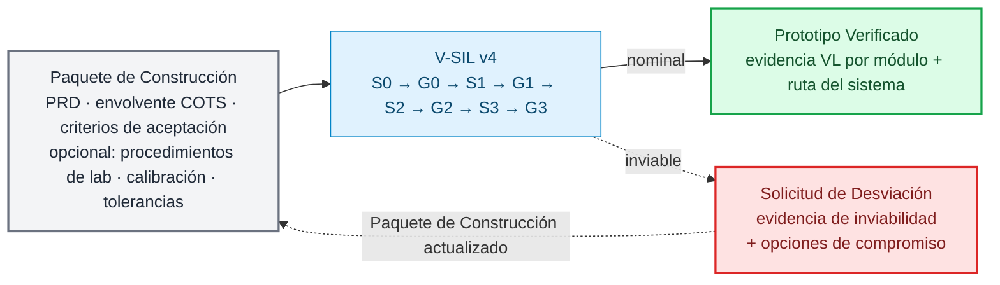

---

## 1 Alcance y Propósito

V-SIL v4 define el ciclo de vida completo desde un Paquete de Construcción finalizado hasta un Prototipo Verificado. El ciclo de vida se organiza como una cadena stage-gate de ocho nodos (cuatro etapas, cuatro compuertas) con una capa de planificación de módulos Agile-V entre el diseño del sistema y la implementación. La metodología es agnóstica al dominio: se aplica a cualquier sistema embebido o de software con restricciones COTS donde los requisitos deben trazarse a través de diseño, planificación, implementación y verificación.

### 1.1 Arquitectura central

El ciclo de vida resuelve cinco problemas:

1. **Normalización de requisitos.** S0 vierte el Paquete de Construcción en plantillas IEEE 29148; G0 valida la estructura mecánicamente.
2. **Descomposición del sistema con trazabilidad.** S1 diseña subsistemas, módulos y su grafo de dependencias; G1 valida completitud.
3. **Acotación de contexto.** S2 produce un PLAN.md autocontenido por módulo para que el implementador necesite solo el plan y los contratos que toca.
4. **Implementación en contexto limpio.** S3 construye cada módulo en un contexto aislado que lleva solo su especificación, forzando la separación.
5. **Verificación adaptativa.** G3 verifica cada módulo al nivel que el usuario declara, con un piso obligatorio VL-0, y clasifica las fallas en cinco clases de enrutamiento.

### 1.2 Principios rectores

**P1.** HITL es una barrera de autorización; HIL es una barrera de validación.  
**P2.** Oráculo ≠ generador — la entidad que verifica nunca aprueba su propio trabajo [7].  
**P3.** G0 es la única compuerta determinista: su rechazo mecánico supera cualquier aprobación [8]. G2 y G3 (incluyendo las sub-compuertas G3.0, G3.1 y G3.2) son preparadas por el agente, aprobadas por el humano. Cualquier otro veredicto de compuerta es humano (HITL).  
**P4.** *Verificado* ≠ *validado* — las afirmaciones nombran el entorno [9].  
**P5.** El módulo es la unidad de iteración — V-SIL adapta el marco de cumplimiento Agile-V [19a][19b] reemplazando la iteración a nivel de tarea con un mini-ciclo V a nivel de módulo cuyo backlog se ordena por ordenamiento topológico del grafo de dependencias de S1.  
**P6.** Las capas son ortogonales a la iteración — la arquitectura por capas es un invariante estructural; Agile-V determina solo el orden en que se construyen los módulos.  
**P7.** Contexto limpio por módulo — el implementador lleva solo PLAN.md y los contratos que toca.  
**P8.** GT vivo con trazabilidad delta — ADDED/MODIFIED/REMOVED/RENAMED por módulo; V-SIL limita el modelo a nivel de cambio de OpenSpec [21] al límite del módulo.

### 1.3 Cadena de compuertas dirigida por reportes

Cada etapa produce un reporte estructurado. Cada compuerta lee y valida el reporte de la etapa predecesora como su entrada principal. Una compuerta nunca re-deriva el trabajo de la etapa; verifica las afirmaciones del reporte contra la evidencia que el reporte referencia. Esto crea una cadena de responsabilidad: el reporte de S0 alimenta G0, el de S1 alimenta G1, el de S2 alimenta G2, el de S3 alimenta G3. Si el reporte de una etapa se vuelve obsoleto (las entradas de las que se derivó han cambiado desde que fue escrito), la compuerta lo rechaza y la etapa debe re-ejecutarse contra las entradas actuales.

### 1.4 Detección de obsolescencia

Un reporte está **obsoleto** cuando cualquiera de sus entradas declaradas ha cambiado desde que el reporte fue producido. Cada reporte registra la versión o resumen de cada entrada que consumió. Una compuerta verifica estos resúmenes antes de evaluar el contenido del reporte. Si alguna entrada ha sido actualizada (una revisión del GT, un cambio de diseño, una modificación de contrato), el reporte está obsoleto y la compuerta retorna FAIL con razón `stale-report`, requiriendo que la etapa se re-ejecute. Esto previene que un reporte de apariencia válida enmascare cambios que invalidan sus conclusiones.

---

## 2 Terminología

Los términos estándar de ingeniería de software (stub, driver, integración sándwich [2], arquitectura por capas [4], verificación de contrato de interfaz [3]) siguen IEEE 29119, Pressman [1] y Bass et al. Los términos específicos o adaptados de V-SIL se definen a continuación.

| Término | Definición | Fuente |
|---|---|---|
| Nivel de verificación (VL-0, VL-1, VL-2) | Profundidad de verificación: solo lógica (VL-0), SIL/mock (VL-1), HIL/hardware real (VL-2) | Adaptado de ISO 26262 [5] |
| Solicitud de Desviación (RFD) | Solicitud formal para cambiar requisitos del Paquete de Construcción cuando son inviables en la plataforma COTS declarada | ECSS [16]; MIL-HDBK-61A [17]; NASA NPR 7150.2 [18] |
| Rebanado topológico | Particionamiento de módulos en rebanadas ordenadas por ordenamiento topológico del grafo de dependencias | V-SIL v4; inspirado en Agile-V [19a][19b] |
| PLAN.md | Especificación autocontenida de módulo producida por S2, que lleva solo los contratos y requisitos trazados que el implementador necesita | V-SIL v4 |
| ADDED / MODIFIED / REMOVED / RENAMED | Anotaciones delta que registran cambios a requisitos en cada límite de módulo; V-SIL limita la convención a nivel de cambio de OpenSpec [21] al límite del módulo | OpenSpec [21], adaptado por V-SIL v4 |
| Processor-in-the-Loop (PIL) | Configuración de verificación usando el procesador objetivo real con entradas Mock HAL; toda afirmación PIL permanece VERIFICADA, no VALIDADA, porque la fuente de datos es sintética | Adaptado de ISO 26262 [5] |
| Kit de verificación | Infraestructura de verificación construida en la Rebanada 0: Mock HAL, vectores dorados con manifiesto, compañero de telemetría, stubs, pares falsos y drivers | V-SIL v4 |
| Contexto limpio | Contexto de implementación aislado que lleva solo el PLAN.md de un módulo y sus contratos, sin estado acumulado de módulos anteriores | V-SIL v4 |
| Contexto verificador | Contexto separado de solo lectura (subagente o sesión nueva) que ejecuta la verificación; implementa P2 (oráculo ≠ generador) | V-SIL v4 |

---

## 3 Resumen Stage-Gate

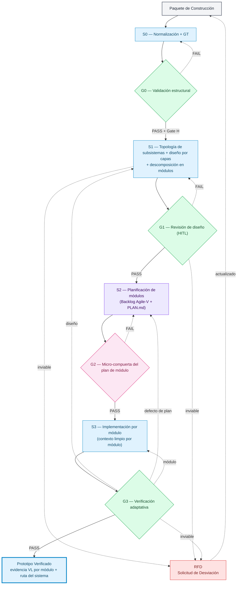

---

## 4 S0 — Normalización y Ground Truth

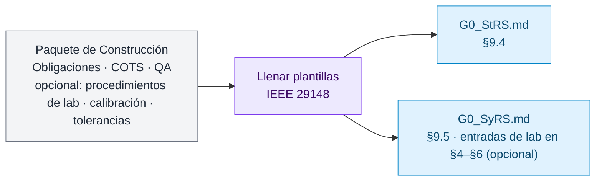

S0 **solo normaliza** — vierte el contenido del Paquete de Construcción en las plantillas de documentos IEEE 29148 [12] y no hace ningún juicio conceptual sobre suficiencia o alcance. Los documentos producidos llevan solo la especificación llenada, no las secciones de guía del autor de la plantilla ni filas de marcador vacías, por lo que un bloque de ejemplo de plantilla nunca se lee como un requisito. Siguiendo la Fase 1 de SDAD (cristalización de especificación) [6], pobla las plantillas:

- **G0_StRS.md** — Especificación de Requisitos de las Partes Interesadas (§9.4): bloques `NRM-*`, `HWC-*`, `STK-*`.
- **G0_SyRS.md** — Especificación de Requisitos del Sistema (§9.5): bloques `SYS-*` trazados al StRS.

Los procedimientos de laboratorio, calibración y tolerancias son contenido opcional del Paquete de Construcción. Cuando están presentes, S0 los vierte en las secciones del SyRS que ya existen para ellos: procedimientos en §6 Protocolos de Medición en Campo (`PROTO-*`: preparación, calibración, ejecución), términos de calibración en §4 Cadenas de Corrección, y tolerancias en §5 Presupuestos de Incertidumbre. Los tres encabezados permanecen requeridos por G0; sin entradas de laboratorio, cada uno contiene exactamente `No aplica: no hay entradas de laboratorio en el Paquete de Construcción.`

Cualquier iteración ocurre después en G0, que valida el contenido del Paquete de Construcción contra la compuerta determinista (la plantilla) — no mediante un juicio de revisión aquí.

---

## 5 G0 — Validación Estructural

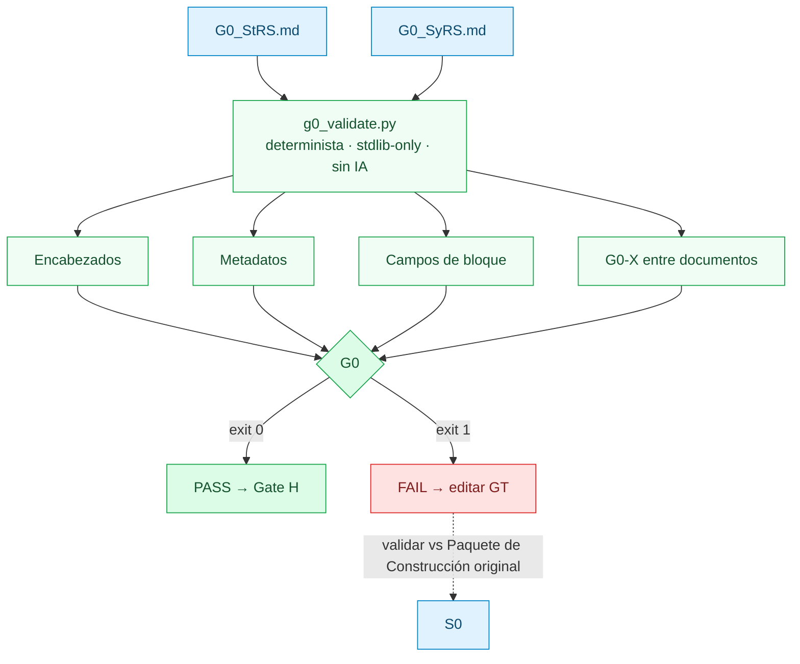

Determinista. Sin IA. Veredicto binario. Después de que G0 pasa, la Gate H humana pregunta: *¿Requisitos completos, acotados y verificables?*

---

## 6 S1 — Sistema de Subsistemas por Capas con Descomposición en Módulos

S1 primero divide el producto en subsistemas desplegados independientemente cuando los requisitos lo requieren. Un solo subsistema sigue siendo un caso especial válido. Un **subsistema** posee un runtime, objetivo de despliegue, capa base, módulos y puertos visibles externamente. Sus módulos se comunican a través de las interfaces de su propia capa base; un intercambio entre subsistemas pasa por un contrato de subsistema declarado y versionado. Dividir subsistemas se justifica cuando se despliegan o reinician independientemente, se comunican por red, o tienen dominios de falla distintos.

### 6.1 Topología del sistema y asignación de requisitos

Las flechas abajo son **mensajes en tiempo de ejecución**, no dependencias de implementación.

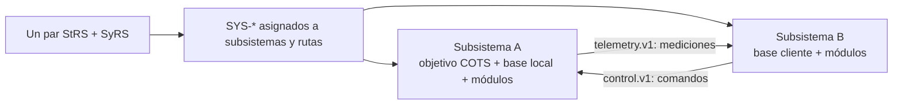

La vista del sistema registra la responsabilidad, objetivo de despliegue, recursos COTS, enlace de red y ciclo de vida de cada subsistema. Un requisito puede mapearse a un subsistema o a una **ruta de extremo a extremo** que abarca varios subsistemas. Una tabla de trazas a nivel de sistema posee esta asignación; los diseños de subsistema no duplican el Ground Truth. Los contratos entre subsistemas especifican productor y consumidor, esquema y versión, unidades, marcas de tiempo, ordenamiento, tasa, latencia, autenticación, reintentos, manejo de duplicados y comportamiento en desconexión o reinicio cuando aplique.

### 6.2 Arquitectura por capas dentro de cada subsistema

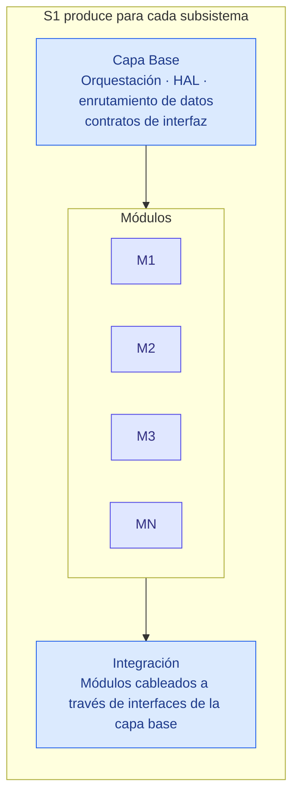

Los módulos son unidades enchufables que se comunican solo a través de la capa base de su subsistema y las interfaces declaradas. No hay llamadas directas módulo-a-módulo, ni llamadas entre subsistemas que eludan un contrato de subsistema. Un subsistema sin hardware físico puede tener un HAL vacío; su base aún posee la orquestación y el enrutamiento.

### 6.3 Identidad de módulo y grafo de dependencias

S1 asigna a cada módulo una identidad única y declara el grafo de dependencias de implementación que S2 usa para el rebanado topológico. El grafo abarca **todos los subsistemas** — cada módulo que será planificado, implementado y verificado debe aparecer aquí.

Cada módulo lleva un **bloque de identidad de módulo**:

| Campo | Descripción |
|---|---|
| `module_id` | Identificador único (ej. `signal_processor`) |
| `subsystem_id` | Subsistema padre |
| `layer` | Capa arquitectónica (HAL, Processing, Decision, Output, Presentation, Control, …) |
| `depends_on` | Lista de módulos cuyos contratos consume este módulo |
| `provides` | Lista de contratos de interfaz que este módulo produce |
| `hw_dependency` | `true` / `false` |
| `required_vl` | VL-0, VL-1, o VL-2 |
| `traced_reqs` | Lista de requisitos `SYS-*` asignados a este módulo |

Cada arista en el grafo de dependencias lleva un **contrato de interfaz** (tipo de dato, versión de esquema, unidades, latencia). El grafo de dependencias de implementación de cada subsistema debe ser acíclico. Cada nodo lleva un **perfil de verificación**: `module_id`, `subsystem_id`, `layer`, `depends_on`, `provides`, `hw_dependency`, `required_vl`.

El **grafo de dependencias de implementación** ordena la definición de contratos, bases de subsistema, módulos e integración del sistema. Debe ser acíclico para que S3 pueda construir con stubs. El **grafo de interacción en tiempo de ejecución** separado describe mensajes en vivo. Puede contener ciclos intencionales (ej. telemetría → display → control), siempre que los contratos definan la propiedad del estado, acuse de recibo, timeouts y comportamiento seguro. Los ciclos de mensajes en tiempo de ejecución no crean ciclos de dependencia de implementación.

#### Ejemplo genérico — extracto de un solo subsistema

| Módulo | Capa | Dep. HW | VL | Reqs. trazados | depends_on | provides |
|---|---|---|---|---|---|---|
| `hw_acquisition` | HAL | **sí** | VL-2 | SYS-001 | — | `raw_samples.v1` |
| `signal_processor` | Processing | no | VL-1 | SYS-002, SYS-003 | `hw_acquisition` | `processed_data.v1` |
| `feature_extractor` | Processing | no | VL-1 | SYS-004 | `signal_processor` | `features.v1` |
| `classifier` | Decision | no | VL-0 | SYS-005 | `feature_extractor` | `decision.v1` |

El grafo de dependencias es una cadena (HAL → Processing → Decision); S2 lo rebana en cuatro pasadas de construcción. Un ejemplo multi-subsistema agrega contratos entre subsistemas (`telemetry.v1`, `control.v1`) con productor/consumidor explícito, versión de esquema y comportamiento ante fallas.

### 6.4 Modelo ML suministrado opcional

Un modelo ML suministrado es una entrada controlada a un módulo de subsistema, no un subsistema por sí mismo. Este recuadro está presente **solo cuando S1 elige un módulo basado en ML o el GT requiere uno**; de lo contrario, él y su verificación G1 están ausentes.

Cuando se usa, S1 identifica el archivo del modelo y pesos por versión y resumen; nombra su propietario suministrador y procedencia; registra la fuente de datos de entrenamiento y procedimiento de etiquetado; especifica el contrato de inferencia (runtime, esquema I/O, unidades, preprocesamiento, posprocesamiento); y presupuesta latencia de inferencia, memoria y dependencia de dispositivo en el objetivo COTS declarado. Una respuesta falsa determinista soporta la integración VL-0; niveles posteriores ejercitan el modelo real. Los metadatos de rendimiento suministrados son evidencia previa, no un veredicto de G3. Paquete o campos del modelo faltantes → G1 **FAIL**; inviabilidad demostrada → RFD. La integración S3/G3 y automatización MLOps son trabajo futuro (FW-005).

### 6.5 Escalera de sustitución HAL y compañero de telemetría

S1 declara el **modo HAL** en los metadatos del diseño: `HAL mode: mock-only` o `HAL mode: mock+real`. Cada etapa posterior lo lee del diseño. Las implementaciones HAL comparten el mismo contrato de interfaz de la capa base pero difieren en qué produce los datos crudos:

- **Mock HAL** (obligatorio en cada modo). Un generador de señales puramente software. En VL-0 emite vectores deterministas (cortos, repetibles, cobertura de casos borde). En VL-1 produce archivos de datos sintéticos en condiciones conocidas usando un sintetizador software o capturas doradas grabadas. Cada vector dorado está versionado con un resumen SHA-256, parámetros de generación, la condición que simula y su salida esperada. El Mock HAL es la fuente de datos predeterminada para todas las pruebas de integración sándwich y SIL.

- **Real HW HAL** (solo en `mock+real`). El HAL de producción que interfaza con el dispositivo COTS declarado. Sirve dos propósitos: (a) ejecutar los procedimientos de laboratorio registrados en el SyRS (§6 `PROTO-*`) para generar **conjuntos de datos reales** con la calidad de calibración del equipo de desarrollo (grado de tamizado, no normativo, SyRS §4 Cadenas de Corrección) y tolerancias declaradas (SyRS §5 Presupuestos de Incertidumbre); y (b) ejecutar las pruebas de campo finales en VL-2. El grado de calibración y las tolerancias son entradas registradas en el SyRS, no afirmaciones de V-SIL. El Real HW HAL puede declararse en VL-0 (API de dispositivo falso) por un ciclo, para que el software del hardware real se construya sin validar métricas en él; G3.2 entonces no se dispara y la declaración de honestidad lo indica.

- **PIL** (Processor-in-the-Loop). Una configuración de verificación que usa el procesador objetivo real con entradas Mock HAL. PIL es relevante cuando la unidad de cómputo difiere del host de desarrollo y el código compilado puede comportarse diferente bajo restricciones de temporización. Toda afirmación PIL permanece VERIFICADA, no VALIDADA, porque la fuente de datos es sintética. Una sub-compuerta G3.PIL dedicada con verificaciones estructuradas de temporización y planificación es trabajo futuro (FW-002).

En `mock-only`, el diseño no tiene Real HW HAL, ni procedimientos de laboratorio, calibración o tolerancias, ni módulo con `hw_dependency: true`; ignora SyRS §4–§6, y toda afirmación está limitada a VL-1 (§11.2). En `mock+real`, ambos HAL se conectan al mismo puerto de la capa base; intercambiar uno por otro es la **sustitución HAL** que se mueve entre niveles de verificación. La progresión escalonada SIL→HIL sigue la práctica de la industria [5][11]; la adaptación específica de V-SIL con Mock HAL/vectores dorados/compañero de telemetría es su propia contribución.

S1 también especifica un **compañero de telemetría**, obligatorio en cada diseño y cada ejecución de prueba: un proceso ligero y no intrusivo que se ejecuta junto a cada ejecución de prueba y registra el estado de la unidad de cómputo — utilización de CPU, memoria disponible, temperatura, buffers descartados y latencia de planificación. No debe interferir con el sistema bajo prueba; su propia huella de recursos se declara y acota. El compañero adjunta sus lecturas a cada registro de evidencia para que G3 pueda determinar si la unidad de cómputo estaba dentro de su envolvente operativa durante una prueba. El compañero de telemetría es infraestructura de verificación, no un módulo del sistema: pertenece a la metodología, no al software. No tiene `SYS-*`, no aparece en el DAG de implementación, está ausente de la evidencia de módulo del Prototipo Verificado, y nunca se envía en el software entregado.

El Mock HAL, los vectores dorados con su manifiesto, el compañero de telemetría, los stubs, los pares falsos y los drivers forman el **kit de verificación**. S3 construye el kit en su capa inicial, antes de cualquier módulo, junto con el Real HW HAL y su API de dispositivo falso en `mock+real` (§10).

Los metadatos del diseño de S1 también declaran una entrada **`Toolchain`** por subsistema: `SUB-xxx: <package> · <language> · <package manager> · <test runner>`. `<package>` es un identificador válido y nombra `src/<package>/`. S3 construye con la cadena de herramientas declarada y nunca elige otra; una entrada `Toolchain` vacía o incompleta es un defecto de diseño.

---

## 7 G1 — Validación de Subsistema, Dependencias, Contratos y Descomposición en Módulos

G1 responde: *¿Están todas las decisiones de diseño críticas para la implementación resueltas, y es cada módulo identificable y planificable?*

G1 es una revisión de diseño humana (HITL), no una compuerta determinista. Un agente puede preparar la revisión y recomendar un veredicto, incluyendo un RFD; el humano decide.

G1 no ejecuta script. El agente que la prepara valida por sí mismo: lee todo el diseño y el GT, re-deriva cada verificación desde las secciones fuente en lugar de confiar en los propios resúmenes del diseño, y ejecuta la cadena de herramientas declarada en la máquina de desarrollo. Una revisión exhaustiva vale su costo en tokens. Los hallazgos del agente informan al humano; nunca se convierten en un veredicto automático.

1. **Topología de subsistemas.** Cada subsistema tiene una responsabilidad, objetivo de despliegue, propietario de estado y puertos externos declarados; la red y la envolvente COTS soportan la topología.
2. **Aciclicidad del DAG de implementación.** Sin ciclo de dependencia dentro de o entre unidades de construcción de subsistemas. Los ciclos de mensajes en tiempo de ejecución se revisan separadamente para comportamiento acotado.
3. **Completitud de interfaces.** Cada arista interna tiene un contrato tipado; cada intercambio entre subsistemas tiene un contrato versionado y comportamiento ante fallas.
4. **Cobertura.** Cada `SYS-*` traza a módulo(s) o una ruta de extremo a extremo entre subsistemas, con un propietario y evidencia de aceptación medible.
5. **Factibilidad de stubs.** Cada contrato interno y entre subsistemas es suficientemente completo para escribir un stub determinista o par falso.
6. **Consistencia del perfil de verificación.** `hw_dependency: true` → `required_vl: VL-2`; las rutas del sistema tienen un nivel de verificación y entorno declarados.
7. **Escalera de sustitución HAL.** Mock HAL expone la interfaz de la capa base; los vectores dorados llevan resumen, parámetros y salidas esperadas. En `mock+real`, el Real HW HAL expone la misma interfaz y referencia los `PROTO-*` del SyRS, cadenas de corrección y tolerancias.
8. **Compañero de telemetría.** La especificación del compañero declara qué monitorea, su intervalo de muestreo, su presupuesto de recursos y que su huella está acotada por debajo de un umbral declarado.
9. **Modelo ML suministrado, cuando se usa.** Los pesos, metadatos, fuente de datos de entrenamiento y procedimiento de etiquetado están identificados, el contrato de inferencia es implementable y el presupuesto COTS es creíble. Esta verificación se omite cuando el diseño no tiene modelo ML.
10. **Disponibilidad de la cadena de herramientas.** En la máquina de desarrollo, el runtime del lenguaje y el gestor de paquetes de cada entrada `Toolchain` responden a su comando de versión. El agente instala una herramienta faltante solo después de un breve sí del usuario; una instalación rechazada o fallida es un hallazgo abierto.
11. **Completitud de la descomposición en módulos.** Cada módulo en todos los subsistemas tiene un `module_id` único, un `subsystem_id`, un `layer`, una lista `depends_on`, una lista `provides`, un indicador `hw_dependency`, un `required_vl` y una lista `traced_reqs`. Cada `SYS-*` en el GT aparece en la `traced_reqs` de al menos un módulo. Ningún módulo tiene `traced_reqs` vacío.
12. **Factibilidad del rebanado topológico.** El grafo de dependencias de implementación admite un ordenamiento topológico. Las aristas `depends_on` de cada módulo apuntan solo a módulos o contratos de la capa base que estarán disponibles (construidos o con stub) antes de que el módulo sea programado.

**PASS** → S2. **FAIL** → S1. **RFD** → §12.2, cuando los requisitos son inviables en la plataforma COTS declarada.

La [plantilla de diseño S1/G1](S1_G1_template.md) expande estas familias de verificación en ítems de revisión incluyendo decisiones de diseño, coherencia COTS, escalera HAL, compañero de telemetría, disponibilidad de cadena de herramientas, descomposición en módulos y evaluación de riesgos.

---

## 8 S2 — Planificación de Módulos (Capa Agile-V)

S2 es el puente entre el diseño del sistema (S1) y la implementación por módulo (S3). Toma el diseño S1 aprobado y produce un **backlog de planes de módulo** ordenado por dependencia topológica, para que cada módulo pueda implementarse en un contexto limpio (P7) sin perder trazabilidad al Ground Truth (P8).

### 8.1 El modelo Agile-V

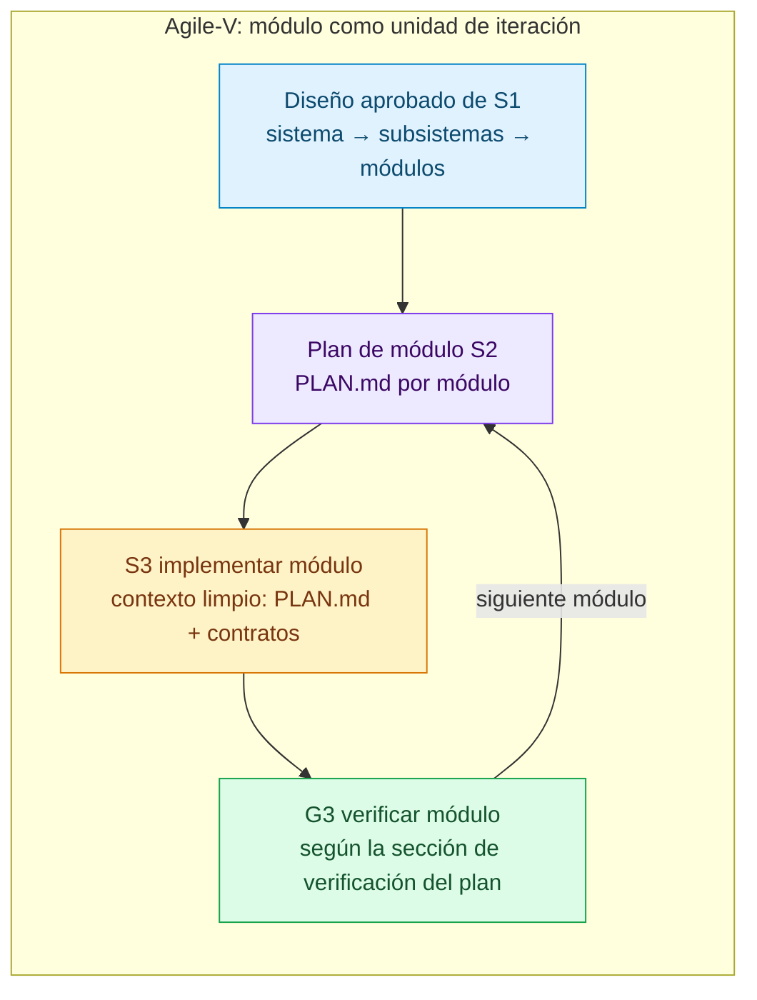

La unidad de iteración es el **módulo**, no una historia de usuario ni un sprint. Cada iteración es un **mini-ciclo V**: planificar (S2) → implementar (S3) → verificar (G3). El backlog es la secuencia de todos los módulos en todos los subsistemas, ordenada por ordenamiento topológico del grafo de dependencias de S1.

### 8.2 Rebanado topológico

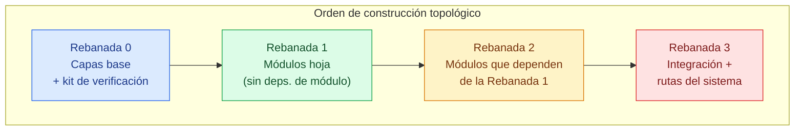

S2 realiza un ordenamiento topológico del grafo de dependencias de implementación de S1 y particiona los módulos en **rebanadas**. La Rebanada 0 siempre son las capas base y el kit de verificación. Dentro de una rebanada, módulos que no comparten dependencias pueden construirse en paralelo. Cada módulo en una rebanada se construye contra los **contratos reales** de módulos de rebanadas anteriores y los **contratos stub** de módulos en rebanadas posteriores (interfaz primero con Mock HAL, P6).

#### Ejemplo genérico — rebanado topológico

| Rebanada | Subsistema A (procesamiento) | Subsistema B (cliente) |
|---|---|---|
| 0 | Capa base + kit de verificación | Capa base + kit de verificación |
| 1 | `hw_acquisition`, `output_formatter` | `dashboard`, `controls` |
| 2 | `signal_processor` | `alerts`, `history` |
| 3 | `feature_extractor` | — |
| 4 | `classifier`, `data_store` | — |
| 5 | Pruebas de contrato entre subsistemas | Pruebas de contrato entre subsistemas |
| 6 | Integración de rutas del sistema | Integración de rutas del sistema |

### 8.3 Formato PLAN.md

S2 produce un `PLAN.md` por módulo. PLAN.md es el **punto de entrada de especificación** para el contexto limpio de S3 para ese módulo; §10.1 lista el conjunto completo de contexto que lo acompaña.

```markdown
# PLAN.md — <module_id>

## Meta
- module_id: <identificador único>
- subsystem_id: <subsistema padre>
- layer: <capa arquitectónica>
- slice: <número de rebanada topológica>
- depends_on: [<module_id>, ...]
- provides: [<contract_name>, ...]
- hw_dependency: true | false
- required_vl: VL-0 | VL-1 | VL-2
- hal_mode: mock-only | mock+real

## Requisitos Trazados
| ID Req | Texto | Delta | Fuente |
|--------|-------|-------|--------|
| SYS-002 | Resolución de procesamiento ≥ N bins | ADDED | GT v1.0 |
| SYS-003 | Latencia ≤ T ms | ADDED | GT v1.0 |

## Contratos de Interfaz
### Consume
- `raw_samples.v1` de `hw_acquisition` (esquema v1, unidades: <tipo>, tasa: continua)

### Produce
- `processed_data.v1` (esquema v1, unidades: <tipo>, latencia: ≤ T ms)

## Tareas Ordenadas
1. Implementar pipeline de procesamiento con parámetros configurables
2. Cablear al contrato consumidor de la capa base
3. Exponer contrato productor a través de la interfaz de la capa base
4. Pruebas unitarias: casos borde (buffer vacío, muestra única, longitud máxima)
5. Integración ascendente: módulo + driver vs base

## Plan de Verificación
| Nivel | Qué | Fuente de datos | Criterio de paso |
|-------|-----|-----------------|------------------|
| VL-0 | Unitaria + sándwich | Vectores deterministas Mock HAL | Todas pasan |
| VL-1 | SIL medida | Datos sintéticos Mock HAL | Latencia ≤ T ms, resolución ≥ N |

## Trazabilidad Delta
- Versión GT: 1.0
- Deltas introducidos por este módulo: ninguno
- Deltas de módulos anteriores que afectan a este módulo: ninguno

## Riesgos
- R1: La biblioteca puede no cumplir la latencia en el objetivo COTS → mitigación: benchmark en S3, escalar a RFD si se excede
```

#### 8.3.1 INFRA-PLAN.md para la Rebanada 0

La Rebanada 0 (capas base y kit de verificación) usa un formato de plan distinto, **INFRA-PLAN.md**, porque la Rebanada 0 no implementa un módulo — construye la fundación de la que dependen todos los módulos. INFRA-PLAN.md especifica: (a) orquestación, HAL y enrutamiento de la capa base para cada subsistema; (b) el kit de verificación completo (Mock HAL, vectores dorados con manifiesto, compañero de telemetría, stubs, pares falsos, drivers); (c) en `mock+real`, el Real HW HAL y su API de dispositivo falso; (d) pruebas de integración descendente (base + todos los stubs). El diagrama de flujo de implementación §10.2 Paso 0 carga INFRA-PLAN.md para la Rebanada 0 y PLAN.md para las Rebanadas 1+.

### 8.4 Trazabilidad delta (P8)

Cada PLAN.md registra la **versión del GT** del que se derivó y cualquier **delta** que el módulo introduce. Cuando la implementación de un módulo revela que un requisito debe modificarse (ej. un umbral relajado después de medición), el delta se registra como:

```
Delta: MODIFIED SYS-003
  Antes: Latencia ≤ T ms
  Después:  Latencia ≤ T' ms
  Razón: Piso de la biblioteca COTS medido en T'' ms
  Autoridad: RFD-002 aprobada por el autor del Paquete de Construcción
```

Los deltas siguen la convención de OpenSpec [21], limitada por V-SIL al límite del módulo: **ADDED** (nuevo requisito descubierto durante implementación), **MODIFIED** (requisito existente cambiado), **REMOVED** (requisito eliminado), **RENAMED** (identificador cambiado sin cambio semántico). Cada delta nombra su autoridad (RFD, revisión de diseño o decisión del autor del Paquete de Construcción). El GT a nivel de sistema se actualiza después de que cada módulo pasa G3, manteniéndolo como un **documento vivo** sin requerir una re-revisión monolítica.

### 8.5 Interacción con el diseño vivo de S1

S2 puede descubrir que el diseño de S1 necesita ajuste (ej. una interfaz faltante, una dependencia no declarada). **Ajustes menores** — definidos como cambios que no alteran la versión del contrato ni rompen stubs existentes (ej. agregar un campo opcional a un contrato) — se registran como deltas en los archivos PLAN.md afectados y deben reflejarse de vuelta al documento de diseño de S1 para que ambos permanezcan sincronizados. **Cambios estructurales** (nuevo módulo, topología del DAG cambiada, incremento de versión de contrato, cualquier cambio que rompa stubs existentes) se enrutan de vuelta a S1 a través de FAIL de G2 o retroalimentación de defecto de diseño de G3.

---

## 9 G2 — Micro-Compuerta del Plan de Módulo

G2 valida cada PLAN.md antes de que el módulo entre a S3. Es ligera por diseño: la revisión completa del diseño ocurrió en G1; G2 verifica solo que el plan es **autocontenido, trazable y construible**.

G2 se ejecuta una vez por módulo, inmediatamente después de que S2 produce su PLAN.md y antes de que S3 comience a trabajar en ese módulo.

### 9.1 Verificaciones

| # | Verificación | Qué verifica |
|---|---|---|
| 1 | **Completitud** | Todas las secciones de PLAN.md están presentes y no vacías |
| 2 | **Trazabilidad** | Cada entrada de `traced_reqs` existe en el GT actual; los deltas referencian autoridad válida |
| 3 | **Consistencia de contratos** | Cada contrato `consumes` es provisto por un módulo en una rebanada anterior o por la capa base; cada contrato `provides` coincide con el diseño de S1 |
| 4 | **Orden de tareas** | Las tareas respetan el orden de dependencias; ninguna tarea referencia un artefacto que una tarea anterior no haya producido |
| 5 | **Factibilidad de verificación** | Las fuentes de datos y criterios de paso del plan de verificación son alcanzables con el modo HAL declarado y el kit de verificación disponible |
| 6 | **Suficiencia de contexto limpio** | El PLAN.md más sus contratos referenciados contienen suficiente información para implementar el módulo sin acceso al diseño completo del sistema o al código fuente de otros módulos |

### 9.2 Veredictos

| Veredicto | Significado | Se enruta a |
|---|---|---|
| **PASS** | Plan es autocontenido y trazable | S3 (implementar este módulo) |
| **FAIL — defecto de plan** | Sección faltante, traza rota o contexto insuficiente | S2 (arreglar PLAN.md) |
| **FAIL — defecto de diseño** | El plan revela un problema estructural en S1 (contrato faltante, error en DAG) | S1 |
| **FAIL — defecto de GT** | El plan revela una inconsistencia en el GT (requisitos conflictivos) | S0 |

---

## 10 S3 — Implementación por Módulo e Integración del Sistema

### 10.1 Protocolo de contexto limpio

Cada módulo se implementa en un **contexto aislado** que lleva:

1. El **PLAN.md** del módulo (de S2, aprobado por G2) — el punto de entrada de especificación
2. Los **contratos de interfaz** que consume y produce (de S1)
3. La **API de la capa base** de su subsistema
4. El **kit de verificación** relevante para su VL declarado
5. Las **implementaciones stub** de módulos de los que depende (si aún no están construidos)

El contexto **no** lleva: el diseño completo del sistema, el GT completo, el código fuente de otros módulos, ni estado acumulado de implementación de módulos anteriores. Esto refuerza P7 y asegura que cada módulo se construya desde su especificación, no desde conocimiento implícito.

### 10.2 Flujo de implementación

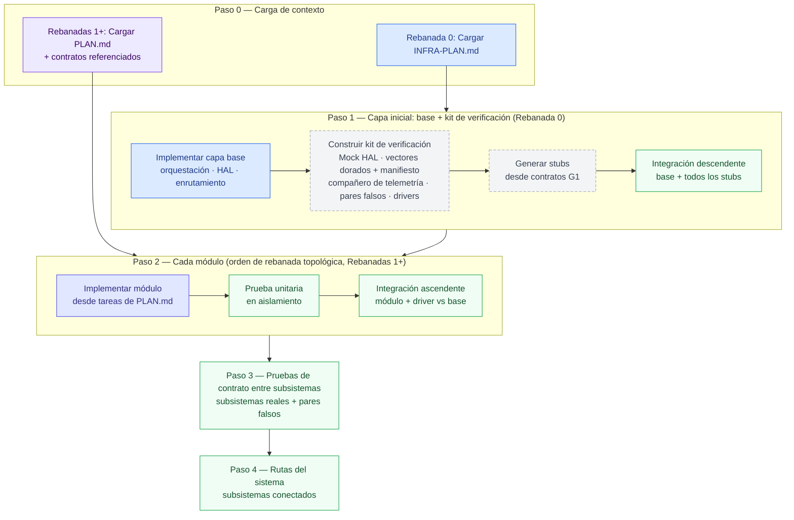

Descendente (base → stubs) + ascendente (módulo → driver → base) = **pruebas de integración sándwich** [1][2][13].

El Paso 1 es la **capa inicial**: antes de cualquier módulo, S3 construye cada base de subsistema y deja listas todas las herramientas — el kit de verificación de §6.5 y, en `mock+real`, el Real HW HAL con su API de dispositivo falso. S3 escribe cada prueba, incluyendo las pruebas VL-1 para módulos y rutas con `required_vl` VL-1 o superior, sin reclamarlas; G3 solo las ejecuta (§11.3).

Cada subsistema vive en `src/<subsistema>/` y se construye con su cadena de herramientas declarada; el kit de verificación, pruebas incluidas, vive en `verification/` y nunca se envía; un comando ejecuta cada nivel de verificación (`verification/run.sh vl0`, `verification/run.sh vl1`); y el código entregado no tiene dependencia de CodeAnvil.

Defina los contratos entre subsistemas primero para que cada subsistema pueda construirse independientemente contra un par falso determinista. Conecte subsistemas reales después de que su piso local VL-0 pase. Para cada `SYS-*` asignado entre subsistemas, ejecute una prueba de ruta del sistema determinista a través de los procesos reales de subsistema con entradas externas simuladas. Esto verifica serialización, enrutamiento, transferencia de estado y recuperación en el límite declarado; VL-1 y VL-2 agregan entornos y mediciones más fuertes.

*Trabajo futuro (FW-005, §6.4).* Si un subsistema usa un modelo ML suministrado, S3 implementa su adaptador de inferencia y prueba el preprocesamiento, mapeo de salida y comportamiento ante fallas declarados. La respuesta falsa ejercita el contrato del módulo circundante en VL-0; las pruebas que reclaman comportamiento del modelo usan los pesos identificados.

### 10.3 Fuentes de datos por nivel de verificación

La escalera de sustitución HAL (§6.5) determina qué alimenta el pipeline en cada nivel. El compañero de telemetría (§6.5) se ejecuta en cada nivel. VL-2 necesita `HAL mode: mock+real`.

| Nivel | Fuente de datos | HAL usado | Compañero de telemetría |
|---|---|---|---|
| **VL-0** | Vectores dorados deterministas (cortos, repetibles, caso borde) | Mock HAL | Activo |
| **VL-1** | Datos sintéticos en condiciones conocidas | Mock HAL | Activo |
| **VL-2** | Datos reales vía dispositivo COTS; procedimientos de lab del SyRS (`PROTO-*`) con calibración y tolerancias declaradas; solo en `mock+real` | Real HW HAL | Activo |

### 10.4 Gobernanza de vectores dorados

Cada vector dorado o captura sintética usada por el Mock HAL es un artefacto controlado: lleva un identificador único, resumen SHA-256, parámetros de generación, la condición que simula (nominal, caso borde, degradado) y la salida esperada en el contrato del módulo consumidor. Cambiar un vector invalida cada registro de evidencia que lo usó. El conjunto de vectores dorados se versiona junto al código fuente.

### 10.5 Piso obligatorio (VL-0) — no se puede omitir

| Componente | Siempre requerido |
|---|---|
| **Capa base** | Prueba unitaria + integración descendente con stubs |
| **Cada módulo** | Prueba unitaria + integración ascendente con driver |
| **Cada contrato entre subsistemas** | Pruebas de contrato productor y consumidor usando un par falso, incluyendo casos de versión y fallas |
| **Cada ruta SYS-* entre subsistemas** | Prueba determinista a través de los procesos de subsistema conectados con entradas externas simuladas |
| **Compañero de telemetría** | Ejecutándose y registrando durante todas las pruebas anteriores; estado UC adjunto a cada registro de evidencia |

---

## 11 G3 — Compuerta de Verificación Adaptativa

### 11.1 Niveles de verificación

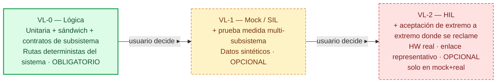

Cada nivel incluye todas las pruebas de los niveles inferiores. La escalera de sustitución HAL (§6.5) determina la fuente de datos; el compañero de telemetría (§6.5) se ejecuta en cada nivel.

### 11.2 Regla adaptativa

El usuario elige el nivel de verificación por módulo y por ruta del sistema, por ciclo. Cuatro restricciones:

1. **Piso.** Cada módulo y cada contrato y ruta del sistema entre subsistemas declarados alcanza VL-0 en cada ciclo.
2. **Honestidad.** Ninguna afirmación de módulo o de extremo a extremo es superior al entorno realmente probado. Pasar subsistemas individualmente no prueba un requisito entre subsistemas.
3. **Contexto de telemetría.** Cada registro de evidencia incluye lecturas del compañero de telemetría (§6.5). La evidencia producida fuera de la envolvente operativa declarada del UC se marca y puede ser invalidada.
4. **Techo del modo HAL.** `mock-only` limita toda afirmación a VL-1. `mock+real` permite VL-2, pero cada módulo y ruta aún declara su nivel por ciclo: el Real HW HAL puede declararse en VL-0 (API de dispositivo falso) por un ciclo, en cuyo caso G3.2 no se dispara y la declaración de honestidad lo indica. PIL usa el procesador objetivo real con entradas Mock HAL; toda afirmación PIL permanece VERIFICADA, no VALIDADA (ver §2 y §6.5).

| Escenario | Usuario declara | G3 verifica |
|---|---|---|
| Iteración rápida | VL-0 todos | Unitaria + sándwich para cada módulo; pruebas de contrato y ruta determinista para subsistemas conectados |
| Validación de procesamiento | VL-1 para procesamiento; VL-0 resto | Mock/SIL para módulos de procesamiento; piso VL-0 para cada ruta de subsistema |
| Pre-release (`mock+real`) | VL-1 para ruta de datos A→B; VL-2 para `hw_acquisition` | Ruta multi-subsistema medida más adquisición HIL |
| Release completa | Todos los módulos y rutas del sistema en `required_vl` | Cada afirmación en su nivel declarado en S1 |

### 11.3 Sub-compuertas

G3 ejecuta las pruebas que S3 escribió y no escribe ninguna; un nivel declarado sin prueba es un defecto de módulo enrutado a S3. Las ejecuciones ocurren en un contexto verificador separado de solo lectura — un subagente donde el runtime lo soporte, de lo contrario una sesión nueva — que implementa P2: el oráculo no es el generador.

**Enrolamiento de hardware.** Antes de que G3.2 pueda dispararse, el objetivo debe estar enrolado en `.codeanvil/project.yaml` vía `codeanvil credential-setup -u <admin-user> -i <host> --port 22`. G3.0 y G3.1 pueden proceder localmente mientras el enrolamiento está pendiente; G3.2 bloquea hasta que exista una entrada `targets:` válida.

| Sub-compuerta | Se dispara cuando | Verifica |
|---|---|---|
| **G3.0** | Siempre | Pruebas unitarias + sándwich, contrato entre subsistemas y rutas deterministas del sistema pasan; vectores dorados Mock HAL; compañero de telemetría confirma UC nominal |
| **G3.1** | VL-1+ declarado para un módulo o ruta | Datos sintéticos Mock HAL; pruebas Mock/SIL del sistema a través de subsistemas afectados pasan; métricas dentro de umbrales; compañero de telemetría confirma UC nominal |
| **G3.2** | VL-2 declarado para un módulo o ruta | Real HW HAL en dispositivo COTS (solo en `mock+real`); enrolamiento requerido (ver arriba); conjuntos de datos de los procedimientos de lab del SyRS (`PROTO-*`) con calibración y tolerancias declaradas; para rutas entre subsistemas, un enlace representativo; mediciones dentro de criterios; compañero de telemetría confirma UC nominal |

### 11.4 Clasificación de fallas y enrutamiento

Las fallas de G3 se clasifican en cinco resultados — corrección operativa, defecto de módulo, defecto de plan, defecto de diseño o RFD — y se enrutan según §12. Antes de enrutar, distinga fallas **operativas** (permisos DUT, SSH, udev — corrija el objetivo y re-ejecute G3) de **defectos** en el código entregado. Regla de autodiagnóstico: si un módulo que *no* fue cambiado falla durante la re-prueba → dependencia no declarada → defecto de diseño → S1.

---

## 12 Enrutamiento de Retroalimentación

V-SIL v4 produce dos tipos de retroalimentación. Son estructuralmente diferentes y no deben confundirse.

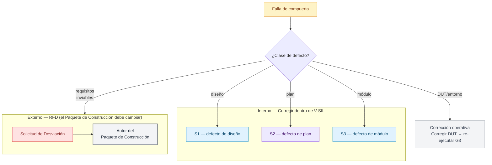

### 12.1 Enrutamiento de defectos internos

Un **defecto** significa que V-SIL puede corregirlo internamente. La implementación, el plan o el diseño es incorrecto, pero los requisitos son alcanzables. Un **problema operativo** no es un defecto: es un problema del DUT/entorno que bloquea la medición; corríjalo y re-ejecute G3 sin tocar S1, S2 o S3.

| Clase | Se enruta a | Ejemplo |
|---|---|---|
| Problema operativo | Corregir DUT → re-ejecutar G3 | Falla de acceso al dispositivo objetivo; falla de autenticación SSH; regla udev faltante |
| Defecto de diseño | S1 | El DAG tiene una dependencia no declarada; contrato entre subsistemas o propiedad de estado está incompleto |
| Defecto de plan | S2 | PLAN.md omitió un contrato necesario; plan de verificación sin un nivel declarado; orden de tareas violó una dependencia |
| Defecto de módulo o integración | S3 | La salida de procesamiento es incorrecta; la UI deserializa un mensaje válido incorrectamente |

**Autodiagnóstico:** si un módulo que *no* fue cambiado falla durante la re-prueba → dependencia no declarada → defecto de diseño → S1.

### 12.2 Solicitud de Desviación (RFD)

Un **RFD** significa que los requisitos del Paquete de Construcción son **inviables en la plataforma COTS declarada**. V-SIL no puede corregirlo internamente — las restricciones mismas deben cambiar. V-SIL **se suspende** hasta que el Paquete de Construcción sea actualizado y re-entra en S0.

Un RFD puede emitirse desde **S1, G1 o cualquier sub-compuerta de G3**. S0 y G0 no emiten uno: S0 no hace juicio sobre factibilidad y G0 verifica solo estructura. S2 y G2 no emiten RFDs directamente; la inviabilidad descubierta durante la planificación se registra en la sección de riesgos del PLAN.md y se confirma en G3. La inviabilidad descubierta durante la implementación en S3 se reporta a través de G3.

| Descubierto en | Ejemplo |
|---|---|
| S1 | La latencia del pipeline excede el requisito bajo cualquier particionamiento en este HW |
| G1 | La revisión de diseño concluye que un presupuesto de latencia no puede cumplirse en este HW, ni por el diseño revisado ni por ningún otro particionamiento |
| G3.0 | Las pruebas unitarias revelan que dos requisitos normativos entran en conflicto matemáticamente |
| G3.1 | Las métricas SIL muestran que dos umbrales de rendimiento no pueden cumplirse simultáneamente |
| G3.2 | HIL muestra que el piso de ruido del hardware real excede el presupuesto asumido |

En S1 y G1 nada ha sido medido aún, por lo que la evidencia es análisis y no nombra nivel de verificación (P4).

### 12.3 Contenido del RFD

Según ECSS [16], MIL-HDBK-61A [17] y NASA NPR 7150.2 [18]:

```
Solicitud de Desviación — RFD-001

  Requisitos en conflicto:
    STK-xxx: <requisito A>    (fuente: <estándar o regulador>)
    STK-yyy: <requisito B>    (fuente: <estándar o regulador>)

  Evidencia (de G3.1, VL-1):
    Config 1 → requisito B cumplido, requisito A violado
    Config 2 → requisito A cumplido, requisito B violado

  Opciones de compromiso:
    A) Relajar requisito A     → ambos cumplidos
    B) Relajar requisito B     → ambos cumplidos
    C) Diseño de modo dual     → ambos cumplidos, agrega complejidad

  Análisis de impacto:
    Opción A: requiere exención normativa de <estándar>
    Opción B: solo grado de tamizado, no grado de cumplimiento
    Opción C: nuevo módulo, nuevo contrato de interfaz, retrabajo de S1

  Recomendación: <opción seleccionada con justificación>
```

### 12.4 Triaje de fallas y modo borrador (S0 · G0 · G1)

Las etapas de requisitos son exploratorias: el Ground Truth se corrige muchas veces antes de que sea sólido. V-SIL v4 suaviza el *ciclo*, no las *verificaciones*, mediante dos dispositivos limitados a S0, G0 y G1 — nunca a S2, S3 o G3.

**Triaje de fallas.** Una falla de máquina o compuerta se traduce antes de llegar al humano. Para cada ERROR de G0, cada marcador de lista faltante y cada hallazgo `open` de G1, el agente expone el problema real en lenguaje claro — describiendo cada requisito por lo que pide, con su ID de bloque solo entre paréntesis, para que el lector nunca abra un documento para saber qué es un ítem — y ofrece de dos a cuatro opciones concretas de reconciliación (conectar un ítem no vinculado, crear su origen faltante, eliminarlo o relajarlo, o — cuando la brecha es un hecho documental y el runtime tiene acceso web — buscarlo en la web y proponer el valor encontrado con su fuente para que el humano confirme), cada una con su consecuencia. El humano elige; el agente aplica. El agente es el intérprete, nunca el oráculo: el veredicto sigue siendo el código de salida del validador (G0) o la respuesta del humano (Gate H, G1), así que P2 y P3 no se tocan.

**Modo borrador.** Cuando una etapa de requisitos encuentra ítems no resueltos — una entrada de lista faltante, un error de formato o un hallazgo `open` de G1 — **entra en borrador automáticamente** y no puede avanzar hasta que **cada uno sea resuelto**. Las correcciones mecánicas que no inventan nada — eliminar andamiaje de plantilla, llenar un valor ya declarado en otro lugar, eliminar una referencia rota — se **auto-aplican y reportan**, no se preguntan; solo los juicios de valor van al humano, quien **corrige**, conscientemente **ignora/acepta** (registrado con el nombre del decisor), o **escala** a un RFD. Mientras está en borrador la etapa se ejecuta contra los archivos actuales, aplica triaje y cicla sin escribir una iteración de reporte ni forzar obsolescencia; el humano puede editar el par GT directamente. Al confirmar — alcanzado solo una vez que cada ítem está decidido — el marcador se elimina y se escribe una ejecución registrada, listando cada ítem y su decisión. Un error de formato puede corregirse o escalarse pero nunca ignorarse para que pase, ya que el validador determinista sigue rechazándolo. La pista de auditoría registra la ejecución que pasa y las decisiones detrás de ella, no el camino rojo hacia ella.

---

## 13 Salida Terminal

El Prototipo Verificado lista el árbol entregado (`src/<subsistema>/`) aparte del kit de verificación (`verification/`) y los planes de módulo (`plans/`), y nombra el contexto verificador en el que G3 ejecutó las pruebas.

```
Prototipo Verificado — V-SIL v4
  Ciclo: <nombre_ciclo>
  Modo HAL: mock+real

  Software entregado (enviado):
    src/subsystem_a/, src/subsystem_b/ — sin dependencia de CodeAnvil
  Planes de módulo (no enviados):
    plans/ — PLAN.md por módulo, registro de trazabilidad delta
  Kit de verificación (no enviado):
    verification/ — Mock HAL, vectores dorados + manifiesto, compañero
                    de telemetría, stubs, pares falsos, drivers, pruebas
  Contexto verificador: subagente verificador de solo lectura (contexto limpio)

  Evidencia de módulo (Subsistema A — procesamiento):
    hw_acquisition:      VL-2 (HIL)  — Real HW HAL, dispositivo COTS
                         Plan: plans/hw_acquisition/PLAN.md (rebanada 1)
    signal_processor:    VL-1 (SIL)  — Mock HAL, vectores dorados (v1.2, SHA bc3f…)
                         Plan: plans/signal_processor/PLAN.md (rebanada 2)
    feature_extractor:   VL-1 (SIL)  — Mock HAL, datos sintéticos en condiciones conocidas
                         Plan: plans/feature_extractor/PLAN.md (rebanada 3)
    classifier:          VL-0 (lógica)— Mock HAL, vectores deterministas
                         Plan: plans/classifier/PLAN.md (rebanada 4)
    output_formatter:    VL-1 (SIL)  — Mock HAL, datos procesados sintéticos
                         Plan: plans/output_formatter/PLAN.md (rebanada 1)
    data_store:          VL-0 (lógica)— Mock HAL, vectores deterministas
                         Plan: plans/data_store/PLAN.md (rebanada 4)

  Evidencia de módulo (Subsistema B — cliente):
    dashboard:           VL-1 (SIL)  — mensajes del subsistema A en enlace simulado
                         Plan: plans/dashboard/PLAN.md (rebanada 1)
    controls:            VL-0 (lógica)— vectores de comando y acuse de recibo
                         Plan: plans/controls/PLAN.md (rebanada 1)
    alerts:              VL-0 (lógica)— unitaria + integración sándwich
                         Plan: plans/alerts/PLAN.md (rebanada 2)
    history:             VL-0 (lógica)— unitaria + integración sándwich
                         Plan: plans/history/PLAN.md (rebanada 2)

  Registro de trazabilidad delta:
    Versión GT al entrar a S2: 1.0
    Deltas aplicados: 0 ADDED, 0 MODIFIED, 0 REMOVED
    Versión GT al salir de G3: 1.0

  Evidencia de subsistema y rutas del sistema:
    A → B telemetry.v1: VL-1 — esquema + latencia en enlace simulado
    B → A control.v1: VL-0 — comandos, reintentos, manejo de duplicados
    PATH-001 / SYS-002 visualización de datos: VL-1 — subsistema A + B, datos sintéticos Mock HAL

  Reporte del compañero de telemetría:
    Todas las pruebas: UC dentro de la envolvente operativa
    Pico CPU: 63%  |  Pico temp: 68 °C  |  Buffers descartados: 0
    Ninguna evidencia invalidada por condiciones del UC.

  Declaración de honestidad:
    Módulos VL-1: VERIFICADOS contra datos sintéticos (Mock HAL).
    Módulos VL-2: VALIDADOS en hardware real (Real HW HAL);
                  calibración: grado de tamizado según SyRS §4;
                  tolerancias: declaradas por el equipo de desarrollo (SyRS §5).
    Módulos VL-0: VERIFICADOS solo a nivel lógico.
    SYS-002: VERIFICADO a través de subsistemas conectados con entrada sintética;
             sin afirmación de enlace real o HIL.
    Compañero de telemetría: UC nominal durante todas las ejecuciones de prueba.

  RFDs emitidos: 0
```

### 13.1 Registro opcional de trabajo futuro

Después de G3, el prototipo puede incluir propuestas para versiones posteriores del software. Cada entrada registra un ID, capacidad, origen, versión candidata, propietario de la decisión, dependencias y criterio de aceptación. El autor del Paquete de Construcción decide qué entra en una versión posterior; una propuesta aceptada se convierte en nueva entrada de S0. Un `SYS-*` actual que falla sigue siendo un defecto o RFD — el registro no puede convertirlo en una afirmación aprobatoria.

Los siguientes ítems se referencian en línea a lo largo del documento:

| ID | Capacidad | Referencia |
|---|---|---|
| FW-001 | Automatización CI/CD de evidencia G3 | §11 |
| FW-002 | PIL como sub-compuerta G3 completa con verificaciones de temporización/planificación | §6.5 |
| FW-003 | Inyección formal de fallas en VL-2 (ISO 26262-5 §10) | §11.3 |
| FW-004 | Medición de correlación SIL ↔ HIL | §11.2 |
| FW-005 | MLOps para el modelo ML opcional (integración S3/G3) | §6.4 |
| FW-006 | Generación automatizada de PLAN.md desde diseño S1 | §8.3 |

---

## 14 Referencias

[1] R. S. Pressman, B. R. Maxim, *Software Engineering*, 9th ed., 2020.
[2] ISO/IEC/IEEE 29119-1:2022, "Software testing — Part 1."
[3] Codeburst, "The Basics of Contract Tests," 2024.
[4] L. Bass, P. Clements, R. Kazman, *Software Architecture in Practice*, 4th ed., 2021.
[5] ISO 26262:2018, "Road vehicles — Functional safety."
[6] V. H. Nguyen, T. Nguyen, "SDAD," arXiv:2608.20341, May 2026.
[7] "LLM-as-a-Judge Is Not an Oracle," arXiv:2609.02246, Sep. 2026.
[8] V. Reddy et al., "Reason Less, Verify More," arXiv:2607.07405, Jul. 2026.
[9] Sheridan Tech, "Design Validation vs Verification," Mar. 2026.
[10] Augment Code, "Coordinator-Implementor-Verifier Pattern," Jun. 2026.
[11] OPAL-RT, "Guide to HIL Testing," Sep. 2026. — Staged SIL→HIL progression for real-time simulation; V-SIL's Mock HAL/golden-vector/telemetry-companion adaptation is its own contribution.
[12] IEEE/ISO/IEC 29148:2018, "Requirements engineering."
[13] V. Lavecchia, "Sandwich testing strategies," 2024.
[14] B. Trinnes, "Test Architecture Patterns," GitHub, Apr. 2026.
[15] "Spec-Driven Development," arXiv:2602.00180, Feb. 2026.
[16] ECSS-Q-ST-10-09C, "Nonconformance control system," European Cooperation for Space Standardization. — Defines Request for Deviation (RFD) as a "planned departure" from requirements.
[17] MIL-HDBK-61A, "Configuration Management Guidance," U.S. DoD, 2001. — Deviation processing: request when a product cannot meet technical requirements; includes impact analysis and trade-off options.
[18] NASA NPR 7150.2, "NASA Software Engineering Requirements." — Deviation/waiver evaluation: technical justification, risk assessment, impact to safety, and proposed alternatives.
[19a] C. Koch, J. A. Wellbrock, "Agile V: A Compliance-Oriented Framework for AI-Augmented Engineering," arXiv:2602.20684, Feb. 2026. — Infinity Loop merging Agile iteration with V-Model verification; task as iteration unit; human approval gates.
[19b] C. Koch, "Agentic Agile-V: From Vibe Coding to Verified Engineering in Software and Hardware Development," arXiv:2605.20456, May 2026. — SCOPE-V micro-cycle (Specify, Constrain, Orchestrate, Prove, Evolve, Verify); minimum input artifacts for agentic work.
[20] GitHub Spec-Kit — Specification-driven development toolkit for stage-gate methodologies.
[21] OpenSpec Delta Traceability Model — ADDED/MODIFIED/REMOVED/RENAMED annotation convention for living requirements documents with change-level tracking; V-SIL scopes the convention to the module boundary.
