# V-SIL v4: Agile-V Stage-Gate Lifecycle for COTS-Constrained Verified Prototype Development

**David Ramírez-Betancourt** — Universidad Nacional de Colombia, GCPDS  
**Version:** 4.0  
**Date:** November 2026

---

## Abstract

V-SIL v4 is a stage-gate lifecycle that receives a finalised Build Package and delivers a Verified Prototype with per-module and end-to-end evidence — or a formal Request for Deviation (RFD) when requirements are infeasible on the declared COTS platform. The chain **S0→G0→S1→G1→S2→G2→S3→G3** normalises requirements, designs the system, plans each module as a self-contained specification (PLAN.md), and implements each module in a fresh context. Verification depth is adaptive per module with a mandatory VL-0 floor; a HAL substitution ladder (Mock HAL → Real HW HAL) and a telemetry companion support staged SIL/HIL progression. V-SIL adapts the Agile-V compliance framework [19a][19b] to module-level iteration, uses OpenSpec [21] delta traceability scoped to the module boundary, and aligns terminology with IEEE/ISO/IEC 29119, ISO 26262 [5], SDAD [6], and the CIV pattern [10].

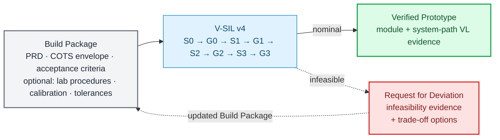

---

## 1 Scope and Purpose

V-SIL v4 defines the complete lifecycle from a finalised Build Package to a Verified Prototype. The lifecycle is organised as an eight-node stage-gate chain (four stages, four gates) with an Agile-V module-planning layer between system design and implementation. The methodology is domain-agnostic: it applies to any COTS-constrained embedded or software system where requirements must be traced through design, planning, implementation, and verification.

### 1.1 Core architecture

The lifecycle solves five problems:

1. **Requirement normalisation.** S0 casts the Build Package into IEEE 29148 blueprints; G0 validates structure mechanically.
2. **System decomposition with traceability.** S1 designs subsystems, modules, and their dependency graph; G1 validates completeness.
3. **Context scoping.** S2 produces a self-contained PLAN.md per module so that the implementor needs only the plan and the contracts it touches.
4. **Fresh-context implementation.** S3 builds each module in an isolated context that carries only its specification, enforcing separation.
5. **Adaptive verification.** G3 verifies each module at the level the user declares, with a mandatory VL-0 floor, and classifies failures into five routing classes.

### 1.2 Governing principles

**P1.** HITL is an authorisation barrier; HIL is a validation barrier.  
**P2.** Oracle ≠ generator — the entity that verifies never approves its own work [7].  
**P3.** G0 is the only deterministic gate: its mechanical rejection beats any approval [8]. G2 and G3 (including sub-gates G3.0, G3.1, and G3.2) are agent-prepared, human-approved. Every other gate verdict is human (HITL).  
**P4.** *Verified* ≠ *validated* — claims name the environment [9].  
**P5.** Module is the iteration unit — V-SIL adapts the Agile-V compliance framework [19a][19b] by replacing the task-level iteration with a module-level mini-V cycle whose backlog is ordered by topological sort of the S1 dependency graph.  
**P6.** Layers are orthogonal to iteration — layered architecture is a structural invariant; Agile-V determines only the order in which modules are built.  
**P7.** Fresh context per module — the implementor carries only PLAN.md and the contracts it touches.  
**P8.** Living GT with delta traceability — ADDED/MODIFIED/REMOVED/RENAMED per module; V-SIL scopes OpenSpec's change-level model [21] to the module boundary.

### 1.3 Report-driven gate chain

Each stage produces a structured report. Each gate reads and validates the predecessor stage's report as its primary input. A gate never re-derives the stage's work; it checks the report's claims against the evidence the report references. This creates a chain of accountability: S0's report feeds G0, S1's feeds G1, S2's feeds G2, S3's feeds G3. If a stage's report becomes stale (the inputs it was derived from have changed since it was written), the gate rejects it and the stage must re-run against the current inputs.

### 1.4 Stale detection

A report is **stale** when any of its declared inputs has changed since the report was produced. Each report records the version or digest of every input it consumed. A gate checks these digests before evaluating the report's content. If any input has been updated (a GT revision, a design change, a contract modification), the report is stale and the gate returns FAIL with reason `stale-report`, requiring the stage to re-run. This prevents a valid-looking report from masking changes that invalidate its conclusions.

---

## 2 Terminology

Standard software-engineering terms (stub, driver, sandwich integration [2], layered architecture [4], interface-contract verification [3]) follow IEEE 29119, Pressman [1], and Bass et al. V-SIL-specific or adapted terms are defined below.

| Term | Definition | Source |
|---|---|---|
| Verification level (VL-0, VL-1, VL-2) | Depth of verification: logic-only (VL-0), SIL/mock (VL-1), HIL/real hardware (VL-2) | Adapted from ISO 26262 [5] |
| Request for Deviation (RFD) | Formal request to change Build Package requirements when infeasible on the declared COTS platform | ECSS [16]; MIL-HDBK-61A [17]; NASA NPR 7150.2 [18] |
| Topological slicing | Partitioning modules into ordered slices by topological sort of the dependency graph | V-SIL v4; inspired by Agile-V [19a][19b] |
| PLAN.md | Self-contained module specification produced by S2, carrying only the contracts and traced requirements the implementor needs | V-SIL v4 |
| ADDED / MODIFIED / REMOVED / RENAMED | Delta annotations recording changes to requirements at each module boundary; V-SIL scopes OpenSpec's change-level convention [21] to the module boundary | OpenSpec [21], adapted by V-SIL v4 |
| Processor-in-the-Loop (PIL) | Verification configuration using the actual target processor with Mock HAL inputs; every PIL claim stays VERIFIED, not VALIDATED, because the data source is synthetic | Adapted from ISO 26262 [5] |
| Verification kit | Verification infrastructure built in Slice 0: Mock HAL, golden vectors with manifest, telemetry companion, stubs, fake peers, and drivers | V-SIL v4 |
| Fresh context | Isolated implementation context carrying only a module's PLAN.md and its contracts, with no accumulated state from prior modules | V-SIL v4 |
| Verifier context | Separate read-only context (subagent or fresh session) that runs verification; implements P2 (oracle ≠ generator) | V-SIL v4 |

---

## 3 Stage-Gate Overview

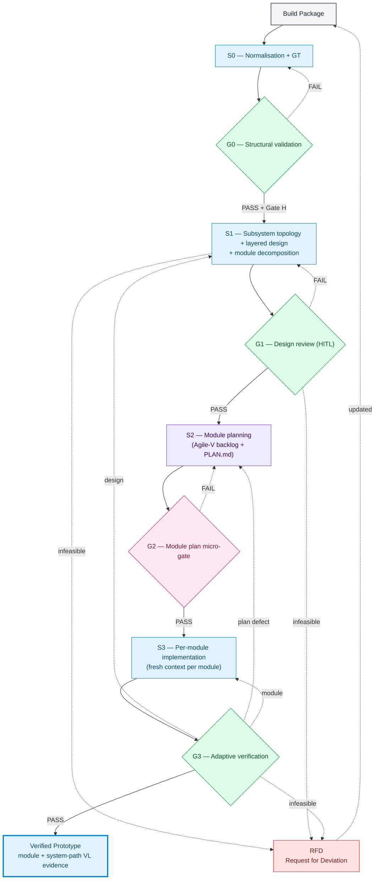

---

## 4 S0 — Normalisation and Ground Truth

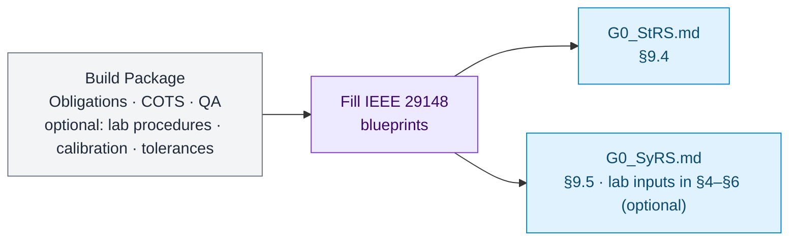

S0 **normalises only** — it casts the Build Package content into the IEEE 29148 [12] document blueprints and makes no conceptual judgement about sufficiency or scope. The produced documents carry only the filled specification, not the blueprint's author-guidance sections or empty placeholder rows, so a template example block is never read as a requirement. Following SDAD Phase 1 (spec crystallisation) [6], it populates the blueprints:

- **G0_StRS.md** — Stakeholder Requirements Specification (§9.4): `NRM-*`, `HWC-*`, `STK-*` blocks.
- **G0_SyRS.md** — System Requirements Specification (§9.5): `SYS-*` blocks tracing to StRS.

Laboratory procedures, calibration, and tolerances are optional Build Package content. When present, S0 casts them into the SyRS sections that already exist for them: procedures into §6 Field Measurement Protocols (`PROTO-*`: setup, calibration, execution), calibration terms into §4 Correction Chains, and tolerances into §5 Uncertainty Budgets. The three headings stay required by G0; with no lab inputs, each holds exactly `Not applicable: no lab inputs in the Build Package.`

Any iteration happens afterwards at G0, which validates the Build Package content against the deterministic gate (the blueprint) — not by a review judgement here.

---

## 5 G0 — Structural Validation

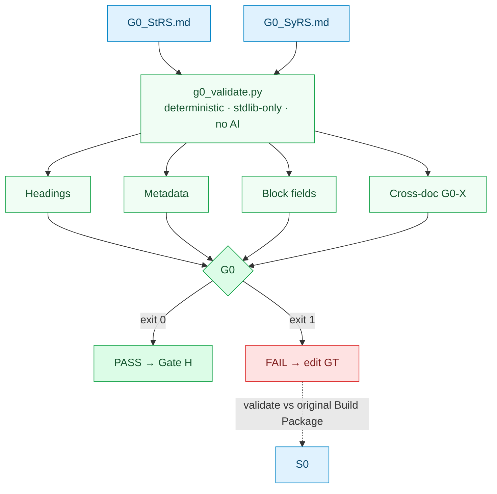

Deterministic. No AI. Binary verdict. After G0 passes, human Gate H asks: *Requirements complete, bounded, and verifiable?*

---

## 6 S1 — System of Layered Subsystems with Module Decomposition

S1 first divides the product into independently deployed subsystems when the requirements call for them. One subsystem remains a valid special case. A **subsystem** owns a runtime, deployment target, base layer, modules, and externally visible ports. Its modules communicate through its own base-layer interfaces; a cross-subsystem exchange goes through a declared, versioned subsystem contract. Splitting subsystems is justified when they deploy or restart independently, communicate over a network, or have distinct failure domains.

### 6.1 System topology and requirement allocation

The arrows below are **runtime messages**, not implementation dependencies.

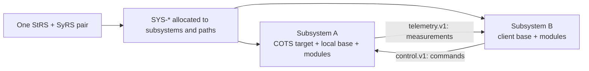

The system view records each subsystem's responsibility, deployment target, COTS resources, network link, and lifecycle. A requirement may map to one subsystem or to an **end-to-end path** spanning several subsystems. One system-level trace table owns this allocation; subsystem designs do not duplicate the Ground Truth. Cross-subsystem contracts specify producer and consumer, schema and version, units, timestamps, ordering, rate, latency, authentication, retries, duplicate handling, and behavior on disconnect or restart where applicable.

### 6.2 Layered architecture within each subsystem

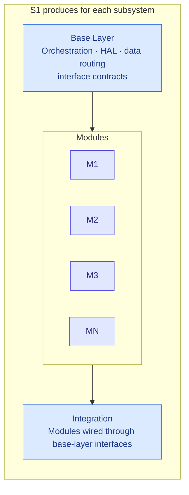

Modules are plug-in units communicating only through their subsystem's base layer and declared interfaces. No direct module-to-module calls, and no cross-subsystem calls that bypass a subsystem contract. A subsystem without physical hardware can have an empty HAL; its base still owns orchestration and routing.

### 6.3 Module identity and dependency graph

S1 assigns each module a unique identity and declares the implementation dependency graph that S2 uses for topological slicing. The graph encompasses **all subsystems** — every module that will be planned, implemented, and verified must appear here.

Each module carries a **module identity block**:

| Field | Description |
|---|---|
| `module_id` | Unique identifier (e.g. `signal_processor`) |
| `subsystem_id` | Parent subsystem |
| `layer` | Architectural layer (HAL, Processing, Decision, Output, Presentation, Control, …) |
| `depends_on` | List of modules whose contracts this module consumes |
| `provides` | List of interface contracts this module produces |
| `hw_dependency` | `true` / `false` |
| `required_vl` | VL-0, VL-1, or VL-2 |
| `traced_reqs` | List of `SYS-*` requirements allocated to this module |

Each edge in the dependency graph carries an **interface contract** (data type, schema version, units, latency). Each subsystem's implementation dependency graph must be acyclic. Each node carries a **verification profile**: `module_id`, `subsystem_id`, `layer`, `depends_on`, `provides`, `hw_dependency`, `required_vl`.

The **implementation dependency graph** orders contract definition, subsystem bases, modules, and system integration. It must be acyclic so S3 can build with stubs. The separate **runtime interaction graph** describes live messages. It may contain intentional loops (e.g. telemetry → display → control), provided the contracts define ownership of state, acknowledgement, timeouts, and safe behavior. Runtime message loops do not create implementation dependency cycles.

#### Generic example — single-subsystem extract

| Module | Layer | HW dep. | VL | Traced reqs | depends_on | provides |
|---|---|---|---|---|---|---|
| `hw_acquisition` | HAL | **yes** | VL-2 | SYS-001 | — | `raw_samples.v1` |
| `signal_processor` | Processing | no | VL-1 | SYS-002, SYS-003 | `hw_acquisition` | `processed_data.v1` |
| `feature_extractor` | Processing | no | VL-1 | SYS-004 | `signal_processor` | `features.v1` |
| `classifier` | Decision | no | VL-0 | SYS-005 | `feature_extractor` | `decision.v1` |

The dependency graph is a chain (HAL → Processing → Decision); S2 slices it into four build passes. A multi-subsystem example adds cross-subsystem contracts (`telemetry.v1`, `control.v1`) with explicit producer/consumer, schema version, and failure behavior.

### 6.4 Optional supplied ML model

A supplied ML model is a controlled input to a subsystem module, not a subsystem by itself. This box is present **only when S1 chooses an ML-based module or the GT requires one**; otherwise it and its G1 check are absent.

When used, S1 identifies the model file and weights by version and digest; names its supplying owner and provenance; records the training data source and labelling procedure; specifies the inference contract (runtime, I/O schema, units, preprocessing, postprocessing); and budgets inference latency, memory, and device dependency on the declared COTS target. A deterministic fake response supports VL-0 integration; later levels exercise the actual model. Supplied performance metadata is prior evidence, not a G3 verdict. Missing model package or fields → G1 **FAIL**; demonstrated infeasibility → RFD. S3/G3 integration and MLOps automation are future work (FW-005).

### 6.5 HAL substitution ladder and telemetry companion

S1 declares the **HAL mode** in the design Meta: `HAL mode: mock-only` or `HAL mode: mock+real`. Every later stage reads it from the design. The HAL implementations share the same base-layer interface contract but differ in what produces the raw data:

- **Mock HAL** (mandatory in every mode). A software-only signal generator. At VL-0 it emits deterministic vectors (short, repeatable, edge-case coverage). At VL-1 it produces synthetic data files at known conditions using a software synthesiser or recorded golden captures. Each golden vector is versioned with a SHA-256 digest, generation parameters, the condition it simulates, and its expected output. The Mock HAL is the default data source for all sandwich-integration and SIL tests.

- **Real HW HAL** (only in `mock+real`). The production HAL that interfaces with the declared COTS device. It serves two purposes: (a) executing the laboratory procedures recorded in the SyRS (§6 `PROTO-*`) to generate **real datasets** with the development team's calibration quality (screening grade, not normative, SyRS §4 Correction Chains) and declared tolerances (SyRS §5 Uncertainty Budgets); and (b) running the final field tests at VL-2. The calibration grade and tolerances are inputs recorded in the SyRS, not claims of V-SIL. The Real HW HAL may be declared at VL-0 (fake device API) for a cycle, so the software for the real hardware is built without validating metrics on it; G3.2 then does not fire and the honesty declaration states it.

- **PIL** (Processor-in-the-Loop). A verification configuration that uses the actual target processor with Mock HAL inputs. PIL is relevant when the compute unit differs from the development host and compiled code may behave differently under timing constraints. Every PIL claim stays VERIFIED, not VALIDATED, because the data source is synthetic. A dedicated G3.PIL sub-gate with structured timing and scheduling checks is future work (FW-002).

In `mock-only`, the design has no Real HW HAL, no lab procedures, calibration, or tolerances, and no module with `hw_dependency: true`; it ignores SyRS §4–§6, and every claim is capped at VL-1 (§11.2). In `mock+real`, both HALs plug into the same base-layer port; swapping one for the other is the **HAL substitution** that moves between verification levels. The staged SIL→HIL progression follows industry practice [5][11]; V-SIL's specific Mock HAL/golden-vector/telemetry-companion adaptation is its own contribution.

S1 also specifies a **telemetry companion**, mandatory in every design and every test run: a lightweight, non-intrusive process that runs alongside every test execution and records compute-unit state — CPU utilisation, available memory, temperature, dropped buffers, and scheduling latency. It must not interfere with the system under test; its own resource footprint is declared and bounded. The companion attaches its readings to every evidence record so that G3 can determine whether the compute unit was within its operating envelope during a test. The telemetry companion is verification infrastructure, not a system module: it belongs to the methodology, not to the software. It has no `SYS-*`, does not appear in the implementation DAG, is absent from the Verified Prototype's module evidence, and is never shipped in the delivered software.

The Mock HAL, the golden vectors with their manifest, the telemetry companion, the stubs, the fake peers, and the drivers form the **verification kit**. S3 builds the kit in its initial layer, before any module, together with the Real HW HAL and its fake device API in `mock+real` (§10).

S1's design Meta also declares one **`Toolchain`** entry per subsystem: `SUB-xxx: <package> · <language> · <package manager> · <test runner>`. `<package>` is a valid identifier and names `src/<package>/`. S3 builds with the declared toolchain and never chooses another; an empty or incomplete `Toolchain` entry is a design defect.

---

## 7 G1 — Subsystem, Dependency, Contract, and Module-Decomposition Validation

G1 answers: *Are all implementation-critical design choices resolved, and is every module identifiable and plannable?*

G1 is a human (HITL) design review, not a deterministic gate. An agent may prepare the review and recommend a verdict, including an RFD; the human decides.

G1 runs no script. The agent that prepares it validates by itself: it reads the whole design and the GT, re-derives every check from the source sections instead of trusting the design's own summaries, and runs the declared toolchain on the development machine. A thorough review is worth its token cost. The agent's findings inform the human; they never become an automatic verdict.

1. **Subsystem topology.** Every subsystem has one responsibility, deployment target, owner of state, and declared external ports; the network and COTS envelope support the topology.
2. **Implementation DAG acyclicity.** No dependency cycle within or between subsystem build units. Runtime message loops are reviewed separately for bounded behavior.
3. **Interface completeness.** Every internal edge has a typed contract; every cross-subsystem exchange has a versioned contract and failure behavior.
4. **Coverage.** Every `SYS-*` traces to module(s) or an end-to-end subsystem path, with an owner and measurable acceptance evidence.
5. **Stub feasibility.** Every internal and cross-subsystem contract is complete enough to write a deterministic stub or fake peer.
6. **Verification-profile consistency.** `hw_dependency: true` → `required_vl: VL-2`; system paths have a declared verification level and environment.
7. **HAL substitution ladder.** Mock HAL exposes the base-layer interface; golden vectors carry digest, parameters and expected outputs. In `mock+real`, the Real HW HAL exposes the same interface and references the SyRS `PROTO-*`, correction chains and tolerances.
8. **Telemetry companion.** The companion spec declares what it monitors, its sampling interval, its resource budget, and that its footprint is bounded below a declared threshold.
9. **Supplied ML model, when used.** The weights, metadata, training data source, and labelling procedure are identified, the inference contract is implementable, and the COTS budget is credible. This check is omitted when the design has no ML model.
10. **Toolchain availability.** On the development machine, the language runtime and package manager of every `Toolchain` entry answer their version command. The agent installs a missing tool only after a brief yes from the user; a refused or failed install is an open finding.
11. **Module decomposition completeness.** Every module across all subsystems has a unique `module_id`, a `subsystem_id`, a `layer`, a `depends_on` list, a `provides` list, a `hw_dependency` flag, a `required_vl`, and a `traced_reqs` list. Every `SYS-*` in the GT appears in at least one module's `traced_reqs`. No module has an empty `traced_reqs`.
12. **Topological slicing feasibility.** The implementation dependency graph admits a topological sort. Every module's `depends_on` edges point only to modules or base-layer contracts that will be available (built or stubbed) before the module is scheduled.

**PASS** → S2. **FAIL** → S1. **RFD** → §12.2, when the requirements are infeasible on the declared COTS platform.

The [S1/G1 design template](S1_G1_template.md) expands these check families into review items including design decisions, COTS coherence, HAL ladder, telemetry companion, toolchain availability, module decomposition, and risk assessment.

---

## 8 S2 — Module Planning (Agile-V Layer)

S2 is the bridge between system design (S1) and per-module implementation (S3). It takes the approved S1 design and produces a **backlog of module plans** ordered by topological dependency, so that each module can be implemented in a fresh context (P7) without losing traceability to the Ground Truth (P8).

### 8.1 The Agile-V model

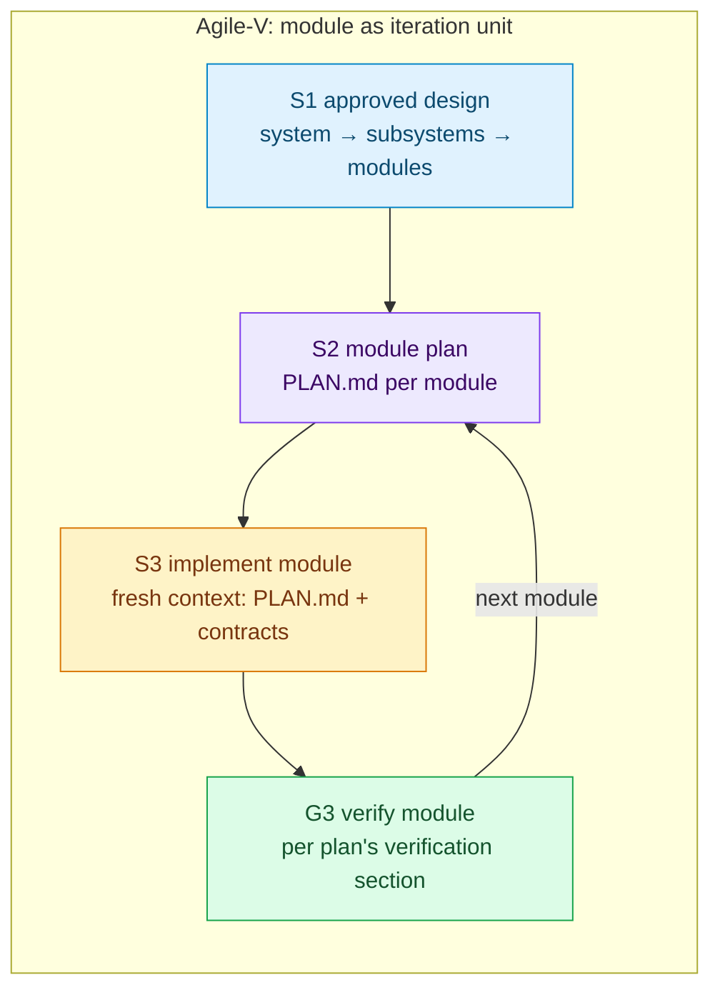

The iteration unit is the **module**, not a user story or a sprint. Each iteration is a **mini-V cycle**: plan (S2) → implement (S3) → verify (G3). The backlog is the sequence of all modules across all subsystems, ordered by topological sort of the S1 dependency graph.

### 8.2 Topological slicing

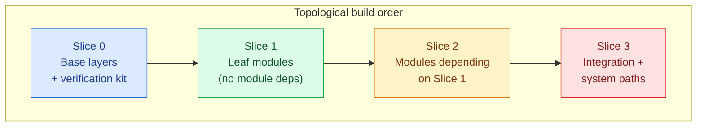

S2 performs a topological sort of the implementation dependency graph from S1 and partitions the modules into **slices**. Slice 0 is always the base layers and verification kit. Within a slice, modules that share no dependency may be built in parallel. Each module in a slice builds against the **real contracts** of modules from earlier slices and the **stub contracts** of modules in later slices (interface-first with Mock HAL, P6).

#### Generic example — topological slicing

| Slice | Subsystem A (processing) | Subsystem B (client) |
|---|---|---|
| 0 | Base layer + verification kit | Base layer + verification kit |
| 1 | `hw_acquisition`, `output_formatter` | `dashboard`, `controls` |
| 2 | `signal_processor` | `alerts`, `history` |
| 3 | `feature_extractor` | — |
| 4 | `classifier`, `data_store` | — |
| 5 | Cross-subsystem contract tests | Cross-subsystem contract tests |
| 6 | System-path integration | System-path integration |

### 8.3 PLAN.md format

S2 produces one `PLAN.md` per module. PLAN.md is the **specification entry-point** for S3's fresh context for that module; §10.1 lists the full context set that accompanies it.

```markdown
# PLAN.md — <module_id>

## Meta
- module_id: <unique identifier>
- subsystem_id: <parent subsystem>
- layer: <architectural layer>
- slice: <topological slice number>
- depends_on: [<module_id>, ...]
- provides: [<contract_name>, ...]
- hw_dependency: true | false
- required_vl: VL-0 | VL-1 | VL-2
- hal_mode: mock-only | mock+real

## Traced Requirements
| Req ID | Text | Delta | Source |
|--------|------|-------|--------|
| SYS-002 | Processing resolution ≥ N bins | ADDED | GT v1.0 |
| SYS-003 | Latency ≤ T ms | ADDED | GT v1.0 |

## Interface Contracts
### Consumes
- `raw_samples.v1` from `hw_acquisition` (schema v1, units: <type>, rate: continuous)

### Produces
- `processed_data.v1` (schema v1, units: <type>, latency: ≤ T ms)

## Ordered Tasks
1. Implement processing pipeline with configurable parameters
2. Wire to base-layer consumer contract
3. Expose producer contract through base-layer interface
4. Unit tests: edge cases (empty buffer, single sample, max-length)
5. Bottom-up integration: module + driver vs base

## Verification Plan
| Level | What | Data source | Pass criterion |
|-------|------|-------------|----------------|
| VL-0 | Unit + sandwich | Mock HAL deterministic vectors | All pass |
| VL-1 | SIL measured | Mock HAL synthetic data | Latency ≤ T ms, resolution ≥ N |

## Delta Traceability
- GT version: 1.0
- Deltas introduced by this module: none
- Deltas from prior modules affecting this module: none

## Risks
- R1: Library may not meet latency on COTS target → mitigation: benchmark in S3, escalate to RFD if exceeded
```

#### 8.3.1 INFRA-PLAN.md for Slice 0

Slice 0 (base layers and verification kit) uses a distinct plan format, **INFRA-PLAN.md**, because Slice 0 does not implement a module — it builds the foundation that all modules depend on. INFRA-PLAN.md specifies: (a) base-layer orchestration, HAL, and routing for each subsystem; (b) the full verification kit (Mock HAL, golden vectors with manifest, telemetry companion, stubs, fake peers, drivers); (c) in `mock+real`, the Real HW HAL and its fake device API; (d) top-down integration tests (base + all stubs). The §10.2 implementation flowchart Step 0 loads INFRA-PLAN.md for Slice 0 and PLAN.md for Slices 1+.

### 8.4 Delta traceability (P8)

Each PLAN.md records the **GT version** it was derived from and any **deltas** the module introduces. When a module's implementation reveals that a requirement must be modified (e.g. a threshold relaxed after measurement), the delta is recorded as:

```
Delta: MODIFIED SYS-003
  Before: Latency ≤ T ms
  After:  Latency ≤ T' ms
  Reason: COTS library floor measured at T'' ms
  Authority: RFD-002 approved by Build Package author
```

The deltas follow the OpenSpec [21] convention, scoped by V-SIL to the module boundary: **ADDED** (new requirement discovered during implementation), **MODIFIED** (existing requirement changed), **REMOVED** (requirement dropped), **RENAMED** (identifier changed without semantic change). Each delta names its authority (RFD, design review, or Build Package author decision). The system-level GT is updated after each module's G3 pass, keeping it a **living document** without requiring a monolithic re-review.

### 8.5 Interaction with S1 living design

S2 may discover that the S1 design needs adjustment (e.g. a missing interface, an undeclared dependency). **Minor adjustments** — defined as changes that do not alter the contract version or break existing stubs (e.g. adding an optional field to a contract) — are recorded as deltas in the affected PLAN.md files and must be reflected back to the S1 design document so the two stay in sync. **Structural changes** (new module, changed DAG topology, contract version bump, any change that breaks existing stubs) route back to S1 through G2 FAIL or G3 design-defect feedback.

---

## 9 G2 — Module Plan Micro-Gate

G2 validates each PLAN.md before the module enters S3. It is lightweight by design: the full design review happened at G1; G2 checks only that the plan is **self-contained, traceable, and buildable**.

G2 runs once per module, immediately after S2 produces its PLAN.md and before S3 begins work on that module.

### 9.1 Checks

| # | Check | What it verifies |
|---|---|---|
| 1 | **Completeness** | All PLAN.md sections are present and non-empty |
| 2 | **Traceability** | Every `traced_reqs` entry exists in the current GT; deltas reference valid authority |
| 3 | **Contract consistency** | Every `consumes` contract is provided by a module in an earlier slice or by the base layer; every `provides` contract matches the S1 design |
| 4 | **Task ordering** | Tasks respect the dependency order; no task references an artifact that a prior task has not produced |
| 5 | **Verification feasibility** | The verification plan's data sources and pass criteria are achievable with the declared HAL mode and available verification kit |
| 6 | **Fresh-context sufficiency** | The PLAN.md plus its referenced contracts contain enough information to implement the module without access to the full system design or other modules' source code |

### 9.2 Verdicts

| Verdict | Meaning | Routes to |
|---|---|---|
| **PASS** | Plan is self-contained and traceable | S3 (implement this module) |
| **FAIL — plan defect** | Missing section, broken trace, or insufficient context | S2 (fix PLAN.md) |
| **FAIL — design defect** | Plan reveals a structural issue in S1 (missing contract, DAG error) | S1 |
| **FAIL — GT defect** | Plan reveals a GT inconsistency (conflicting requirements) | S0 |

---

## 10 S3 — Per-Module Implementation and System Integration

### 10.1 Fresh-context protocol

Each module is implemented in an **isolated context** that carries:

1. The module's **PLAN.md** (from S2, approved by G2) — the specification entry-point
2. The **interface contracts** it consumes and produces (from S1)
3. The **base-layer API** of its subsystem
4. The **verification kit** relevant to its declared VL
5. The **stub implementations** of modules it depends on (if not yet built)

The context does **not** carry: the full system design, the complete GT, other modules' source code, or accumulated implementation state from prior modules. This enforces P7 and ensures that each module is built from its specification, not from implicit knowledge.

### 10.2 Implementation flow

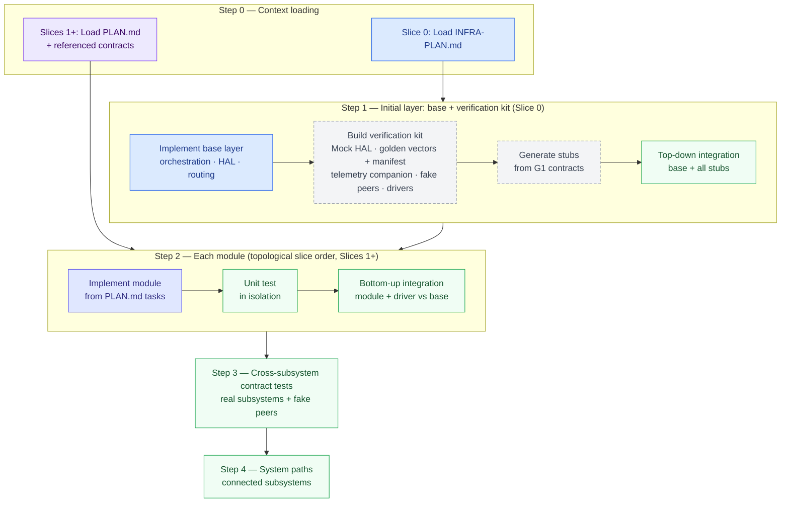

Top-down (base → stubs) + bottom-up (module → driver → base) = **sandwich integration testing** [1][2][13].

Step 1 is the **initial layer**: before any module, S3 builds each subsystem base and makes every tool ready — the verification kit of §6.5 and, in `mock+real`, the Real HW HAL with its fake device API. S3 writes every test, including the VL-1 tests for modules and paths with `required_vl` VL-1 or higher, without claiming them; G3 only runs them (§11.3).

Each subsystem lives in `src/<subsystem>/` and is built with its declared toolchain; the verification kit, tests included, lives in `verification/` and is never shipped; one command runs each verification level (`verification/run.sh vl0`, `verification/run.sh vl1`); and the delivered code has no dependency on CodeAnvil.

Define cross-subsystem contracts first so each subsystem can be built independently against a deterministic fake peer. Connect real subsystems after their local VL-0 floor passes. For each `SYS-*` allocated across subsystems, execute a deterministic system-path test across the real subsystem processes with simulated external inputs. This checks serialization, routing, state handoff, and recovery at the declared boundary; VL-1 and VL-2 add stronger environments and measurements.

*Future work (FW-005, §6.4).* If a subsystem uses a supplied ML model, S3 implements its inference adapter and tests the declared preprocessing, output mapping, and failure behavior. The fake response exercises the surrounding module contract at VL-0; tests claiming model behavior use the identified weights.

### 10.3 Data sources by verification level

The HAL substitution ladder (§6.5) determines what feeds the pipeline at each level. The telemetry companion (§6.5) runs at every level. VL-2 needs `HAL mode: mock+real`.

| Level | Data source | HAL used | Telemetry companion |
|---|---|---|---|
| **VL-0** | Deterministic golden vectors (short, repeatable, edge-case) | Mock HAL | Active |
| **VL-1** | Synthetic data at known conditions | Mock HAL | Active |
| **VL-2** | Real data via COTS device; SyRS lab procedures (`PROTO-*`) with declared calibration and tolerances; only in `mock+real` | Real HW HAL | Active |

### 10.4 Golden vector governance

Each golden vector or synthetic capture used by the Mock HAL is a controlled artefact: it carries a unique identifier, SHA-256 digest, generation parameters, the condition it simulates (nominal, edge-case, degraded), and the expected output at the consuming module's contract. Changing a vector invalidates every evidence record that used it. The golden-vector set is versioned alongside the source code.

### 10.5 Mandatory floor (VL-0) — cannot be skipped

| Component | Always required |
|---|---|
| **Base layer** | Unit test + top-down integration with stubs |
| **Each module** | Unit test + bottom-up integration with driver |
| **Each cross-subsystem contract** | Producer and consumer contract tests using a fake peer, including version and failure cases |
| **Each cross-subsystem SYS-* path** | Deterministic test across the connected subsystem processes with simulated external inputs |
| **Telemetry companion** | Running and recording during all tests above; UC state attached to every evidence record |

---

## 11 G3 — Adaptive Verification Gate

### 11.1 Verification levels

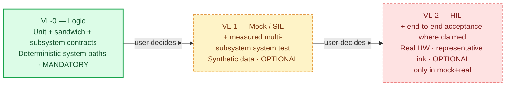

Each level includes all tests from the levels below. The HAL substitution ladder (§6.5) determines the data source; the telemetry companion (§6.5) runs at every level.

### 11.2 Adaptive rule

The user chooses the verification level per module and per system path, per cycle. Four constraints:

1. **Floor.** Every module and every declared cross-subsystem contract and system path reaches VL-0 in every cycle.
2. **Honesty.** No module or end-to-end claim is higher than the environment actually tested. Passing subsystems individually does not prove a cross-subsystem requirement.
3. **Telemetry context.** Every evidence record includes telemetry companion readings (§6.5). Evidence produced outside the UC's declared operating envelope is flagged and may be invalidated.
4. **HAL mode ceiling.** `mock-only` caps every claim at VL-1. `mock+real` allows VL-2, but each module and path still declares its level per cycle: the Real HW HAL may be declared at VL-0 (fake device API) for a cycle, in which case G3.2 does not fire and the honesty declaration states it. PIL uses the actual target processor with Mock HAL inputs; every PIL claim stays VERIFIED, not VALIDATED (see §2 and §6.5).

| Scenario | User declares | G3 checks |
|---|---|---|
| Fast iteration | VL-0 all | Unit + sandwich for every module; contract and deterministic path tests for connected subsystems |
| Processing validation | VL-1 for processing; VL-0 rest | Mock/SIL for processing modules; VL-0 floor for every subsystem path |
| Pre-release (`mock+real`) | VL-1 for A→B data path; VL-2 for `hw_acquisition` | Measured multi-subsystem path plus HIL acquisition |
| Full release | All modules and system paths at `required_vl` | Every claim at its S1-declared level |

### 11.3 Sub-gates

G3 runs the tests S3 wrote and writes none; a declared level with no test is a module defect routed to S3. The runs happen in a separate read-only verifier context — a subagent where the runtime supports it, otherwise a fresh session — which implements P2: the oracle is not the generator.

**Hardware enrollment.** Before G3.2 can fire, the target must be enrolled in `.codeanvil/project.yaml` via `codeanvil credential-setup -u <admin-user> -i <host> --port 22`. G3.0 and G3.1 may proceed locally while enrollment is pending; G3.2 blocks until a valid `targets:` entry exists.

| Sub-gate | Fires when | Checks |
|---|---|---|
| **G3.0** | Always | Unit + sandwich, cross-subsystem contract, and deterministic system-path tests pass; Mock HAL golden vectors; telemetry companion confirms UC nominal |
| **G3.1** | VL-1+ declared for a module or path | Mock HAL synthetic data; Mock/SIL system tests across affected subsystems pass; metrics within thresholds; telemetry companion confirms UC nominal |
| **G3.2** | VL-2 declared for a module or path | Real HW HAL on COTS device (only in `mock+real`); enrollment required (see above); datasets from the SyRS lab procedures (`PROTO-*`) with declared calibration and tolerances; for cross-subsystem paths, a representative link; measurements within criteria; telemetry companion confirms UC nominal |

### 11.4 Failure classification and routing

G3 failures are classified into five outcomes — operational fix, module defect, plan defect, design defect, or RFD — and routed per §12. Before routing, distinguish **operational** faults (DUT permissions, SSH, udev — fix the target and re-run G3) from **defects** in the delivered code. Self-diagnosis rule: if a module that was *not* changed fails during re-testing → undeclared dependency → design defect → S1.

---

## 12 Feedback Routing

V-SIL v4 produces two types of feedback. They are structurally different and must not be conflated.

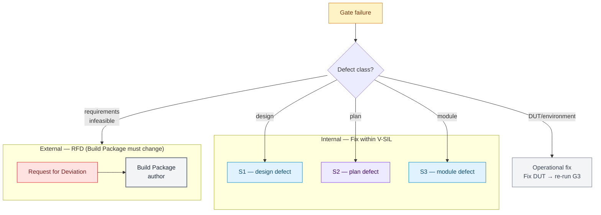

### 12.1 Internal defect routing

A **defect** means V-SIL can fix it internally. The implementation, the plan, or the design is wrong, but the requirements are achievable. An **operational problem** is not a defect: it is a DUT/environment issue that blocks measurement; fix it and re-run G3 without touching S1, S2, or S3.

| Class | Routes to | Example |
|---|---|---|
| Operational problem | Fix DUT → re-run G3 | Target device access failure; SSH auth failure; missing udev rule |
| Design defect | S1 | DAG has undeclared dependency; cross-subsystem contract or state ownership is incomplete |
| Plan defect | S2 | PLAN.md omitted a needed contract; verification plan missing a declared level; task ordering violated a dependency |
| Module or integration defect | S3 | Processing output is wrong; UI deserializes a valid message incorrectly |

**Self-diagnosis:** if a module that was *not* changed fails during re-testing → undeclared dependency → design defect → S1.

### 12.2 Request for Deviation (RFD)

An **RFD** means the Build Package requirements are **infeasible on the declared COTS platform**. V-SIL cannot fix it internally — the constraints themselves must change. V-SIL **suspends** until the Build Package is updated and re-enters at S0.

An RFD can be emitted from **S1, G1, or any G3 sub-gate**. S0 and G0 do not emit one: S0 makes no judgement about feasibility and G0 checks structure only. S2 and G2 do not emit RFDs directly; infeasibility discovered during planning is recorded in the PLAN.md risks section and confirmed at G3. Infeasibility discovered while implementing in S3 is reported through G3.

| Discovered at | Example |
|---|---|
| S1 | Pipeline latency exceeds requirement under any partitioning on this HW |
| G1 | Design review concludes that a latency budget cannot be met on this HW, by the reviewed design or by any other partitioning |
| G3.0 | Unit tests reveal that two normative requirements conflict mathematically |
| G3.1 | SIL metrics show two performance thresholds cannot simultaneously be met |
| G3.2 | HIL shows real hardware noise floor exceeds assumed budget |

At S1 and G1 nothing has been measured yet, so the evidence is analysis and names no verification level (P4).

### 12.3 RFD contents

Per ECSS [16], MIL-HDBK-61A [17], and NASA NPR 7150.2 [18]:

```
Request for Deviation — RFD-001

  Conflicting requirements:
    STK-xxx: <requirement A>    (source: <standard or regulator>)
    STK-yyy: <requirement B>    (source: <standard or regulator>)

  Evidence (from G3.1, VL-1):
    Config 1 → requirement B met, requirement A violated
    Config 2 → requirement A met, requirement B violated

  Trade-off options:
    A) Relax requirement A     → both met
    B) Relax requirement B     → both met
    C) Dual-mode design        → both met, adds complexity

  Impact analysis:
    Option A: requires normative waiver from <standard>
    Option B: screening-grade only, not compliance-grade
    Option C: new module, new interface contract, S1 rework

  Recommendation: <selected option with rationale>
```

### 12.4 Failure triage and draft mode (S0 · G0 · G1)

The requirements stages are exploratory: the Ground Truth is corrected many times before it is sound. V-SIL v4 softens the *loop*, not the *checks*, through two devices scoped to S0, G0 and G1 — never to S2, S3, or G3.

**Failure triage.** A machine or gate failure is translated before it reaches the human. For every G0 ERROR, every missing-list placeholder and every G1 `open` finding, the agent states the real problem in plain language — describing each requirement by what it asks, with its block ID only in parentheses, so the reader never opens a document to know what an item is — and offers two to four concrete reconciliation options (connect an unlinked item, create its missing origin, remove or relax it, or — when the gap is a documentary fact and the runtime has web access — look it up on the web and propose the found value with its source for the human to confirm), each with its consequence. The human chooses; the agent applies. The agent is the interpreter, never the oracle: the verdict stays the validator's exit code (G0) or the human's answer (Gate H, G1), so P2 and P3 are untouched.

**Draft mode.** When a requirements stage finds unresolved items — a missing-list entry, a format error, or a G1 open finding — it **enters draft automatically** and cannot advance until **each one is resolved**. Mechanical fixes that invent nothing — removing blueprint scaffolding, filling a value already stated elsewhere, dropping a broken reference — are **auto-applied and reported**, not asked; only the judgment calls go to the human, who **fixes** them, knowingly **ignores/accepts** them (recorded with the decider's name), or **escalates** to an RFD. While in draft the stage runs against the current files, applies triage and loops without writing a report iteration or enforcing staleness; the human may edit the GT pair directly. On commit — reached only once every item is decided — the marker is removed and one recorded run is written, listing each item and its decision. A format error can be fixed or escalated but never ignored into a pass, since the deterministic validator keeps rejecting it. The audit trail records the run that passes and the decisions behind it, not the red path to it.

---

## 13 Terminal Output

The Verified Prototype lists the delivered tree (`src/<subsystem>/`) apart from the verification kit (`verification/`) and the module plans (`plans/`), and names the verifier context in which G3 ran the tests.

```
Verified Prototype — V-SIL v4
  Cycle: <cycle_name>
  HAL mode: mock+real

  Delivered software (shipped):
    src/subsystem_a/, src/subsystem_b/ — no CodeAnvil dependency
  Module plans (not shipped):
    plans/ — PLAN.md per module, delta traceability log
  Verification kit (not shipped):
    verification/ — Mock HAL, golden vectors + manifest, telemetry
                    companion, stubs, fake peers, drivers, tests
  Verifier context: read-only verifier subagent (fresh context)

  Module evidence (Subsystem A — processing):
    hw_acquisition:      VL-2 (HIL)  — Real HW HAL, COTS device
                         Plan: plans/hw_acquisition/PLAN.md (slice 1)
    signal_processor:    VL-1 (SIL)  — Mock HAL, golden vectors (v1.2, SHA bc3f…)
                         Plan: plans/signal_processor/PLAN.md (slice 2)
    feature_extractor:   VL-1 (SIL)  — Mock HAL, synthetic data at known conditions
                         Plan: plans/feature_extractor/PLAN.md (slice 3)
    classifier:          VL-0 (logic)— Mock HAL, deterministic vectors
                         Plan: plans/classifier/PLAN.md (slice 4)
    output_formatter:    VL-1 (SIL)  — Mock HAL, synthetic processed data
                         Plan: plans/output_formatter/PLAN.md (slice 1)
    data_store:          VL-0 (logic)— Mock HAL, deterministic vectors
                         Plan: plans/data_store/PLAN.md (slice 4)

  Module evidence (Subsystem B — client):
    dashboard:           VL-1 (SIL)  — subsystem A messages on simulated link
                         Plan: plans/dashboard/PLAN.md (slice 1)
    controls:            VL-0 (logic)— command and acknowledgement vectors
                         Plan: plans/controls/PLAN.md (slice 1)
    alerts:              VL-0 (logic)— unit + sandwich integration
                         Plan: plans/alerts/PLAN.md (slice 2)
    history:             VL-0 (logic)— unit + sandwich integration
                         Plan: plans/history/PLAN.md (slice 2)

  Delta traceability log:
    GT version at S2 entry: 1.0
    Deltas applied: 0 ADDED, 0 MODIFIED, 0 REMOVED
    GT version at G3 exit: 1.0

  Subsystem and system-path evidence:
    A → B telemetry.v1: VL-1 — schema + latency on simulated link
    B → A control.v1: VL-0 — commands, retries, duplicate handling
    PATH-001 / SYS-002 data display: VL-1 — subsystem A + B, Mock HAL synthetic data

  Telemetry companion report:
    All tests: UC within operating envelope
    CPU peak: 63%  |  Temp peak: 68 °C  |  Dropped buffers: 0
    No evidence invalidated by UC conditions.

  Honesty declaration:
    VL-1 modules: VERIFIED against synthetic data (Mock HAL).
    VL-2 modules: VALIDATED on real hardware (Real HW HAL);
                  calibration: screening grade per SyRS §4;
                  tolerances: declared by development team (SyRS §5).
    VL-0 modules: VERIFIED at logic level only.
    SYS-002: VERIFIED across connected subsystems with synthetic input;
             no real-link or HIL claim.
    Telemetry companion: UC nominal during all test executions.

  RFDs issued: 0
```

### 13.1 Optional future work register

After G3, the prototype may include proposals for later software versions. Each entry records an ID, capability, origin, candidate version, decision owner, dependencies, and acceptance criterion. The Build Package author decides what enters a later version; an accepted proposal becomes new S0 input. A failing current `SYS-*` remains a defect or RFD — the register cannot turn it into a passing claim.

The following items are forward-referenced inline throughout the document:

| ID | Capability | Reference |
|---|---|---|
| FW-001 | CI/CD automation of G3 evidence | §11 |
| FW-002 | PIL as a full G3 sub-gate with timing/scheduling checks | §6.5 |
| FW-003 | Formal fault injection at VL-2 (ISO 26262-5 §10) | §11.3 |
| FW-004 | SIL ↔ HIL correlation measurement | §11.2 |
| FW-005 | MLOps for the optional ML model (S3/G3 integration) | §6.4 |
| FW-006 | Automated PLAN.md generation from S1 design | §8.3 |

---

## 14 References

[1] R. S. Pressman, B. R. Maxim, *Software Engineering*, 9th ed., 2020.
[2] ISO/IEC/IEEE 29119-1:2022, "Software testing — Part 1."
[3] Codeburst, "The Basics of Contract Tests," 2024.
[4] L. Bass, P. Clements, R. Kazman, *Software Architecture in Practice*, 4th ed., 2021.
[5] ISO 26262:2018, "Road vehicles — Functional safety."
[6] V. H. Nguyen, T. Nguyen, "SDAD," arXiv:2608.20341, May 2026.
[7] "LLM-as-a-Judge Is Not an Oracle," arXiv:2609.02246, Sep. 2026.
[8] V. Reddy et al., "Reason Less, Verify More," arXiv:2607.07405, Jul. 2026.
[9] Sheridan Tech, "Design Validation vs Verification," Mar. 2026.
[10] Augment Code, "Coordinator-Implementor-Verifier Pattern," Jun. 2026.
[11] OPAL-RT, "Guide to HIL Testing," Sep. 2026. — Staged SIL→HIL progression for real-time simulation; V-SIL's Mock HAL/golden-vector/telemetry-companion adaptation is its own contribution.
[12] IEEE/ISO/IEC 29148:2018, "Requirements engineering."
[13] V. Lavecchia, "Sandwich testing strategies," 2024.
[14] B. Trinnes, "Test Architecture Patterns," GitHub, Apr. 2026.
[15] "Spec-Driven Development," arXiv:2602.00180, Feb. 2026.
[16] ECSS-Q-ST-10-09C, "Nonconformance control system," European Cooperation for Space Standardization. — Defines Request for Deviation (RFD) as a "planned departure" from requirements.
[17] MIL-HDBK-61A, "Configuration Management Guidance," U.S. DoD, 2001. — Deviation processing: request when a product cannot meet technical requirements; includes impact analysis and trade-off options.
[18] NASA NPR 7150.2, "NASA Software Engineering Requirements." — Deviation/waiver evaluation: technical justification, risk assessment, impact to safety, and proposed alternatives.
[19a] C. Koch, J. A. Wellbrock, "Agile V: A Compliance-Oriented Framework for AI-Augmented Engineering," arXiv:2602.20684, Feb. 2026. — Infinity Loop merging Agile iteration with V-Model verification; task as iteration unit; human approval gates.
[19b] C. Koch, "Agentic Agile-V: From Vibe Coding to Verified Engineering in Software and Hardware Development," arXiv:2605.20456, May 2026. — SCOPE-V micro-cycle (Specify, Constrain, Orchestrate, Prove, Evolve, Verify); minimum input artifacts for agentic work.
[20] GitHub Spec-Kit — Specification-driven development toolkit for stage-gate methodologies.
[21] OpenSpec Delta Traceability Model — ADDED/MODIFIED/REMOVED/RENAMED annotation convention for living requirements documents with change-level tracking; V-SIL scopes the convention to the module boundary.
