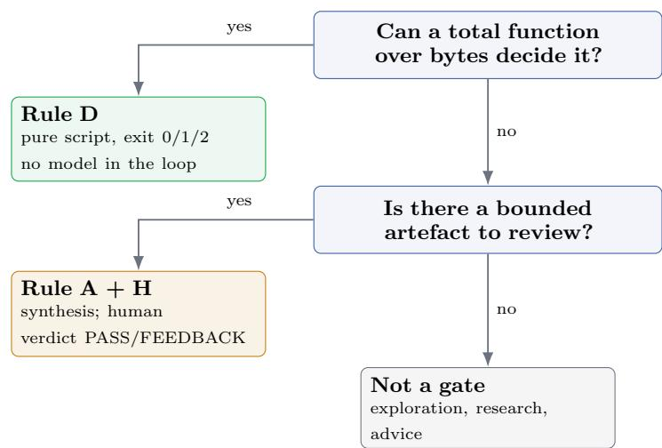

# Engineering AI Agent Harnesses

Conceptual Foundations, Architectural Paradigms, and Commercial Runtime Strategies

David Ram´ırez-Betancourt

Universidad Nacional de Colombia — GCPDS October 2026 • Version 2.1

#### Abstract

Teams that need reliable, auditable engineering workflows with language models keep making the same mistake: they build an agent application, and in doing so they rebuild—badly—the interface that commercial coding agents already ship. This paper argues that the correct unit of design is not the agent but the harness, and it separates the stack into two owners. The cockpit is the rented commercial runtime: the human-machine interface that owns token streaming, terminal multiplexing, permission prompts, diff rendering, context compaction, and model routing. The outer harness is the owned, deterministic rig that wraps a cockpit and supplies what no vendor can ship: domain ground truth, an ordered gate topology, script-decided validation, append-only evidence, and custody of the inputs. We state the baseline equation Agent = Model + Harness, give the ownership split across the six concerns of the ETCSLV model, define the harness as a quadruple of methodology, gate topology, state, and custody, and derive a portability proposition that makes the cockpit interchangeable. We then show how state is enforced choreographically instead of by an orchestrator, why decidable checks must be executed by pure scripts rather than by the model, and how custody, out-of-band verdicts, and read-time re-verification keep acceptance tamper-evident when the cockpit itself is untrusted. The paper closes with a six-phase blueprint, a maturity model, and an explicit account of what the argument does not establish.

## 1 Introduction

Between 2023 and 2026 the limiting factor in applied AI shifted. It is no longer whether a model can produce a plausible design document or a working parser; it can. The limiting factor is whether an organization can trust, reproduce, and audit what the model produced, and whether it can do so without rebuilding the model's interface every quarter. The industry's default answer—wrap the model in an agent framework—addresses the wrong layer. It produces a bespoke application where a commodity interface already exists, and leaves the engineering problem untouched: the absence of explicit acceptance criteria, ordered verification stages, and evidence.

The 2026 literature has converged on a corrective formulation. A coding agent is not a model deployment; it is a composed system whose behaviour is determined as much by its scaffolding as by its weights [\[3,](#page-13-0) [4\]](#page-13-1). We adopt that formulation as the baseline of this paper:

Agent = Model + Harness. (1)

| Agent = Model + Harness. | (1) |
|--------------------------|-----|
|--------------------------|-----|

The left-hand side is what a user experiences. The right-hand side distributes the engineering work, and it distributes it unequally: the model is rented, the harness is owned. Everything a team can differentiate—its acceptance criteria, its verification order, its evidence—lives on the owned side. This paper is about designing that side well.

Principle 1.1 (Determinism is relocated, not manufactured). A harness cannot reduce the entropy of a language model. It can make the acceptance of the model's work independent of that entropy for every check that a program can decide, and it can make the remaining judgments attributable to a named human at a named iteration.

Three conflations account for most failed agent programmes, and all three are conceptual. Capability conflation assumes a better model will fix a broken workflow; it will not, because whether a requirement traces to a system requirement is a property of the document, not of the prose. Layer conflation assumes that building an agent application means building the agent's environment; the streaming renderer, the

diff applicator, the permission prompt, and the context compactor are already products. Ownership conflation assumes a vendor can ship a harness; a vendor can ship a runtime, a skill format, and a tool protocol, but it cannot ship your domain's acceptance criteria.

Contributions. (i) A five-way taxonomy—prompt engineering, context engineering, agent frameworks, cockpits, and outer harnesses—with a trade-off matrix over six engineering dimensions (Section [2\)](#page-1-0). (ii) An ownership model that assigns the six ETCSLV concerns of Meng et al. [\[4\]](#page-13-1) to the cockpit or to the harness, and a portability proposition derived from it (Section [3\)](#page-3-0). (iii) A definition of the outer harness as a quadruple of methodology, gate topology, state, and custody, with the authoring/instantiation split and its invariants (Section [4\)](#page-4-0). (iv) A state and verification design that replaces the orchestrator with choreographed preconditions, a decidability partition, and cryptographic custody (Section [5\)](#page-7-0), followed by a six-phase blueprint (Section [7\)](#page-11-0). The argument is architectural rather than empirical: rules are distilled from deployed harnesses and stated so that a team can apply them to a domain of its own. Where a rule has a published counterpart—a specification, a standard, a technique—it is cited.

# 2 The Paradigm Spectrum

### 2.1 Prompt and context engineering

Prompt engineering treats the model's input as the design surface: system instructions, few-shot examples, output formats, and manual iteration in a chat window. It is the cheapest paradigm to start and the hardest to audit, because nothing outside the conversation records what was accepted or why. Context engineering extends it with retrieval: a vector or lexical index selects passages and injects them into the prompt [\[11\]](#page-13-2), and agentic variants interleave retrieval with reasoning steps [\[12\]](#page-13-3). Both paradigms improve what the model sees. Neither changes what the organization accepts: retrieval is read-only, and a retrieved passage is evidence of relevance, not of conformance. The failure mode is structural rather than technical—the workflow's acceptance criteria remain implicit, so every run is re-litigated in conversation.

### 2.2 Agent frameworks

Agent frameworks—graph DSLs, tool dispatchers, role-playing multi-agent runtimes—move the design surface to code: nodes, edges, shared state, and tool bindings [\[13,](#page-14-0) [14,](#page-14-1) [15\]](#page-14-2). They buy explicit control flow and, with it, an obligation the team may not have budgeted for: the framework owns the execution loop, which means the team now owns the streaming interface, the permission model, the diff renderer, the context compactor, and the session store as well—the hidden technical debt of glue code, which compounds because the glue sits on the critical path [\[16\]](#page-14-3). The economic consequence is decisive at team scale, though not in the direction a price comparison suggests. A framework calls the provider's raw API, so every token is billed at metered rates; a cockpit is sold as a subscription that includes an allowance and meters the excess. Both meter, so the gap is smaller than a seat-versus-token comparison implied in 2025. What differs is the unit of work: a harness spends tokens on synthesis and judgment and spends nothing on checks a script can decide, while a framework spends tokens on work a validator could have performed. For a team of twenty running long verification loops, that difference changes which experiments are affordable, and therefore how fast the methodology can be iterated [\[17,](#page-14-4) [18\]](#page-14-5). The capability boundary is real: frameworks are the right instrument when the product is the agent loop (Section [3\)](#page-3-0).

### 2.3 The cockpit: layer 1, rented

We name the commercial coding agent the cockpit: the interactive surface through which a human and a model collaborate on a repository. Claude Code, OpenAI Codex CLI, OpenCode, and Pi are cockpits. The term is chosen deliberately. A cockpit is not the aircraft and it is not the flight plan; it is the interface where the pilot observes instruments and issues commands, and it is certified, instrumented, and expensive to build. A cockpit owns, as a product:

- Execution—the agent loop, tool dispatch, streaming output, and interruption;
- Tools—the client side of the tool protocol [\[2\]](#page-13-4), permission prompts, and the approval model that decides what the agent may touch;
- Context—window management, compaction, and the hooks through which skills, instructions, and retrieved files enter the prompt;

- Interface—terminal multiplexing or a desktop surface, diff rendering, session resumption, and model routing across providers.

The cockpit is rented: it improves on the vendor's schedule, it is billed as a subscription with a metered usage allowance, and its internal behaviour is not a design surface the team controls. That is a feature. The parts of the stack a team is worst at maintaining—streaming UI, compaction heuristics, provider plumbing—are precisely the parts a vendor amortizes across thousands of customers. Rebuilding them is not differentiation; it is a maintenance liability with a chat box on top.

Cockpit SDKs. Between the framework and the cockpit a third delivery form appeared: SDKs that expose a vendor's loop as a library—the Claude Agent SDK, the Codex SDK, the OpenAI Agents SDK—while the team supplies the surface. The taxonomy treats them as a cockpit variant rather than a new paradigm, because what they rent is still execution, tools, context, and compaction; only the delivery form changes, from terminal to process. They sharpen the decision rule of Section [3:](#page-3-0) the question is not whether to build a loop, but which layer of the loop is commodity for this team.

### 2.4 The outer harness: layers 2 and 3, owned

What the cockpit cannot own is the outer harness: the deterministic rig that wraps a cockpit and decides what counts as acceptable work. It has two layers. Layer 2 is the methodology harness—skills that encode procedures, an ordered gate topology, an append-only report per gate and cycle, and a verdict protocol. Layer 3 is domain governance—the ground truth of the field, the deterministic validators that check it, the standards the work must satisfy, and the custody chain that makes the inputs tamper-evident. Both layers are owned in the strong sense: they live in the team's repository, they survive a change of model, cockpit, and personnel, and they are the only part of the stack that stays valuable when the cockpit is replaced.

Table 1: The five paradigms on six engineering dimensions. Filled boxes indicate strength; more boxes are better in every row. Ratings assume an engineering workflow with human review, not a consumer chat product.

|      | Dimension     |           |         | Prompt Context Framework cockpit Outer harness |
|------|---------------|-----------|---------|------------------------------------------------|
| Time | to            | first     | working | loop                                           |
|      | Velocity      | amortized |         | over a year                                    |
| Cost | control       | at        | team    | scale                                          |
|      | Interface     | readiness |         |                                                |
|      | Deterministic |           |         | acceptance                                     |
|      | Reversibility |           | (low    | lock-in)                                       |

Two rows invert naive expectations. Cost control no longer separates the cockpit from the framework by price: subscriptions are metered at the margin, so a long loop pays for tokens either way. What separates them is what the tokens buy—a harness spends them on synthesis and judgment while every decidable check runs as a script that costs nothing, whereas a framework bills a model call for work a validator could have decided. Deterministic acceptance is zero for the cockpit alone: a cockpit can render a diff and ask for approval, but it has no notion of a gate that must pass before the next one runs, and its transcript is not evidence a third party can replay. The harness inherits the cockpit's interface score and adds the property the cockpit cannot have.

### 2.5 The ETCSLV split

Meng et al. [\[4\]](#page-13-1) decompose an agent harness into six concerns: Execution, Tools, Context, State, Lifecycle, and Evaluation. The decomposition is useful not because it enumerates components but because it exposes the seam this paper draws. Three concerns are executed at runtime and belong to the cockpit; three are durable and belong to the outer harness (Table [2\)](#page-3-1). Confusing the two is the mechanism behind layer conflation: a team that decides to own evaluation usually discovers it has also decided to own execution, and inherits a cockpit it did not intend to build.

Model rented weights; interchangeable, no memory of the project

Layer 1 — cockpit rented runtime: loop, tools, permissions, streaming, diffs, compaction

Layer 2 — Methodology harness owned: skills, gate DAG, reports, verdicts

Layer 3 — Domain governance owned: ground truth, Rule D validators, standards, custody

Agent = Model + Harness the harness wraps, it does not replace

Figure 1: The four-layer stack. The model and the cockpit are rented; the two harness layers are owned. The stacking order is also a dependency order: a gate can require a script, a script can require a baseline, but none of them requires the cockpit's internals.

Table 2: The ETCSLV concerns and their owner. The right column is the design surface of this paper; the middle column is a contract a vendor maintains.

| Concern    | cockpit (rented, runtime)                | Outer harness (owned, durable)                    |
|------------|------------------------------------------|---------------------------------------------------|
| Execution  | Agent loop, tool dispatch, streaming,    |                                                   |
|            |                                          | Which steps run, in what order, and what exit     |
|            |                                          | criterion closes each                             |
| Tools      | Tool transport, MCP client, permission   |                                                   |
|            |                                          | Declarative server definitions; capability policy |
|            |                                          | per gate                                          |
| Context    | Window management, compaction, injection |                                                   |
|            |                                          | What must be loaded: the procedure, the           |
|            |                                          | baseline, the prior reports                       |
| State      | Session transcript, resumption           | Gate state, append-only reports, cycle identity,  |
| Lifecycle  | Session start and stop, model routing    | Gate order, prerequisites, verdict domain,        |
|            |                                          | review mode                                       |
| Evaluation | None beyond rendering a diff             | Validators, decidability partition, human         |

# 3 The Architectural Divide

## 3.1 The cockpit inventory

The divide is best stated as an inventory of what a team must not build. A commercial cockpit already provides a streaming renderer, terminal or desktop multiplexing, a permission prompt, a diff viewer, a context compactor, session persistence, model routing, and an MCP client. Each is a product with years of edge cases: resumable streams, tool calls that fail halfway, terminal escape sequences, approval UI for destructive operations, token accounting under compaction. A team that reimplements any of them has chosen to maintain a cockpit while claiming to build a methodology. The anti-pattern has a recognizable symptom: the repository's largest module is an event loop, and its acceptance criteria live in a slide deck.

What a cockpit does not and cannot provide is equally specific. It has no concept of a gate that must pass before another begins, no notion of a domain's ground truth, no deterministic validator for the field's artefacts, and no evidence trail independent of its own transcript. A cockpit optimizes a conversation; a harness certifies a deliverable. Those are different products, and the second one is the team's to build.

### 3.2 Separation of responsibilities

The seam is contractual, not aspirational. The cockpit owns everything that must respond within a frame: input, streaming, approval, rendering. The outer harness owns everything that must survive the session: which gate is open, what the last verdict was, what the baseline digest is, and who is accountable. The harness may invoke the cockpit and read its output; it must never depend on the cockpit's internal representation. Concretely, the harness treats the cockpit as a function from (prompt, tools, workspace) to (artefacts, transcript), and it evaluates only the artefacts. That is what makes the next subsection possible.

#### 3.3 The economics of iteration

Let Eh be the cost of engineering the harness and Ef the cost of engineering a framework application. The framework looks cheaper at the first milestone because Ef omits the interface: the loop, the renderer, and the approval model are counted as code rather than as work. They reappear as maintenance, on the critical path of every methodology change, whereas the harness pays a fixed cost—a validator, a gate schema, a report format—that does not grow with the number of experiments. A harness makes a methodology change cheap, and only a cheap methodology change reveals which gates are worth having—the same argument that made deployment pipelines standard [\[21\]](#page-14-6).

Pricing has also changed shape. The flat seat that made cockpits obviously cheaper in 2025 has become a subscription with an allowance and a metered overage, so the token arithmetic no longer decides the comparison. The defect of the framework is not that tokens are metered—the cockpit meters them too—but that a framework spends them on work a total function could decide. The cheapest token is the one never sent, and Rule D (Section [5.3\)](#page-8-0) is the policy that makes it so: every check moved from the model to a script removes cost from every future cycle, while the fixed cost of writing the script is paid once.

#### 3.4 The interchangeability test

Portability is not a claim about supporting many models. It is a test a harness either passes or fails, and the test is operational.

Definition 3.1 (Interchangeability test). Move a project to a different cockpit—different vendor, different terminal, different configuration surface, say from Claude Code to Codex—in one working day, without editing the methodology, the gate order, the report schema, or the validators. If the reports produced after the move are comparable with the reports produced before it, the harness passes.

Four conditions make the test pass, and each closes one channel through which a runtime's identity can leak into the methodology: procedures are packaged in a runtime-agnostic format; instructions converge into one canonical file that other surfaces link or point to; tool configuration is declarative, rendered into each client's shape rather than hand-maintained; and state is plain files with relative paths, so no session store has to be migrated.

Proposition 3.1 (Runtime portability). If a harness satisfies those four conditions, then replacing the cockpit changes neither the methodology nor the gate semantics, and the only residual work is installing and configuring the new cockpit.

Proof sketch. Each condition removes one host-specific construct. A conforming procedure contains no vocabulary to translate, because it names capabilities and files rather than a host's tools; a canonical instruction file has no forked copy to reconcile; a declarative tool definition has no hand-maintained manifest to update; and file-based state has no session store to migrate. The residue is the cockpit's own installation, which lies outside the harness. The proposition is therefore conditional, and its strength is exactly the strength of the conformance argument: the residual work is installable, not zero.

### 3.5 When a framework is the right answer

The divide is a decision rule, not a verdict. A framework is the correct instrument when the agent loop is the product: a research system that must expose custom reasoning topologies, a product whose value is a novel interaction model, or a deployment that cannot use a commercial seat at all. The tell is where the differentiation lives. If it lives in the loop, build the loop and accept that you are maintaining an interface. If it lives in the acceptance criteria—in the field's notion of a correct artefact—then the loop is overhead, and the harness is the product. The SDKs of Section [2.3](#page-1-1) sit on the same axis: they rent the loop while leaving the surface to the team, which is the right choice when the loop is commodity but its integration is not.

# 4 The Outer Harness: Structure and Portability

Definition 4.1 (Outer harness). An outer harness is a quadruple H = (M, G, S, C): a methodology M of procedures stated as runtime-agnostic skills; a gate topology G, a directed acyclic graph of verification stages, each with a precondition and a verdict domain; a state substrate S of durable, append-only records; and a custody mechanism C that binds the baseline inputs to digests and a signed chain of events. H is executed on a cockpit K and over a baseline B.

The quadruple is deliberately minimal. Anything not in it—a scheduler, a database, a server, a dashboard is an implementation choice, and Section [5](#page-7-0) argues that the default choice should be none of them. The harness is also the part that evolves: capability improves without retraining the base model, so the design question is how the harness changes, not how the weights do [\[5\]](#page-13-5).

#### 4.1 Gate topology

A gate is a verification stage with three properties: a precondition (its predecessor's latest verdict is pass), a bounded artefact a human can review in minutes, and a verdict written by someone other than the artefact's generator. Four constraints turn a list of stages into a topology. The graph is acyclic and ordered, because a cycle of preconditions has no admissible start. The entry gate is deterministic, because a chain that begins with a model judgment has no reproducible foundation. The verdict domain has exactly two values, pass and feedback; a third, terminal value such as denied carries no information about what would be acceptable and either stalls the chain or invites the model to guess. And the chain is cycle-scoped: one traversal against a fixed baseline produces one record set, so a new baseline produces a new cycle rather than overwriting the old one.

#### 4.2 The authoring plane and the execution plane

A harness has two audiences with incompatible needs. The people who author the methodology need to change it constantly and test it against adversarial inputs; the people who use it need a workspace that does not move underneath an audit. Conflating them produces one of two failures: the project is coupled to a moving repository, or the methodology ossifies because changing it would break live projects.

The separation is a factory and a vehicle. The factory is the repository where the methodology is engineered: procedures as data, deterministic validators, the scaffold generator, and a regression corpus of adversarial baselines. It is allowed to be unstable, because its tests are what keep evolution honest. The vehicle is the project produced by the scaffold. Its defining property is that it contains no orchestrator program: no scheduler, no server, no daemon, no runtime-specific code. It contains a layout, a set of skills, and a state directory, and opening it with any conforming cockpit is sufficient to start work.

The generator is a compiler. Its input is the template set plus a project identity; its output is a vehicle in which every runtime-specific path is a projection of a canonical artefact. Four transformations are mandatory: procedures are copied and their repo-relative references rewritten to project-relative ones; the baseline is materialized from locked templates into the skill that owns it, so the user's ground-truth area starts empty; the state directories and the instruction file are generated from the configuration; and links plus per-client manifests are created last, so a failed rewrite cannot leave a half-linked project. The pipeline is idempotent with respect to identity: re-scaffolding a project whose manifest carries the same identifier does not rewrite it.

Five invariants keep the two planes from leaking into each other. No back-reference: a vehicle never imports, executes, or resolves a path into the factory. No absolute paths in committed artefacts: skills, manifests, and reports use project-relative paths, and machine-local locations live in a local registry. One canonical store: runtime directories are links, so content exists once and a fix is visible everywhere immediately. Immutable history: reports and custody records are append-only; re-running a gate adds an iteration rather than editing one. No vendor workflow engine: the methodology must not adopt a cockpit's proprietary orchestration feature—agent teams, background delegation, dynamic workflow scripts—as the place where gate order lives. A workflow that only one runtime can execute is a lock-in wearing the shape of a feature; the order must remain readable in the procedures.

A consequence the architecture must state plainly: a vehicle is a snapshot. When the factory changes a skill, existing vehicles do not change. That is a feature for audit—re-running a cycle reproduces the procedure that was in force—and a problem for fixes, because a corrected validator does not reach projects scaffolded before the correction. A production harness therefore needs an explicit upgrade path: a schema version in the manifest, a migration that preserves report history, and a policy for which changes are security fixes that must be back-propagated.

### 4.3 Portable projection

The portability substrate is a standard rather than a feature: the Agent Skills specification [\[1\]](#page-13-6) defines a procedure as a directory whose only required member is SKILL.md—YAML frontmatter for metadata, Markdown for the procedure, and optional scripts, references, and assets. The format specifies no runtime API and no execution model, which is why unrelated cockpits can consume it. Its load model is a

context-economics mechanism: metadata on the order of a hundred tokens is indexed at startup, the body is loaded only on activation, and bundled resources are read only when the procedure asks for them. A harness can therefore ship a dozen gate skills and pay for the metadata, not for the sum of the bodies. Table 3: Skill frontmatter as a portability contract. The right column is the harness's use of each field; the constraint column is the specification's.

| Field Specification         | constraint     | Use          | in a harness |            |          |                                 |
|-----------------------------|----------------|--------------|--------------|------------|----------|---------------------------------|
| name Lowercase kebab-case,  | at             |              |              |            |          |                                 |
| most 64 characters,         |                |              |              |            |          |                                 |
| matching the                | directory      |              |              |            |          |                                 |
|                             |                | Stable       | identity     | for humans |          | and for the scaffold            |
| description At most 1024    | characters;    |              |              |            |          |                                 |
| what the skill              | does and when  |              |              |            |          |                                 |
| to use it                   |                |              |              |            |          |                                 |
|                             |                | Carries      | the trigger  | vocabulary |          | that drives activation          |
| license ;                   |                |              |              |            |          |                                 |
| Optional short              | name or        |              |              |            |          |                                 |
| bundled file;               | environment    |              |              |            |          |                                 |
|                             |                | Declares     | the runtime, |            | the      | side effects, and the files the |
|                             |                | procedure    | writes       |            |          |                                 |
| metadata Map of string      | keys to string |              |              |            |          |                                 |
|                             |                | Extension    | keys:        | owner,     | version, | gate identity, domain           |
| allowed-tools Experimental, |                |              |              |            |          |                                 |
|                             |                | Deliberately | unused:      |            | naming   | a host’s tools binds the        |
|                             |                | procedure    | to one       | cockpit    |          |                                 |

The specification says where a skill lives; it does not say where a cockpit looks for one. Each runtime has its own discovery convention and the conventions disagree. A projection mesh resolves the disagreement once, at scaffold time: one canonical store, and every runtime-specific directory a relative symlink to it. Instructions converge the same way—one canonical file, with runtime-specific names as links or pointers. The instruction case is instructive: where a runtime concatenates instruction files instead of linking, pointing is not equivalent to linking, because the same content is loaded twice and the context budget pays for it. The mesh must therefore know each runtime's read semantics, not only its path. Two standards now anchor this layer. AGENTS.md has become the convergence filename for the canonical instruction file, which is why a mesh can point rather than copy, and the Agent Client Protocol standardizes the editor-to-cockpit channel, so a harness can be driven from an IDE without shipping a plugin of its own [\[7\]](#page-13-7). Neither covers skill discovery or tool manifests, which is why the mesh remains necessary rather than redundant.

Tool configuration repeats the pattern at a lower level. The Model Context Protocol [\[2\]](#page-13-4) is a standard interface—a server declares tools, resources, and prompts over a standard transport, and any conforming client can call them—but its configuration is not standard: each client expects a different file, at a different path, with a different key, and a generator that emits the wrong shape fails silently, because the client simply sees no servers. Table [4](#page-6-0) lists the renderings a harness must emit from one canonical definition.

Table 4: Tool-manifest renderings from one canonical server definition. The protocol is standard; the configuration is not.

| Client           | Manifest         | Server key  | Notes                                     |
|------------------|------------------|-------------|-------------------------------------------|
| Claude Code      | .mcp.json        | mcpServers  | Plus a settings allow-list, or a          |
|                  |                  |             | project-scoped session will not connect   |
|                  |                  |             | the servers                               |
| VS Code, Copilot | .vscode/mcp.json | servers     | Wrapped in a top-level object             |
| OpenCode         | opencode.json    | mcp         | Flat map; a local server is one argv list |
| Codex            | config.toml      | mcp servers | Closest to the canonical shape            |

Two properties are requirements disguised as implementation details. Renderings must be merged into existing files rather than written over them, so a project keeps its own tooling. And substitution must be late, so the canonical artefacts stay free of machine-specific paths. A domain harness also needs a runtime the language package manager does not own—a native library, a vendor SDK, a licensed simulator, a driver stack. The bridge is a resolver, not a patch: ask the toolchain for its prefix, fall back to scanning the standard system locations, and inject the resolved directory into the server's interpreter path in every rendered manifest. The server is not modified, the isolated environment is not violated, and the binding lives in the generator rather than in a README.

#### 4.4 Conformance gaps and ecosystem evidence

Portability is a spectrum, and the honest position is to publish the gaps rather than the slogan. Four are visible today. There is no standard tool manifest: four clients, four file formats, four key names, no agreed location—and the failure mode is a missing tool, not a wrong manifest. Two of four runtimes have no published discovery contract for a project-level skill directory, so the symlink is harmless if the convention changes, which is not the same as supported. Directory and name conventions diverge, because scaffolds name directories from configuration keys while the specification requires the frontmatter name to match the parent directory. And there is no standard isolation mechanism: a project-scope flag, an environment redirect, and capability stripping bound different things, so a harness can promise a reproducible demonstration but not a secure one.

The boundary is not only a paper construct. Open-source projects instantiate each layer of the stack: specification tooling such as Spec Kit and OpenSpec formalizes the Layer 3 artefact that a gate validates; methodology and test-driven skill collections such as Superpowers implement Layer 2 procedures that a cockpit can load; and OS-level containment tools such as gentle-ai and gentle-shell implement Layer 1 sandboxing [\[22\]](#page-14-7). None is a harness on its own. A harness is the composition—which is exactly the claim of Section [3.](#page-3-0)

# 5 State, Control, and Verification

### 5.1 The state substrate

The conventional design for a gate chain is an orchestrator: a program that knows the order, holds the current position, and calls each stage. It is the obvious design and the wrong one. A scheduler is a single point of failure whose crash destroys the position it was holding; it creates a second source of truth, because it stores which gate is next while the reports store what happened, and the two diverge after any manual intervention; it becomes an API that every surface must speak to, with versioning and authentication obligations that have nothing to do with the methodology; and it makes the project unarchivable, because a workspace that requires a service is not a workspace an auditor can open or a colleague can clone.

The alternative follows from noticing that the cockpit is already an orchestrator of exactly the right kind: it loads a procedure and follows it. If every procedure enforces its own precondition, the chain needs no coordinator. Three artefacts carry all durable state, and none of them is a database, a session store, or a runtime-specific format: a manifest holding identity and position (a stable identifier, the baseline pointers, and the active cycle); a report tree holding history (one file per gate per cycle, each an append-only sequence of iterations); and a custody directory holding integrity evidence (a sealed manifest of the baseline and a signed ledger).

Listing [1](#page-7-1) shows a report at the point where its first iteration was rejected and its second accepted. The shape is deliberately boring: a header naming the gate, the cycle, the baseline, and the creation time, followed by one section per iteration. Any Markdown reader renders it, any text tool diffs it, and any human reads it without the harness installed.

Listing 1: A gate report after two iterations. The latest iteration is the gate state; earlier iterations are history that is never edited.

# Gate: <gate-id> # Cycle: <cycle-id> Baseline: <id> @ <digest> # Created: <timestamp, millisecond precision, one clock>

## Iteration 1

| Field | Value | |-------------|---------------------------------------------| | Iteration | 1 | | Verdict | FEEDBACK | | Reviewer | <actor> | | Evidence | <validator>, exit 2, <finding>:<line> | | Description | Trace unresolved: requirement 4.2 cites no | | | stakeholder identifier. |

| Field | Value | |-------------|---------------------------------------------| | Iteration | 2 | | Verdict | PASS |

|  |                                 |  |  |  |  |
|---------------|----------------------------------------------|---------------|---------------|---------------|---------------|
| Evidence      | <validator>, exit 0, 0 findings              |               |               |               |               |
| Description   | Trace added in 4.2; all identifiers resolve. |               |               |               |               |

Four properties of this substrate are load-bearing. Append-only: a re-run appends, so the history of a disagreement survives, including the reviewer's wording, which is the most useful part of the record a year later. The latest iteration is the state: there is no separate status field and no progress database, so a derived state cannot disagree with its source because it is not stored. Cycle-scoped: a new baseline produces a new cycle rather than overwriting the old one, which makes an audit a comparison rather than a reconstruction. One clock: the harness supplies timestamps in a human-readable and a filesystem-safe form, so reports agree on when things happened without any gate inventing its own format.

#### 5.2 Choreographed enforcement

The protocol is short because it is stated in each procedure rather than implemented in a program. Each gate skill performs three steps: resolve the active cycle from the manifest, asking the user and recording the answer only when it is absent; read the predecessor's latest verdict and refuse if it is not pass, returning the predecessor's name and the action that unblocks it; otherwise run the gate and append exactly one iteration. The refusal string is a literal contract, not a courtesy—it names the blocking gate and the unblocking action, which is what lets one agent hand control back to a human without knowing anything about the rest of the chain.

Proposition 5.1 (Choreographed enforcement). Let G1, . . . , Gn be gates in a fixed order, each with the precondition that the latest iteration of its predecessor's report is pass. If every procedure refuses to execute when its precondition fails and appends exactly one iteration when it holds, then the set of report trees reachable by the procedures equals the set reachable under a central scheduler enforcing the same order and the same preconditions.

Proof sketch. By induction on the length of the run. The empty tree is reachable in both systems. Suppose a tree T is reachable by the procedures and its last appended iteration belongs to Gk. Before appending, Gk verified that Gk−1's latest iteration is pass, so the prefix of T is a scheduler-reachable trace on which the scheduler would also permit Gk. Conversely, if the scheduler permits Gk on T, then T satisfies Gk's precondition, the procedure would not refuse, and the append is admitted. The systems agree on reachable states and differ only in diagnostics: a scheduler reports a global error, a procedure reports a local refusal.

The proposition does not extend to concurrency. Two writers that read the same predecessor may both proceed and both append to the same report, and without locking one iteration is lost. The protocol therefore assumes one active writer per cycle—a limitation recorded rather than overlooked, and one that multi-agent cockpits make urgent: the expected fix is a claim or lease per gate, with merge semantics for concurrent iterations. What the design does guarantee is failure legibility: when a precondition fails, the chain stops at that point, names the predecessor, and writes nothing.

### 5.3 The decidability partition: Rule D

Not every check should be a model call, and not every check can be a script. The partition between the two is the single most consequential decision in the harness, because it decides which part of the acceptance procedure is reproducible. Three rules govern it.

- Rule D decidability. If a total function over bytes decides the property—a section is present, an identifier resolves, a schema validates, a digest matches, a vocabulary is respected—implement it as a pure script inside the harness. Do not ask a model to check what code can decide.
- Rule A attribution. If the property requires judgment—is the design sound, is the evidence sufficient—it becomes an agent gate that produces a bounded artefact and requests a verdict. A gate never certifies itself.
- Rule H human closure. The verdict is recorded by a human, in the report, at a named iteration. pass is an act of accountability, not a measurement.

Rule D is the load-bearing one, and it has three operational consequences that distinguish a harness from a well-prompted cockpit. First, a decidable check runs as a standalone process with a three-valued exit contract—0 for pass, 1 for a failed check, 2 for usage or I/O error—so the verdict is a bit, not a paragraph, and any CI system, auditor, or second harness can read it without a model in the loop. Second, the script is a total function of its inputs: the same bytes produce the same verdict on any machine, at any time, without network access or a model version, which is precisely what a cockpit's transcript cannot offer. Third, the model is thereby confined to synthesis—producing the artefact a validator will judge—and to nothing else on that gate. The model is not degraded; it is de-scoped, and the scope it loses is the scope where its output is not reproducible.

Rule D is not a preference for scripts over models. It is a claim about evidence. A deterministic check can run in continuous integration, be re-run by an auditor, and be explained by its source code; a model-based check of the same property produces a verdict that depends on a model identifier, a prompt, a sampling configuration, and a context window. That is acceptable for synthesis and unacceptable for schema conformance. The same reasoning motivates deployment pipelines [\[21\]](#page-14-6): a pipeline does not make the code correct, it makes the acceptance procedure repeatable.

Equally important is what a deterministic gate refuses to check. A validator that also judged quality would need a model and would lose the property that made it valuable; the boundary is what makes its verdict trustworthy, because a narrow total function can be exhaustive within its domain. Figure [2](#page-9-0) turns the rules into a decision procedure, asked twice in order: first whether the check is decidable by code, then whether there is a bounded artefact a human can review. What remains is exploration or advice, and it is not presented as verification at all.

Figure 2: Partitioning checks by decidability. The left branch is where auditability comes from: a deterministic gate is reproducible by anyone with the same bytes. The middle branch is where model work belongs. The right branch is work that should not be presented as verification at all.

#### 5.4 Custody of the inputs

Deterministic gates make acceptance reproducible; custody makes the inputs to that acceptance tamperevident. Two primitives suffice. Sealing: walk a project-relative set of paths, record each file's relative path, byte length, and SHA-256 digest [\[20\]](#page-14-8), sort by path, and compute a manifest digest over the entry list; refuse to seal an empty set and refuse to overwrite an existing seal without an explicit flag. Verification recomputes every digest and the manifest digest and reports missing files, length changes, digest changes, and files added after sealing. Ledgering: each custody entry names a document, an action, an actor, a role, and a detail string; the entry hash chains to its predecessor, and the chain head is signed with HMAC-SHA256 [\[19\]](#page-14-9) using a key supplied through the environment, with the refusal to write an unsigned entry when the key is absent.

The honest characterization of what this proves is part of the design, because a hash is evidence of identity, not of truth. Custody detects modification and reordering; it does not establish the authenticity of persons or the correctness of content, which require organizational controls and asymmetric signatures respectively. Table [5](#page-10-0) states the boundary explicitly.

### 5.5 The cockpit is untrusted

Every design above assumes that the cockpit executes the procedure faithfully. Prompt injection breaks that assumption: untrusted content the model reads—a repository file, a tool output, an MCP response, a web page—can carry instructions, and the model may follow them while believing it follows the procedure [\[6\]](#page-13-8). The consequence is specific. Reports are written by the agent inside the cockpit, and a

Table 5: Custody guarantees. The right column is as important as the left: a signature is evidence of custody, not of judgement.

| A verification pass proves                               | It does not prove                                   |
|----------------------------------------------------------|-----------------------------------------------------|
| Sealed files match the recorded paths, lengths, and      |                                                     |
|                                                          | That the files were correct when sealed             |
| The ledger is unbroken, signed, and time-ordered         | That every real-world access was recorded           |
| The latest document hashes match the bytes on disk       | That the recorded actor identity is authentic       |
| The baseline has not changed since the last verdict      | That the verdict itself was justified               |
| The report tree is append-only and internally consistent | That an agent did not write a claimed verdict under |
|                                                          | injected instruction                                |

verdict is a line in a file the agent can write; an injected cockpit can append an iteration that says pass with a plausible evidence line, and the custody ledger will sign it, because the ledger signs what it is handed. Sealing protects the inputs; it does not authenticate the writer.

Three controls close most of the gap, and none requires new infrastructure. Verdicts are committed out of band: approval is a separate action—a command the human runs, or a review surface outside the agent's write scope—that appends and signs the verdict once the report body exists. The cockpit may propose a verdict; it cannot commit one. Deterministic evidence is re-derived at read time: a recorded "exit 0" is prose, not proof, and because Rule D checks are total functions, the consumer—CI, an auditor, a later gate—re-runs the validator against the sealed artefact and compares. A forged evidence line fails on the first replay, at no token cost. Configuration isolation is not process isolation: project-scope flags, an empty configuration directory, and stripped extensions bound what the agent sees, not what the process can do, and a tool-approval prompt is a usability control, not a security boundary. A harness that needs containment must say so and use an operating-system or container control; one that needs only reproducibility can stop at configuration isolation, provided it does not call the result sandboxing.

The same reasoning covers the harness's own artefacts. Skills, the baseline, and prior reports are input to a model, so a validator parses them and never executes them, and the sealing rules keep the sealed set project-relative and refuse symlinks, so a link cannot smuggle a file from outside the project. A harness cannot make an injected model honest; it can make the injection unable to commit a verdict, unable to forge evidence that survives replay, and unable to reach the host.

### 5.6 What the combination buys

Append-only reports, the decidability partition, and custody yield what neither prompts nor frameworks provide: evidence continuity. A cycle's record outlives the model that produced it, the cockpit that hosted it, and the engineer who reviewed it; the audit is a diff and the review is a report.

# 6 Ingress and Human Verdicts

A harness that depends on one presentation surface is not a harness; it is an application with a protocol attached. If state is files and the protocol is in the procedures, then any surface that reads and writes files can drive the same workflow: a command line, a terminal interface, a desktop application, an IDE panel, a web cockpit, or a bot that posts a verdict request into a team channel. None of these requires a change to the state machine, because the state machine is not a program. The surface can therefore be chosen per role—an editor for the methodologist, a script for the auditor, a dashboard for the manager, a gate for CI—and all of them read the same bytes.

Human-in-the-loop is not one mechanism, and the choice is per gate rather than per project. Synchronous blocking fits identity, scope, and irreversible actions—the cycle name, the target environment, a destructive migration—and it costs flow, because the agent idles and a distracted answer becomes durable state. Asynchronous review fits synthesis gates with a written artefact, and it costs latency but nothing else. A well-designed harness blocks for exactly one thing: identity that cannot be inferred. Everything else is asynchronous—the agent runs the gate, writes an iteration, and returns; the human reviews when they are ready.

Every gate has two verdicts and only two. pass means the gate's work is accepted and later gates may proceed. feedback means it is not accepted and the reviewer supplied the delta that the next iteration addresses. There is no denied: a denial is a terminal state that carries no information about what would be acceptable, and in a pipeline it either stalls the system or invites the agent to guess. Feedback is a refinement instruction, and the iteration number preserves the lineage of every refinement. The semantics also constrain the reviewer: "this is wrong" is not feedback; "requirement 4.2 does not trace to a stakeholder requirement, and its acceptance threshold is missing" is. A harness can enforce the shape of a verdict, not its quality.

Human review is the throughput limit of any harness. A gate that takes an hour to review will be rubber-stamped; a chain with twenty gates will be abandoned. Every gate must therefore ask a question a competent reviewer can answer in minutes, with the evidence in front of them, and three anti-patterns violate the rule: rubber-stamping, where a default pass or an unreadable report trains approval without reading; approval fatigue, where too many gates ask the same question in different words; and self-review, where a model evaluates its own output and writes the verdict—a loop with a human-shaped label.

One boundary deserves to be stated. A verdict is a decision, not a signature: it is committed out of band (Section [5.5\)](#page-9-1) and is not bound to an identity, which is proportionate for internal engineering but insufficient for regulated work. Regulated work needs an authenticated actor—an asymmetric signature over the iteration or an approval record from an identity provider—and until then an unsigned verdict is a proposal, not an authorization. Custody signs artefacts, not decisions; extending it is a design change, not a configuration flag.

# 7 A Universal Design Blueprint

The preceding sections describe the architecture; this one is the procedure, ordered by dependency. Each phase produces something the next consumes, and each has an exit criterion that can be checked rather than believed. The blueprint is silent about the domain: substitute a compiler front-end, a medical-device submission, a financial model validation, or a data pipeline. What the architecture requires is not a particular methodology but the willingness to write the acceptance boundary down precisely enough that a script can decide part of it and a named human can decide the rest.

Table 6: The blueprint. A phase that cannot demonstrate its exit criterion is not complete, regardless of how much was written.

| # Phase              | Produces         |               |              | Exit criterion                             |
|----------------------|------------------|---------------|--------------|--------------------------------------------|
| 1 Domain invariant   |                  |               |              |                                            |
| and ground truth     |                  |               |              |                                            |
| Baseline             | format,          | identity      | rules,       |                                            |
|                      | deterministic    | validator,    | adversarial  |                                            |
|                      |                  |               |              | The validator accepts the reference        |
|                      |                  |               |              | baseline and rejects every fixture with a  |
|                      |                  |               |              | line number                                |
| 2 Gate topology and  |                  |               |              |                                            |
|                      | Prerequisite     | graph, entry  | point,       | report                                     |
| schema,              | verdict          | domain,       | cycle        | scoping                                    |
|                      |                  |               |              | A human can walk the chain by hand,        |
|                      |                  |               |              | and each gate refuses correctly when its   |
|                      |                  |               |              | predecessor is absent                      |
| 3 Verification       |                  |               |              |                                            |
| Check                | inventory        | with          | exactly one  | owner                                      |
| per                  | check            |               |              |                                            |
|                      |                  |               |              | No decidable check is model-evaluated;     |
|                      |                  |               |              | every agent gate ends in a human verdict   |
| 4 Runtime projection |                  |               |              |                                            |
| and discovery        |                  |               |              |                                            |
|                      | Canonical store, | projection    | mesh,        |                                            |
|                      | instruction      | convergence,  | tool         | manifests,                                 |
|                      |                  |               |              | Two cockpits complete the same gate        |
|                      |                  |               |              | with no edits to the methodology           |
| 5 State persistence  |                  |               |              |                                            |
| and integrity        |                  |               |              |                                            |
| Manifest,            |                  | append-only   | report tree, | sealed                                     |
| baseline,            | signed           | ledger,       | verification |                                            |
|                      |                  |               |              | Tampering is detected; a missing key       |
|                      |                  |               |              | fails closed; the ledger verifies after an |
| 6 Ingress layer One  | or more          | surfaces over | the          | same                                       |
| state,               | review           | protocol,     | attribution  | rules                                      |
|                      |                  |               |              | A second surface drives a full cycle;      |
|                      |                  |               |              | every verdict has a named author           |

Phase 1 — model the domain invariant. A harness protects an invariant the domain cannot leave implicit: a requirement that must trace to its source, a dose inside a range, a schema that stays backward compatible, a submission that cites an approved standard. Choose the baseline format—if the domain has a standard, adopt it, as requirements engineering does with ISO/IEC/IEEE 29148 [\[10\]](#page-13-9), because a standard arrives with a vocabulary reviewers already share—and fix the identity rules, because traceability is decided by identifier namespaces rather than by prose. Then write the validator before any procedure and build adversarial fixtures: a missing section, a duplicated identifier, a reference that points nowhere, a malformed cell. A validator that accepts the reference baseline proves little; one that rejects every fixture proves that the acceptance boundary exists.

Phase 2 — draw the gate topology. Enumerate the verification stages, assign each a prerequisite, and draw the graph; decide the entry point, the report schema, the verdict domain, and the cycle boundary. Write the refusal strings before the procedures and keep them identical in the skill, the instruction file, and

the report contract, because they are the entire coordination mechanism. Two constraints matter more than the stages themselves: each gate must be reviewable in bounded time, which bounds how many the chain can carry, and the chain must start deterministically. The exit criterion is a manual walk from an empty project: each gate refuses in the right circumstances and writes the right record when it proceeds.

Phase 3 — partition every check. Build a table with one row per check and one column for its owner, and apply Rules D, A, and H. The table forces the question teams otherwise skip, which is not "how will this be checked" but "who is accountable when this check passes and the artefact is still wrong". The division is by decidability, not difficulty: a schema check is trivial for a script and unreliable for a model, while a judgment about design soundness is the reverse. The exit criterion is negative and auditable: no check that a total function could decide is evaluated by a model, no model-generated judgment is recorded without a human verdict, and no row is unassigned.

Phase 4 — build the projection engine. Package procedures in a runtime-agnostic format, keep one canonical copy, and project it into each cockpit's discovery path. Converge the instruction files, render the tool manifests from one declaration, and add a configuration-isolation launcher per runtime—while stating, in the same document, that it is not process isolation. The engine is a compiler, not a configuration wizard: template set plus project identity in, self-contained workspace out, with every runtime-specific path a projection of a canonical artefact, merged into existing files and substituted late. The exit criterion is the interchangeability test of Section [3.4:](#page-4-1) two cockpits, one methodology, zero edits, run before a third cockpit is attempted.

Phase 5 — implement state and integrity. Choose durable state and make it boring: a manifest for identity and position, an append-only report tree for history, a custody directory for integrity. Decide what must be sealed—the baseline certainly, generated audit documents probably, build outputs never—and choose a key-management story that keeps the key out of the repository. The exit criterion is adversarial: modify a sealed file and confirm the verifier fails, remove the key and confirm the ledger refuses to write, replay a validator against a forged evidence line and confirm the contradiction is reported, and interrupt a write and confirm the next verification does not report a spurious pass. A custody mechanism never tested against a tamper is a mechanism whose failure mode is unknown.

Phase 6 — design the ingress layer. This is the phase teams build first, which is why they rebuild it. With state in files and the protocol in the procedures, a surface is a renderer; the decisions that belong here are the review mode per gate and attribution. The exit criterion is portability of surface, not beauty of interface: a second surface completes a full cycle against the same state, and every verdict has a named author and an iteration number.

Table [7](#page-12-0) closes the section with the levels a team passes through. The levels describe capability, not tool adoption: a team can install every component in this paper and remain at level 1 if its acceptance criteria are still implicit, which is consistent with the evidence that delivery performance comes from capabilities rather than from installed tools [\[18\]](#page-14-5).

Table 7: Harness maturity. Each level adds a property that survives a change of model, cockpit, or personnel.

| Level | Name         | Defining property                                                                      |
|-------|--------------|----------------------------------------------------------------------------------------|
| L1    | Prompt       | library Shared prompts; no ordered gates; acceptance is ad hoc and lives in people’s   |
| L2    | Versioned    | skills Procedures packaged and reviewed; invocation manual; evidence partial           |
| L3    | Gated        | harness Ordered gates, explicit prerequisites, report state, deterministic entry gate, |
|       |              | human verdicts                                                                         |
| L4    | Portable,    | custodied                                                                              |
|       |              | Multi-cockpit projection, sealed inputs, signed ledger, isolation, regression          |
| L5    | Continuously | evaluated                                                                              |
|       |              | Validator-coverage metrics, methodology regression in CI, upgrade path,                |
|       |              | externally anchored heads                                                              |

# 8 Threats to Validity and Open Problems

Single-family evidence. The rules are distilled from deployed harnesses rather than from a controlled study: an existence proof, not a comparison. A different domain could reveal couplings this account hides.

Qualitative ratings. Table [1](#page-2-0) is structured judgment, not measurement. The ratings are challengeable by design; the matrix makes assumptions explicit, it does not prove superiority.

Selection and authorship. The author builds harnesses of this kind, so the design choices are both the object of study and the author's position—a familiar conflict in design-science work, mitigated only by traceability to artefacts a reader can inspect.

Validator coverage. A deterministic gate checks only what it encodes; requirements not encoded pass silently and the pass overstates the assurance. Measuring coverage—the fraction of the domain's acceptance criteria a gate decides—is the most important open problem.

Harness evaluation. The landscape is forming rather than empty: lifecycle-oriented safety benchmarks such as HarnessRisk score harness responsibilities [\[8\]](#page-13-10), and harness-discrimination benchmarks hold the model fixed—LangChain reported a 13.7-point Terminal-Bench 2.0 gain from changes to prompts, tools, and middleware alone [\[9\]](#page-13-11). What is still missing is a method for evaluating a given harness: reproducibility, evidence completeness, review efficiency, and defect escape rate have no accepted instrument.

Upgrade, identity, and concurrency. Vehicles are snapshots, so a migration that preserves report history is unsolved; custody is symmetric, so binding a verdict to a person requires asymmetric signatures and an identity provider; and the protocol assumes one writer per gate, so teams need claim, merge, and conflict policies.

# 9 Conclusion

The argument compresses into three claims. The cockpit is commodity. Streaming, tool dispatch, permissions, diff rendering, and context compaction are solved products that improve on a vendor's schedule; building them is not differentiation but a maintenance liability that competes with the work only the organization can do. Determinism belongs in acceptance. A probabilistic generator cannot be made deterministic by better prompting, but it can be surrounded by checks that are deterministic and verdicts that are attributable: code decides what code can decide, humans decide what requires authority, and models synthesize in between. The evidence is the asset. Models, cockpits, and people change; the ground truth, the ordered gates, the append-only reports, and the custody chain are what remain.

The practical implication is not a new tool to install but a change in what one builds first. Instead of the agent loop, build the validator; instead of the chat interface, build the report; instead of the graph, build the gate. Then attach whichever cockpit is best this quarter, and replace it without rewriting the methodology. That is harness engineering: not a better agent, but a better rig around the agent—one that makes the work observable, the acceptance explicit, and the evidence durable.
