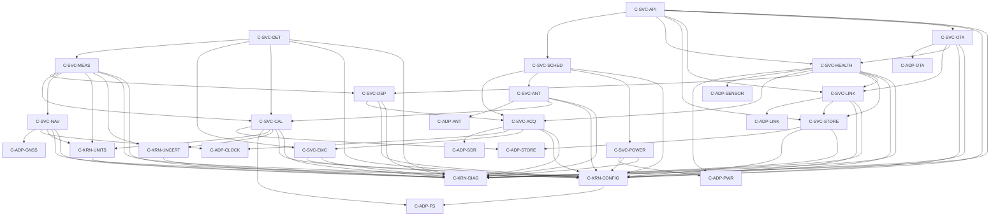

# Attribute-Driven Design — G1 Job 6

| Field | Value |
|---|---|
| Cycle | 01_smoke_test |
| Baseline | `Arch_01` Layered Modular Pipeline (ATAM-selected) |
| Borrowings | A3 timing discipline (core pinning, preallocated rings, deadline telemetry); A2 contract/supervision discipline (versioned ports, watchdog restart) |
| Iterations | 5 |
| Result | 29 components, acyclic dependency graph, 10/10 Condition Groups allocated |

## 1. Method

ADD proceeds driver-first. Each iteration:

1. selects the highest-priority drivers not yet satisfied;
2. chooses architectural elements that satisfy them;
3. allocates responsibilities and defines interfaces;
4. verifies that the iteration's drivers are met and no dependency rule is broken.

Drivers are drawn from `ATAM.md` (sensitivity/tradeoff points and risks) and from
the ASR Condition Groups. Iterations 1–4 add elements; iteration 5 closes
cross-cutting concerns and validates the whole graph.

## 2. Iteration 1 — Acquisition and Spectrum Core

**Drivers:** CG-01 (RF acquisition), CG-02 (parameterization), SP-1 (core
isolation), SP-2 (queue/drop policy), R-01 (USB ceiling), R-03 (jitter).

**Elements introduced:** `C-SVC-ACQ`, `C-SVC-DSP`, `C-SVC-SCHED`,
`C-SVC-EMC`, `C-ADP-SDR`, `C-ADP-CLOCK`, `C-KRN-CONFIG`.

**Responsibilities and decisions:**

- `C-SVC-ACQ` is the only component allowed to touch the SDR. It owns tuner,
  sample rate, gain, and antenna-settle gating; it timestamps frames and counts
  gaps. It never allocates or blocks on I/O.
- `C-SVC-DSP` consumes immutable IQ frames and produces spectrum frames. FFT
  length, window, and decimation derive from the validated scan plan.
- `C-SVC-SCHED` turns operator or scheduled requests into a validated scan plan;
  it rejects span/RBW/VBW combinations that the hardware cannot realize.
- `C-SVC-EMC` supplies the internal-spur catalog used to annotate traces.
- Interfaces: `IIQSource` (frame index, sequence, timestamp, gap flag),
  `ISpectrumSink` (trace record, resolution, detector).

**Verification:** CG-01 and CG-02 are allocated; acquisition is isolated from
storage and network by construction; the 40 MB/s physical gap is represented in
the frame contract rather than hidden.

## 3. Iteration 2 — Measurement, Detection, and Accuracy Semantics

**Drivers:** CG-03 (measurement/analysis), CG-10 (accuracy), SP-6 (calibration
context), R-07 (uncertainty correctness).

**Elements introduced:** `C-SVC-MEAS`, `C-SVC-DET`, `C-KRN-UNITS`,
`C-KRN-UNCERT`.

**Responsibilities and decisions:**

- `C-SVC-MEAS` computes OBW, channel power, modulation metrics, RDS, audio
  extraction, and trace statistics. Every output is an immutable record that
  carries the calibration context and uncertainty budget that produced it.
- `C-SVC-DET` applies threshold rules, intermodulation-product checks, and
  interference classification. Rules are declarative configuration, not code.
- `C-KRN-UNITS` performs pure unit conversions; it never performs I/O.
- `C-KRN-UNCERT` evaluates GUM budgets from a typed contribution list.
- Interfaces: `ISpectrumSource`, `IMeasurandSink`, `ICalibrationContext`,
  `IUncertaintyBudget`.

**Verification:** CG-03 is allocated; no measurand can be constructed without a
calibration context; detection rules are data, satisfying maintainability.

## 4. Iteration 3 — Data, Time, and Persistence

**Drivers:** CG-04 (geolocation/time/units), CG-05 (storage/throughput),
CG-10 (calibration persistence), SP-4 (single writer), TP-5 (recording mode).

**Elements introduced:** `C-SVC-NAV`, `C-SVC-CAL`, `C-SVC-STORE`,
`C-ADP-GNSS`, `C-ADP-STORE`, `C-ADP-FS`.

**Responsibilities and decisions:**

- `C-SVC-NAV` is the single source of position and time. It merges manual entry,
  GNSS, PPS, and NTP, and stamps every record with a fix ID.
- `C-SVC-CAL` loads antenna factors, cable loss, and correction tables; it
  publishes a versioned `ICalibrationContext` consumed by measurement.
- `C-SVC-STORE` is the only writer to the data volume. It commits metadata
  before acknowledging IQ segments, uses atomic rename for publication, and
  enforces retention.
- `C-ADP-STORE` wraps SQLite and segmented files; `C-ADP-FS` supplies
  configuration files; `C-ADP-GNSS` wraps `gpsd`.
- Interfaces: `ITimePosition`, `ICalibrationContext`, `IRecordStore`,
  `IIQSegmentWriter`.

**Verification:** CG-04 and CG-05 are allocated; a record cannot exist without
time/position provenance; persistence has one writer; recording modes respect
the USB ceiling.

## 5. Iteration 4 — Operations, Links, Antennas, Power, and Health

**Drivers:** CG-06 (connectivity), CG-07 (antennas/radiation), CG-08 (power/
thermal), CG-09 (health/scheduling), SP-5 (OTA), SP-7 (antenna settle),
R-02 (single fault domain), R-08 (OTA bricking), R-09 (antenna interlock).

**Elements introduced:** `C-SVC-LINK`, `C-SVC-OTA`, `C-SVC-HEALTH`,
`C-SVC-POWER`, `C-SVC-ANT`, `C-SVC-API`, `C-ADP-LINK`, `C-ADP-OTA`,
`C-ADP-ANT`, `C-ADP-PWR`, `C-ADP-SENSOR`.

**Responsibilities and decisions:**

- `C-SVC-LINK` selects Ethernet → WiFi → LTE, maintains a durable outbox, and
  exposes store-and-forward upload. Link loss never blocks acquisition.
- `C-SVC-OTA` stages signed bundles via `C-SVC-LINK`, asks `C-SVC-HEALTH` for a
  self-test verdict, and triggers A/B rollback on failure.
- `C-SVC-HEALTH` aggregates heartbeats, deadlines, temperature, disk, and power;
  it drives the degradation ladder and kicks the hardware watchdog.
- `C-SVC-POWER` maintains the energy budget and advises `C-SVC-SCHED` on scan
  duty cycles.
- `C-SVC-ANT` owns antenna/probe selection and enforces settle time before
  capture; it obtains antenna factors from `C-SVC-CAL`.
- `C-SVC-API` is read-only by default, with job submission gated by role.
- Interfaces: `ILink`, `IOtaStaging`, `IAntennaControl`, `IPowerBudget`,
  `IHealthReport`.

**Verification:** CG-06…CG-09 are allocated; the single-process fault domain is
mitigated by heartbeat/watchdog restart; OTA and antenna switching have explicit
interlocks.

## 6. Iteration 5 — Cross-Cutting Closure and Graph Verification

**Drivers:** maintainability, observability, configuration integrity, and the
requirement that every component dependency be resolvable and acyclic.

**Elements introduced:** `C-KRN-DIAG`.

**Decisions:**

- All components emit structured diagnostics through `C-KRN-DIAG`; no component
  writes its own log format.
- Configuration is versioned and validated at startup by `C-KRN-CONFIG`; a
  measurement record stamps the configuration version.
- Dependency rule: adapters are leaves; kernel components depend only on
  adapters; services depend on kernel, adapters, and lower services. No cycles.
- The graph below is the complete closure of iterations 1–5.

## 7. Final Component Catalog

| ID | Component | Responsibility | Groups |
|---|---|---|---|
| `C-ADP-SDR` | SDR Adapter | SoapySDR/libhackrf control, CS8 streaming | CG-01 |
| `C-ADP-GNSS` | GNSS Adapter | `gpsd` client, fix ingestion | CG-04 |
| `C-ADP-CLOCK` | Clock Adapter | NTP/PPS discipline, monotonic clock | CG-04 |
| `C-ADP-LINK` | Link Adapter | ModemManager/NetworkManager, interface state | CG-06 |
| `C-ADP-OTA` | OTA Adapter | A/B slot staging, signature verification | CG-06 |
| `C-ADP-STORE` | Store Adapter | SQLite WAL, segmented files, fsync/rename | CG-05 |
| `C-ADP-FS` | Filesystem Adapter | Config/calibration file access | CG-10 |
| `C-ADP-ANT` | Antenna Adapter | Switch/probe control, settle feedback | CG-07 |
| `C-ADP-PWR` | Power Adapter | INA219 telemetry, battery/solar state | CG-08 |
| `C-ADP-SENSOR` | Sensor Adapter | Temperature, fan, disk-health telemetry | CG-08/09 |
| `C-SVC-SCHED` | Scan Scheduler | Scan plans, dwell/retune budgets, admission | CG-09 |
| `C-SVC-ACQ` | Acquisition Service | Tuner/rate/gain, framing, gap accounting | CG-01 |
| `C-SVC-DSP` | DSP Pipeline | FFT, window, detectors, demodulation | CG-02/03 |
| `C-SVC-MEAS` | Measurement Service | OBW, channel power, modulation, RDS, audio | CG-03 |
| `C-SVC-DET` | Detection Service | Thresholds, intermod, interference rules | CG-03/10 |
| `C-SVC-CAL` | Calibration Service | Corrections, antenna factor, context versioning | CG-10 |
| `C-SVC-NAV` | Geo/Time Service | Position and time source of truth | CG-04 |
| `C-SVC-STORE` | Storage Service | Single writer, retention, atomic publication | CG-05 |
| `C-SVC-LINK` | Link Manager | Link arbitration, durable outbox, upload | CG-06 |
| `C-SVC-OTA` | OTA Service | Staged update, self-test, rollback | CG-06 |
| `C-SVC-HEALTH` | Health Supervisor | Heartbeats, deadlines, degradation ladder | CG-08/09 |
| `C-SVC-POWER` | Power Policy | Energy budget, duty-cycle advice | CG-08 |
| `C-SVC-ANT` | Antenna Manager | Band/probe selection, settle interlock | CG-07 |
| `C-SVC-EMC` | EMC Guard | Internal-spur catalog, trace annotation | CG-01 |
| `C-SVC-API` | API Service | Read-only status, gated job submission | CG-06/09 |
| `C-KRN-CONFIG` | Config Registry | Schema validation, version stamping | all |
| `C-KRN-UNITS` | Unit Converter | Pure unit conversions | CG-04 |
| `C-KRN-UNCERT` | Uncertainty Engine | GUM budget evaluation | CG-10 |
| `C-KRN-DIAG` | Diagnostics | Structured logs, metrics, deadline counters | all |

## 8. Component Dependency Graph

### Adjacency List (authoritative)

| Component | Direct dependencies |
|---|---|
| `C-ADP-*` (all adapters) | none (leaves) |
| `C-KRN-CONFIG` | `C-ADP-FS` |
| `C-KRN-UNITS` | `C-KRN-DIAG` |
| `C-KRN-UNCERT` | `C-KRN-DIAG` |
| `C-KRN-DIAG` | none |
| `C-SVC-EMC` | `C-KRN-CONFIG`, `C-KRN-DIAG` |
| `C-SVC-POWER` | `C-ADP-PWR`, `C-KRN-CONFIG`, `C-KRN-DIAG` |
| `C-SVC-ANT` | `C-ADP-ANT`, `C-SVC-CAL`, `C-KRN-CONFIG`, `C-KRN-DIAG` |
| `C-SVC-ACQ` | `C-ADP-SDR`, `C-ADP-CLOCK`, `C-SVC-EMC`, `C-KRN-CONFIG`, `C-KRN-DIAG` |
| `C-SVC-DSP` | `C-SVC-ACQ`, `C-KRN-CONFIG`, `C-KRN-DIAG` |
| `C-SVC-CAL` | `C-ADP-STORE`, `C-ADP-FS`, `C-KRN-UNITS`, `C-KRN-UNCERT`, `C-KRN-CONFIG`, `C-KRN-DIAG` |
| `C-SVC-NAV` | `C-ADP-GNSS`, `C-ADP-CLOCK`, `C-KRN-UNITS`, `C-KRN-CONFIG`, `C-KRN-DIAG` |
| `C-SVC-MEAS` | `C-SVC-DSP`, `C-SVC-CAL`, `C-SVC-NAV`, `C-KRN-UNITS`, `C-KRN-UNCERT`, `C-KRN-CONFIG`, `C-KRN-DIAG` |
| `C-SVC-DET` | `C-SVC-MEAS`, `C-SVC-EMC`, `C-SVC-CAL`, `C-KRN-CONFIG`, `C-KRN-DIAG` |
| `C-SVC-STORE` | `C-ADP-STORE`, `C-KRN-CONFIG`, `C-KRN-DIAG` |
| `C-SVC-LINK` | `C-ADP-LINK`, `C-SVC-STORE`, `C-KRN-CONFIG`, `C-KRN-DIAG` |
| `C-SVC-OTA` | `C-ADP-OTA`, `C-SVC-LINK`, `C-SVC-HEALTH`, `C-KRN-CONFIG`, `C-KRN-DIAG` |
| `C-SVC-HEALTH` | `C-ADP-PWR`, `C-ADP-SENSOR`, `C-SVC-ACQ`, `C-SVC-DSP`, `C-SVC-STORE`, `C-SVC-LINK`, `C-KRN-CONFIG`, `C-KRN-DIAG` |
| `C-SVC-SCHED` | `C-SVC-ACQ`, `C-SVC-ANT`, `C-SVC-POWER`, `C-KRN-CONFIG`, `C-KRN-DIAG` |
| `C-SVC-API` | `C-SVC-SCHED`, `C-SVC-HEALTH`, `C-SVC-STORE`, `C-SVC-LINK`, `C-SVC-OTA`, `C-KRN-CONFIG`, `C-KRN-DIAG` |

No cycles: adapters and `C-KRN-DIAG` are leaves; `C-KRN-CONFIG` depends only on
an adapter; services depend strictly on adapters, kernel, or services that are
lower in the order above. `C-SVC-ACQ` is the only SDR owner; `C-SVC-STORE` is the
only data-volume writer.

## 9. Interface Catalog

| Interface | Provider → Consumer | Contract |
|---|---|---|
| `IIQSource` | `C-SVC-ACQ` → `C-SVC-DSP` | frame index, sequence, monotonic timestamp, gap flag, CS8 buffer view |
| `ISpectrumSink` | `C-SVC-DSP` → `C-SVC-MEAS` | trace values, RBW/VBW, detector, config version |
| `IMeasurandSink` | `C-SVC-MEAS` → `C-SVC-STORE`/`C-SVC-LINK` | measurand id, value+unit, uncertainty, calibration context |
| `ICalibrationContext` | `C-SVC-CAL` → `C-SVC-MEAS`/`C-SVC-ANT` | table version, antenna factor, cable loss, validity interval |
| `ITimePosition` | `C-SVC-NAV` → all record producers | fix id, lat/lon/alt, UTC, monotonic offset, source |
| `IRecordStore` | `C-SVC-STORE` → producers | commit(metadata, payload), read, retention |
| `ILink` | `C-SVC-LINK` → `C-SVC-OTA`/`C-SVC-API` | link state, send, outbox depth, idempotency key |
| `IAntennaControl` | `C-SVC-ANT` → `C-SVC-ACQ` | select(port), settle-complete, interlock state |
| `IHealthReport` | `C-SVC-HEALTH` → `C-SVC-API`/`C-SVC-OTA` | component heartbeat, deadline misses, thermal/power state, verdict |
| `IPowerBudget` | `C-SVC-POWER` → `C-SVC-SCHED` | remaining energy, allowed duty cycle, load-shed tier |

## 10. Error, Timing, and Gap Semantics

- **Backpressure:** bounded rings; drop-oldest with sequence gap; acquisition
  never blocks. A gap is a first-class field in `IIQSource` and every derived
  record.
- **Deadlines:** each stage publishes progress counters via `C-KRN-DIAG`;
  `C-SVC-HEALTH` converts missed deadlines into the degradation ladder.
- **Atomicity:** metadata commits before payload acknowledgement; IQ segments
  publish by atomic rename; an interrupted segment is quarantined, not reported.
- **Restart:** systemd restarts the process; state is recovered from SQLite;
  in-flight scans are marked interrupted, never silently completed.
- **Calibration validity:** a record whose calibration context is expired or
  missing is marked invalid and excluded from compliant reports.

## 11. Decomposition Verification

- **Coverage:** all 10 Condition Groups map to at least one component (table
  above); all 91 ASRs remain allocated through their group.
- **Acyclicity:** verified against the adjacency list; no back edges.
- **Resolvability:** every dependency resolves to a catalog entry.
- **Single ownership:** SDR (`C-SVC-ACQ`), data volume (`C-SVC-STORE`), time
  (`C-SVC-NAV`), calibration (`C-SVC-CAL`), and health (`C-SVC-HEALTH`) each have
  exactly one owner.
- **Risk responses:** R-01 → gap semantics; R-02 → watchdog restart; R-03 →
  acquisition core isolation; R-07 → calibration context; R-08 → A/B rollback;
  R-09 → antenna interlock.
