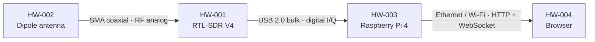
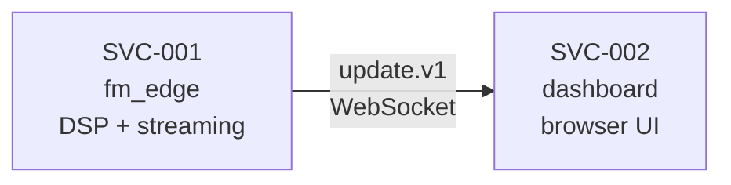
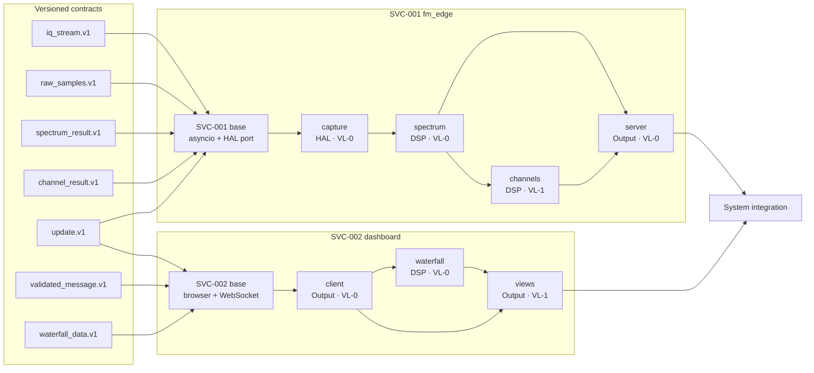
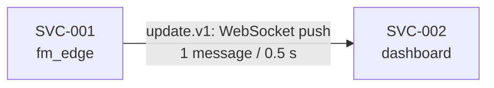

# S1 — Design of a System of Layered Services

## Meta

| Field          | Value                                                       |
|----------------|-------------------------------------------------------------|
| Project        | FM Spectrum, Waterfall and Channel Detection (RTL-SDR → Raspberry Pi) · FMSWD |
| Cycle          | 01_fm_occupancy_mock                                        |
| Date           | 2026-11-05                                                  |
| Author         | D. Ramírez / Stakeholder                                    |
| G0 approved    | StRS f98de6b36c6139926e22755f79768697579a1314333257e8d94f78f5c90c07b1 · SyRS 0ad3d83c46e129725ce81ee54c526a73b7e888337e6305430c1881a8aeb1fd35 |
| Gate H         | 2026-11-05 20:56:12.336 · D. Ramírez                       |
| Services       | SVC-001 (fm_edge), SVC-002 (dashboard)                      |
| HAL mode       | mock-only                                                   |
| Toolchain      | SVC-001: fm_edge · Python 3.12 · uv · pytest; SVC-002: dashboard · TypeScript · pnpm · vitest |
| ML model       | not used                                                    |
| Status         | draft                                                       |

---

## 0. COTS envelope

### 0.1 Device inventory

| ID       | Device                              | Role                                       | Key constraints |
|----------|--------------------------------------|---------------------------------------------|-----------------|
| HW-001   | RTL-SDR Blog V4 (RTL2832U + R828D)  | RF front end, tuner, 8-bit I/Q ADC (receive only) | Tuning range 500 kHz–1.766 GHz; max sample rate 2.4 MS/s; 8-bit unsigned I/Q; DC spike at every fc; 1 ppm TCXO |
| HW-002   | RTL-SDR Blog dipole antenna kit      | VHF receive antenna                         | Passive, no active constraints on software |
| HW-003   | Raspberry Pi 4 Model B, 4 GB        | Edge node: runs the DSP service and serves the UI | 4 cores ARM Cortex-A72 64-bit, 4 GB RAM, Raspberry Pi OS 64-bit |
| HW-004   | User laptop or PC with a browser     | Runs the UI over the LAN                    | Recent Chromium or Firefox |

### 0.2 Physical topology

### 0.3 Physical interfaces (HW ↔ HW contracts)

#### PHY-001: HW-002 → HW-001

| Field            | Value |
|------------------|-------|
| Connector        | SMA male → SMA female |
| Impedance        | 50 Ω (nominal) |
| Band / range     | 88–108 MHz (FM broadcast) |
| Expected loss    | Negligible (direct connection, no cable) |
| Key constraint   | Antenna factor not characterised this cycle (mock-only); no correction chain. |

#### PHY-002: HW-001 → HW-003

| Field            | Value |
|------------------|-------|
| Connector        | USB Type-A |
| Impedance        | N/A (digital) |
| Band / range     | N/A |
| Expected loss    | N/A |
| Key constraint   | 4.8 MB/s sustained at 2.4 MS/s × 2 B (HWC-SDR-002). Dropped samples are a system fault. Affects `iq_stream.v1`. |

#### PHY-003: HW-003 → HW-004

| Field            | Value |
|------------------|-------|
| Connector        | RJ-45 / Wi-Fi |
| Impedance        | N/A |
| Band / range     | N/A |
| Expected loss    | N/A |
| Key constraint   | LAN latency ≤ 100 ms (SYS-QOS-001 budget). Affects `update.v1`. |

### 0.4 Deployment and links between services

| Service ID | Process / deployment target | HWC-* used | Links to other services | Restart / disconnected operation |
|------------|-----------------------------|------------|-------------------------|-----------------------------------|
| SVC-001    | Python process on HW-003 (Raspberry Pi) | HW-001 (via HAL), HW-003 | WebSocket to SVC-002 | SVC-001 restarts independently; SVC-002 reconnects automatically every 2 s |
| SVC-002    | TypeScript in browser on HW-004 | none | WebSocket from SVC-001 | SVC-002 is stateless on reload; reconnects every 2 s when the WebSocket drops |

---

## 1. Building block view

### 1.1 System service view (level 0)

| Service ID | Single responsibility | State it owns | External inputs / outputs | Deployment target |
|------------|-----------------------|---------------|---------------------------|-------------------|
| SVC-001    | Acquire I/Q, compute spectrum, channel detection, and stream results | Current update state; channel occupancy history (120 updates) | Input: I/Q from HAL; Output: WebSocket messages to SVC-002 | Python process on HW-003 |
| SVC-002    | Display live spectrum, waterfall, and channel table | Waterfall ring buffer (120 spectra); current display state | Input: WebSocket messages from SVC-001; Output: rendered views | TypeScript in browser on HW-004 |

**Motivation for the service boundaries:**

SVC-001 and SVC-002 are separate processes on separate machines (Raspberry Pi and browser PC), communicating over the LAN. They restart independently: the browser can reload without affecting DSP capture, and the DSP service can restart while the UI reconnects automatically. The Build Package requires Python for the DSP and TypeScript for the UI (STK-SW-001), enforcing separate deployment targets.

### 1.2 White box: each service (level 1)

**Motivation for the decomposition:**

SVC-001 decomposes along the DSP pipeline: capture → spectrum → channels, each a self-contained signal-processing step with its own golden vector. The server module is the output boundary. Modules communicate only through the base's data routing, not directly. This decomposition matches the SYS block boundaries and lets each module be tested in isolation at VL-0 with deterministic input.

SVC-002 decomposes into client (protocol boundary), waterfall (state management), and views (rendering). The client validates messages before any module sees them. The waterfall module owns the ring buffer that the views module reads.

### 1.3 Base layer

**Service ID:** SVC-001

#### 1.3.1 Orchestration

| Field            | Value |
|------------------|-------|
| Mechanism        | asyncio event loop |
| Execution model  | Periodic: the HAL delivers one update (K×N samples) every 0.5 s; the pipeline runs synchronously within each update |
| Timing           | Soft real-time: 200 ms processing budget per update (SYS-QOS-001) |

The asyncio event loop is the simplest mechanism for a periodic pipeline with I/O (WebSocket). The pipeline is CPU-bound numpy: each update runs in one coroutine tick. The 200 ms budget (SYS-QOS-001) is generous for 64 × 1024 samples on ARM Cortex-A72.

#### 1.3.2 HAL (Hardware Abstraction Layer)

| Field               | Value |
|---------------------|-------|
| Devices it wraps    | HW-001 (RTL-SDR V4) |
| Exposed interface   | `hal_port`: async generator yielding `HalFrame(samples: np.ndarray[complex64], t_capture_end: str, fc_hz: int)` per update. The `samples` array has shape `(K*N,)` = `(65536,)` complex64. |
| Raw device type     | HW-001 delivers interleaved uint8 I/Q bytes via `iq_stream.v1`. The HAL port converts them to complex64 using `capture.convert_samples()` before yielding. Modules downstream of the HAL see only complex64. |
| Buffering strategy  | At 2.4 MS/s the device produces 1,200,000 complex samples in 0.5 s. The HAL reads the continuous stream into a circular buffer and, at each update boundary, extracts the most recent K×N = 65,536 samples (the Welch periodogram window). Remaining samples are discarded. In mock-only mode the Mock HAL generates exactly K×N samples per update, so no buffering is needed. A future Real HW HAL must implement the circular drain. |
| Isolation           | Swapping HW-001 for another SDR changes only the Real HW HAL implementation behind `hal_port`. The Mock HAL and all modules are unchanged. |

#### 1.3.3 Data routing

| Input signal | Consumers | Mechanism |
|--------------|-----------|-----------|
| `HalFrame` from `hal_port` (complex64, post-conversion) | `spectrum` module | Direct async iteration; the HAL port already called `capture.convert_samples()` |
| `SpectrumResult` from `spectrum` | `channels` module, `server` module | Base fans out |
| `ChannelResult` from `channels` | `server` module | Base passes to server |

Each update triggers the pipeline in order: HAL port (with capture conversion) → spectrum → (channels, server receives spectrum) → server receives channels → server sends WebSocket message. No module calls another directly. The capture module's conversion is invoked by the HAL port, not by the pipeline loop.

#### 1.3.4 Verification kit

| Tool | Path | Language | Consumed by | Source section |
|------|------|----------|-------------|----------------|
| Mock HAL | `verification/fm_edge/mock_hal/` | Python | capture tests, scene tests, PATH tests | §1.6 |
| Golden vectors + manifest | `verification/golden/` + `manifest.md` | — | VL-0 tests | §1.6, §3 |
| Telemetry companion | `verification/telemetry/` | Python | every test run | §1.7 |
| Stubs | `verification/fm_edge/stubs/` | Python | module unit tests (SVC-001) | §3.1–3.2 |
| Fake peers | `verification/dashboard/fakes/` | TypeScript | SVC-002 tests | §3.4 |
| Drivers | `verification/fm_edge/drivers/` | Python | PATH tests | §4.4 |
| Level runner | `verification/run.sh` (`vl0`, `vl1`) | shell | S2, G2 | §4.4 |

---

**Service ID:** SVC-002

#### 1.3.1 Orchestration

| Field            | Value |
|------------------|-------|
| Mechanism        | Browser event loop (native) |
| Execution model  | Event-driven: WebSocket `onmessage` triggers the rendering pipeline |
| Timing           | Best-effort: 200 ms render budget per message (SYS-QOS-001) |

#### 1.3.2 HAL (Hardware Abstraction Layer)

| Field               | Value |
|---------------------|-------|
| Devices it wraps    | None (SVC-002 has no hardware) |
| Exposed interface   | N/A |
| Isolation           | N/A |

#### 1.3.3 Data routing

| Input signal | Consumers | Mechanism |
|--------------|-----------|-----------|
| WebSocket `onmessage` | `client` module | Browser event |
| `ValidatedMessage` from `client` | `waterfall` module, `views` module | Client dispatches to subscribers |
| `WaterfallState` from `waterfall` | `views` module | Waterfall pushes to views on update |

### 1.4 Black boxes: modules

#### SVC-001/capture

| Field            | Value |
|------------------|-------|
| service_id       | SVC-001 |
| Functional layer | HAL |
| Responsibility   | Provide the uint8-to-complex64 conversion used by the HAL port (§1.3.2), and expose `raw_samples.v1` to downstream modules. The HAL port calls `capture.convert_samples()` on the raw `iq_stream.v1` bytes; the pipeline never sees uint8. |
| depends_on       | `iq_stream.v1` (HW → SW contract, consumed inside the HAL port) |
| provides         | `raw_samples.v1` |
| hw_dependency    | false |
| required_vl      | VL-0 |

**Rationale for the required VL:**
Sample conversion is pure arithmetic: `x = ((I − 127.5) + j(Q − 127.5))/127.5`. Golden vector GV-1 with 4 bytes is sufficient to verify the conversion. No realistic data is needed.

#### SVC-001/spectrum

| Field            | Value |
|------------------|-------|
| service_id       | SVC-001 |
| Functional layer | DSP |
| Responsibility   | Compute the Welch periodogram (Hann, N=1024, K=64) and output the 853 used bins in dBFS plus the noise floor. |
| depends_on       | `raw_samples.v1` |
| provides         | `spectrum_result.v1` |
| hw_dependency    | false |
| required_vl      | VL-0 |

**Rationale for the required VL:**
The Welch periodogram is deterministic linear algebra. GV-2 (pure tone, no noise) verifies the peak location and level. The DC spike placement rule (SYS-PSD-002) is validated at configuration time by checking that the allowed fc values put DC bins outside every channel window.

#### SVC-001/channels

| Field            | Value |
|------------------|-------|
| service_id       | SVC-001 |
| Functional layer | DSP |
| Responsibility   | Compute per-channel power from the spectrum, detect occupied channels (10 dB threshold above noise floor), and maintain the 60 s occupancy ratio. |
| depends_on       | `spectrum_result.v1` |
| provides         | `channel_result.v1` |
| hw_dependency    | false |
| required_vl      | VL-1 |

**Rationale for the required VL:**
GV-3 and GV-4 verify channel power and detection at VL-0 with deterministic inputs. However, the 10 dB threshold and noise-floor estimator interact with realistic noise in ways that single-update golden vectors cannot exercise: SC-4 (near-threshold) and SC-5 (intermittent) require 120 updates of synthetic data to confirm. VL-1 scene tests are needed.

#### SVC-001/server

| Field            | Value |
|------------------|-------|
| service_id       | SVC-001 |
| Functional layer | Output |
| Responsibility   | Format the spectrum, channel state, and metadata into the Y8 JSON message and send it over WebSocket. |
| depends_on       | `spectrum_result.v1`, `channel_result.v1` |
| provides         | `update.v1` (service contract) |
| hw_dependency    | false |
| required_vl      | VL-0 |

**Rationale for the required VL:**
Message formatting is deterministic serialisation. GV-5 (producer side) verifies the correct JSON structure and field content. The WebSocket transport is tested at the PATH level.

#### SVC-002/client

| Field            | Value |
|------------------|-------|
| service_id       | SVC-002 |
| Functional layer | Output |
| Responsibility   | Connect to the WebSocket, validate incoming messages (schema, version), reconnect every 2 s on drop, and dispatch validated messages. |
| depends_on       | `update.v1` (service contract) |
| provides         | `validated_message.v1` |
| hw_dependency    | false |
| required_vl      | VL-0 |

**Rationale for the required VL:**
Message validation is deterministic parsing. GV-5 (consumer side) verifies that a valid message is accepted and a `v` ≠ 1 message is rejected and logged.

#### SVC-002/waterfall

| Field            | Value |
|------------------|-------|
| service_id       | SVC-002 |
| Functional layer | DSP |
| Responsibility   | Maintain a ring buffer of the last 120 received spectra (60 s), newest first. |
| depends_on       | `validated_message.v1` |
| provides         | `waterfall_data.v1` |
| hw_dependency    | false |
| required_vl      | VL-0 |

**Rationale for the required VL:**
The ring buffer is pure data-structure logic. A deterministic test: push 130 items, verify the buffer holds the last 120 in order. No realistic data needed.

#### SVC-002/views

| Field            | Value |
|------------------|-------|
| service_id       | SVC-002 |
| Functional layer | Output |
| Responsibility   | Render the spectrum line plot (−80…−20 dBFS, channel centres marked, occupied channels highlighted), waterfall canvas (120 rows, −80…−20 dBFS colour scale), and channel table (frequency, occupied flag, occupancy %). |
| depends_on       | `validated_message.v1`, `waterfall_data.v1` |
| provides         | rendered DOM (no downstream contract) |
| hw_dependency    | false |
| required_vl      | VL-1 |

**Rationale for the required VL:**
Visual rendering correctness needs demonstration with realistic data. A VL-0 test can verify that the DOM elements exist and update, but confirming that the spectrum plot has correct axes, the waterfall colour scale is correct, and occupied channels are highlighted requires VL-1 visual inspection or screenshot comparison.

### 1.6 HAL substitution ladder

#### Mock HAL

| Field | Value |
|-------|-------|
| Base-layer port | `hal_port`: async generator yielding `HalFrame(samples, t_capture_end, fc_hz)` — same interface as the Real HW HAL |
| VL-0: deterministic vectors | GV-1 (4 bytes → 2 complex64), GV-2 (64×1024 pure tone), GV-3 (tone at fc+0.1 MHz), GV-4 (SC-2 seed 1, one update). Each is a fixed byte sequence with a known SHA-256. |
| VL-1: synthetic generator | Generates 120 updates (60 s) per labelled scene (SC-1 to SC-6). Parameters: carrier frequencies, levels, durations, seed. Output: interleaved uint8 I/Q at 2.4 MS/s. |
| Generation tool | Software FM synthesiser per Build Package B.2: noise (complex white Gaussian, σ²=−31.7 dBFS), FM carriers (A·exp(j(2π·Δf·t + 75·sin(2π·1000·t + φ))), DC spike (+0.02 real), quantisation to uint8. |

**Golden vectors (governance):**

| Vector ID | Simulated condition | SHA-256 digest | Generation parameters | Expected output at consumer |
|-----------|---------------------|----------------|-----------------------|-----------------------------|
| GV-1      | Raw sample conversion | Computed at S2 | uint8 bytes `[255, 0, 127, 128]` | complex64 `[1.0 − 1.0j, −0.0039216 + 0.0039216j]` (± 1e-6) |
| GV-2      | Pure tone spectrum | Computed at S2 | 64 × 1024 complex64 samples, tone amplitude 1.0 at +43 bins (+100.78125 kHz), no noise | Maximum of P at bin N/2 + 43, value 0.0 ± 0.1 dBFS |
| GV-3      | Channel power identification | Computed at S2 | GV-2 generator with tone at fc + 0.1 MHz (98.1 MHz) | Highest channel power is channel n = 5 |
| GV-4      | Detection flags | Computed at S2 | SC-2 through Mock HAL with seed 1, one update | Occupied flags `[false, true, false, false, true, false, false, false, true, false]` |
| GV-5      | WebSocket message validation | Computed at S2 | One fixed Y8 message with n1 and n4 occupied | Table shows 10 rows with n1, n4 marked occupied; `v` = 2 copy rejected and logged |

### 1.7 Telemetry companion

| Field | Value |
|-------|-------|
| Monitored signals | CPU %, memory %, temperature (°C), dropped buffers (count), scheduling latency (ms) |
| Sampling interval | 1 s |
| Resource budget | ≤ 2 % CPU, ≤ 50 MB memory |
| Output format | JSON lines: `{"ts": "<ISO 8601>", "cpu_pct": N, "mem_pct": N, "temp_c": N, "dropped": N, "sched_ms": N}` |
| Evidence attachment | Each test run's telemetry file is named `telemetry_<run_id>.jsonl` alongside the test output |

**Compute-unit operating envelope:**

| Signal | Nominal threshold | Action if exceeded |
|--------|-------------------|--------------------|
| Temperature | ≤ 80 °C | Flag evidence as potentially invalid |
| CPU | ≤ 90 % sustained (5 s window) | Flag evidence as potentially invalid |
| Dropped buffers | 0 | Flag evidence as potentially invalid |
| Scheduling latency | ≤ 50 ms | Flag evidence as potentially invalid |

---

## 2. Dependency view

### 2.1 Implementation dependency graph (DAG)

### 2.2 Topological implementation order

| Step | Service | Module / integration | Depends on (contracts) | Rationale for the order |
|------|---------|----------------------|------------------------|-------------------------|
| 0    | —       | All versioned contracts | — | Contracts are defined first so stubs can be built |
| 1    | SVC-001 | Base (asyncio + HAL port) | `iq_stream.v1`, `raw_samples.v1`, `spectrum_result.v1`, `channel_result.v1`, `update.v1` | Base wires the pipeline; HAL port is the entry |
| 2    | SVC-001 | capture | `iq_stream.v1` → `raw_samples.v1` | First in the pipeline; depends only on HAL |
| 3    | SVC-001 | spectrum | `raw_samples.v1` → `spectrum_result.v1` | Needs capture's output contract |
| 4    | SVC-001 | channels | `spectrum_result.v1` → `channel_result.v1` | Needs spectrum output |
| 5    | SVC-001 | server | `spectrum_result.v1`, `channel_result.v1` → `update.v1` | Last module; assembles the message |
| 6    | SVC-002 | Base (browser + WebSocket) | `update.v1`, `validated_message.v1`, `waterfall_data.v1` | Entry point for the UI |
| 7    | SVC-002 | client | `update.v1` → `validated_message.v1` | First in the UI pipeline |
| 8    | SVC-002 | waterfall | `validated_message.v1` → `waterfall_data.v1` | Needs validated messages |
| 9    | SVC-002 | views | `validated_message.v1`, `waterfall_data.v1` | Last UI module; renders everything |
| 10   | —       | System integration | SVC-001/server, SVC-002/client connected | End-to-end with Mock HAL scenes |

### 2.3 Runtime interaction graph

The runtime interaction is unidirectional: SVC-001 pushes, SVC-002 receives. There is no command channel from SVC-002 to SVC-001. SVC-001 owns all DSP state. SVC-002 owns its display state (waterfall buffer). When the WebSocket drops, SVC-002 reconnects every 2 s; SVC-001 continues capturing and discards messages when no client is connected. No acknowledgement, no retries, no duplicate handling needed for a live-streaming display.

---

## 3. Interface view

### 3.1 HW → SW contracts

#### iq_stream.v1

| Field              | Value |
|--------------------|-------|
| Physical origin    | PHY-002 (HW-001 → HW-003) |
| COTS device        | HW-001 (RTL-SDR V4) |
| Consuming module   | SVC-001/capture (via the HAL port — see §1.3.2) |
| Data type          | `bytes` (interleaved uint8 I, Q) |
| Shape / structure  | Continuous stream at 2.4 MS/s. The HAL port (§1.3.2) drains the stream, extracts the most recent K×N = 65,536 complex samples per 0.5 s update, and yields them as complex64. In mock-only mode the Mock HAL generates exactly K×N samples per update. |
| Units              | Unsigned 8-bit: 0–255, centre at 127.5 |
| Rate / frequency   | 2.4 MS/s continuous; one update of 65536 complex samples every 0.5 s |
| Maximum latency    | Determined by USB bulk transfer; not software-controllable |
| Schema version     | v1 |
| Inherited budget   | HWC-SDR-002: max 2.4 MS/s; HWC-SDR-003: 8-bit unsigned I/Q interleaved |

**Stub recipe:**

The Mock HAL generates interleaved uint8 I/Q bytes per Build Package B.2. At VL-0, it returns the golden vector bytes directly (GV-1: 4 bytes; GV-2/GV-3: 131072 bytes of a pure tone; GV-4: 131072 bytes of SC-2 seed 1). At VL-1, it generates 120 updates per labelled scene using the B.2 signal model with parameters and seed, producing identical bytes on every run.

**Reference test vectors:**

| Input | Expected output |
|-------|-----------------|
| GV-1: `[255, 0, 127, 128]` | complex64 `[1.0 − 1.0j, −0.0039216 + 0.0039216j]` (± 1e-6) |
| GV-2: 64×1024 tone at +43 bins, amplitude 1.0 | Spectrum peak at bin N/2+43, 0.0 ± 0.1 dBFS |

### 3.2 SW → SW contracts

#### raw_samples.v1

| Field              | Value |
|--------------------|-------|
| Producer           | SVC-001/capture |
| Consumer(s)        | SVC-001/spectrum |
| Data type          | `np.ndarray[complex64]` |
| Shape / structure  | `(65536,)` — K×N complex64 samples, one update |
| Units              | Full-scale ±1.0 (after conversion from uint8) |
| Rate / frequency   | One array per update (every 0.5 s) |
| Maximum latency    | Negligible (in-process) |
| Schema version     | v1 |

**Stub recipe:**

A numpy array of 65536 complex64 zeros (silence), or a tone: `A * np.exp(2j * np.pi * f_offset * t)` at a specified bin offset and amplitude. Deterministic, no randomness.

**Reference test vectors:**

| Input | Expected output |
|-------|-----------------|
| 65536 zeros | Spectrum: all bins at noise floor (−∞ dBFS, clamped to −80 dBFS) |
| GV-2 tone array | Spectrum peak at bin N/2+43, 0.0 ± 0.1 dBFS |

#### spectrum_result.v1

| Field              | Value |
|--------------------|-------|
| Producer           | SVC-001/spectrum |
| Consumer(s)        | SVC-001/channels, SVC-001/server |
| Data type          | `SpectrumResult(bins_dbfs: np.ndarray[float64], floor_dbfs: float, fc_hz: int, bin_hz: float)` |
| Shape / structure  | `bins_dbfs`: `(853,)` float64 array, FFT-shifted, central ±1.0 MHz; `floor_dbfs`: scalar; `fc_hz`: integer centre frequency; `bin_hz`: 2343.75 |
| Units              | dBFS (relative to ADC full scale) |
| Rate / frequency   | One per update (every 0.5 s) |
| Maximum latency    | Negligible (in-process) |
| Schema version     | v1 |

**Stub recipe:**

A flat spectrum at −60 dBFS (noise floor) with optional peaks at specified bin offsets. For channels stub: one peak at channel n=5 centre, −20 dBFS. Floor = −60 dBFS. Deterministic.

**Reference test vectors:**

| Input | Expected output |
|-------|-----------------|
| GV-2 raw_samples | bins_dbfs peak at index 469 (= 426 + 43), value 0.0 ± 0.1 dBFS; floor ≈ −∞ dBFS |
| GV-3 raw_samples (tone at fc+0.1 MHz) | Peak in channel n=5 window |

#### channel_result.v1

| Field              | Value |
|--------------------|-------|
| Producer           | SVC-001/channels |
| Consumer(s)        | SVC-001/server |
| Data type          | `ChannelResult(channels: list[ChannelState])` where `ChannelState(f_mhz: float, power_dbfs: float, occupied: bool, occupancy: float)` |
| Shape / structure  | 10 ChannelState entries, one per FM channel (n=0…9) |
| Units              | f_mhz: MHz; power_dbfs: dBFS; occupied: bool; occupancy: ratio 0–1 |
| Rate / frequency   | One per update (every 0.5 s) |
| Maximum latency    | Negligible (in-process) |
| Schema version     | v1 |

**Stub recipe:**

10 channels: all at −60 dBFS, not occupied, occupancy 0.0 (silence stub). Or: channels n1, n4, n8 at −20 dBFS, occupied, occupancy 1.0 (SC-2 stub). Deterministic.

**Reference test vectors:**

| Input | Expected output |
|-------|-----------------|
| GV-3 spectrum_result | Highest channel power is n=5 |
| GV-4 spectrum_result (SC-2 seed 1) | Occupied: `[false, true, false, false, true, false, false, false, true, false]` |

#### validated_message.v1

| Field              | Value |
|--------------------|-------|
| Producer           | SVC-002/client |
| Consumer(s)        | SVC-002/waterfall, SVC-002/views |
| Data type          | `UpdateMessage` (TypeScript interface matching Y8 schema) |
| Shape / structure  | `{v: 1, t_capture_end: string, fc_hz: number, bin_hz: 2343.75, spectrum_dbfs: number[853], floor_dbfs: number, channels: {f_mhz: number, power_dbfs: number, occupied: boolean, occupancy: number}[10]}` |
| Units              | As defined in SYS-IFC-001 |
| Rate / frequency   | One per WebSocket message (every 0.5 s) |
| Maximum latency    | Negligible (in-process) |
| Schema version     | v1 |

**Stub recipe:**

A fixed JSON string matching the Y8 schema with all channels at −60 dBFS, none occupied. Or: the GV-5 message with n1, n4 occupied. For rejection: a copy with `v: 2`.

**Reference test vectors:**

| Input | Expected output |
|-------|-----------------|
| GV-5 valid message | Parsed UpdateMessage with n1, n4 occupied |
| GV-5 with `v: 2` | Rejected; error logged |

#### waterfall_data.v1

| Field              | Value |
|--------------------|-------|
| Producer           | SVC-002/waterfall |
| Consumer(s)        | SVC-002/views |
| Data type          | `number[][]` (TypeScript) |
| Shape / structure  | Up to 120 rows of 853 numbers each; newest first |
| Units              | dBFS (copied from spectrum_dbfs) |
| Rate / frequency   | Updated on every validated message |
| Maximum latency    | Negligible (in-process) |
| Schema version     | v1 |

**Stub recipe:**

An array of 120 identical rows at −60 dBFS (flat waterfall), or a ramp of 120 rows with incrementing values to test ordering.

**Reference test vectors:**

| Input | Expected output |
|-------|-----------------|
| 130 sequential pushes (rows numbered 1–130) | Buffer contains rows 11–130, newest (130) first |

### 3.3 SW → HW contracts

No SW → HW contracts. The system is receive-only; the centre frequency is set at HAL initialisation (constructor parameter), not as a runtime command.

### 3.4 Service → service contracts

#### update.v1: SVC-001 → SVC-002

| Field                     | Value |
|---------------------------|-------|
| Producer / consumer       | SVC-001/server (port: WebSocket server on HW-003, default port 8765) → SVC-002/client (port: WebSocket client in browser) |
| State owner               | SVC-001 owns DSP state; SVC-002's replica is the last received message + waterfall buffer |
| Operation / message       | `update.v1`: one JSON message per DSP update |
| Transport / direction     | WebSocket, server → client push (unidirectional) |
| Schema and version        | `{"v": 1, "t_capture_end": "<ISO 8601 ms>", "fc_hz": <int>, "bin_hz": 2343.75, "spectrum_dbfs": [<853 numbers, 0.1 dB resolution>], "floor_dbfs": <number>, "channels": [{"f_mhz": <number>, "power_dbfs": <number>, "occupied": <bool>, "occupancy": <0–1>} × 10]}` |
| Units and time            | dBFS; MHz; ISO 8601 with milliseconds; occupancy ratio 0–1 |
| Order / rate / size       | One message per 0.5 s; ≈ 15 KB per message (853 × ~6 chars + overhead); no backpressure (latest wins) |
| Latency / availability    | Capture end → message sent ≤ 200 ms (SYS-QOS-001); LAN ≤ 100 ms |
| Authorisation             | None (LAN-only, no user accounts per Build Package) |
| Acknowledgement / retries | None; live stream, lost messages are acceptable |
| Disconnect / restart      | SVC-002 reconnects every 2 s; SVC-001 continues capturing; no queue, no resynchronisation |
| SYS-* / NRM-* affected    | SYS-IFC-001, SYS-QOS-001, SYS-UI-001 |

**Fake-peer recipe:**

- **Fake SVC-001 (for SVC-002 tests):** A WebSocket server that sends one fixed GV-5 message on connect, then closes. For scene tests: sends 120 messages at 0.5 s intervals with pre-computed spectra and channel states. For error test: sends a message with `v: 2`. For disconnect test: sends 5 messages, closes, waits 3 s, re-opens.
- **Fake SVC-002 (for SVC-001 tests):** A WebSocket client that connects, receives messages, and records them to a JSON-lines file. For latency test: records `t_capture_end` and receipt timestamp.

**Contract and test vectors:**

| Input | Expected response/state |
|-------|-------------------------|
| GV-5 message (n1, n4 occupied) | SVC-002/client accepts, dispatches; views show 10 rows, n1 and n4 marked occupied |
| GV-5 with `v: 2` | SVC-002/client rejects, logs error; views not updated |
| SVC-001 closes WebSocket | SVC-002/client retries connection every 2 s |

---

## 4. Traceability

### 4.1 Requirements → services, modules and paths

| Requirement | Text (summary) | Service(s) | Module(s) | Path / contract(s) | Acceptance owner |
|-------------|----------------|------------|-----------|--------------------|------------------|
| SYS-CAP-001 | Capture I/Q at 2.4 MS/s, fixed fc, update every 0.5 s | SVC-001 | capture | iq_stream.v1, raw_samples.v1 | SVC-001/capture |
| SYS-CAP-002 | uint8 → complex64 conversion | SVC-001 | capture | iq_stream.v1 → raw_samples.v1 | SVC-001/capture (GV-1) |
| SYS-PSD-001 | Welch periodogram, 853 bins, RBW ≤ 25 kHz | SVC-001 | spectrum | raw_samples.v1 → spectrum_result.v1 | SVC-001/spectrum (GV-2) |
| SYS-PSD-002 | DC spike outside every channel window | SVC-001 | spectrum (config validation) | — | SVC-001/spectrum (config check) |
| SYS-PSD-003 | Per-channel power (77 bins, ±90 kHz) | SVC-001 | channels | spectrum_result.v1 → channel_result.v1 | SVC-001/channels (GV-3) |
| SYS-DET-001 | Detection: 10 dB threshold, occupancy ratio | SVC-001 | channels | spectrum_result.v1 → channel_result.v1 | SVC-001/channels (GV-4, SC-1–SC-6) |
| SYS-WFL-001 | Waterfall ring buffer, 120 spectra | SVC-002 | waterfall | validated_message.v1 → waterfall_data.v1 | SVC-002/waterfall |
| SYS-IFC-001 | Y8 JSON message over WebSocket | SVC-001, SVC-002 | server, client | update.v1 | PATH-001 (GV-5) |
| SYS-UI-001  | Spectrum plot, waterfall canvas, channel table | SVC-002 | views | waterfall_data.v1, validated_message.v1 | SVC-002/views |
| SYS-QOS-001 | Latency p95 ≤ 1.0 s | SVC-001, SVC-002 | server, client, views | PATH-004 | PATH-004 end-to-end |
| SYS-SW-001  | Python ≥ 3.12 + numpy; TypeScript | SVC-001, SVC-002 | all | — | Manifest inspection |

### 4.2 Modules → requirements (inverse view)

| Service | Module (SVC-xxx/module_id) | Requirement(s) satisfied |
|---------|----------------------------|--------------------------|
| SVC-001 | SVC-001/capture | SYS-CAP-001, SYS-CAP-002 |
| SVC-001 | SVC-001/spectrum | SYS-PSD-001, SYS-PSD-002 |
| SVC-001 | SVC-001/channels | SYS-PSD-003, SYS-DET-001 |
| SVC-001 | SVC-001/server | SYS-IFC-001 (producer), SYS-QOS-001 (processing budget) |
| SVC-002 | SVC-002/client | SYS-IFC-001 (consumer) |
| SVC-002 | SVC-002/waterfall | SYS-WFL-001 |
| SVC-002 | SVC-002/views | SYS-UI-001 |

### 4.3 Normative constraints → contracts

| Norm         | Constraint | Affected contract | Imposed value |
|--------------|------------|-------------------|---------------|
| NRM-ITU-001  | Observed slice inside 88–108 MHz | iq_stream.v1 (fc parameter) | fc allowed values 89.0–107.0 MHz, slice fc ± 1.0 MHz ⊂ 88–108 MHz |
| NRM-FCC-001  | FM channel raster 200 kHz | spectrum_result.v1, channel_result.v1 | Channel centres fc − 0.9 + 0.2·n MHz, n = 0…9 |
| NRM-ITU-002  | RBW ≤ 25 kHz | spectrum_result.v1 | RBW = 1.5 × 2.4 MS/s / 1024 = 3.52 kHz ≤ 25 kHz |

### 4.4 System paths and end-to-end evidence

| Path ID   | SYS-* | Services and contracts, in order | Input → observable result | End-to-end budget | required_vl | Environment / acceptance criterion |
|-----------|-------|----------------------------------|---------------------------|-------------------|-------------|------------------------------------|
| PATH-001  | SYS-CAP-001, SYS-CAP-002, SYS-PSD-001, SYS-IFC-001, SYS-UI-001 | HAL → SVC-001/capture → spectrum → server → [update.v1] → SVC-002/client → views | GV-2 input → spectrum plot shows peak at +43 bins, 0.0 ± 0.1 dBFS | Processing + LAN + render ≤ 1.0 s | VL-0 | Mock HAL with GV-2 tone |
| PATH-002  | SYS-PSD-003, SYS-DET-001, SYS-IFC-001, SYS-UI-001 | HAL → capture → spectrum → channels → server → [update.v1] → client → views | SC-1–SC-6 inputs → channel table shows correct occupancy | 120 updates × 0.5 s = 60 s per scene | VL-1 | Mock HAL with labelled scenes |
| PATH-003  | SYS-WFL-001, SYS-IFC-001, SYS-UI-001 | server → [update.v1] → client → waterfall → views | 130 updates → waterfall canvas shows last 120 | N/A | VL-0 | Fake SVC-001 sending 130 messages |
| PATH-004  | SYS-QOS-001 | capture end timestamp → server send → LAN → client receive → views render | 60 s of updates → p95 latency ≤ 1.0 s | capture→send ≤ 200 ms, LAN ≤ 100 ms, render ≤ 200 ms, margin 500 ms | VL-1 | Mock HAL + telemetry companion measuring each term |

---

## 5. Design decisions

### DEC-001: Service partitioning — two services

- **Status:** proposed
- **Context:** The system has a DSP pipeline (Python on Raspberry Pi) and a browser UI (TypeScript). The Build Package mandates Python ≥ 3.12 for DSP and TypeScript for UI (STK-SW-001).
- **Alternatives considered:**
  1. Two services: SVC-001 (fm_edge, Python) and SVC-002 (dashboard, TypeScript) — DSP on Pi, UI in browser, WebSocket link.
  2. Three services: separate capture, processing, and UI — adds a network boundary within the DSP pipeline.
  3. One service with server-side rendering — the Build Package requires TypeScript in the browser.
- **Decision:** Alternative 1: two services.
- **Rationale:** The Build Package requires two languages on two machines. A third service adds network overhead inside the DSP pipeline for no gain: all DSP runs on one Pi with one failure domain. One service is impossible because the UI must be TypeScript in the browser.
- **Consequences:** Positive: simple deployment, one WebSocket link, clear ownership. Negative: the UI cannot access DSP internals for debugging (mitigated by the telemetry companion and the detailed Y8 message).
- **Requirements affected:** STK-SW-001, SYS-IFC-001, SYS-QOS-001.

### DEC-002: Orchestration — asyncio event loop

- **Status:** proposed
- **Context:** SVC-001 needs to run a periodic DSP pipeline (every 0.5 s) and serve WebSocket connections concurrently.
- **Alternatives considered:**
  1. asyncio event loop with periodic task.
  2. GNU Radio flowgraph.
  3. Threaded scheduler.
- **Decision:** Alternative 1: asyncio.
- **Rationale:** GNU Radio is heavyweight for a 4-module pipeline with no real-time constraints beyond 200 ms. Threading adds GIL contention and complexity for I/O that asyncio handles natively. The pipeline is numpy-bound (released GIL during array ops) and completes in one tick.
- **Consequences:** Positive: simple, standard library, natural WebSocket integration. Negative: a CPU-bound module that exceeds 200 ms blocks the loop (mitigated: the pipeline budget is generous for 64×1024 samples).
- **Requirements affected:** SYS-QOS-001.

### DEC-003: Waterfall ownership — UI-side ring buffer

- **Status:** proposed
- **Context:** SYS-WFL-001 requires a ring buffer of 120 spectra. The WebSocket message (Y8) sends only the current spectrum; Y8 states "the UI keeps its own waterfall from the received spectra."
- **Alternatives considered:**
  1. UI maintains the ring buffer from received messages.
  2. DSP maintains the ring buffer and sends the full waterfall each update (≈ 120 × 853 × 6 ≈ 600 KB per message).
  3. Both maintain a copy.
- **Decision:** Alternative 1: UI-side only.
- **Rationale:** Y8 explicitly states the UI keeps its own waterfall. Sending 600 KB per message would exceed the LAN latency budget. The DSP has no use for the waterfall internally.
- **Consequences:** Positive: small messages, simple DSP. Negative: the waterfall is lost on page reload (acceptable: it refills in 60 s).
- **Requirements affected:** SYS-WFL-001, SYS-IFC-001.

---

## 6. Risks and known infeasibilities

| ID      | Risk | Requirements / PATH-* affected | Evidence / estimate (`ANALYSIS (no VL)`) | Proposed mitigation | Potential RFD? |
|---------|------|--------------------------------|------------------------------------------|---------------------|----------------|
| RSK-001 | Mock HAL noise model is simplified (white Gaussian); real FM band noise may differ in shape and level | SYS-DET-001, PATH-002 | The 10 dB threshold is designed for white noise. Non-white noise could shift the noise-floor estimate. | This cycle is mock-only; the Mock HAL model is the test oracle. Real-hardware testing in a future mock+real cycle will validate the threshold. | no |
| RSK-002 | Browser rendering of 853-bin spectrum and 120-row waterfall canvas may exceed the 200 ms render budget on low-end devices | SYS-QOS-001, PATH-004 | 853 points in a line plot and a 120×853 canvas are modest by browser standards; the 200 ms budget is generous. | Profile rendering during VL-1 with the telemetry companion. If exceeded, reduce canvas resolution. | no |
| RSK-003 | SYS-CAP-002, SYS-DET-001, SYS-WFL-001 have Standard(s) = — (no external normative source) | SYS-CAP-002, SYS-DET-001, SYS-WFL-001 | Build Package v2.0.1 states: "An em dash in Standard means no external normative source prescribes that method; its values and acceptance criteria are specified by this Build Package." G0 Gate H accepted this. | No mitigation needed; the Build Package is the authority for these specifications. | no |
