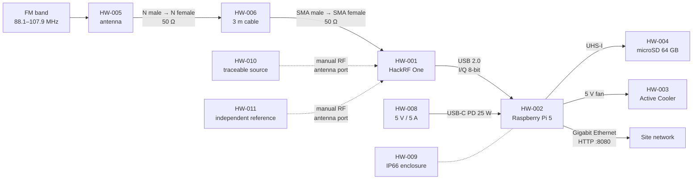

# S1 — Design of a System of Layered Subsystems

## Meta

| Field          | Value                                                       |
|----------------|-------------------------------------------------------------|
| Project        | FM HackRF RPI5 MVP                                          |
| Cycle          | `01_fm_hackrf_rpi5_mvp`                                     |
| Date           | 2026-11-12                                                  |
| Author         | OpenCode agent, S1 design pass                              |
| G0 approved    | `StRS.md` `db9d3775d3cca3683603ab998a31ca5a7df6e5b1853b6cfb954b169152a88ef3`; `SyRS.md` `ac2230edf7cc2e6f90a3f74be322dd54f282759e2f219ac8ac4fd29cd49a76b5` |
| Gate H         | 2026-11-12 22:25:37.841, `dramirezbe`                       |
| Subsystems     | SUB-001 `measure`; SUB-002 `store_alert`; SUB-003 `report`; SUB-004 `web`; SUB-005 `time`; SUB-006 `supervisor` |
| Target(s)      | `local` (VL-0/VL-1); `Raspberry Pi 5 node` (VL-2, deduced from HWC-CPU-*, HWC-SDR-*, HWC-ENV-*) |
| HAL mode       | `mock+real`                                                 |
| Toolchain      | SUB-001: `fm_measure` · Python 3.12 · uv · pytest; SUB-002: `fm_store_alert` · Python 3.12 · uv · pytest; SUB-003: `fm_report` · Python 3.12 · uv · pytest; SUB-004: `fm_web` · TypeScript · pnpm · vitest; SUB-005: `fm_time` · Python 3.12 · uv · pytest; SUB-006: `fm_supervisor` · Python 3.12 · uv · pytest |
| Status         | draft                                                       |

---

## 0. COTS envelope

### 0.1 Device inventory

| ID      | Device | Role | Key constraints |
|---------|--------|------|-----------------|
| HW-001 | Great Scott Gadgets HackRF One (HWC-SDR-001…009) | Receives the FM band and delivers I/Q samples | Tuning 1–6 000 MHz; sampling 2–20 Msps; 8-bit ADC; SMA female 50 Ω; maximum input −5 dBm; crystal ±20 ppm; LNA ≤40 dB, RF amp ≤14 dB; 8 MHz usable per capture |
| HW-002 | Raspberry Pi Ltd Raspberry Pi 5, 8 GB (HWC-CPU-001…005) | Runs the six processes and the web server | 4× Arm Cortex-A76 at 2.4 GHz; 8 GB RAM; Gigabit Ethernet; USB 2.0/3.0; 0–70 °C board |
| HW-003 | Raspberry Pi Active Cooler (HWC-COOL-001…002) | Dissipates board heat | 5 V fan; 1.09 CFM maximum |
| HW-004 | Kingston Industrial microSD SDCIT2/64GBSP (HWC-STO-001…004) | Stores OS, configuration, reports, calibration and validation records | 64 GB; class 10 / UHS-I U3, ≥30 MB/s sustained; −40…85 °C; ~1 920 TBW |
| HW-005 | Rohde & Schwarz HK033 coaxial dipole (HWC-ANT-001…004) | Captures 88.1–107.9 MHz | 80 MHz–2 GHz; N female 50 Ω; 2 dBi typical; VSWR ≤2 typical |
| HW-006 | LMR-195 antenna cable, 3 m (HWC-CBL-001…003) | Connects antenna to receiver | ≤1.8 dB loss 0–3 GHz; N male to SMA male |
| HW-007 | Lindy USB 2.0 A–Micro-B cable, 0.5 m (HWC-USB-001…002) | Connects receiver to board | USB 2.0; 0.5 m |
| HW-008 | Inventus Power XWA0650PDA-USB-C, 65 W (HWC-PWR-001…006) | Powers the board over USB-C PD | 85–264 V AC, 47–63 Hz; 5 V / 5 A (25 W); 81 % typical; 0–40 °C; IP22 |
| HW-009 | Fibox ARCA-304021 polycarbonate enclosure (HWC-ENV-001…005) | Contains and protects the node | 300 × 400 × 210 mm; IP66 / IK10; −40…80 °C; site ambient ≤40 °C; internal air ≤60 °C |
| HW-010 | Traceable calibration source (HWC-CAL-001…003) | Establishes amplitude and frequency corrections on site | Expanded uncertainty ≤0.5 dB (k = 2); frequency ≤1 ppm; independent from HW-011 |
| HW-011 | Independent verification reference (HWC-CAL-003) | Verifies the correction with an independent traceability chain | Expanded uncertainty ≤0.5 dB (k = 2); different instrument and chain from HW-010 |

### 0.2 Physical topology

### 0.3 Physical interfaces (HW ↔ HW contracts)

#### PHY-001: antenna → antenna cable

| Field            | Value |
|------------------|-------|
| Connector        | N female (antenna) to N male (cable) |
| Impedance        | 50 Ω |
| Band / range     | 80 MHz–2 GHz (FM use 88.1–107.9 MHz) |
| Expected loss    | Cable loss ≤1.8 dB from 0–3 GHz; antenna VSWR ≤2 typical |
| Key constraint   | The receiver sees the antenna temperature and cable loss; gain and cable loss are outside the calibrated quantity (R-09) and are recorded with the reference plane. Affects HW-IQ-001. |

#### PHY-002: antenna cable → receiver

| Field            | Value |
|------------------|-------|
| Connector        | SMA male (cable) to SMA female (receiver) |
| Impedance        | 50 Ω |
| Band / range     | 1–6 000 MHz receiver range; FM use 88.1–107.9 MHz |
| Expected loss    | Included in PHY-001; no additional adapter |
| Key constraint   | The calibrated reference plane is this connector (REF-001 §4.2, §5.5). Input above −5 dBm can damage the receiver. Affects HW-IQ-001 and SW-HACKRF-001. |

#### PHY-003: receiver → compute board

| Field            | Value |
|------------------|-------|
| Connector        | USB 2.0 type A (board) to Micro-B (receiver) |
| Impedance        | USB 90 Ω differential |
| Band / range     | USB 2.0 high speed, 480 Mbit/s theoretical |
| Expected loss    | None specified; 0.5 m cable |
| Key constraint   | 10 Msps × 2 × 8 bits = 20 MB/s sustained; a dropped frame is a marked scan. Affects HW-IQ-001. |

#### PHY-004: compute board → microSD

| Field            | Value |
|------------------|-------|
| Connector        | microSD slot, UHS-I |
| Impedance        | Not applicable |
| Band / range     | UHS-I U3, ≥30 MB/s sustained; theoretical rate not supplied by the Build Package |
| Expected loss    | Not applicable |
| Key constraint   | Report writes ~41.6 KB per scan and fsync each scan; the card must sustain the write and survive ~2.19 TB/year. Affects SW-STORAGE-001. |

#### PHY-005: compute board → active cooler

| Field            | Value |
|------------------|-------|
| Connector        | 4-pin fan connector, 5 V |
| Impedance        | Not applicable |
| Band / range     | Fan power and tachometer |
| Expected loss    | Not applicable |
| Key constraint   | The fan is controlled by the board firmware, not by the software; the software only reads temperature. Affects the §1.7 thermal envelope. |

#### PHY-006: power supply → compute board

| Field            | Value |
|------------------|-------|
| Connector        | USB-C with Power Delivery |
| Impedance        | Not applicable |
| Band / range     | 5 V / 5 A (25 W); input 85–264 V AC, 47–63 Hz |
| Expected loss    | Efficiency 81 % typical; the node budget is 20 W (80 % of 25 W) |
| Key constraint   | The supply is outside the enclosure; a power cut is outside scope (R-48 assumes none). Affects the §1.7 power envelope. |

#### PHY-007: compute board → site network

| Field            | Value |
|------------------|-------|
| Connector        | RJ45, Gigabit Ethernet |
| Impedance        | Not applicable |
| Band / range     | 1 Gbit/s theoretical; sustained rate not supplied by the Build Package; web downloads limited to 20 MB/s |
| Expected loss    | Not applicable |
| Key constraint   | HTTP on port 8080, no authentication; all page assets are local to the node. Affects SW-NET-001. |

#### PHY-008: calibration source → receiver antenna port

| Field            | Value |
|------------------|-------|
| Connector        | Manual RF connection to the SMA female antenna port |
| Impedance        | 50 Ω, 50 Ω termination when the source is removed |
| Band / range     | 88–108 MHz CW |
| Expected loss    | Cable loss measured during calibration; source level traceable, ≤0.5 dB (k = 2), ≤1 ppm |
| Key constraint   | The source must be a different instrument from the verification reference, with an independent chain (R-20). Affects INT-CAL-001 and SW-HACKRF-001. |

#### PHY-009: verification reference → receiver antenna port

| Field            | Value |
|------------------|-------|
| Connector        | Manual RF connection to the SMA female antenna port |
| Impedance        | 50 Ω, 50 Ω termination |
| Band / range     | 88–108 MHz CW, two levels |
| Expected loss    | Cable loss measured; reference ≤0.5 dB (k = 2), independent of HW-010 |
| Key constraint   | 12 points (6 channels × 2 levels), 5 scans per point, tolerance 1.0 dB. Affects SYS-VER-001. |

#### PHY-010: enclosure → environment

| Field            | Value |
|------------------|-------|
| Connector        | Cable glands and mounting entries |
| Impedance        | Not applicable |
| Band / range     | IP66 / IK10; −40…80 °C; site ambient ≤40 °C; internal air ≤60 °C |
| Expected loss    | Thermal conductance estimated 4.8 W/K, not from a datasheet |
| Key constraint   | The enclosure and cable entries must pass P-093 (water and dust ingress); the internal air must stay ≤60 °C at 40 °C ambient. Affects SYS-ENV-001. |

### 0.4 Deployment and links between subsystems

| Subsystem ID | Process / deployment target | Execution target (`local` or declared name) | HWC-* used | Links to other subsystems | Restart / disconnected operation |
|------------|-----------------------------|---------------------------------------------|------------|-------------------------|-----------------------------------|
| SUB-001 `measure` | one process under the supervisor; systemd unit on the node | `local` (VL-0/VL-1); `Raspberry Pi 5 node` (VL-2) | HW-001, HW-002, HW-005, HW-006, HW-007, HW-008, HW-010, HW-011 | consumes `time_status.v1`, `config_status.v1`; produces `scan_records.v1`, `duty_cycle.v1`, `progress.v1` | Restart loses the scan in progress and the 10-scan noise-floor smoothing; the calibration record is a file and is re-read. Keeps measuring with an unsynced clock (marked). |
| SUB-002 `store_alert` | one process under the supervisor | `local` (VL-0/VL-1); `Raspberry Pi 5 node` (VL-2) | HW-002 | consumes `scan_records.v1`, `duty_cycle.v1`, `time_status.v1`, `config_status.v1`, `supervisor_status.v1`; produces `history.v1`, `alerts.v1`, `progress.v1` | Restart loses history and alert state; both start empty and rebuild over 24 h. |
| SUB-003 `report` | one process under the supervisor | `local` (VL-0/VL-1); `Raspberry Pi 5 node` (VL-2) | HW-002, HW-004 | consumes `scan_records.v1`, `duty_cycle.v1`, `time_status.v1`, `config_status.v1`, `report_command.v1`; produces `report_catalog.v1`, `progress.v1` | Restart closes an open run as `interrupted = true` from `progress.json`; at most the scan being written is lost. |
| SUB-004 `web` | one Node.js process under the supervisor | `local` (VL-0/VL-1); `Raspberry Pi 5 node` (VL-2) | HW-002 | consumes `history.v1`, `alerts.v1`, `supervisor_status.v1`, `report_catalog.v1`; reads report files read-only; produces `progress.v1` | Restart loses only the response cache; the measurement continues. |
| SUB-005 `time` | one process under the supervisor | `local` (VL-0/VL-1); `Raspberry Pi 5 node` (VL-2) | HW-002 | consumes `config_status.v1`; produces `time_status.v1`, `progress.v1` | Restart loses nothing; the NTP state is rebuilt. A scan is never held for time. |
| SUB-006 `supervisor` | one process started by systemd; it starts the other five | `local` (VL-0/VL-1); `Raspberry Pi 5 node` (VL-2) | HW-002, HW-003, HW-009 | consumes `progress.v1`; produces `config_status.v1`, `supervisor_status.v1`, `report_command.v1`, `shutdown.v1`; feeds `/dev/watchdog` | systemd restarts the supervisor; the hardware watchdog resets a frozen node. Configuration is reloaded at start. |

### 0.5 Runnable system entry point

| Field | Value |
|-------|-------|
| Project-root command | `./run.sh` — builds the TypeScript web package if needed, then starts `fm_supervisor`, which starts the five child processes. `./run.sh --hal real` selects the Real HW HAL; the default is the Mock HAL. |
| HAL mode for preview | `mock+real`; the default preview uses the **Mock HAL** (deterministic IQ files and a fake watchdog/thermal port). |
| Subsystems started | SUB-001 `measure`, SUB-002 `store_alert`, SUB-003 `report`, SUB-004 `web`, SUB-005 `time`, SUB-006 `supervisor` (launcher). |
| Local URL / endpoint | `http://localhost:8080/power` (redirects from `/`); APIs under `/api/*`; reports under `/reports/<run_id>/<file>`. |
| Visible result | The four web views show 199 channels updating every 6 s, the current spectrum, selected stations over 24 h, node status and the active-alert bar, all labelled “Screening evidence only: not a compliance determination”. |
| Shutdown | `SIGTERM`/`SIGINT` to `./run.sh` → supervisor sends `shutdown.v1`, closes the report run as `stopped`, stops children in reverse order, stops feeding `/dev/watchdog` and closes the device; exit code 0. |