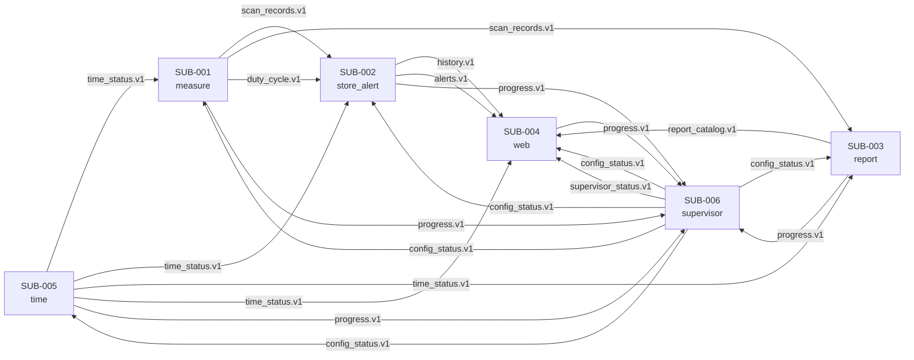

---

## 1. Building block view

### 1.1 System subsystem view (level 0)

| Subsystem ID | Single responsibility | State it owns | External inputs / outputs | Deployment target |
|------------|-----------------------|---------------|---------------------------|-------------------|
| SUB-001 `measure` | Acquire, estimate, calibrate, classify, compare and build the per-scan records | Scan in progress; 10-scan noise-floor smoothing; active calibration view | Input: IQ from HW-001, time and config; output: `scan_records.v1`, `duty_cycle.v1` | `local` (VL-0/1); `Raspberry Pi 5 node` (VL-2) |
| SUB-002 `store_alert` | Keep volatile history and evaluate the five alert rules | 744 h of 60 s bins per channel; latest scan; alert state and 1 000 events | Input: scan records, duty cycle, time, config, supervisor status; output: `history.v1`, `alerts.v1` | `local`; `Raspberry Pi 5 node` |
| SUB-003 `report` | Persist the screening report as results are produced | Open run and segment; rotation state; report catalog | Input: scan records, duty cycle, time, config, report commands; output: files and `report_catalog.v1` | `local`; `Raspberry Pi 5 node` |
| SUB-004 `web` | Serve the four views, alerts, status and report files read-only | Response cache only | Input: history, alerts, supervisor status, report catalog, report files; output: HTTP on :8080 | `local`; `Raspberry Pi 5 node` |
| SUB-005 `time` | Maintain UTC by NTP and publish the time status | Last synchronization, estimated offset, leap state | Input: config time sources; output: `time_status.v1` every 1 s | `local`; `Raspberry Pi 5 node` |
| SUB-006 `supervisor` | Start, watch and restart the units; own configuration, resources and the hardware watchdog | Process table, restart ladder, node state, configuration status, watchdog state | Input: progress counters; output: `config_status.v1`, `supervisor_status.v1`, commands, watchdog feed | `local`; `Raspberry Pi 5 node` |

**Motivation for the subsystem boundaries:**

The Build Package (§4.3) already fixes five independent units plus a supervisor and names what is lost when each restarts: `measure` loses the scan in progress, `store_alert` loses history and alerts, `report` closes an interrupted run, `web` loses only its cache, `time` loses nothing, and the supervisor is covered by systemd and the hardware watchdog. Those are distinct failure domains, so S1 keeps them as six subsystems rather than merging them into one process. The split also matches the four reasons the method allows a subsystem boundary: each unit is deployed as its own process, restarts independently, communicates over Unix sockets, and has its own failure domain. `measure` is not split further although it contains many modules: acquisition, estimation, calibration, detection, comparison and record building share the same 6 s scan deadline and the same in-process data, and a restart of any of them would invalidate the same scan. The supervisor is separate because it must survive the failure of the units it restarts.

### 1.2 White box: each subsystem (level 1)

**Motivation for the decomposition:**

Within `measure`, the modules follow the data path of REF-001 §5.3–5.9: acquisition produces IQ, the estimator produces per-channel dBFS, calibration produces dBm and validity, the detector produces Occupancy/Free/Uncertain, the comparator produces the assignment result, the duty-cycle accumulator produces interval counts, and the record builder assembles the 199 channel records and the health record. Each boundary is a contract with a deterministic stub, so S2 can build and test the modules in that order without a real radio. The operator procedures (`calibrate`, `verify`) are separate modules because they are invoked manually and write persistent records; the runtime `calibration` module only applies and validates what those procedures produced.

Within `store_alert`, history and alerts are separate because history is a data store with query limits while alerts are a rule engine with five independent rules and volatile state. Within `web`, the HTTP layer and the view layer are separate because the HTTP layer owns the request limits and the evidence headers, while the view layer owns the release rule (“only released values; otherwise null plus reason”) and the UTC formatting. Within `supervisor`, configuration, process supervision, the hardware watchdog/resources and the offline metrics are separate responsibilities: configuration is a file-validation concern, process supervision is a restart-ladder concern, the watchdog is the only module that touches `/dev/watchdog` and the thermal zone, and metrics computes availability and field-validation results from persisted evidence.

### 1.3 Base layer

**Subsystem ID:** SUB-001 `measure`

#### 1.3.1 Orchestration

| Field            | Value |
|------------------|-------|
| Mechanism        | `asyncio` event loop with a monotonic 6 s scan scheduler; in-process bounded queues between modules |
| Execution model  | Dataflow push: acquisition publishes an IQ block; each module transforms and forwards; the record builder publishes one message per scan |
| Timing           | Soft real-time; the scan chain budget is 4.98 s of 6 s, a scan over 7 s is marked late, and the 1.02 s slack is the acceptance margin |

The GT fixes the 6 s scan period, the 4.98 s chain and the “marked late at 7 s” rule (REF-001 §4.5, SyRS SYS-RES-001). A single event loop is enough because the modules are I/O- and CPU-bound in short bursts; the estimator runs in a worker thread so the socket and scheduler loops keep their deadlines. No module may extend its allocation without reducing the 1.02 s slack.

#### 1.3.2 HAL (Hardware Abstraction Layer)

| Field               | Value |
|---------------------|-------|
| Devices it wraps    | HW-001 (HackRF One); HW-005/HW-006/HW-007 are passive RF/USB paths; HW-010/HW-011 are manual RF references |
| Exposed interface   | `SdrPort`: `open()`, `info()`, `configure(ScanConfig)`, `read_frames(n, timeout)`, `close()`; IQ frames are `int8` interleaved I/Q at 10 Msps |
| Isolation           | Replacing the receiver changes only `src/fm_measure/hal/real.py`; the estimator, detector, calibration and records see the same `SdrPort` contract |

The HAL is the only point that touches the receiver. The Mock HAL and the Real HW HAL share the same port (§1.6). Calibration and verification use the same port with a manual RF source connected to the antenna connector; the software does not switch or attenuate anything.

#### 1.3.3 Data routing

| Input signal | Consumers | Mechanism |
|--------------|-----------|-----------|
| IQ block from `acq` | `estimator` | In-process queue, 39 frames of 131 072 samples per step; no disk write |
| `channel_power` from `estimator` | `calibration` and `records` | In-process queue; 199 powers in dBFS plus 819-point spectrum per step |
| `calibrated_power` from `calibration` | `detector` and `records` | In-process queue; 199 dBm values, uncertainty, validity and withheld reasons |
| `occupancy` from `detector` | `comparator`, `duty_cycle`, `records` | In-process fan-out; the same 199 states feed all three |
| `assignment` from `comparator` | `records` | In-process queue; 199 of four result values |
| `scan_records` from `records` | `store_alert` and `report` | One `scan_records.v1` message per scan over the base-layer Unix socket |

#### 1.3.4 Verification kit

| Tool | Path | Language | Consumed by | Source section |
|------|------|----------|-------------|----------------|
| Mock HAL | `verification/fm_measure/mock_hal/` | Python | VL-0/VL-1 tests | §1.6 |
| Golden vectors + manifest | `verification/golden/` + `manifest.md` | Python generator, binary/CSV vectors | `acq`, `estimator`, `calibration`, `detector` tests | §1.6, §3 |
| Telemetry companion | `verification/telemetry/` | Python | every test run | §1.7 |
| Stubs | `verification/fm_measure/stubs/` | Python | module tests without the full pipeline | §3.1–3.3 |
| Fake peers | `verification/fm_measure/fakes/` | Python | socket tests against `store_alert`/`report` | §3.4 |
| Drivers | `verification/fm_measure/drivers/` | Python | path and regression drivers | §4.4 |
| Level runner | `verification/run.sh` (`vl0`, `vl1`) | shell | S2, G2 | §4.4 |
| Real HW HAL + fake device API | `src/fm_measure/hal/` | Python | VL-2 and VL-0 with the fake device | §1.6 |

**Subsystem ID:** SUB-002 `store_alert`

#### 1.3.1 Orchestration

| Field            | Value |
|------------------|-------|
| Mechanism        | `asyncio` event loop; one socket server for `scan_records.v1`/`duty_cycle.v1`, one request server for `history.v1` |
| Execution model  | Event-driven; each incoming scan updates the history bins and the alert state |
| Timing           | Soft real-time; alerts evaluate in ≤0.22 s per scan; history queries answer within the web's 2 s response budget |

#### 1.3.2 HAL (Hardware Abstraction Layer)

| Field               | Value |
|---------------------|-------|
| Devices it wraps    | None |
| Exposed interface   | No hardware port; the subsystem is pure memory and sockets |
| Isolation           | Not applicable; the subsystem can run on any Linux host and on the Pi 5 without change |

#### 1.3.3 Data routing

| Input signal | Consumers | Mechanism |
|--------------|-----------|-----------|
| `scan_records.v1` | `history`, `alerts` | In-process fan-out; the latest scan is retained for `/api/latest-scan` |
| `duty_cycle.v1` | `history` | In-process queue; one record per closed interval |
| History bins and medians | `alerts` | In-process query; the alert engine reads the 60 min and 24 h windows |
| `history.v1` request | `history` | Unix socket request/response from `web` |
| `alerts.v1` subscription | `alerts` | Unix socket push every 6 s and on change |

#### 1.3.4 Verification kit

| Tool | Path | Language | Consumed by | Source section |
|------|------|----------|-------------|----------------|
| Mock HAL | Not applicable (no hardware) | — | — | §1.6 |
| Golden vectors + manifest | `verification/golden/` + `manifest.md` | Python | replay scans for history and alert tests | §1.6, §3 |
| Telemetry companion | `verification/telemetry/` | Python | every test run | §1.7 |
| Stubs | `verification/fm_store_alert/stubs/` | Python | history/alert unit tests | §3.1–3.3 |
| Fake peers | `verification/fm_store_alert/fakes/` | Python | fake `measure` producer and fake `web` client | §3.4 |
| Drivers | `verification/fm_store_alert/drivers/` | Python | alert-scenario drivers | §4.4 |
| Level runner | `verification/run.sh` (`vl0`, `vl1`) | shell | S2, G2 | §4.4 |
| Real HW HAL + fake device API | Not applicable | — | — | §1.6 |

**Subsystem ID:** SUB-003 `report`

#### 1.3.1 Orchestration

| Field            | Value |
|------------------|-------|
| Mechanism        | `asyncio` event loop with a worker thread for file writes and `fsync`; one socket server for scan records and commands |
| Execution model  | Event-driven; each scan appends its CSV lines, flushes and fsyncs before acknowledging |
| Timing           | Soft real-time; ≤0.05 s to append and flush one scan; `progress.json` every 60 s; segment close every 3 600 s |

#### 1.3.2 HAL (Hardware Abstraction Layer)

| Field               | Value |
|---------------------|-------|
| Devices it wraps    | HW-004 (microSD) through the filesystem; HW-002 |
| Exposed interface   | `ReportStorePort`: `open_run()`, `append_scan(lines)`, `fsync()`, `open_segment()`, `close_segment()`, `free_space()`, `rename_atomic()` |
| Isolation           | The Mock store writes to a temporary directory; the Real store writes to the mounted card. The report format does not change between them. |

#### 1.3.3 Data routing

| Input signal | Consumers | Mechanism |
|--------------|-----------|-----------|
| `scan_records.v1` | `writer` | In-process queue; header, 199 channel rows and health row per scan |
| `duty_cycle.v1` | `writer` | In-process queue; one `intervals.csv` row per closed interval |
| `report_command.v1` | `writer` | Unix socket command from the supervisor: start, stop, rotate check |
| Report catalog | `web` | `report_catalog.v1` after a run opens/closes or a segment closes |

#### 1.3.4 Verification kit

| Tool | Path | Language | Consumed by | Source section |
|------|------|----------|-------------|----------------|
| Mock HAL | `verification/fm_report/mock_hal/` | Python | temp-directory store | §1.6 |
| Golden vectors + manifest | `verification/golden/` + `manifest.md` | Python | expected CSV headers and rows | §1.6, §3 |
| Telemetry companion | `verification/telemetry/` | Python | every test run | §1.7 |
| Stubs | `verification/fm_report/stubs/` | Python | writer tests | §3.1–3.3 |
| Fake peers | `verification/fm_report/fakes/` | Python | fake `measure` producer and fake supervisor | §3.4 |
| Drivers | `verification/fm_report/drivers/` | Python | crash/rotation drivers | §4.4 |
| Level runner | `verification/run.sh` (`vl0`, `vl1`) | shell | S2, G2 | §4.4 |
| Real HW HAL + fake device API | `src/fm_report/hal/` | Python | real card and temp-dir fake | §1.6 |

**Subsystem ID:** SUB-004 `web`

#### 1.3.1 Orchestration

| Field            | Value |
|------------------|-------|
| Mechanism        | Node.js event loop; `node:http` server; one Unix-socket client per data source; timers at 6 s and 60 s |
| Execution model  | Request-driven plus periodic cache refresh; no writes |
| Timing           | Soft real-time; each response assembled in ≤2 s; at most 8 concurrent requests, 64 queued for 30 s, then 503 with `Retry-After: 10` |

#### 1.3.2 HAL (Hardware Abstraction Layer)

| Field               | Value |
|---------------------|-------|
| Devices it wraps    | HW-002 (network interface) and the report files on HW-004, read-only |
| Exposed interface   | `DataPort`: `getHistory()`, `getLatestScan()`, `getAlerts()`, `getStatus()`, `getReportCatalog()`, `readReportFile(path)`; `NetPort`: `listen(8080)` |
| Isolation           | The Mock data port replays golden JSON; the Real data port uses Unix sockets and the report directory. The HTTP layer sees the same port. |

#### 1.3.3 Data routing

| Input signal | Consumers | Mechanism |
|--------------|-----------|-----------|
| `history.v1` | `views` | Unix socket request/response; cached for the view refresh interval |
| `alerts.v1` | `views` | Unix socket push; alert bar refreshed every 6 s |
| `supervisor_status.v1` | `views` | Unix socket push; status view |
| `report_catalog.v1` | `views`, `http` | Unix socket push; download routes |
| Report files | `http` | Read-only file stream from `reports/<run_id>/` |

#### 1.3.4 Verification kit

| Tool | Path | Language | Consumed by | Source section |
|------|------|----------|-------------|----------------|
| Mock HAL | `verification/fm_web/mock_hal/` | TypeScript | fake data and net ports | §1.6 |
| Golden vectors + manifest | `verification/golden/` + `manifest.md` | JSON | view and API expected outputs | §1.6, §3 |
| Telemetry companion | `verification/telemetry/` | Python | every test run | §1.7 |
| Stubs | `verification/fm_web/stubs/` | TypeScript | view tests | §3.1–3.3 |
| Fake peers | `verification/fm_web/fakes/` | TypeScript | fake `store_alert`, `report` and supervisor sockets | §3.4 |
| Drivers | `verification/fm_web/drivers/` | TypeScript | HTTP load and release-rule drivers | §4.4 |
| Level runner | `verification/run.sh` (`vl0`, `vl1`) | shell | S2, G2 | §4.4 |
| Real HW HAL + fake device API | `src/fm_web/hal/` | TypeScript | real sockets/files and fake ports | §1.6 |

**Subsystem ID:** SUB-005 `time`

#### 1.3.1 Orchestration

| Field            | Value |
|------------------|-------|
| Mechanism        | `asyncio` event loop; one NTP poll task (64–1 024 s once stable) and one 1 s publish task |
| Execution model  | Periodic publish; NTP client state machine |
| Timing           | Soft real-time; `time_status.v1` every 1 s; unsynced if offset >50 ms or last success >3 600 s ago |

#### 1.3.2 HAL (Hardware Abstraction Layer)

| Field               | Value |
|---------------------|-------|
| Devices it wraps    | HW-002 system clock; no GPS (R-71) |
| Exposed interface   | `ClockPort`: `utc_now()`, `monotonic_now()`, `set_ntp_sources()`; `NtpPort`: `query(source)`, `offset()` |
| Isolation           | The Mock clock advances deterministically and injects offsets; the Real clock uses the OS and the configured NTP sources. |

#### 1.3.3 Data routing

| Input signal | Consumers | Mechanism |
|--------------|-----------|-----------|
| NTP response | `time` state | Converts to UTC, offset, resolution and sync state |
| `time_status.v1` | All other subsystems | Push every 1 s over Unix sockets; consumers keep the last value and its age |

#### 1.3.4 Verification kit

| Tool | Path | Language | Consumed by | Source section |
|------|------|----------|-------------|----------------|
| Mock HAL | `verification/fm_time/mock_hal/` | Python | deterministic clock and fake NTP | §1.6 |
| Golden vectors + manifest | `verification/golden/` + `manifest.md` | Python | offset/leap vectors | §1.6, §3 |
| Telemetry companion | `verification/telemetry/` | Python | every test run | §1.7 |
| Stubs | `verification/fm_time/stubs/` | Python | time-state tests | §3.1–3.3 |
| Fake peers | `verification/fm_time/fakes/` | Python | fake NTP server and fake consumer | §3.4 |
| Drivers | `verification/fm_time/drivers/` | Python | sync/unsync drivers | §4.4 |
| Level runner | `verification/run.sh` (`vl0`, `vl1`) | shell | S2, G2 | §4.4 |
| Real HW HAL + fake device API | `src/fm_time/hal/` | Python | real clock and fake NTP | §1.6 |

**Subsystem ID:** SUB-006 `supervisor`

#### 1.3.1 Orchestration

| Field            | Value |
|------------------|-------|
| Mechanism        | `asyncio` event loop; 1 s supervision tick, 5 s watchdog feed, child processes via `subprocess`/`systemd` units |
| Execution model  | Periodic control loop; commands are sent over Unix sockets and through process signals |
| Timing           | Soft real-time; progress counter every 1 s; stuck at 10 s; watchdog 15 s fed every 5 s |

#### 1.3.2 HAL (Hardware Abstraction Layer)

| Field               | Value |
|---------------------|-------|
| Devices it wraps    | HW-002 (hardware watchdog, thermal zone, cgroups); HW-003 and HW-009 enter through the thermal envelope |
| Exposed interface   | `WatchdogPort`: `open()`, `feed()`, `close()`; `ThermalPort`: `read_soc_temp()`; `ResourcePort`: `apply_limits(unit)`, `read_free_space()` |
| Isolation           | The Mock ports simulate the watchdog, temperature and limits; the Real ports use `/dev/watchdog`, `/sys/class/thermal` and cgroups. |

#### 1.3.3 Data routing

| Input signal | Consumers | Mechanism |
|--------------|-----------|-----------|
| `progress.v1` | `processes` | Unix socket push every 1 s from each child |
| `config_status.v1` | All subsystems | Push at start and on reload |
| `supervisor_status.v1` | `web`, `store_alert` | Push every 1 s |
| `report_command.v1` | `report` | Command at run start/stop and rotation check |
| `shutdown.v1` | All children | Command on ordered stop |
| Watchdog feed | `/dev/watchdog` | Write every 5 s only when the supervision loop actually ran |
| Temperature | `processes` | Read every 10 s; set/clear the `thermal` condition at 70/65 °C |

#### 1.3.4 Verification kit

| Tool | Path | Language | Consumed by | Source section |
|------|------|----------|-------------|----------------|
| Mock HAL | `verification/fm_supervisor/mock_hal/` | Python | fake watchdog, thermal zone and cgroup | §1.6 |
| Golden vectors + manifest | `verification/golden/` + `manifest.md` | Python | restart-ladder and status vectors | §1.6, §3 |
| Telemetry companion | `verification/telemetry/` | Python | every test run | §1.7 |
| Stubs | `verification/fm_supervisor/stubs/` | Python | supervision tests | §3.1–3.3 |
| Fake peers | `verification/fm_supervisor/fakes/` | Python | fake children and fake config files | §3.4 |
| Drivers | `verification/fm_supervisor/drivers/` | Python | kill/hang/recover drivers | §4.4 |
| Level runner | `verification/run.sh` (`vl0`, `vl1`) | shell | S2, G2 | §4.4 |
| Real HW HAL + fake device API | `src/fm_supervisor/hal/` | Python | real `/dev/watchdog` and fake device API | §1.6 |