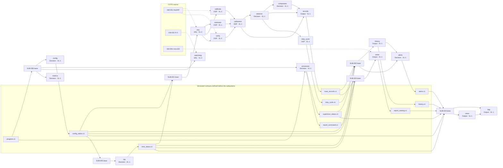
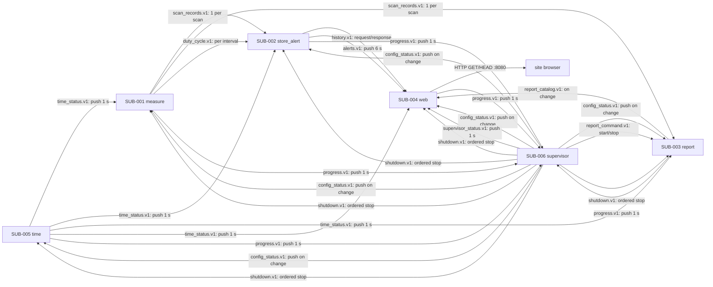

---

## 2. Dependency view

### 2.1 Implementation dependency graph (DAG)

A cross-subsystem contract is defined before both subsystems and is never drawn as a mutual dependency: the module that produces it points up to the contract, and the bases that consume it point down from the contract. The hardware subgraph is separate. The graph has no cycle.

### 2.2 Topological implementation order

| Step | Subsystem | Module / integration | Depends on (contracts) | Rationale for the order |
|------|---------|----------------------|------------------------|-------------------------|
| 1 | shared | Socket framing, JSON schemas, golden generator, telemetry companion, `verification/run.sh` | None | Every module and every fake peer uses the same framing and schemas; the verification kit must exist before the first module. |
| 2 | SUB-006 | `config` | `site-config.json`, station reference files | Configuration is the first runtime input; every other unit consumes its status. |
| 3 | SUB-005 | `ntp` | `config_status.v1` (stub until step 2 lands) | Time status is needed by the scan path and by every record. |
| 4 | SUB-006 | `processes`, `watchdog`, `metrics` | `progress.v1`, `HW-TEMP-001`, `SW-WDOG-001` | The supervisor can start and watch units once the contracts and config exist. |
| 5 | SUB-001 | `acq` | `HW-IQ-001`, `SW-HACKRF-001`, `time_status.v1`, `config_status.v1` | The first module of the scan path depends only on contracts, the base and the radio. |
| 6 | SUB-001 | `estimator` | `INT-IQ-001`, `INT-CTRL-001` (stub correction 0 ppm) | The estimator turns IQ into the first per-channel product. |
| 7 | SUB-001 | `calibration` | `INT-PWR-001`, `calibration_record` (stub `none`) | Calibration applies K(f) and produces the validity that gates detection. |
| 8 | SUB-001 | `detector` | `INT-CAL-001`, `config_status.v1` | Detection needs calibrated power and the declared minimum power. |
| 9 | SUB-001 | `comparator`, `duty_cycle` | `INT-OCC-001`, `config_status.v1` | Both consume occupancy; the comparator also needs the station reference. |
| 10 | SUB-001 | `records` | `INT-CAL-001`, `INT-OCC-001`, `INT-ASG-001` | The record builder is the last in-process module; it publishes the scan contract. |
| 11 | SUB-001 | `calibrate`, `verify` | `HW-IQ-001`, `INT-PWR-001`, `calibration_record` | The operator procedures are built after the scan path they measure; they are VL-2. |
| 12 | SUB-002 | `history`, `alerts` | `scan_records.v1`, `duty_cycle.v1`, `time_status.v1` | The volatile store and the rules consume the finished scan records. |
| 13 | SUB-003 | `writer` | `scan_records.v1`, `duty_cycle.v1`, `report_command.v1` | The report persists the same records; it is independent of the web. |
| 14 | SUB-004 | `views`, `http` | `history.v1`, `alerts.v1`, `supervisor_status.v1`, `report_catalog.v1` | The web is last because it reads every other subsystem's published result. |
| 15 | integration | PATH-001…PATH-009 | All contracts | Connect the real subsystems and run the end-to-end paths in §4.4. |

### 2.3 Runtime interaction graph

The loops are valid because every edge has a §3.4 contract. State ownership: `measure` owns the scan in progress and the calibration view; `store_alert` owns history and alert state; `report` owns the open run; `supervisor` owns process state and configuration; `time` owns the clock status. A command is acknowledged by the next progress counter; a duplicate retry is idempotent by `scan_id` or `run_id`. If a consumer drops, the producer queues up to 10 scans (60 s) and drops the oldest; when the consumer returns, it resumes from the next message. If `store_alert` restarts, history is empty and the web shows “insufficient history” until it rebuilds.

---

## 3. Interface view

### 3.1 HW → SW contracts

#### HW-IQ-001: HackRF One → acquisition

| Field              | Value |
|--------------------|-------|
| Physical origin    | PHY-003 (receiver → compute board) |
| COTS device        | HW-001 |
| Consuming module   | `SUB-001/acq` |
| Data type          | Interleaved `int8` I/Q pairs |
| Shape / structure  | 39 frames × 131 072 samples per step (65 536 complex samples per frame); three steps per scan |
| Units              | Full-scale signed 8-bit; converted to `complex64` by `(I + jQ)/128` |
| Rate / frequency   | 10 Msps, 20 MB/s over USB 2.0 |
| Maximum latency    | A frame must be available before the 64-frame ring buffer (0.839 s) overflows |
| Schema version     | v1 |
| Inherited budget   | 8-bit resolution; ±20 ppm crystal; 8 MHz usable bandwidth; maximum input −5 dBm; LNA ≤40 dB; RF amp ≤14 dB; no AGC |

**Stub recipe:**

`verification/fm_measure/mock_hal/iq_source.py` returns `GV-001` as 39 frames of 131 072 `int8` samples: a complex tone at +1 MHz from the step centre, amplitude 0.5 FS, AWGN with fixed seed 1, plus one frame at full scale for `GV-005` and a 38-frame variant for `GV-006`. The source exposes the same `read_frames(n, timeout)` signature as the Real HW HAL; it can also replay `GV-003` (noise only) and `GV-004` (two tones).

**Reference test vectors:**

| Input | Expected output |
|-------|-----------------|
| GV-001, 39 frames, step 1 | 39 frames accepted; `dropped_frames = 0`; step 1 channels 1–60; channel 100 not in step 1 |
| GV-005, one frame at full scale, step 1 | `saturated = true`; only step-1 channels flagged; power withheld; occupancy Uncertain |
| GV-006, 38 frames, step 2 | `dropped_frames = 1`; all 199 records marked; power withheld; occupancy Uncertain |
| Device absent | `open()` raises `SdrUnavailable`; the module counts 10 retries at 1 s, then stops; the supervisor restarts it |

#### HW-TEMP-001: Raspberry Pi thermal zone → supervisor

| Field              | Value |
|--------------------|-------|
| Physical origin    | PHY-005 (board thermal zone and fan) |
| COTS device        | HW-002; HW-003 contributes the cooling |
| Consuming module   | `SUB-006/watchdog` |
| Data type          | `float32` |
| Shape / structure  | Scalar `{soc_temp_c}` |
| Units              | °C |
| Rate / frequency   | 0.1 Hz (every 10 s) |
| Maximum latency    | 10 s |
| Schema version     | v1 |
| Inherited budget   | Board 0–70 °C (HWC-CPU-005); internal air ≤60 °C at 40 °C ambient (HWC-ENV-005); thermal condition at 70 °C, clear at 65 °C; throttle at 80 °C |

**Stub recipe:**

`verification/fm_supervisor/mock_hal/thermal.py` returns a scripted sequence `[25, 69, 71, 64, 85]` °C, one value per call, and records each read. The Real HW HAL reads `/sys/class/thermal/thermal_zone0/temp` and divides by 1 000.

**Reference test vectors:**

| Input | Expected output |
|-------|-----------------|
| 69 °C | `thermal = false` |
| 71 °C | `thermal = true`; condition published in `supervisor_status.v1` |
| 64 °C after 71 °C | `thermal = false` (clear threshold 65 °C) |
| 85 °C | `thermal = true` and a telemetry flag; no module stops |

### 3.2 SW → SW contracts

#### INT-IQ-001: acquisition → estimator

| Field              | Value |
|--------------------|-------|
| Producer           | `SUB-001/acq` |
| Consumer(s)        | `SUB-001/estimator` |
| Data type          | `int8` interleaved I/Q frames plus `CaptureMeta` |
| Shape / structure  | `{scan_id, step, center_hz, frames[39][131072], gains, agc_enabled:false, overflow_count, dropped_frames, saturated, captured_utc_us}` |
| Units               | Full-scale samples; Hz; dB |
| Rate / frequency   | 39 frames per step, three steps per 6 s scan |
| Maximum latency    | ≤0.839 s (ring buffer) |
| Schema version     | v1 |

**Stub recipe:**

Replay `GV-001` with `scan_id = 1`, `step = 1`, `center_hz = 90.25e6`, gains `{lna:0, rf:16, bb:16}`, `agc_enabled = false`, zero counters; a second variant with `dropped_frames = 1`.

**Reference test vectors:**

| Input | Expected output |
|-------|-----------------|
| GV-001 step 1 | 199 channel powers; channel 100 is absent from step 1; no withheld flags |
| GV-006 step 2 | `dropped_frames = 1`; estimator still returns 199 powers, but the records mark them withheld |
| Saturated frame | `saturated = true`; estimator returns the powers; calibration withholds the step-1 channels |

#### INT-PWR-001: estimator → calibration

| Field              | Value |
|--------------------|-------|
| Producer           | `SUB-001/estimator` |
| Consumer(s)        | `SUB-001/calibration`, `SUB-001/records` |
| Data type          | 199 `float64` dBFS values, 3 × 819 `float32` spectrum points, flags |
| Shape / structure  | `{scan_id, channels[199]{power_dbfs, dc_adjacent, mapping_error_khz}, spectrum[3][819], stats{segments:2495, enbw}}` |
| Units               | dBFS; kHz |
| Rate / frequency   | One message per scan |
| Maximum latency    | ≤2.5 s per scan (estimator allocation) |
| Schema version     | v1 |

**Stub recipe:**

A deterministic generator produces 199 powers from a fixed formula (`-80 + 0.1·k` dBFS, with channel 100 at −40 dBFS) and an 819-point spectrum with one tone; the same input always yields the same message.

**Reference test vectors:**

| Input | Expected output |
|-------|-----------------|
| GV-001 | Channel 100 power within ±0.1 dB of the synthetic level; `dc_adjacent` false except the step-centre channels |
| GV-007 | The two DC-adjacent channels have `dc_adjacent = true`; the spike is replaced |
| GV-008 | `mapping_error_khz ≤ 3.4648` at 100 MHz; the configured 5 kHz limit is compared |

#### INT-CTRL-001: calibration → estimator

| Field              | Value |
|--------------------|-------|
| Producer           | `SUB-001/calibration` |
| Consumer(s)        | `SUB-001/estimator` |
| Data type          | `{c_ppm: float64, reference_state: enum}` |
| Shape / structure  | Scalar correction and state (`valid`, `expiring`, `expired`, `invalid`, `none`) |
| Units               | ppm |
| Rate / frequency   | At start and whenever the active calibration changes |
| Maximum latency    | One scan |
| Schema version     | v1 |

**Stub recipe:**

Return `{c_ppm: 0.0, reference_state: "none"}` for the default stub, and `{c_ppm: 20.0, reference_state: "valid"}` for the offset vector.

**Reference test vectors:**

| Input | Expected output |
|-------|-----------------|
| 0 ppm | Estimator maps channels with the nominal frequencies |
| +20 ppm | Mapping bound still ≤5 kHz at 100 MHz; the corrected frequency is used |
| `reference_state = none` | Estimator still computes; records/calibration withhold the power |

#### INT-CAL-001: calibration → detector and records

| Field              | Value |
|--------------------|-------|
| Producer           | `SUB-001/calibration` |
| Consumer(s)        | `SUB-001/detector`, `SUB-001/records` |
| Data type          | 199 records `{power_dbm, u_db, u_basis, withheld_reason, validity, config_sha256}` |
| Shape / structure  | `{scan_id, channels[199], calibration_id, corrected: bool}` |
| Units               | dBm; dB |
| Rate / frequency   | One message per scan |
| Maximum latency    | ≤0.1 s (calibration allocation inside the 4.98 s chain) |
| Schema version     | v1 |

**Stub recipe:**

`calibration_record` with `K(f) = 60.0 dB`, `u_db = 1.28`, `validity = valid`, `config_sha256` matching the scan; a second record with `validity = expired` and `withheld_reason = "expired"`.

**Reference test vectors:**

| Input | Expected output |
|-------|-----------------|
| Valid record, GV-001 | `power_dbm = power_dbfs + 60.0`; `u_db = 1.28`; no withheld reason |
| Expired record | All 199 powers `null` with `withheld_reason = "expired"`; detector sees `validity = expired` |
| Config SHA mismatch | No power released; the scan is stopped per R-58 |

#### INT-OCC-001: detector → comparator, duty cycle and records

| Field              | Value |
|--------------------|-------|
| Producer           | `SUB-001/detector` |
| Consumer(s)        | `SUB-001/comparator`, `SUB-001/duty_cycle`, `SUB-001/records` |
| Data type          | 199 records `{state, reason, e_k, noise_dbm, threshold_dbm, min_dbm, margin_db, validity}` |
| Shape / structure  | `{scan_id, channels[199]}` |
| Units               | dB; dBm; enum |
| Rate / frequency   | One message per scan |
| Maximum latency    | ≤0.2 s (detector allocation) |
| Schema version     | v1 |

**Stub recipe:**

A synthetic scan with channel 100 Occupied (`e = 5 dB`), channel 101 Free (`e = 0.2 dB`), channel 102 Uncertain (`e = 1.2 dB`), channel 103 Uncertain (`uncertain_adjacent_leakage`), and the declared minimum power set so Free is allowed on channel 101.

**Reference test vectors:**

| Input | Expected output |
|-------|-----------------|
| `e = 1.5 dB` | Occupied |
| `e = 1.0 dB`, release conditions true | Free |
| `e = 1.2 dB` | Uncertain |
| `e = 0.5 dB` but `D_k` missing | Uncertain (`E-DET-002`) |
| Adjacent leakage, `R_k < 0` | Uncertain (`uncertain_adjacent_leakage`) |

#### INT-ASG-001: comparator → records

| Field              | Value |
|--------------------|-------|
| Producer           | `SUB-001/comparator` |
| Consumer(s)        | `SUB-001/records` |
| Data type          | 199 enum results plus reference identity |
| Shape / structure  | `{scan_id, reference_id, reference_used, channels[199]: consistent | unassigned-occupied | assigned-free | indeterminate}` |
| Units               | Enum |
| Rate / frequency   | One message per scan |
| Maximum latency    | ≤0.01 s (comparison allocation) |
| Schema version     | v1 |

**Stub recipe:**

A station reference with channel 100 assigned; scans with channel 100 Occupied → `consistent`, channel 101 Occupied → `unassigned-occupied`, channel 100 Free → `assigned-free`, channel 102 Uncertain → `indeterminate`; a missing reference → all 199 `indeterminate`.

**Reference test vectors:**

| Input | Expected output |
|-------|-----------------|
| Assigned + Occupied | `consistent` |
| Unassigned + Free | `consistent` |
| Unassigned + Occupied | `unassigned-occupied` |
| Assigned + Free | `assigned-free` |
| Uncertain or missing reference | `indeterminate` |

#### INT-REC-001: record builder → base outbound

| Field              | Value |
|--------------------|-------|
| Producer           | `SUB-001/records` |
| Consumer(s)        | `SUB-001` base, then `scan_records.v1` |
| Data type          | Header + 199 channel records + 1 health record |
| Shape / structure  | Header ≤4 096 B; channel record ≤1 024 B; health record ≤1 024 B; presence flags for power/occupancy/comparison |
| Units               | dBm; dB; enum; UTC µs |
| Rate / frequency   | One message per scan; a failed scan publishes only the health record |
| Maximum latency    | ≤0.15 s (record builder allocation) |
| Schema version     | v1 |

**Stub recipe:**

The three upstream stub messages (INT-CAL-001, INT-OCC-001, INT-ASG-001) with a fixed `scan_id`; the expected output is a golden JSON record with 199 channel entries, `evidence_label`, `not_configured` for the power limit, and the free-release evidence.

**Reference test vectors:**

| Input | Expected output |
|-------|-----------------|
| Valid calibrated + occupied + consistent | One header, 199 channel records, one health record; `power.withheld_reason = null` |
| Withheld power | `power = null`, `withheld_reason` set, occupancy Uncertain |
| No configured limit | `limit_comparison = not_configured`; never `within_limit` |
| Failed scan | Only the health record with `records_published = 0` |

#### INT-QRY-001: views → HTTP

| Field              | Value |
|---------------------|-------|
| Producer           | `SUB-004/views` |
| Consumer(s)        | `SUB-004/http` |
| Data type          | View model (`JSON` or HTML fragment) |
| Shape / structure  | `{view, utc_us, sync_state, evidence_label, data, alerts, flags}` |
| Units               | dBm; %; enum; UTC µs |
| Rate / frequency   | Per request; cache refresh 6 s or 60 s |
| Maximum latency    | ≤2 s per response |
| Schema version     | v1 |

**Stub recipe:**

A golden history response with one released channel, one withheld channel with reason, and one “insufficient history” marker; the view model must render the withheld value as `null` plus reason, never as 0 or the last value.

**Reference test vectors:**

| Input | Expected output |
|-------|-----------------|
| Released power | Numeric value with uncertainty and color |
| Withheld power | `null` plus reason and flags |
| Missing history | `insufficient_history = true`; no invented zeros |
| Unsynced clock | `sync_state = unsynced` visible in the header |

#### INT-HAL-001: history → alerts

| Field              | Value |
|--------------------|-------|
| Producer           | `SUB-002/history` |
| Consumer(s)        | `SUB-002/alerts` |
| Data type          | Query result: 60 min medians, 24 h duty cycle, bins |
| Shape / structure  | `{channel, window, bins, median_db, duty_cycle_pct, insufficient}` |
| Units               | dB; %; counts |
| Rate / frequency   | Once per minute +10 s for the history rules |
| Maximum latency    | ≤0.22 s (alert evaluation allocation) |
| Schema version     | v1 |

**Stub recipe:**

A replay of 1 440 bins with a 90 % duty cycle for the “busy” case and a 50 % case for “not_busy”; a second replay with fewer than 24 h to force `insufficient_history`.

**Reference test vectors:**

| Input | Expected output |
|-------|-----------------|
| 24 h with >90 % Occupied | `busy`; silent credit can raise the alert |
| 24 h with <90 % | `not_busy`; no silent alert |
| <24 h of bins | `insufficient_history`; no silent alert |

### 3.3 SW → HW contracts

#### SW-HACKRF-001: acquisition → HackRF One

| Field             | Value |
|-------------------|-------|
| Sending module    | `SUB-001/acq` (through `SdrPort`) |
| Physical target   | PHY-002 / HW-001 |
| Data type         | Configuration struct |
| Meaning           | `{center_hz, sample_rate_hz:10e6, lna_gain_db, rf_gain_db, bb_gain_db, agc:false, antenna_power:false, baseband_filter_hz}`; no TX |
| Latency           | ≤0.1 s settling per step before capture |
| Side effects      | Changing the centre frequency invalidates the current capture; gains are recorded with every capture; AGC is never enabled |

**Stub recipe:**

`verification/fm_measure/mock_hal/fake_hackrf.py` records every configuration call and rejects values outside 1–6 000 MHz, 2–20 Msps, LNA 0–40 dB, RF 0–14 dB or AGC on; it returns the recorded configuration in `info()`.

**Reference test vectors:**

| Input | Expected output |
|-------|-----------------|
| Valid 90.25 MHz, 10 Msps, (0,16,16), AGC off | Accepted; the same values appear in `CaptureMeta` |
| Sample rate 25 Msps | Rejected before configure; `E-ACQ` guard error |
| Centre 7 GHz | Rejected; no device call |
| AGC on | Rejected; the guard never bypasses to a raw API |

#### SW-WDOG-001: supervisor → hardware watchdog

| Field             | Value |
|-------------------|-------|
| Sending module    | `SUB-006/watchdog` |
| Physical target   | HW-002 `/dev/watchdog` |
| Data type         | Write of the magic character / ioctl |
| Meaning           | Feed the watchdog; never disable it while the node is running |
| Latency           | Every 5 s; timeout 15 s |
| Side effects      | On close, the watchdog may reset the board unless the “nowayout” policy is set; the supervisor closes it only on an ordered shutdown |

**Stub recipe:**

`verification/fm_supervisor/mock_hal/fake_watchdog.py` records feed timestamps and simulates a reset if no feed arrives within 15 s; `close()` records the ordered-stop reason.

**Reference test vectors:**

| Input | Expected output |
|-------|-----------------|
| Feed every 5 s | No reset; feed count increases |
| No feed for 16 s | Simulated reset; the event is recorded |
| Ordered shutdown | `close()` called last; no reset |

#### SW-STORAGE-001: report writer → microSD

| Field             | Value |
|-------------------|-------|
| Sending module    | `SUB-003/writer` |
| Physical target   | PHY-004 / HW-004 |
| Data type         | CSV lines, JSON header/progress, segment files |
| Meaning           | Append, flush and fsync per scan; atomic rename for `header.json` and `progress.json`; rotation only for closed segments older than 30 days |
| Latency           | ≤0.05 s per scan to append and fsync |
| Side effects      | A power cut loses at most the scan being written; a corrupt segment is marked, never repaired |

**Stub recipe:**

`verification/fm_report/mock_hal/temp_store.py` implements the same port on a temporary directory and can inject `ENOSPC`, a short write and a rename failure.

**Reference test vectors:**

| Input | Expected output |
|-------|-----------------|
| One scan | 199 channel rows + scan line + health line appended; fsync called once |
| `ENOSPC` | `report_state = stopped`; monitoring continues; no data written elsewhere |
| Interrupted run | Next start closes it with `interrupted = true` from `progress.json` |

#### SW-NET-001: web → site network

| Field             | Value |
|-------------------|-------|
| Sending module    | `SUB-004/http` |
| Physical target   | PHY-007 / HW-002 Ethernet |
| Data type         | HTTP/1.1 GET and HEAD responses |
| Meaning           | Listen on `0.0.0.0:8080`; no authentication; no write routes; `X-Screening-Evidence: true` on every response |
| Latency           | ≤2 s per response; 8 concurrent, 64 queued for 30 s, then 503 with `Retry-After: 10` |
| Side effects      | None on the node; downloads are read-only; total download rate ≤20 MB/s |

**Stub recipe:**

`verification/fm_web/mock_hal/fake_net.ts` starts the same HTTP handler on an ephemeral port and records requests; it can inject 9 concurrent requests and a slow client.

**Reference test vectors:**

| Input | Expected output |
|-------|-----------------|
| `GET /power` | 200 with the four-view page and the evidence header |
| `POST /power` | 405; no write route |
| 9 concurrent requests | 8 processed; 1 queued; after 30 s, 503 with `Retry-After: 10` |
| Report download | Read-only stream; no transformation |