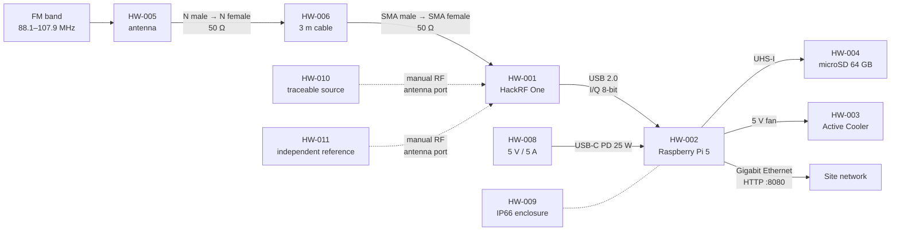
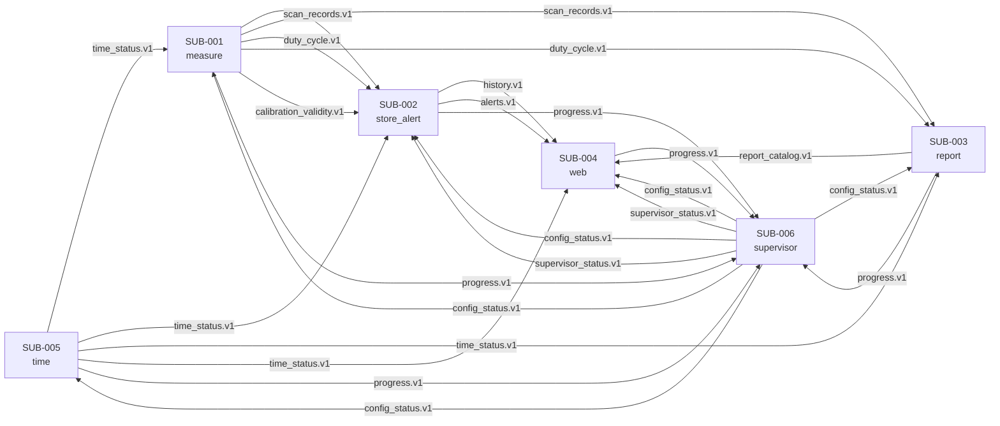
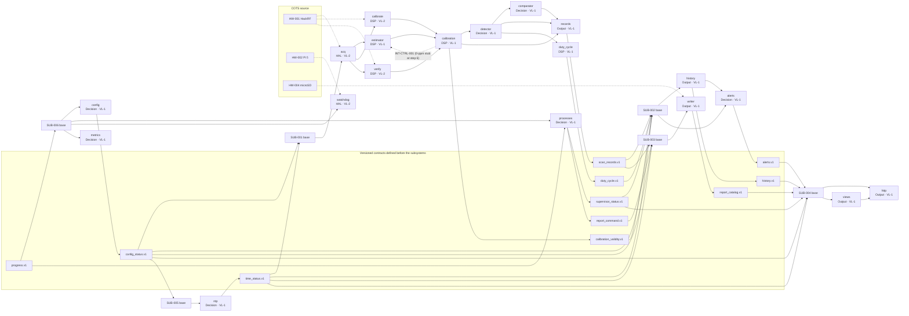
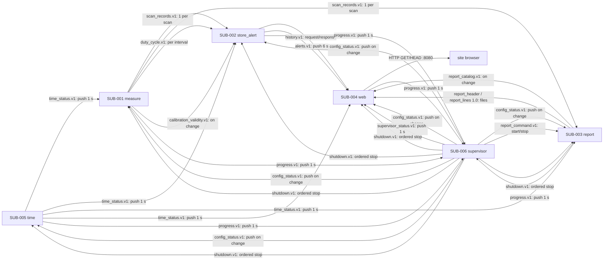

# S1 — Design of a System of Layered Subsystems

## Meta

| Field          | Value                                                       |
|----------------|-------------------------------------------------------------|
| Project        | FM HackRF RPI5 MVP                                          |
| Cycle          | `01_fm_hackrf_rpi5_mvp`                                     |
| Date           | 2026-11-13                                                  |
| Author         | OpenCode agent, S1 design pass                              |
| G0 approved    | `StRS.md` `db9d3775d3cca3683603ab998a31ca5a7df6e5b1853b6cfb954b169152a88ef3`; `SyRS.md` `ac2230edf7cc2e6f90a3f74be322dd54f282759e2f219ac8ac4fd29cd49a76b5` |
| Gate H         | 2026-11-12 22:25:37.841, `dramirezbe`                       |
| Subsystems     | SUB-001 `measure`; SUB-002 `store_alert`; SUB-003 `report`; SUB-004 `web`; SUB-005 `time`; SUB-006 `supervisor` |
| Target(s)      | `local` (VL-0/VL-1); `Raspberry Pi 5 node` (VL-2, deduced from HWC-CPU-*, HWC-SDR-*, HWC-ENV-*) |
| HAL mode       | `mock+real`                                                 |
| Toolchain      | SUB-001: `fm_measure` · Python 3.12 · uv · pytest; SUB-002: `fm_store_alert` · Python 3.12 · uv · pytest; SUB-003: `fm_report` · Python 3.12 · uv · pytest; SUB-004: `fm_web` · TypeScript · pnpm · vitest; SUB-005: `fm_time` · Python 3.12 · uv · pytest; SUB-006: `fm_supervisor` · Python 3.12 · uv · pytest |
| Status         | S1 rework after G1 iteration 1 (FEEDBACK); Anexo B names in §3.2/§3.4, runtime HAL under `src/`, unavailable-signal policy in §1.7 |

---

## 0. COTS envelope

### 0.1 Device inventory

| ID      | Device | Role | Key constraints |
|---------|--------|------|-----------------|
| HW-001 | Great Scott Gadgets HackRF One (HWC-SDR-001…009) | Receives the FM band and delivers I/Q samples | Tuning 1–6 000 MHz; sampling 2–20 Msps; 8-bit ADC; SMA female 50 Ω; maximum input −5 dBm; crystal ±20 ppm; LNA ≤40 dB, RF amp ≤14 dB; 8 MHz usable per capture |
| HW-002 | Raspberry Pi Ltd Raspberry Pi 5, 8 GB (HWC-CPU-001…005) | Runs the six processes and the web server | 4× Arm Cortex-A76 at 2.4 GHz; 8 GB RAM; Gigabit Ethernet; USB 2.0/3.0; 0–70 °C board |
| HW-003 | Raspberry Pi Active Cooler (HWC-COOL-001…002) | Dissipates board heat | 5 V fan; 1.09 CFM maximum |
| HW-004 | Kingston Industrial microSD SDCIT2/64GBSP (HWC-STO-001…004) | Stores OS, configuration, reports, calibration and validation records | 64 GB; class 10 / UHS-I U3, ≥30 MB/s sustained; −40…85 °C; ~1 920 TBW |
| HW-005 | Rohde & Schwarz HK033 coaxial dipole (HWC-ANT-001…004) | Captures 88.1–107.9 MHz | 80 MHz–2 GHz; N female 50 Ω; 2 dBi typical; VSWR ≤2 typical |
| HW-006 | LMR-195 antenna cable, 3 m (HWC-CBL-001…003) | Connects antenna to receiver | ≤1.8 dB loss 0–3 GHz; N male to SMA male |
| HW-007 | Lindy USB 2.0 A–Micro-B cable, 0.5 m (HWC-USB-001…002) | Connects receiver to board | USB 2.0; 0.5 m |
| HW-008 | Inventus Power XWA0650PDA-USB-C, 65 W (HWC-PWR-001…006) | Powers the board over USB-C PD | 85–264 V AC, 47–63 Hz; 5 V / 5 A (25 W); 81 % typical; 0–40 °C; IP22 |
| HW-009 | Fibox ARCA-304021 polycarbonate enclosure (HWC-ENV-001…005) | Contains and protects the node | 300 × 400 × 210 mm; IP66 / IK10; −40…80 °C; site ambient ≤40 °C; internal air ≤60 °C |
| HW-010 | Traceable calibration source (HWC-CAL-001…003) | Establishes amplitude and frequency corrections on site | Expanded uncertainty ≤0.5 dB (k = 2); frequency ≤1 ppm; independent from HW-011 |
| HW-011 | Independent verification reference (HWC-CAL-003) | Verifies the correction with an independent traceability chain | Expanded uncertainty ≤0.5 dB (k = 2); different instrument and chain from HW-010 |

### 0.2 Physical topology

### 0.3 Physical interfaces (HW ↔ HW contracts)

#### PHY-001: antenna → antenna cable

| Field            | Value |
|------------------|-------|
| Connector        | N female (antenna) to N male (cable) |
| Impedance        | 50 Ω |
| Band / range     | 80 MHz–2 GHz (FM use 88.1–107.9 MHz) |
| Expected loss    | Cable loss ≤1.8 dB from 0–3 GHz; antenna VSWR ≤2 typical |
| Key constraint   | The receiver sees the antenna temperature and cable loss; gain and cable loss are outside the calibrated quantity (R-09) and are recorded with the reference plane. Affects HW-IQ-001. |

#### PHY-002: antenna cable → receiver

| Field            | Value |
|------------------|-------|
| Connector        | SMA male (cable) to SMA female (receiver) |
| Impedance        | 50 Ω |
| Band / range     | 1–6 000 MHz receiver range; FM use 88.1–107.9 MHz |
| Expected loss    | Included in PHY-001; no additional adapter |
| Key constraint   | The calibrated reference plane is this connector (REF-001 §4.2, §5.5). Input above −5 dBm can damage the receiver. Affects HW-IQ-001 and SW-HACKRF-001. |

#### PHY-003: receiver → compute board

| Field            | Value |
|------------------|-------|
| Connector        | USB 2.0 type A (board) to Micro-B (receiver) |
| Impedance        | USB 90 Ω differential |
| Band / range     | USB 2.0 high speed, 480 Mbit/s theoretical |
| Expected loss    | None specified; 0.5 m cable |
| Key constraint   | 10 Msps × 2 × 8 bits = 20 MB/s sustained; a dropped frame is a marked scan. Affects HW-IQ-001. |

#### PHY-004: compute board → microSD

| Field            | Value |
|------------------|-------|
| Connector        | microSD slot, UHS-I |
| Impedance        | Not applicable |
| Band / range     | UHS-I U3, ≥30 MB/s sustained; theoretical rate not supplied by the Build Package |
| Expected loss    | Not applicable |
| Key constraint   | Report writes ~41.6 KB per scan and fsync each scan; the card must sustain the write and survive ~0.22 TB/year (599 MB/day × 365 = 218 GB/year). Affects SW-STORAGE-001. |

#### PHY-005: compute board → active cooler

| Field            | Value |
|------------------|-------|
| Connector        | 4-pin fan connector, 5 V |
| Impedance        | Not applicable |
| Band / range     | Fan power and tachometer |
| Expected loss    | Not applicable |
| Key constraint   | The fan is controlled by the board firmware, not by the software; the software only reads temperature. Affects the §1.7 thermal envelope. |

#### PHY-006: power supply → compute board

| Field            | Value |
|------------------|-------|
| Connector        | USB-C with Power Delivery |
| Impedance        | Not applicable |
| Band / range     | 5 V / 5 A (25 W); input 85–264 V AC, 47–63 Hz |
| Expected loss    | Efficiency 81 % typical; the node budget is 20 W (80 % of 25 W) |
| Key constraint   | The supply is outside the enclosure; a power cut is outside scope (R-48 assumes none). Affects the §1.7 power envelope. |

#### PHY-007: compute board → site network

| Field            | Value |
|------------------|-------|
| Connector        | RJ45, Gigabit Ethernet |
| Impedance        | Not applicable |
| Band / range     | 1 Gbit/s theoretical; sustained rate not supplied by the Build Package; web downloads limited to 20 MB/s |
| Expected loss    | Not applicable |
| Key constraint   | HTTP on port 8080, no authentication; all page assets are local to the node. Affects SW-NET-001. |

#### PHY-008: calibration source → receiver antenna port

| Field            | Value |
|------------------|-------|
| Connector        | Manual RF connection to the SMA female antenna port |
| Impedance        | 50 Ω, 50 Ω termination when the source is removed |
| Band / range     | 88–108 MHz CW |
| Expected loss    | Cable loss measured during calibration; source level traceable, ≤0.5 dB (k = 2), ≤1 ppm |
| Key constraint   | The source must be a different instrument from the verification reference, with an independent chain (R-20). Affects INT-CAL-001 and SW-HACKRF-001. |

#### PHY-009: verification reference → receiver antenna port

| Field            | Value |
|------------------|-------|
| Connector        | Manual RF connection to the SMA female antenna port |
| Impedance        | 50 Ω, 50 Ω termination |
| Band / range     | 88–108 MHz CW, two levels |
| Expected loss    | Cable loss measured; reference ≤0.5 dB (k = 2), independent of HW-010 |
| Key constraint   | 12 points (6 channels × 2 levels), 5 scans per point, tolerance 1.0 dB. Affects SYS-VER-001. |

#### PHY-010: enclosure → environment

| Field            | Value |
|------------------|-------|
| Connector        | Cable glands and mounting entries |
| Impedance        | Not applicable |
| Band / range     | IP66 / IK10; −40…80 °C; site ambient ≤40 °C; internal air ≤60 °C |
| Expected loss    | Thermal conductance estimated 4.8 W/K, not from a datasheet |
| Key constraint   | The enclosure and cable entries must pass P-093 (water and dust ingress); the internal air must stay ≤60 °C at 40 °C ambient. Affects SYS-ENV-001. |

### 0.4 Deployment and links between subsystems

| Subsystem ID | Process / deployment target | Execution target (`local` or declared name) | HWC-* used | Links to other subsystems | Restart / disconnected operation |
|------------|-----------------------------|---------------------------------------------|------------|-------------------------|-----------------------------------|
| SUB-001 `measure` | one process under the supervisor; systemd unit on the node | `local` (VL-0/VL-1); `Raspberry Pi 5 node` (VL-2) | HW-001, HW-002, HW-005, HW-006, HW-007, HW-008, HW-010, HW-011 | consumes `time_status.v1`, `config_status.v1`, `shutdown.v1`; produces `scan_records.v1`, `duty_cycle.v1`, `calibration_validity.v1`, `progress.v1` | Restart loses the scan in progress and the 10-scan noise-floor smoothing; the calibration record is a file and is re-read. Keeps measuring with an unsynced clock (marked). |
| SUB-002 `store_alert` | one process under the supervisor | `local` (VL-0/VL-1); `Raspberry Pi 5 node` (VL-2) | HW-002 | consumes `scan_records.v1`, `duty_cycle.v1`, `calibration_validity.v1`, `time_status.v1`, `config_status.v1`, `supervisor_status.v1`, `shutdown.v1`; produces `history.v1`, `alerts.v1`, `progress.v1` | Restart loses history and alert state; both start empty and rebuild over 24 h. |
| SUB-003 `report` | one process under the supervisor | `local` (VL-0/VL-1); `Raspberry Pi 5 node` (VL-2) | HW-002, HW-004 | consumes `scan_records.v1`, `duty_cycle.v1`, `time_status.v1`, `config_status.v1`, `report_command.v1`, `shutdown.v1`; produces `report_catalog.v1`, `progress.v1`, the `report_header` and `report_lines` files | Restart closes an open run as `interrupted = true` from `progress.json`; at most the scan being written is lost. |
| SUB-004 `web` | one Node.js process under the supervisor | `local` (VL-0/VL-1); `Raspberry Pi 5 node` (VL-2) | HW-002 | consumes `history.v1`, `alerts.v1`, `supervisor_status.v1`, `report_catalog.v1`, `shutdown.v1`; reads `report_header` and `report_lines` files read-only; produces `progress.v1` | Restart loses only the response cache; the measurement continues. |
| SUB-005 `time` | one process under the supervisor | `local` (VL-0/VL-1); `Raspberry Pi 5 node` (VL-2) | HW-002 | consumes `config_status.v1`, `shutdown.v1`; produces `time_status.v1`, `progress.v1` | Restart loses nothing; the NTP state is rebuilt. A scan is never held for time. |
| SUB-006 `supervisor` | one process started by systemd; it starts the other five | `local` (VL-0/VL-1); `Raspberry Pi 5 node` (VL-2) | HW-002, HW-003, HW-009 | consumes `progress.v1`; produces `config_status.v1`, `supervisor_status.v1`, `report_command.v1`, `shutdown.v1`, the `supervisor_log_line` event log and the `cross_site_comparison` file; feeds `/dev/watchdog` | systemd restarts the supervisor; the hardware watchdog resets a frozen node. Configuration is reloaded at start. |

### 0.5 Runnable system entry point

| Field | Value |
|-------|-------|
| Project-root command | `./run.sh` — builds the TypeScript web package if needed, then starts `fm_supervisor`, which starts the five child processes. `./run.sh --hal real` selects the Real HW HAL; the default is the **runtime Mock HAL shipped in `src/`** (`src/fm_measure/hal/mock.py`, `src/fm_supervisor/hal/mock.py`), which replays the vectors of `verification/golden/`. The command imports nothing from `verification/`. |
| HAL mode for preview | `mock+real`; the default preview uses the runtime Mock HAL (deterministic IQ replay and a fake watchdog/thermal port). The deterministic vectors and their generator stay in the verification kit; they are data for the runtime mock, not a runtime dependency. |
| Subsystems started | SUB-001 `measure`, SUB-002 `store_alert`, SUB-003 `report`, SUB-004 `web`, SUB-005 `time`, SUB-006 `supervisor` (launcher). |
| Local URL / endpoint | `http://localhost:8080/power` (redirects from `/`); APIs under `/api/*`; reports under `/reports/<run_id>/<file>`. |
| Visible result | The four web views show 199 channels updating every 6 s, the current spectrum, selected stations over 24 h, node status and the active-alert bar, all labelled “Screening evidence only: not a compliance determination”. |
| Shutdown | `SIGTERM`/`SIGINT` to `./run.sh` → supervisor sends `shutdown.v1`, closes the report run as `stopped`, stops children in reverse order, stops feeding `/dev/watchdog` and closes the device; exit code 0. |---

## 1. Building block view

### 1.1 System subsystem view (level 0)

| Subsystem ID | Single responsibility | State it owns | External inputs / outputs | Deployment target |
|------------|-----------------------|---------------|---------------------------|-------------------|
| SUB-001 `measure` | Acquire, estimate, calibrate, classify, compare and build the per-scan records | Scan in progress; 10-scan noise-floor smoothing; active calibration view | Input: IQ from HW-001, time, config and `shutdown.v1`; output: `scan_records.v1`, `duty_cycle.v1`, `calibration_validity.v1`, `progress.v1` | `local` (VL-0/1); `Raspberry Pi 5 node` (VL-2) |
| SUB-002 `store_alert` | Keep volatile history and evaluate the five alert rules | 744 h of 60 s bins per channel; latest scan; alert state and 1 000 events | Input: scan records, duty cycle, calibration validity, time, config, supervisor status, `shutdown.v1`; output: `history.v1`, `alerts.v1`, `progress.v1` | `local`; `Raspberry Pi 5 node` |
| SUB-003 `report` | Persist the screening report as results are produced | Open run and segment; rotation state; report catalog | Input: scan records, duty cycle, time, config, report commands, `shutdown.v1`; output: files, `report_catalog.v1`, `progress.v1` | `local`; `Raspberry Pi 5 node` |
| SUB-004 `web` | Serve the four views, alerts, status and report files read-only | Response cache only | Input: history, alerts, supervisor status, report catalog, report files, `shutdown.v1`; output: HTTP on :8080, `progress.v1` | `local`; `Raspberry Pi 5 node` |
| SUB-005 `time` | Maintain UTC by NTP and publish the time status | Last synchronization, estimated offset, leap state | Input: config time sources, `shutdown.v1`; output: `time_status.v1` every 1 s, `progress.v1` | `local`; `Raspberry Pi 5 node` |
| SUB-006 `supervisor` | Start, watch and restart the units; own configuration, resources and the hardware watchdog | Process table, restart ladder, node state, configuration status, watchdog state | Input: progress counters; output: `config_status.v1`, `supervisor_status.v1`, `report_command.v1`, `shutdown.v1`, watchdog feed, the supervisor event log | `local`; `Raspberry Pi 5 node` |

**Motivation for the subsystem boundaries:**

The Build Package (§4.3) already fixes five independent units plus a supervisor and names what is lost when each restarts: `measure` loses the scan in progress, `store_alert` loses history and alerts, `report` closes an interrupted run, `web` loses only its cache, `time` loses nothing, and the supervisor is covered by systemd and the hardware watchdog. Those are distinct failure domains, so S1 keeps them as six subsystems rather than merging them into one process. The split also matches the four reasons the method allows a subsystem boundary: each unit is deployed as its own process, restarts independently, communicates over Unix sockets, and has its own failure domain. `measure` is not split further although it contains many modules: acquisition, estimation, calibration, detection, comparison and record building share the same 6 s scan deadline and the same in-process data, and a restart of any of them would invalidate the same scan. The supervisor is separate because it must survive the failure of the units it restarts.

### 1.2 White box: each subsystem (level 1)

**Motivation for the decomposition:**

Within `measure`, the modules follow the data path of REF-001 §5.3–5.9: acquisition produces IQ, the estimator produces per-channel dBFS, calibration produces dBm and validity, the detector produces Occupancy/Free/Uncertain, the comparator produces the assignment result, the duty-cycle accumulator produces interval counts, and the record builder assembles the 199 channel records and the health record. Each boundary is a contract with a deterministic stub, so S2 can build and test the modules in that order without a real radio. The operator procedures (`calibrate`, `verify`) are separate modules because they are invoked manually and write persistent records; the runtime `calibration` module only applies and validates what those procedures produced.

Within `store_alert`, history and alerts are separate because history is a data store with query limits while alerts are a rule engine with five independent rules and volatile state. Within `web`, the HTTP layer and the view layer are separate because the HTTP layer owns the request limits and the evidence headers, while the view layer owns the release rule (“only released values; otherwise null plus reason”) and the UTC formatting. Within `supervisor`, configuration, process supervision, the hardware watchdog/resources and the offline metrics are separate responsibilities: configuration is a file-validation concern, process supervision is a restart-ladder concern, the watchdog is the only module that touches `/dev/watchdog` and the thermal zone, and metrics computes availability and field-validation results from persisted evidence.

### 1.3 Base layer

**Subsystem ID:** SUB-001 `measure`

#### 1.3.1 Orchestration

| Field            | Value |
|------------------|-------|
| Mechanism        | `asyncio` event loop with a monotonic 6 s scan scheduler; in-process bounded queues between modules |
| Execution model  | Dataflow push: acquisition publishes an IQ block; each module transforms and forwards; the record builder publishes one message per scan |
| Timing           | Soft real-time; the scan chain budget is 4.98 s of 6 s, a scan over 7 s is marked late, and the 1.02 s slack is the acceptance margin |

The GT fixes the 6 s scan period, the 4.98 s chain and the “marked late at 7 s” rule (REF-001 §4.5, SyRS SYS-RES-001). A single event loop is enough because the modules are I/O- and CPU-bound in short bursts; the estimator runs in a worker thread so the socket and scheduler loops keep their deadlines. No module may extend its allocation without reducing the 1.02 s slack.

#### 1.3.2 HAL (Hardware Abstraction Layer)

| Field               | Value |
|---------------------|-------|
| Devices it wraps    | HW-001 (HackRF One); HW-005/HW-006/HW-007 are passive RF/USB paths; HW-010/HW-011 are manual RF references |
| Exposed interface   | `SdrPort`: `open()`, `info()`, `configure(ScanConfig)`, `read_frames(n, timeout)`, `close()`; IQ frames are `int8` interleaved I/Q at 10 Msps |
| Isolation           | Replacing the receiver changes only `src/fm_measure/hal/real.py`; the estimator, detector, calibration and records see the same `SdrPort` contract |

The HAL is the only point that touches the receiver. The Mock HAL and the Real HW HAL share the same port (§1.6). Calibration and verification use the same port with a manual RF source connected to the antenna connector; the software does not switch or attenuate anything.

#### 1.3.3 Data routing

| Input signal | Consumers | Mechanism |
|--------------|-----------|-----------|
| IQ block from `acq` | `estimator` | In-process queue, 39 frames of 131 072 samples per step; no disk write |
| `channel_power` from `estimator` | `calibration` and `records` | In-process queue; 199 powers in dBFS plus 819-point spectrum per step |
| `calibrated_power` from `calibration` | `detector` and `records` | In-process queue; 199 dBm values, uncertainty, validity and withheld reasons |
| `occupancy` from `detector` | `comparator`, `duty_cycle`, `records` | In-process fan-out; the same 199 states feed all three |
| `assignment` from `comparator` | `records` | In-process queue; 199 of four result values |
| `scan_records` from `records` | `store_alert` and `report` | One `scan_records.v1` message per scan over the base-layer Unix socket |

#### 1.3.4 Verification kit

| Tool | Path | Language | Consumed by | Source section |
|------|------|----------|-------------|----------------|
| Mock HAL (runtime) | `src/fm_measure/hal/mock.py` | Python | default preview, VL-0/VL-1 | §1.6 |
| Fake device API | `verification/fm_measure/fakes/fake_hackrf.py` | Python | VL-0 of the Real HW HAL | §1.6 |
| Golden vectors + manifest | `verification/golden/` + `manifest.md` | Python generator, binary/CSV vectors | `acq`, `estimator`, `calibration`, `detector` tests and the runtime mock | §1.6, §3 |
| Telemetry companion | `verification/telemetry/` | Python | every test run | §1.7 |
| Stubs | `verification/fm_measure/stubs/` | Python | module tests without the full pipeline | §3.1–3.3 |
| Fake peers | `verification/fm_measure/fakes/` | Python | socket tests against `store_alert`/`report` | §3.4 |
| Drivers | `verification/fm_measure/drivers/` | Python | path and regression drivers | §4.4 |
| Level runner | `verification/run.sh` (`vl0`, `vl1`) | shell | S2, G2 | §4.4 |
| Real HW HAL + fake device API | `src/fm_measure/hal/` | Python | VL-2 and VL-0 with the fake device | §1.6 |

**Subsystem ID:** SUB-002 `store_alert`

#### 1.3.1 Orchestration

| Field            | Value |
|------------------|-------|
| Mechanism        | `asyncio` event loop; one socket server for `scan_records.v1`/`duty_cycle.v1`, one request server for `history.v1` |
| Execution model  | Event-driven; each incoming scan updates the history bins and the alert state |
| Timing           | Soft real-time; alerts evaluate in ≤0.22 s per scan; history queries answer within the web's 2 s response budget |

#### 1.3.2 HAL (Hardware Abstraction Layer)

| Field               | Value |
|---------------------|-------|
| Devices it wraps    | None |
| Exposed interface   | No hardware port; the subsystem is pure memory and sockets |
| Isolation           | Not applicable; the subsystem can run on any Linux host and on the Pi 5 without change |

#### 1.3.3 Data routing

| Input signal | Consumers | Mechanism |
|--------------|-----------|-----------|
| `scan_records.v1` | `history`, `alerts` | In-process fan-out; the latest scan is retained for `/api/latest-scan` |
| `duty_cycle.v1` | `history` | In-process queue; one record per closed interval |
| History bins and medians | `alerts` | In-process query; the alert engine reads the 60 min and 24 h windows |
| `history.v1` request | `history` | Unix socket request/response from `web` |
| `alerts.v1` subscription | `alerts` | Unix socket push every 6 s and on change |

#### 1.3.4 Verification kit

| Tool | Path | Language | Consumed by | Source section |
|------|------|----------|-------------|----------------|
| Mock HAL | Not applicable (no hardware) | — | — | §1.6 |
| Golden vectors + manifest | `verification/golden/` + `manifest.md` | Python | replay scans for history and alert tests | §1.6, §3 |
| Telemetry companion | `verification/telemetry/` | Python | every test run | §1.7 |
| Stubs | `verification/fm_store_alert/stubs/` | Python | history/alert unit tests | §3.1–3.3 |
| Fake peers | `verification/fm_store_alert/fakes/` | Python | fake `measure` producer and fake `web` client | §3.4 |
| Drivers | `verification/fm_store_alert/drivers/` | Python | alert-scenario drivers | §4.4 |
| Level runner | `verification/run.sh` (`vl0`, `vl1`) | shell | S2, G2 | §4.4 |
| Real HW HAL + fake device API | Not applicable | — | — | §1.6 |

**Subsystem ID:** SUB-003 `report`

#### 1.3.1 Orchestration

| Field            | Value |
|------------------|-------|
| Mechanism        | `asyncio` event loop with a worker thread for file writes and `fsync`; one socket server for scan records and commands |
| Execution model  | Event-driven; each scan appends its CSV lines, flushes and fsyncs before acknowledging |
| Timing           | Soft real-time; ≤0.05 s to append and flush one scan; `progress.json` every 60 s; segment close every 3 600 s |

#### 1.3.2 HAL (Hardware Abstraction Layer)

| Field               | Value |
|---------------------|-------|
| Devices it wraps    | HW-004 (microSD) through the filesystem; HW-002 |
| Exposed interface   | `ReportStorePort`: `open_run()`, `append_scan(lines)`, `fsync()`, `open_segment()`, `close_segment()`, `free_space()`, `rename_atomic()` |
| Isolation           | The Mock store writes to a temporary directory; the Real store writes to the mounted card. The report format does not change between them. |

#### 1.3.3 Data routing

| Input signal | Consumers | Mechanism |
|--------------|-----------|-----------|
| `scan_records.v1` | `writer` | In-process queue; header, 199 channel rows and health row per scan |
| `duty_cycle.v1` | `writer` | In-process queue; one `intervals.csv` row per closed interval |
| `report_command.v1` | `writer` | Unix socket command from the supervisor: start, stop, rotate check |
| Report catalog | `web` | `report_catalog.v1` after a run opens/closes or a segment closes |

#### 1.3.4 Verification kit

| Tool | Path | Language | Consumed by | Source section |
|------|------|----------|-------------|----------------|
| Runtime store port | `src/fm_report/hal/store.py` | Python | default preview against the real filesystem | §1.6 |
| Fake store (fault injection) | `verification/fm_report/fakes/fake_store.py` | Python | temp-directory store with injected `ENOSPC`, short write and rename failure | §1.6 |
| Golden vectors + manifest | `verification/golden/` + `manifest.md` | Python | expected CSV headers and rows | §1.6, §3 |
| Telemetry companion | `verification/telemetry/` | Python | every test run | §1.7 |
| Stubs | `verification/fm_report/stubs/` | Python | writer tests | §3.1–3.3 |
| Fake peers | `verification/fm_report/fakes/` | Python | fake `measure` producer and fake supervisor | §3.4 |
| Drivers | `verification/fm_report/drivers/` | Python | crash/rotation drivers | §4.4 |
| Level runner | `verification/run.sh` (`vl0`, `vl1`) | shell | S2, G2 | §4.4 |
| Real HW HAL + fake device API | `src/fm_report/hal/` | Python | real card and temp-dir fake | §1.6 |

**Subsystem ID:** SUB-004 `web`

#### 1.3.1 Orchestration

| Field            | Value |
|------------------|-------|
| Mechanism        | Node.js event loop; `node:http` server; one Unix-socket client per data source; timers at 6 s and 60 s |
| Execution model  | Request-driven plus periodic cache refresh; no writes |
| Timing           | Soft real-time; each response assembled in ≤2 s; at most 8 concurrent requests, 64 queued for 30 s, then 503 with `Retry-After: 10` |

#### 1.3.2 HAL (Hardware Abstraction Layer)

| Field               | Value |
|---------------------|-------|
| Devices it wraps    | HW-002 (network interface) and the report files on HW-004, read-only |
| Exposed interface   | `DataPort`: `getHistory()`, `getLatestScan()`, `getAlerts()`, `getStatus()`, `getReportCatalog()`, `readReportFile(path)`; `NetPort`: `listen(8080)` |
| Isolation           | The Mock data port replays golden JSON; the Real data port uses Unix sockets and the report directory. The HTTP layer sees the same port. |

#### 1.3.3 Data routing

| Input signal | Consumers | Mechanism |
|--------------|-----------|-----------|
| `history.v1` | `views` | Unix socket request/response; cached for the view refresh interval |
| `alerts.v1` | `views` | Unix socket push; alert bar refreshed every 6 s |
| `supervisor_status.v1` | `views` | Unix socket push; status view |
| `report_catalog.v1` | `views`, `http` | Unix socket push; download routes |
| Report files | `http` | Read-only file stream from `reports/<run_id>/` |

#### 1.3.4 Verification kit

| Tool | Path | Language | Consumed by | Source section |
|------|------|----------|-------------|----------------|
| Runtime ports (files, sockets, HTTP) | `src/fm_web/hal/` | TypeScript | default preview against the real files and sockets | §1.6 |
| Fake net (fault injection) | `verification/fm_web/fakes/fake_net.ts` | TypeScript | slow client and 9-concurrent-request injection | §1.6 |
| Golden vectors + manifest | `verification/golden/` + `manifest.md` | JSON | view and API expected outputs | §1.6, §3 |
| Telemetry companion | `verification/telemetry/` | Python | every test run | §1.7 |
| Stubs | `verification/fm_web/stubs/` | TypeScript | view tests | §3.1–3.3 |
| Fake peers | `verification/fm_web/fakes/` | TypeScript | fake `store_alert`, `report` and supervisor sockets | §3.4 |
| Drivers | `verification/fm_web/drivers/` | TypeScript | HTTP load and release-rule drivers | §4.4 |
| Level runner | `verification/run.sh` (`vl0`, `vl1`) | shell | S2, G2 | §4.4 |
| Real HW HAL + fake device API | `src/fm_web/hal/` | TypeScript | real sockets/files and fake ports | §1.6 |

**Subsystem ID:** SUB-005 `time`

#### 1.3.1 Orchestration

| Field            | Value |
|------------------|-------|
| Mechanism        | `asyncio` event loop; one NTP poll task (64–1 024 s once stable) and one 1 s publish task |
| Execution model  | Periodic publish; NTP client state machine |
| Timing           | Soft real-time; `time_status.v1` every 1 s; unsynced if offset >50 ms or last success >3 600 s ago |

#### 1.3.2 HAL (Hardware Abstraction Layer)

| Field               | Value |
|---------------------|-------|
| Devices it wraps    | HW-002 system clock; no GPS (R-71) |
| Exposed interface   | `ClockPort`: `utc_now()`, `monotonic_now()`, `set_ntp_sources()`; `NtpPort`: `query(source)`, `offset()` |
| Isolation           | The Mock clock advances deterministically and injects offsets; the Real clock uses the OS and the configured NTP sources. |

#### 1.3.3 Data routing

| Input signal | Consumers | Mechanism |
|--------------|-----------|-----------|
| NTP response | `time` state | Converts to UTC, offset, resolution and sync state |
| `time_status.v1` | All other subsystems | Push every 1 s over Unix sockets; consumers keep the last value and its age |

#### 1.3.4 Verification kit

| Tool | Path | Language | Consumed by | Source section |
|------|------|----------|-------------|----------------|
| Runtime clock and NTP ports | `src/fm_time/hal/` | Python | default preview against the real clock and network | §1.6 |
| Fake NTP peer | `verification/fm_time/fakes/fake_ntp.py` | Python | scripted offset, delay and unreachable states | §1.6 |
| Golden vectors + manifest | `verification/golden/` + `manifest.md` | Python | offset/leap vectors | §1.6, §3 |
| Telemetry companion | `verification/telemetry/` | Python | every test run | §1.7 |
| Stubs | `verification/fm_time/stubs/` | Python | time-state tests | §3.1–3.3 |
| Fake peers | `verification/fm_time/fakes/` | Python | fake NTP server and fake consumer | §3.4 |
| Drivers | `verification/fm_time/drivers/` | Python | sync/unsync drivers | §4.4 |
| Level runner | `verification/run.sh` (`vl0`, `vl1`) | shell | S2, G2 | §4.4 |
| Real HW HAL + fake device API | `src/fm_time/hal/` | Python | real clock and fake NTP | §1.6 |

**Subsystem ID:** SUB-006 `supervisor`

#### 1.3.1 Orchestration

| Field            | Value |
|------------------|-------|
| Mechanism        | `asyncio` event loop; 1 s supervision tick, 5 s watchdog feed, child processes via `subprocess`/`systemd` units |
| Execution model  | Periodic control loop; commands are sent over Unix sockets and through process signals |
| Timing           | Soft real-time; progress counter every 1 s; stuck at 10 s; watchdog 15 s fed every 5 s |

#### 1.3.2 HAL (Hardware Abstraction Layer)

| Field               | Value |
|---------------------|-------|
| Devices it wraps    | HW-002 (hardware watchdog, thermal zone, cgroups); HW-003 and HW-009 enter through the thermal envelope |
| Exposed interface   | `WatchdogPort`: `open()`, `feed()`, `close()`; `ThermalPort`: `read_soc_temp()`; `ResourcePort`: `apply_limits(unit)`, `read_free_space()` |
| Isolation           | The Mock ports simulate the watchdog, temperature and limits; the Real ports use `/dev/watchdog`, `/sys/class/thermal` and cgroups. |

#### 1.3.3 Data routing

| Input signal | Consumers | Mechanism |
|--------------|-----------|-----------|
| `progress.v1` | `processes` | Unix socket push every 1 s from each child |
| `config_status.v1` | All subsystems | Push at start and on reload |
| `supervisor_status.v1` | `web`, `store_alert` | Push every 1 s |
| `report_command.v1` | `report` | Command at run start/stop and rotation check |
| `shutdown.v1` | All children | Command on ordered stop |
| Watchdog feed | `/dev/watchdog` | Write every 5 s only when the supervision loop actually ran |
| Temperature | `processes` | Read every 10 s; set/clear the `thermal` condition at 70/65 °C |

#### 1.3.4 Verification kit

| Tool | Path | Language | Consumed by | Source section |
|------|------|----------|-------------|----------------|
| Mock HAL (runtime) | `src/fm_supervisor/hal/mock.py` | Python | default preview, VL-0/VL-1 (fake watchdog, thermal zone and cgroup) | §1.6 |
| Fake device API | `verification/fm_supervisor/fakes/fake_watchdog.py` | Python | VL-0 of the Real HW HAL | §1.6 |
| Golden vectors + manifest | `verification/golden/` + `manifest.md` | Python | restart-ladder and status vectors | §1.6, §3 |
| Telemetry companion | `verification/telemetry/` | Python | every test run | §1.7 |
| Stubs | `verification/fm_supervisor/stubs/` | Python | supervision tests | §3.1–3.3 |
| Fake peers | `verification/fm_supervisor/fakes/` | Python | fake children and fake config files | §3.4 |
| Drivers | `verification/fm_supervisor/drivers/` | Python | kill/hang/recover drivers | §4.4 |
| Level runner | `verification/run.sh` (`vl0`, `vl1`) | shell | S2, G2 | §4.4 |
| Real HW HAL + fake device API | `src/fm_supervisor/hal/` | Python | real `/dev/watchdog` and fake device API | §1.6 |### 1.4 Black boxes: modules

#### SUB-001/acq

| Field            | Value |
|------------------|-------|
| subsystem_id       | `SUB-001` |
| Functional layer | HAL |
| Responsibility   | Schedule and execute the three-step scan, configure the receiver, capture 39 frames per step, count overflows and dropped frames, flag clipping and publish IQ blocks with capture metadata. |
| depends_on       | `HW-IQ-001`, `SW-HACKRF-001`, `time_status.v1`, `config_status.v1` |
| provides         | `INT-IQ-001` (`capture_block`) and `INT-ACQ-001` (`acquisition_counters`) |
| hw_dependency    | true |
| required_vl      | VL-2 |

**Rationale for the required VL:** The correctness of this module depends on the real HackRF: 10 Msps sustained over USB 2.0, the fixed gain steps, the 8 MHz usable bandwidth, saturation at full scale, and the overflow/dropped-frame behaviour. A Mock HAL proves the scheduling and counters, but only HIL at VL-2 proves that the real receiver sustains the scan without loss.

#### SUB-001/estimator

| Field            | Value |
|------------------|-------|
| subsystem_id       | `SUB-001` |
| Functional layer | DSP |
| Responsibility   | Convert each IQ block into 199 channel powers in dBFS and an 819-point spectrum using a 4 096-point Hann FFT, 50 % overlap, 2 495 segments and DC-spike replacement. |
| depends_on       | `INT-IQ-001`, `INT-CTRL-001` (frequency correction and reference state) |
| provides         | `INT-PWR-001` |
| hw_dependency    | false |
| required_vl      | VL-1 |

**Rationale for the required VL:** The algorithm is deterministic: the same IQ block must produce the same channel powers and spectrum. Golden vectors at VL-1 prove the FFT, window, DC replacement, 105-bin integration and 3.4648 kHz mapping bound. The real-hardware timing (2.5 s per scan) is a PATH-001 VL-2 measurement, not an algorithm property.

#### SUB-001/calibration

| Field            | Value |
|------------------|-------|
| subsystem_id       | `SUB-001` |
| Functional layer | DSP |
| Responsibility   | Apply K(f) and the frequency correction to the estimator output, attach uncertainty and its basis, enforce the calibration validity state and the configuration SHA-256 check, and withhold power when the correction cannot be demonstrated. |
| depends_on       | `INT-PWR-001`, `INT-CTRL-001`, `INT-CALFILE-001` (the active `calibration_record` file), `time_status.v1`, `config_status.v1` |
| provides         | `INT-CAL-001`, `INT-CTRL-001`, `SSC-CALV-001` (`calibration_validity.v1`) |
| hw_dependency    | false |
| required_vl      | VL-1 |

**Rationale for the required VL:** Interpolation, validity transitions, uncertainty arithmetic and the configuration comparison are file and state logic, fully testable with deterministic records. The real amplitude accuracy is established by `calibrate` and `verify` at VL-2.

#### SUB-001/detector

| Field            | Value |
|------------------|-------|
| subsystem_id       | `SUB-001` |
| Functional layer | Decision |
| Responsibility   | Classify each channel as Occupied, Free or Uncertain from the calibrated excess over the verified noise floor, applying hysteresis, the adjacent-channel ratio and all Free-release conditions. |
| depends_on       | `INT-CAL-001`, `config_status.v1` (declared minimum power) |
| provides         | `INT-OCC-001` |
| hw_dependency    | false |
| required_vl      | VL-1 |

**Rationale for the required VL:** The decision is a fixed table of thresholds and rules. Synthetic golden scans at SNR 0 dB, vacant channels and adjacent leakage prove the state machine, the hysteresis and every Uncertain reason at VL-1. Real-signal detection and false-alarm probabilities are acceptance measurements on PATH-001 at VL-2.

#### SUB-001/comparator

| Field            | Value |
|------------------|-------|
| subsystem_id       | `SUB-001` |
| Functional layer | Decision |
| Responsibility   | Compare each channel's occupancy with the site station reference and emit one of four results, leaving all channels indeterminate when the reference is absent or invalid. |
| depends_on       | `INT-OCC-001`, `config_status.v1` (station reference) |
| provides         | `INT-ASG-001` |
| hw_dependency    | false |
| required_vl      | VL-1 |

**Rationale for the required VL:** The result is a six-row decision table over two enums. Deterministic vectors cover every row, including the absent/invalid reference and the “Uncertain never becomes a verdict” rule.

#### SUB-001/duty_cycle

| Field            | Value |
|------------------|-------|
| subsystem_id       | `SUB-001` |
| Functional layer | DSP |
| Responsibility   | Accumulate Occupied/Free/Uncertain counts per UTC-aligned interval and publish the duty cycle and uncertain fraction when the interval closes. |
| depends_on       | `INT-OCC-001` |
| provides         | `SSC-DUTY-001` (`duty_cycle.v1`) |
| hw_dependency    | false |
| required_vl      | VL-1 |

**Rationale for the required VL:** Counting and the UTC interval boundary are deterministic. Replay scans across two interval boundaries prove the counts and the null-denominator rule.

#### SUB-001/records

| Field            | Value |
|------------------|-------|
| subsystem_id       | `SUB-001` |
| Functional layer | Output |
| Responsibility   | Assemble the per-scan header, 199 channel records and health record with power, uncertainty, occupancy inputs, comparison, limit comparison, flags and the evidence label. |
| depends_on       | `INT-CAL-001`, `INT-OCC-001`, `INT-ASG-001`, `INT-ACQ-001`, `INT-CALFILE-001`, `time_status.v1`, `config_status.v1` |
| provides         | `SSC-SCAN-001` (`scan_records.v1`) |
| hw_dependency    | false |
| required_vl      | VL-1 |

**Rationale for the required VL:** The module is a schema assembler. Golden expected records prove every field, the `not_configured` rule, the withheld-power reason, the Free-release evidence and the prohibited-word check at VL-1.

#### SUB-001/calibrate

| Field            | Value |
|------------------|-------|
| subsystem_id       | `SUB-001` |
| Functional layer | DSP |
| Responsibility   | Run the operator's `establish_amplitude_calibration` procedure, measure K(f), the dynamic range and the crystal correction, and write one immutable calibration record. |
| depends_on       | `HW-IQ-001`, `SW-HACKRF-001`, `INT-PWR-001` |
| provides         | `INT-CALFILE-001` (`calibration_record` 1.0 file, persistent) and the new active correction |
| hw_dependency    | true |
| required_vl      | VL-2 |

**Rationale for the required VL:** The procedure depends on the real receiver response, the real cable loss and the traceable source HW-010. The Mock HAL can exercise the procedure's data flow, but the resulting K(f) only has meaning against real hardware and a real reference.

#### SUB-001/verify

| Field            | Value |
|------------------|-------|
| subsystem_id       | `SUB-001` |
| Functional layer | DSP |
| Responsibility   | Run the operator's `verify_amplitude_correction` procedure at 12 points, compare the median differences with the 1.0 dB tolerance and the ±20 ppm frequency limit, and write one immutable validation record. |
| depends_on       | `HW-IQ-001`, `SW-HACKRF-001`, `INT-PWR-001`, `calibration_record` |
| provides         | `INT-CALFILE-001` (`validation_record` 1.0 file, persistent) and the updated `verified_until` |
| hw_dependency    | true |
| required_vl      | VL-2 |

**Rationale for the required VL:** The verification is only meaningful with the independent reference HW-011 and the real receiver; it is the evidence that keeps the calibration valid. Deterministic replay cannot establish independence of the traceability chain.

#### SUB-002/history

| Field            | Value |
|------------------|-------|
| subsystem_id       | `SUB-002` |
| Functional layer | Output |
| Responsibility   | Keep 744 h of 60 s bins per channel and the latest scan in memory, answer bounded queries and expose the 60 min noise-floor medians and the 24 h duty cycle. |
| depends_on       | `SSC-SCAN-001`, `SSC-DUTY-001`, `time_status.v1` |
| provides         | `SSC-HIST-001` (`history.v1`), `INT-HIS-001` (`history_series_response` 1.1), `latest_scan` |
| hw_dependency    | false |
| required_vl      | VL-1 |

**Rationale for the required VL:** The ring buffer, bin aliasing, query caps (2 000 bins per channel, 40 000 total) and the “insufficient history” answer are deterministic data structures. The 512 MB memory ceiling is checked by the resource envelope.

#### SUB-002/alerts

| Field            | Value |
|------------------|-------|
| subsystem_id       | `SUB-002` |
| Functional layer | Decision |
| Responsibility   | Evaluate the five alert rules over scan records and history, maintain their persistence counters and credit, and publish active alerts, recent events and rule states. |
| depends_on       | `SSC-SCAN-001`, `SSC-CALV-001` (`calibration_validity.v1`), `INT-HIS-001`, `time_status.v1`, `supervisor_status.v1` |
| provides         | `SSC-ALERT-001` (`alerts.v1`) |
| hw_dependency    | false |
| required_vl      | VL-1 |

**Rationale for the required VL:** The rules are explicit counters and thresholds over record values. Replay scenarios (silent channel, unexpected occupancy, missing health, expiring calibration, 6 dB drift) prove each rule, its clearing rule and the `not_configured`/`insufficient_history` states at VL-1.

#### SUB-003/writer

| Field            | Value |
|------------------|-------|
| subsystem_id       | `SUB-003` |
| Functional layer | Output |
| Responsibility   | Write the screening report as results are produced, with atomic headers, fsynced scan lines, 3 600 s segments, 60 s progress, space checks and interrupted-run recovery. |
| depends_on       | `SSC-SCAN-001`, `SSC-DUTY-001`, `time_status.v1`, `config_status.v1`, `SSC-REPORT-001` |
| provides         | `SSC-CAT-001` (`report_catalog.v1`) and the `report_header` 1.0 / `report_lines` 1.0 files |
| hw_dependency    | false |
| required_vl      | VL-1 |

**Rationale for the required VL:** Run/segment lifecycle, atomic rename, fsync ordering, rotation and recovery are filesystem logic testable in a temporary directory. The real card's sustained write (≤0.05 s per scan) and endurance are PATH-001 VL-2 measurements.

#### SUB-004/http

| Field            | Value |
|------------------|-------|
| subsystem_id       | `SUB-004` |
| Functional layer | Output |
| Responsibility   | Serve HTTP GET/HEAD on port 8080 with the four views and report downloads, enforce the request/download limits and attach the evidence headers. |
| depends_on       | `INT-QRY-001` (view responses), `SSC-HIST-001`, `SSC-ALERT-001`, `SSC-STATUS-001`, `SSC-CAT-001` |
| provides         | `SW-NET-001` (HTTP endpoint) |
| hw_dependency    | false |
| required_vl      | VL-1 |

**Rationale for the required VL:** HTTP semantics, status codes, `Retry-After`, the 8/64/30 s limits and the read-only rule are testable with a local server and fake data. The real Ethernet throughput and 8-client load are PATH-002/PATH-009 VL-2 measurements.

#### SUB-004/views

| Field            | Value |
|------------------|-------|
| subsystem_id       | `SUB-004` |
| Functional layer | Output |
| Responsibility   | Shape the four views and API payloads from released values only, applying the null-plus-reason rule, UTC formatting and the evidence label. |
| depends_on       | `SSC-HIST-001`, `SSC-ALERT-001`, `SSC-STATUS-001`, `SSC-CAT-001` |
| provides         | `INT-QRY-001` |
| hw_dependency    | false |
| required_vl      | VL-1 |

**Rationale for the required VL:** The release rule, the fixed color scale, the “never 0 or last value” rule and the alert-bar states are deterministic payload transformations. Golden JSON vectors prove each view at VL-1.

#### SUB-005/ntp

| Field            | Value |
|------------------|-------|
| subsystem_id       | `SUB-005` |
| Functional layer | Decision |
| Responsibility   | Synchronize the node clock from the configured NTP sources and publish a 1 s UTC status with resolution, offset and sync state. |
| depends_on       | `config_status.v1` (time sources) |
| provides         | `SSC-TIME-001` (`time_status.v1`) |
| hw_dependency    | false |
| required_vl      | VL-1 |

**Rationale for the required VL:** The NTP client state machine, the 50 ms/3 600 s unsynced rule, the 120 s startup wait and the leap detection are testable against a fake NTP peer. The site network is not a COTS device and does not raise the level.

#### SUB-006/config

| Field            | Value |
|------------------|-------|
| subsystem_id       | `SUB-006` |
| Functional layer | Decision |
| Responsibility   | Load, validate and atomically accept or reject `site-config.json` and the station reference, compute their SHA-256 and publish `config_status.v1`. |
| depends_on       | `site-config.json`, `station_reference_file` (files) |
| provides         | `SSC-CFG-001` (`config_status.v1`) |
| hw_dependency    | false |
| required_vl      | VL-1 |

**Rationale for the required VL:** Field ranges, the whole-file accept/reject rule, the “keep the last valid configuration” rule and the station table are file logic with deterministic vectors. No hardware property is involved.

#### SUB-006/processes

| Field            | Value |
|------------------|-------|
| subsystem_id       | `SUB-006` |
| Functional layer | Decision |
| Responsibility   | Start, watch, restart and stop the five units, maintain the restart ladder and publish the node state and progress view. |
| depends_on       | `SSC-PROG-001` (`progress.v1`) |
| provides         | `SSC-STATUS-001` (`supervisor_status.v1`), `SSC-REPORT-001` (`report_command.v1`), `SSC-SHUT-001` (`shutdown.v1`), `INT-LOG-001` (`supervisor_log_line` 1.0) |
| hw_dependency    | false |
| required_vl      | VL-1 |

**Rationale for the required VL:** The progress counter, 10 s stuck rule, 5/10/20/40/60 s ladder, loop detection and ordered shutdown are process-control logic testable with fake children on any Linux host.

#### SUB-006/watchdog

| Field            | Value |
|------------------|-------|
| subsystem_id       | `SUB-006` |
| Functional layer | HAL |
| Responsibility   | Feed the hardware watchdog every 5 s only when the supervision loop ran, read the SoC temperature every 10 s, apply the unit resource limits and raise or clear the thermal condition. |
| depends_on       | `HW-TEMP-001`, `SW-WDOG-001` |
| provides         | Thermal condition and resource limits to `processes` |
| hw_dependency    | true |
| required_vl      | VL-2 |

**Rationale for the required VL:** `/dev/watchdog`, the Pi thermal zone and cgroups only exist on the target. The Mock device API proves the feed/hold logic, but the real reset and thermal behaviour are HIL properties.

#### SUB-006/metrics

| Field            | Value |
|------------------|-------|
| subsystem_id       | `SUB-006` |
| Functional layer | Decision |
| Responsibility   | Compute availability over a 30-day report and supervisor log and run the 72 h field-validation analysis, without adding runtime functions. |
| depends_on       | `INT-LOG-001` (`supervisor_log_line` 1.0) and the `report_header`/`report_lines` files (read-only) |
| provides         | `INT-CMP-001` (`cross_site_comparison` 1.0), `availability` and `field_validation` analysis records (operator output) |
| hw_dependency    | false |
| required_vl      | VL-1 |

**Rationale for the required VL:** Both procedures are file analyses with explicit counting rules (R-48/R-49 and `run_field_validation`). Deterministic report/log fixtures prove the counts and the acceptance result at VL-1.

### 1.5 Supplied ML model (optional)

Not applicable: no module uses machine learning. The detector is a fixed threshold and ratio rule, and the estimator is a deterministic FFT.

### 1.6 HAL substitution ladder

**Where each level runs:**

| Level | Subsystem / PATH-* | Execution target | HAL | Required target capabilities |
|-------|------------------|------------------|-----|------------------------------|
| VL-0 | All six subsystems; PATH-001…PATH-009 with fake peers | `local` | Mock HAL / fake device API | Python 3.12 + uv, Node.js + pnpm, no radio |
| VL-1 | All six subsystems; all paths except the hardware-only acceptance | `local` | Mock HAL synthetic inputs | Same as VL-0; golden IQ, replay scans, fake NTP and fake watchdog |
| VL-2 | SUB-001 `acq`/`calibrate`/`verify`, SUB-006 `watchdog`; PATH-001, PATH-006, PATH-008, PATH-009 | `Raspberry Pi 5 node` | Real HW HAL | HackRF One, Pi 5 with `/dev/watchdog` and thermal zone, microSD, traceable source HW-010, independent reference HW-011, site NTP and Ethernet |

#### Mock HAL

| Field | Value |
|-------|-------|
| Base-layer port | `SdrPort` (`open`, `info`, `configure`, `read_frames`, `close`), `WatchdogPort`, `ThermalPort`, `ClockPort`, `NtpPort`, `ReportStorePort`, `DataPort` |
| Runtime location | `src/<package>/hal/mock.py` in the subsystem that owns the port: `src/fm_measure/hal/mock.py` for `SdrPort`, `src/fm_supervisor/hal/mock.py` for `WatchdogPort`, `ThermalPort` and `ResourcePort`. `ClockPort`, `NtpPort`, `ReportStorePort` and `DataPort` run against the real clock, network and files in the preview. The vectors and generator stay in `verification/golden/` and only supply data. |
| VL-0: deterministic vectors | 39 frames × 131 072 interleaved `int8` I/Q per step; known tones at exact FFT bins; a DC spike at the step centre; one clipped frame; one dropped frame; a vacant-noise-only scan; an adjacent-channel-leakage scan |
| VL-1: synthetic generator | FM stereo signal (mono + 19 kHz pilot + stereo subcarrier), 100 % modulation, SNR 0 dB and 20 dB; 199 channels with a configurable occupancy pattern; 60 min of scans for duty-cycle and alert tests; generation with a fixed seed |
| Generation tool | `verification/golden/generate.py` (Python, NumPy), writing the vectors and `verification/golden/manifest.md` |

**Golden vectors (governance):**

| Vector ID | Simulated condition | SHA-256 digest | Generation parameters | Expected output at consumer |
|-----------|---------------------|----------------|-----------------------|-----------------------------|
| GV-001 | Nominal single carrier, channel 100, −60 dBm equivalent | recorded in `verification/golden/manifest.md` at generation (S2) | 10 Msps, 39 frames, tone at the channel centre, SNR 30 dB, fixed seed | Occupied on channel 100, power within ±0.1 dB of the synthetic level, no withheld flag |
| GV-002 | Occupied channel at SNR 0 dB | same | tone plus AWGN, SNR 0 dB, 20 repetitions | Detection ≥95 % over the repetitions, `excess_db ≈ 3.01 dB` |
| GV-003 | Vacant channel | same | noise only, 20 repetitions | False alarm ≤5 %, state Free when the release conditions hold |
| GV-004 | Adjacent-channel leakage | same | strong carrier at channel n, weak carrier at n+2, 20 dB difference | Adjacent channel Uncertain (`uncertain_adjacent_leakage`), never Occupied or Free |
| GV-005 | Clipped capture | same | one frame at full scale in step 1 | Only step-1 channels clipped (`clipped = true`), power withheld, occupancy Uncertain |
| GV-006 | Dropped frame | same | 38 of 39 frames delivered in step 2 | All 199 records marked, power withheld, occupancy Uncertain, health count = 1 |
| GV-007 | DC spike | same | tone exactly at a step centre | DC-adjacent channels marked, spectrum spike replaced, no false Occupied |
| GV-008 | Crystal offset | same | 20 ppm frequency offset | Estimator correction and mapping bound within 5 kHz at 100 MHz |
| GV-009 | Time unsynced | same | fake clock with no NTP sync | Scans continue with `sync_state = unsynced`, never held |
| GV-010 | Calibration expiring | same | calibration record with `verified_until` in the margin | Power released, calibration alert state `expiring` |

#### Real HW HAL (mock+real only)

| Field | Value |
|-------|-------|
| Base-layer port | The same `SdrPort` as the Mock HAL; the same `WatchdogPort`/`ThermalPort` for the supervisor |
| COTS device | HW-001 HackRF One; HW-002 Pi 5 watchdog and thermal zone |
| Measurement method | Functional and metric scripts against SYS-ACQ-001, SYS-EST-001, SYS-CAL-001, SYS-VER-001 and SYS-SUP-001: P-075 (1 h at 10 Msps, 0 events), P-077 (estimator ≤2.5 s), P-078 (detector ≤0.2 s), P-079 (report write ≤0.05 s), P-087 (scan chain ≤6 s), P-089 (detection ≥95 % at SNR 0 dB), P-090 (mapping ≤5 kHz at 40 °C), P-091 (weak channel next to +20 dB, ≥95 %) |
| Lab procedures | PROTO-003 (`scan_cycle`), PROTO-004 (`estimate_channel_power`), PROTO-005 (`establish_amplitude_calibration`), PROTO-009 (`verify_amplitude_correction`) from SyRS §6; the operator CLI reads its session file and writes the records |
| Reference / calibration | HW-010 traceable source ≤0.5 dB (k = 2), ≤1 ppm; HW-011 independent reference ≤0.5 dB (k = 2), different instrument and chain (R-20); no calibration is invented when the instruments are absent |
| Correction chains | SyRS §4: reference plane at the receiver antenna connector; calibration-cable loss; crystal correction `c` in ppm; antenna gain and antenna-cable loss recorded but not applied to the calibrated quantity |
| Declared tolerances | R-10: absolute error ≤3 dB; acceptance uses 2.5 dB after subtracting the 0.5 dB source uncertainty; verification: 1.0 dB with 0.59 dB measurement uncertainty; mapping: 5 kHz at 100 MHz; crystal: ±20 ppm; power uncertainty: 1.28 dB (1.37 dB DC-adjacent), k = 2 |
| Calibration grade | Development-team screening grade, not a normative calibration; the final compliance use is out of scope (R-32/R-33) |
| Device probe | `hackrf_info`/SoapySDR enumerate: board ID, firmware, serial, USB speed; read the watchdog identity and the thermal zone; failure output names the missing device and the port |
| Capability guard | Reject before configure: centre outside 1–6 000 MHz, sample rate outside 2–20 Msps, LNA outside 0–40 dB, RF amp outside 0–14 dB, AGC on, missing device, or input level above −5 dBm when the level is known; never bypass via a raw device API |
| Safe stop | Stop the stream, never enable TX, close the device, release USB; on timeout or disconnect retry 10 times at 1 s, then stop and let the supervisor restart; close `/dev/watchdog` last |
| Fake device API | `verification/fm_measure/fakes/fake_hackrf.py` and `verification/fm_supervisor/fakes/fake_watchdog.py` implement the same ports from GV-001…GV-010, so the Real HW HAL code path runs at VL-0 without the device |

**Substitution check:**

The same contract vectors (`INT-IQ-001`, `HW-IQ-001`, `SW-WDOG-001`) run against the Mock HAL and the Real HW HAL's fake device API. The check compares the message schema, the frame counts, the counter fields and the error paths; it does not compare RF noise, which is device-specific. A schema or count mismatch fails the check and blocks VL-2.

### 1.7 Telemetry companion

| Field | Value |
|-------|-------|
| Monitored signals | CPU % per process, RSS MB, SoC temperature °C, USB dropped frames, scheduling latency p99, free disk GB, scan duration, report write duration |
| Sampling interval | 1 s |
| Resource budget | ≤2 % of one core and ≤50 MB RSS; the companion never writes to the report |
| Output format | JSON Lines: `{ts_utc_us, target, signal, value, unit, run_id, signal_status}`; `signal_status` is `ok` or `unavailable` |
| Evidence attachment | Each test run writes `verification/telemetry/<run_id>.jsonl`; the `measurement.json` of the run names the file and the run_id |

**Compute-unit operating envelope (repeat per execution target):**

| Field | Value |
|-------|-------|
| Execution target | `local` |
| Subsystems / PATH-* | All VL-0/VL-1 evidence |
| COTS basis | Development host; the GT limits apply to the node, not to the host. The readings are diagnostic and never turn a Mock HAL result into VL-2 evidence. |

| Signal | Nominal threshold | Action if exceeded |
|--------|-------------------|--------------------|
| Temperature | Not applicable on the host | Record only |
| CPU | ≤90 % sustained for the run | Flag evidence as host-limited |
| Dropped buffers | 0 for the Mock HAL | Flag evidence; a non-zero value is an infrastructure defect |
| Scheduling latency | ≤1 000 ms p99 (derived from the 1.02 s scan slack) | Flag evidence and diagnose the host |

| Field | Value |
|-------|-------|
| Execution target | `Raspberry Pi 5 node` |
| Subsystems / PATH-* | VL-2 evidence: PATH-001, PATH-006, PATH-008, PATH-009 |
| COTS basis | HWC-CPU-001…005 (4 cores, 8 GB, 0–70 °C), HWC-ENV-004/005 (40 °C ambient, 60 °C internal air), REF-001 §4.5 (70 % CPU, 1 738 MB demand, 12.8 GB free floor, 20 W power) |

| Signal | Nominal threshold | Action if exceeded |
|--------|-------------------|--------------------|
| Temperature | SoC ≤70 °C; internal air ≤60 °C at 40 °C ambient | Set the `thermal` condition at 70 °C, clear at 65 °C; flag evidence above 80 °C |
| CPU | ≤70 % sustained | Flag evidence; the run is not a valid timing acceptance |
| Dropped buffers | 0 (R-25) | Mark the scan and flag the evidence |
| Scheduling latency | ≤1 000 ms p99 (1.02 s slack) | Flag evidence and repeat the timing measurement |
| Free disk | ≥12.8 GB | Flag evidence; the report rotation rule applies |
| Power | ≤20 W for board + receiver + fan | Flag evidence; the power measurement is P-086 |

**Unavailable signal policy.** A signal that cannot be read — the source is absent, the permission is
denied, the companion did not start, or the run left no file — is written as a `null` value with
`signal_status = unavailable` and its reason. The host value is never substituted and the signal is
never dropped silently. The run's `measurement.json` carries `telemetry_state = incomplete` with the
list of missing signals.

| Missing signal | Results that must be repeated | Results that remain supported |
|----------------|-------------------------------|-------------------------------|
| CPU, temperature, scheduling latency | The timing acceptance of that target: scan chain, estimator/detector/writer allocations and the PATH-009 CPU and thermal clauses | Every functional result: contract conformance, schema validation, state machines and the functional PATH-002/003/005/007 outcomes |
| Dropped buffers | Any VL-2 acquisition claim of the run (P-075 and the `dropped_frames` clauses) | The functional and schema results; Mock HAL results stay VL-0/VL-1 |
| Free disk, report write duration | The report timing and rotation acceptance of that run | The report content and download results |
| The whole file or the companion | Every timing, thermal and resource acceptance of that run | Every functional result, which is re-run with the companion before it is claimed |

A VL-2 run with no telemetry file is never accepted as timing, thermal or resource evidence; it may
still support a functional result. A missing signal is named in the run's evidence with its reason,
never inferred from its absence.---

## 2. Dependency view

### 2.1 Implementation dependency graph (DAG)

A contract — cross-subsystem or in-process — is defined before its producer and its consumer and is never drawn as a mutual dependency: the module that produces it points up to the contract, and the consumer points down from it. The one in-process loop, `INT-CTRL-001` (`calibration` → `estimator`), is drawn dashed: the estimator is built first against its 0-ppm stub (§2.2 step 6), so the solid implementation edges stay acyclic and the loop never becomes a build-order cycle. The hardware subgraph is separate. The graph has no cycle.

### 2.2 Topological implementation order

| Step | Subsystem | Module / integration | Depends on (contracts) | Rationale for the order |
|------|---------|----------------------|------------------------|-------------------------|
| 1 | shared | Socket framing, JSON schemas, golden generator, telemetry companion, `verification/run.sh` | None | Every module and every fake peer uses the same framing and schemas; the verification kit must exist before the first module. |
| 2 | SUB-006 | `config` | `site-config.json`, station reference files | Configuration is the first runtime input; every other unit consumes its status. |
| 3 | SUB-005 | `ntp` | `config_status.v1` (stub until step 2 lands) | Time status is needed by the scan path and by every record. |
| 4 | SUB-006 | `processes`, `watchdog`, `metrics` | `progress.v1`, `HW-TEMP-001`, `SW-WDOG-001` | The supervisor can start and watch units once the contracts and config exist. |
| 5 | SUB-001 | `acq` | `HW-IQ-001`, `SW-HACKRF-001`, `time_status.v1`, `config_status.v1` | The first module of the scan path depends only on contracts, the base and the radio. |
| 6 | SUB-001 | `estimator` | `INT-IQ-001`, `INT-CTRL-001` (stub correction 0 ppm) | The estimator turns IQ into the first per-channel product. |
| 7 | SUB-001 | `calibration` | `INT-PWR-001`, `INT-CALFILE-001` (stub `none`) | Calibration applies K(f) and produces the validity that gates detection. |
| 8 | SUB-001 | `detector` | `INT-CAL-001`, `config_status.v1` | Detection needs calibrated power and the declared minimum power. |
| 9 | SUB-001 | `comparator`, `duty_cycle` | `INT-OCC-001`, `config_status.v1` | Both consume occupancy; the comparator also needs the station reference. |
| 10 | SUB-001 | `records` | `INT-CAL-001`, `INT-OCC-001`, `INT-ASG-001` | The record builder is the last in-process module; it publishes the scan contract. |
| 11 | SUB-001 | `calibrate`, `verify` | `HW-IQ-001`, `INT-PWR-001`, `INT-CALFILE-001` | The operator procedures are built after the scan path they measure; they are VL-2. |
| 12 | SUB-002 | `history`, `alerts` | `scan_records.v1`, `duty_cycle.v1`, `calibration_validity.v1`, `time_status.v1` | The volatile store and the rules consume the finished scan records. |
| 13 | SUB-003 | `writer` | `scan_records.v1`, `duty_cycle.v1`, `report_command.v1` | The report persists the same records; it is independent of the web. |
| 14 | SUB-004 | `views`, `http` | `history.v1`, `alerts.v1`, `supervisor_status.v1`, `report_catalog.v1` | The web is last because it reads every other subsystem's published result. |
| 15 | integration | PATH-001…PATH-009 | All contracts | Connect the real subsystems and run the end-to-end paths in §4.4. |

### 2.3 Runtime interaction graph

The loops are valid because every edge has a §3.4 contract. State ownership: `measure` owns the scan in progress and the calibration view; `store_alert` owns history, alert state and the last `calibration_validity` message; `report` owns the open run; `supervisor` owns process state and configuration; `time` owns the clock status. A command is acknowledged by the next progress counter; a duplicate retry is idempotent by `scan_id` or `run_id`. If a consumer drops, the producer queues up to 10 scans (60 s) and drops the oldest; when the consumer returns, it resumes from the next message. If `store_alert` restarts, history is empty and the web shows “insufficient history” until it rebuilds.

---

## 3. Interface view

### 3.1 HW → SW contracts

#### HW-IQ-001: HackRF One → acquisition

| Field              | Value |
|--------------------|-------|
| Physical origin    | PHY-003 (receiver → compute board) |
| COTS device        | HW-001 |
| Consuming module   | `SUB-001/acq` |
| Data type          | Interleaved `int8` I/Q pairs |
| Shape / structure  | 39 frames × 131 072 samples per step (65 536 complex samples per frame); three steps per scan |
| Units              | Full-scale signed 8-bit; converted to `complex64` by `(I + jQ)/128` |
| Rate / frequency   | 10 Msps, 20 MB/s over USB 2.0 |
| Maximum latency    | A frame must be available before the 64-frame ring buffer (0.839 s) overflows |
| Schema version     | v1 |
| Inherited budget   | 8-bit resolution; ±20 ppm crystal; 8 MHz usable bandwidth; maximum input −5 dBm; LNA ≤40 dB; RF amp ≤14 dB; no AGC |

**Stub recipe:**

`src/fm_measure/hal/mock.py` returns `GV-001` as 39 frames of 131 072 `int8` samples: a complex tone at +1 MHz from the step centre, amplitude 0.5 FS, AWGN with fixed seed 1, plus one frame at full scale for `GV-005` and a 38-frame variant for `GV-006`. The source exposes the same `read_frames(n, timeout)` signature as the Real HW HAL; it can also replay `GV-003` (noise only) and `GV-004` (two tones).

**Reference test vectors:**

| Input | Expected output |
|-------|-----------------|
| GV-001, 39 frames, step 1 | 39 frames accepted; `dropped_frames = 0`; step 1 channels 1–60; channel 100 not in step 1 |
| GV-005, one frame at full scale, step 1 | `clipped = true`, `clip_count ≥ 1`; only step-1 channels flagged; power withheld with `withheld_reason = clipped`; occupancy Uncertain |
| GV-006, 38 frames, step 2 | `dropped_frames = 1`; all 199 records marked; power withheld; occupancy Uncertain |
| Device absent | `open()` raises `SdrUnavailable`; the module counts 10 retries at 1 s, then stops; the supervisor restarts it |

#### HW-TEMP-001: Raspberry Pi thermal zone → supervisor

| Field              | Value |
|--------------------|-------|
| Physical origin    | PHY-005 (board thermal zone and fan) |
| COTS device        | HW-002; HW-003 contributes the cooling |
| Consuming module   | `SUB-006/watchdog` |
| Data type          | `float32` |
| Shape / structure  | Scalar `{soc_temp_c}` |
| Units              | °C |
| Rate / frequency   | 0.1 Hz (every 10 s) |
| Maximum latency    | 10 s |
| Schema version     | v1 |
| Inherited budget   | Board 0–70 °C (HWC-CPU-005); internal air ≤60 °C at 40 °C ambient (HWC-ENV-005); thermal condition at 70 °C, clear at 65 °C; throttle at 80 °C |

**Stub recipe:**

`src/fm_supervisor/hal/mock.py` returns a scripted sequence `[25, 69, 71, 64, 85]` °C, one value per call, and records each read. The Real HW HAL reads `/sys/class/thermal/thermal_zone0/temp` and divides by 1 000.

**Reference test vectors:**

| Input | Expected output |
|-------|-----------------|
| 69 °C | `thermal = false` |
| 71 °C | `thermal = true`; condition published in `supervisor_status.v1` |
| 64 °C after 71 °C | `thermal = false` (clear threshold 65 °C) |
| 85 °C | `thermal = true` and a telemetry flag; no module stops |

### 3.2 SW → SW contracts

**Anexo B is normative.** Every module message in this section is one of the 33 documents of
Anexo B, at the version the GT declares (SYS-DAT-001); the `INT-*` identifier is only the design's
name for the producer/consumer pair. A module consumes or produces that document itself, not an
internal variant of it, so two modules built from this design interoperate on the GT schema without
a translation layer. The field list in "Shape / structure" is complete for the fields the module
reads or writes; a field absent from it is absent from the document. Where two documents travel on
one producer/consumer pair (`channel_power_scan` with `spectrum_snapshot`, `calibrated_channel_power`
with `calibrated_spectrum`) they are two messages, each validated on its own.

| Anexo B document | Version | Contract | Producer → consumer |
|------------------|---------|----------|---------------------|
| `capture_block` | 1.0 | INT-IQ-001 | `acq` → `estimator` |
| `acquisition_counters` | 1.0 | INT-ACQ-001 | `acq` → `records` |
| `channel_power_scan` | 1.0 | INT-PWR-001 | `estimator` → `calibration`, `records` |
| `spectrum_snapshot` | 1.0 | INT-PWR-001 | `estimator` → `calibration`, `records` |
| `estimator_control` | 1.0 | INT-CTRL-001 | `calibration` → `estimator` |
| `calibrated_channel_power` | 1.0 | INT-CAL-001 | `calibration` → `detector`, `records` |
| `calibrated_spectrum` | 1.0 | INT-CAL-001 | `calibration` → `detector`, `records` |
| `calibration_record` | 1.0 | INT-CALFILE-001 | `calibrate` → `calibration`, `records` |
| `validation_record` | 1.0 | INT-CALFILE-001 | `verify` → `calibration`, `records` |
| `occupancy_scan` | 1.0 | INT-OCC-001 | `detector` → `comparator`, `duty_cycle`, `records` |
| `assignment_comparison_scan` | 1.0 | INT-ASG-001 | `comparator` → `records` |
| `scan_header` | 1.0 | INT-REC-001 / SSC-SCAN-001 | `records` → `scan_records.v1` |
| `channel_record` | 1.0 | INT-REC-001 / SSC-SCAN-001 | `records` → `scan_records.v1` |
| `health_record` | 1.0 | INT-REC-001 / SSC-SCAN-001 | `records` → `scan_records.v1` |
| `duty_cycle_report` | 1.0 | SSC-DUTY-001 | `duty_cycle` → `store_alert`, `writer` |
| `calibration_validity` | 1.0 | SSC-CALV-001 | `calibration` → `alerts` |
| `history_bins_response` | 1.0 | SSC-HIST-001 | `history` → `web` |
| `history_series_response` | 1.1 | INT-HIS-001 / SSC-HIST-001 | `history` → `alerts` |
| `alert_event` | 1.0 | SSC-ALERT-001 | `alerts` → `web` |
| `alert_status_response` | 1.1 | SSC-ALERT-001 | `alerts` → `web` |
| `report_header` | 1.0 | SSC-CAT-001 | `writer` → `web` (file) |
| `report_lines` | 1.0 | SSC-CAT-001 | `writer` → `web` (file) |
| `report_listing` | 1.0 | SSC-CAT-001 | `writer` → `web` |
| `storage_status` | 1.0 | SSC-REPORT-001 | `writer` → `supervisor` |
| `supervisor_status` | 1.0 | SSC-STATUS-001 | `supervisor` → `store_alert`, `web` |
| `supervisor_log_line` | 1.0 | INT-LOG-001 | `supervisor` → `metrics` |
| `cross_site_comparison` | 1.0 | INT-CMP-001 | `metrics` → verification kit |
| `web_request` | 1.0 | INT-QRY-001 | `http` → `views` |
| `web_view_data` | 1.0 | INT-QRY-001 | `views` → `http` |
| `time_status` | 1.0 | SSC-TIME-001 | `ntp` → all |
| `config_status` | 1.0 | SSC-CFG-001 | `supervisor` → all |
| `station_assignment_reference` | 1.0 | SSC-CFG-001 | `config` → `comparator` |
| `site_config` | 1.1 | SSC-CFG-001 | `config` → all (file `site-config.json`) |

`progress.v1` (SSC-PROG-001) is the one message in this design that is not an Anexo B document:
it is a design-internal control signal that carries only liveness counters and ages — the values
the supervisor later publishes inside `supervisor_status.processes[]` — never a measurement or a
record, and it is never persisted. It therefore adds no data format to the 33, and no other
message may borrow its shape.

#### INT-IQ-001: acquisition → estimator

| Field              | Value |
|--------------------|-------|
| Producer           | `SUB-001/acq` |
| Consumer(s)        | `SUB-001/estimator` |
| Anexo B document   | `capture_block` 1.0 |
| Data type          | Fixed JSON header followed by 39 frames of interleaved signed 8-bit I then Q |
| Shape / structure  | `scan_id` int64, `step` 1–3, `centre_frequency_hz` float64 (90 250 000 / 97 750 000 / 105 250 000), `sample_rate_sps` float64 (10 000 000), `frames` int (39), `scan_start_utc_us` int64, `scan_start_sync_state` `synced\|unsynced\|stepped`, `rf_amp_db` 0–14, `lna_db` 0–40, `baseband_db` 0–40, `agc_enabled` always false, `clip_count` 0–2×39×131 072, `clipped` bool (`clip_count ≥ clip_sample_count_threshold`), `dropped_frames` 0–39, `overflow_events` 0–1 000 000, `retune_failed` bool, `monotonic_ns` int64 |
| Units               | Full-scale `int8` samples (converted to `complex64` by `(I + jQ)/128`); Hz; dB; µs; ns |
| Rate / frequency   | 39 frames per step, three steps per 6 s scan; three blocks per scan period |
| Maximum latency    | ≤0.839 s (64-frame ring buffer) |
| Schema version     | 1.0: minor adds an optional header field; major changes the sample format, the scaling, the frame order or a field unit |

**Stub recipe:**

Replay `GV-001` as a `capture_block` 1.0 with `scan_id = 1`, `step = 1`, `centre_frequency_hz = 90.25e6`,
`sample_rate_sps = 1e7`, `frames = 39`, `rf_amp_db = 0`, `lna_db = 0`, `baseband_db = 0`,
`agc_enabled = false`, `clip_count = 0`, `clipped = false`, `dropped_frames = 0`,
`overflow_events = 0`, `retune_failed = false`. Two variants: `dropped_frames = 1`, and
`clipped = true` with `clip_count = 1`.

**Reference test vectors:**

| Input | Expected output |
|-------|-----------------|
| GV-001 step 1 | 39 frames accepted; `dropped_frames = 0`; 199 channel powers; channel 100 absent from step 1 |
| GV-006 step 2 | `dropped_frames = 1`; the estimator still returns 199 powers; the records mark them withheld |
| GV-005 step 1 | `clipped = true`, `clip_count ≥ 1`; powers computed; calibration withholds the step-1 channels with `withheld_reason = clipped` |
| `retune_failed = true` | The step's channels get `no_data = true`; occupancy `uncertain_no_data`; the scan continues |

#### INT-ACQ-001: acquisition → record builder

| Field              | Value |
|--------------------|-------|
| Producer           | `SUB-001/acq` |
| Consumer(s)        | `SUB-001/records` |
| Anexo B document   | `acquisition_counters` 1.0 |
| Data type          | JSON object per scan, UTF-8 |
| Shape / structure  | `scan_id` int64, `overflow_count` 0–1 000 000, `dropped_frame_count` 0–117, `clipped_captures` 0–3, `retune_failures` 0–3, `scan_late` bool, `scan_duration_s` 0–60, `records_flag_scan` bool (`overflow_count > 0` or `dropped_frame_count > 0`) |
| Units               | counts; s; bool |
| Rate / frequency   | One message per scan, at most 512 B |
| Maximum latency    | ≤0.05 s inside the record-builder allocation |
| Schema version     | 1.0: minor adds an optional field; major removes or changes the meaning of a count |

**Stub recipe:**

A counters block per scan with every count at zero and `scan_late = false`; a flagged variant with
`overflow_count = 1`, `records_flag_scan = true`, `clipped_captures = 1`, `retune_failures = 1`; a
late variant with `scan_late = true`, `scan_duration_s = 7.4`.

**Reference test vectors:**

| Input | Expected output |
|-------|-----------------|
| All counts zero | No channel flagged; every power released |
| `records_flag_scan = true` | Every channel record flagged and its power withheld (R-25) |
| `retune_failures = 1` | The unmeasured step's channels carry `no_data = true` |
| `scan_late = true` | `health_record.scan_late = true`; the scan is still published |

#### INT-PWR-001: estimator → calibration and record builder

| Field              | Value |
|--------------------|-------|
| Producer           | `SUB-001/estimator` |
| Consumer(s)        | `SUB-001/calibration` (both documents), `SUB-001/records` (the spectrum, re-issued as `calibrated_spectrum` by INT-CAL-001) |
| Anexo B document   | `channel_power_scan` 1.0 and `spectrum_snapshot` 1.0 |
| Data type          | Two JSON objects per scan, UTF-8 |
| Shape / structure  | `channel_power_scan`: `scan_id`, `scan_start_utc_us`, `scan_start_sync_state`, `gains{rf_amp_db, lna_db, baseband_db}`, `bin_spacing_hz` 2441.40625, `integration_bandwidth_hz` 256 347, `window` Hann, `fft_length` 4096, `segments` 2 495, `frequency_correction_ppm` −100…100, `channels[199]{channel 1–199, step 1–3, power_dbfs −140…3 or null, bins_used 98–105, dc_adjacent, no_data, clipped, scan_flagged, mapping_error_bound_khz 0–20, mapping_limit_exceeded}`. `spectrum_snapshot`: `scan_id`, `steps[3]{step, first_frequency_hz, point_spacing_hz` 9 765.625`, points_dbfs[819]` −140…3`}` |
| Units               | dBFS; Hz; ppm; bool |
| Rate / frequency   | One `channel_power_scan` and one `spectrum_snapshot` per scan; about 40 KB and 9.8 KB of values |
| Maximum latency    | ≤2.5 s per scan (estimator allocation) |
| Schema version     | 1.0: minor adds an optional field or enum value; major changes the unit, the dB reference, the channel order or a field meaning |

**Stub recipe:**

A deterministic generator produces `channel_power_scan` 1.0 with 199 entries at `-80 + 0.1·k` dBFS and
channel 100 at −40 dBFS, `bins_used = 105` (`98` on the DC-adjacent channels), `no_data = false`,
`clipped = false`, `scan_flagged = false`, `mapping_limit_exceeded = false`, and a `spectrum_snapshot`
1.0 with one tone; the same input always yields the same messages.

**Reference test vectors:**

| Input | Expected output |
|-------|-----------------|
| GV-001 | Channel 100 within ±0.1 dB of the synthetic level; `dc_adjacent` true only for the step-centre channels; `bins_used = 105` elsewhere |
| GV-007 | The two DC-adjacent channels carry `dc_adjacent = true`, `bins_used = 98`; the spike is replaced in the snapshot |
| GV-008 | `mapping_error_bound_khz ≤ 3.4648` at 100 MHz; `mapping_limit_exceeded = false` with the 5 kHz limit, `true` with a 2 kHz limit |
| GV-006 | `scan_flagged = true` on all 199 entries; the powers are computed and withheld downstream |

#### INT-CTRL-001: calibration → estimator

| Field              | Value |
|--------------------|-------|
| Producer           | `SUB-001/calibration` |
| Consumer(s)        | `SUB-001/estimator` |
| Anexo B document   | `estimator_control` 1.0 |
| Data type          | JSON object, UTF-8, at most 256 B |
| Shape / structure  | `frequency_correction_ppm` float64 −100…100 (positive: the actual frequency is higher than nominal; 0 when none), `frequency_reference_state` `stock_uncorrected\|stock_corrected\|out_of_limit`, `calibration_record_id` string 0–64 bytes |
| Units               | ppm; enum; identifier |
| Rate / frequency   | At start-up and at every change of the active calibration record |
| Maximum latency    | One scan |
| Schema version     | 1.0: minor adds an optional field; major changes the sign convention or the unit |

**Stub recipe:**

`{frequency_correction_ppm: 0.0, frequency_reference_state: "stock_uncorrected", calibration_record_id: ""}`
for the default stub; `{20.0, "stock_corrected", "CAL-20260101-000000-01"}` for the offset vector;
`{35.0, "out_of_limit", …}` for the rejected-reference vector.

**Reference test vectors:**

| Input | Expected output |
|-------|-----------------|
| 0 ppm, `stock_uncorrected` | The estimator maps channels with the nominal frequencies |
| +20 ppm, `stock_corrected` | The corrected frequency is used; the mapping bound stays ≤5 kHz at 100 MHz |
| `out_of_limit` | The estimator still computes; the scans carry `frequency_reference.state = out_of_limit` and the mapping bound is compared per channel |
| A `valid`/`expiring`/`expired` value | Rejected as a schema error: those values belong to `calibration_record.validity.state` and `calibrated_channel_power.calibration_state`, not to this message |

#### INT-CAL-001: calibration → detector and record builder

| Field              | Value |
|--------------------|-------|
| Producer           | `SUB-001/calibration` |
| Consumer(s)        | `SUB-001/detector` (`calibrated_channel_power`), `SUB-001/records` (both documents) |
| Anexo B document   | `calibrated_channel_power` 1.0 and `calibrated_spectrum` 1.0 |
| Data type          | Two JSON objects per scan, UTF-8 |
| Shape / structure  | `calibrated_channel_power`: `scan_id`, `scan_start_utc_us`, `calibration_state` `valid\|expiring\|expired\|invalid\|none`, `calibration_record_id`, `verified_until_utc_us` (or null), `channels[199]{channel, power_dbm −140…0 or null, uncertainty_db 0–2.5, uncertainty_basis, withheld_reason` `none\|not_demonstrated\|expired\|config_mismatch\|clipped\|scan_flagged\|no_data\|above_range\|invalid`, `near_noise_floor, dc_adjacent, noise_floor_dbm` −140…−60`}`. `calibrated_spectrum`: `scan_id`, `steps[3]{step, first_frequency_hz, point_spacing_hz, points_dbfs[819]}` in dBm |
| Units               | dBm; dB; enum; µs |
| Rate / frequency   | One of each per scan; 199 entries and 9 828 spectrum values |
| Maximum latency    | ≤0.1 s (calibration allocation inside the 4.98 s chain) |
| Schema version     | 1.0: minor adds an optional field or enum value; major changes the unit, the reference plane or a field meaning |

**Stub recipe:**

A `calibration_record` 1.0 with `offsets` giving `K(f) = 60.0 dB`, `uncertainty.expanded_default_db = 1.28`,
`validity.state = valid` and the scan's `config_sha256`; a second record with `validity.state = expired`
and `withheld_reason = expired` on every channel; a third with a different `config_sha256`.

**Reference test vectors:**

| Input | Expected output |
|-------|-----------------|
| Valid record, GV-001 | `power_dbm = power_dbfs + 60.0`; `uncertainty_db = 1.28`; `withheld_reason = none` |
| Expired record | All 199 `power_dbm = null` with `withheld_reason = expired`; the detector sees `calibration_state = expired` |
| Config SHA mismatch | All 199 `null` with `withheld_reason = config_mismatch`; the scan is stopped per R-58 |
| DC-adjacent channel | `uncertainty_db = 1.37` and the dc-adjacent basis text |

#### INT-CALFILE-001: operator procedures → calibration and record builder

| Field              | Value |
|--------------------|-------|
| Producer           | `SUB-001/calibrate` (`calibration_record`), `SUB-001/verify` (`validation_record`) |
| Consumer(s)        | `SUB-001/calibration` (active correction and validity), `SUB-001/records` (basis text and record identity) |
| Anexo B document   | `calibration_record` 1.0 in `calibration/<record_id>.json` and `validation_record` 1.0 in `validation/<validation_id>.json`, each with its `<id>.sha256` companion |
| Data type          | JSON files, UTF-8, written atomically; never overwritten or deleted by the node |
| Shape / structure  | `calibration_record`: `record_id`, `created_utc_us`, `operator`, `device{sdr_model, sdr_serial, board_id, software_version}`, `configuration{config_sha256, sample_rate, step centres, gains, fft_length, window, integration_bins}`, `reference_plane`, `reference_source{…}`, `cable{loss_db, uncertainty_db}`, `offsets[24]{step, channel, frequency_hz, offset_db, spread_db}`, `noise_floor_dbfs[199]`, `dynamic_range`, `frequency_reference{correction_ppm, state, uncertainty_hz}`, `uncertainty{components, expanded_default_db, expanded_dc_adjacent_db, basis}`, `validity{state, verified_until_utc_us, verification_interval_s, expiry_margin_s, last_verification_id}`, `acceptance{pass, …}`. `validation_record`: `validation_id`, `calibration_record_id`, the 12 points with their median differences, `frequency_reference`, `result` |
| Units               | dB; dBm; ppm; µs |
| Rate / frequency   | On operator command only (`PROTO-005`, `PROTO-009`); one record per procedure |
| Maximum latency    | Not applicable: the files are read at start-up and on change |
| Schema version     | 1.0: minor adds an optional field; major changes the meaning or unit of K, the sign convention or a retained field; retention unbounded |

**Stub recipe:**

The fixed record `CAL-20260101-000000-01` with 24 offsets at 60.0 dB, `expanded_default_db = 1.28`,
`validity.state = valid`, `verified_until_utc_us` at +30 days and a matching sha256; a validation
record `VAL-20260102-000000-01` with 12 points at +0.3 dB and `result = pass`; a second calibration
record whose sha256 file does not match.

**Reference test vectors:**

| Input | Expected output |
|-------|-----------------|
| Record and digest match | Active correction applied; `calibration_state = valid` |
| Digest mismatch | `calibration_state = invalid`; power withheld; `E-CAL-001` logged |
| `verified_until` inside the expiry margin | `calibration_state = expiring`; power released; the alert state follows |
| Validation median 0.6 dB | Accepted; `verified_until` extended |
| Validation median 1.4 dB | Calibration invalidated; `calibration_not_demonstrated` raised |

#### INT-OCC-001: detector → comparator, duty cycle and record builder

| Field              | Value |
|--------------------|-------|
| Producer           | `SUB-001/detector` |
| Consumer(s)        | `SUB-001/comparator`, `SUB-001/duty_cycle`, `SUB-001/records` |
| Anexo B document   | `occupancy_scan` 1.0 |
| Data type          | JSON object per scan, UTF-8, about 70 KB |
| Shape / structure  | `scan_id`, `scan_start_utc_us`, `calibration_state`, `noise_reference_dbm[3]{step, noise_dbm, reliable}`, `noise_floor_median_dbm` (or null), `thresholds{occupied_excess_db 1.5, free_excess_db 1.0, hysteresis_db 0.5, release_margin_db 10}`, `channels[199]{channel, state` `Occupied\|Free\|Uncertain`, `reason, validity` `valid\|not_valid`, `power_dbm, excess_db, noise_dbm, threshold_dbm, declared_min_power_dbm, release_margin_db, threshold_not_above_declared, own_carrier_ratio_db`}` |
| Units               | dBm; dB; enum |
| Rate / frequency   | One message per scan |
| Maximum latency    | ≤0.2 s (detector allocation) |
| Schema version     | 1.0: minor adds an optional field or enum value at the end; major changes the meaning of a state, a unit or the rule that sets a reason |

**Stub recipe:**

A synthetic scan with channel 100 `Occupied` (`excess_db = 5`), channel 101 `Free` (`excess_db = 0.2`),
channel 102 `Uncertain` (`excess_db = 1.2`, `uncertain_between_thresholds`), channel 103 `Uncertain`
(`uncertain_adjacent_leakage`), the declared minimum power configured, and every field of the schema set.

**Reference test vectors:**

| Input | Expected output |
|-------|-----------------|
| `excess_db = 1.5` | `Occupied` (`occupied_isolated`) |
| `excess_db = 1.0` and the release conditions true | `Free` (`free_released`) |
| `excess_db = 1.2` | `Uncertain` (`uncertain_between_thresholds`) |
| `excess_db = 0.5`, `declared_min_power_dbm = null` | `Uncertain` (`uncertain_not_configured`, `E-DET-002`) |
| Adjacent leakage, `own_carrier_ratio_db < 0` | `Uncertain` (`uncertain_adjacent_leakage`) |
| Withheld power | `Uncertain` (`uncertain_power_withheld`), `validity = not_valid` |
| Flagged scan | `Uncertain` (`uncertain_scan_flagged`), `validity = not_valid` |

#### INT-ASG-001: comparator → record builder

| Field              | Value |
|--------------------|-------|
| Producer           | `SUB-001/comparator` |
| Consumer(s)        | `SUB-001/records` |
| Anexo B document   | `assignment_comparison_scan` 1.0 |
| Data type          | JSON object per scan, UTF-8, about 90 KB; carries the whole `occupancy_scan` entry of each channel |
| Shape / structure  | `scan_id`, `scan_start_utc_us`, `reference_state` `valid\|missing\|invalid`, `reference_id`, `reference_used` bool, `channels[199]{channel, occupancy{the `occupancy_scan` entry}, assigned bool or null, station text, comparison` `consistent\|unassigned-occupied\|assigned-free\|indeterminate`}` |
| Units               | Enum; text; count |
| Rate / frequency   | One message per scan |
| Maximum latency    | ≤0.01 s (comparison allocation) |
| Schema version     | 1.0: minor adds an optional field; major changes the meaning of a comparison value or the mapping table |

**Stub recipe:**

A station reference with channel 100 assigned; the occupancy stub of INT-OCC-001; scans with channel
100 `Occupied` → `consistent`, channel 101 `Occupied` → `unassigned-occupied`, channel 100 `Free` →
`assigned-free`, channel 102 `Uncertain` → `indeterminate`, and a missing reference → every channel
`indeterminate` with `reference_state = missing`, `reference_used = false`, `assigned = null`.

**Reference test vectors:**

| Input | Expected output |
|-------|-----------------|
| Assigned + `Occupied` | `consistent` |
| Unassigned + `Free` | `consistent` |
| Unassigned + `Occupied` | `unassigned-occupied` |
| Assigned + `Free` | `assigned-free` |
| `Uncertain` or a missing reference | `indeterminate` |

#### INT-REC-001: record builder → base outbound

| Field              | Value |
|--------------------|-------|
| Producer           | `SUB-001/records` |
| Consumer(s)        | `SUB-001` base, then `scan_records.v1` (SSC-SCAN-001) |
| Anexo B document   | `scan_header` 1.0, `channel_record` 1.0, `health_record` 1.0 |
| Data type          | One header, 199 channel records and one health record per scan, UTF-8 JSON |
| Shape / structure  | Header ≤4 096 B: `schema_version`, `node_id`, `scan_id`, `scan_start_utc_us`, `resolution_us`, `sync_state`, `evidence_label`, `acquisitions[3]{step, centre_frequency_hz, sample_rate_sps, rf_amp_db, lna_db, baseband_db, agc_enabled, clipped, clip_count, dropped_frames, overflow_events, retune_failed}`, `calibration{record_id, state, verified_until_utc_us}`, `frequency_reference{state, correction_ppm}`, `estimator{fft_length, window, bin_spacing_hz, integration_bandwidth_hz, segments}`, `configuration{config_sha256, config_state, reference_id, reference_state, location, received_power_limit_state}`, `thresholds{…}`. Channel record ≤1 024 B: `scan_id`, `channel`, `frequency_hz`, `step`, `power{value_dbm, uncertainty_db, uncertainty_basis, withheld_reason, near_noise_floor, dc_adjacent, calibration_record_id, gain}`, `limit{state, limit_dbm, comparison}`, `occupancy{state, reason, validity, detected, power_dbm, noise_dbm, excess_db, threshold_dbm, declared_min_power_dbm, release_margin_db, threshold_not_above_declared}`, `assignment{assigned, station, comparison, reference_id}`, `mapping{error_bound_khz, limit_exceeded}`, `screening_evidence` always true. Health record ≤1 024 B: `scan_id`, `utc_us`, `node_id`, `overflow_count`, `dropped_frame_count`, `records_published`, `clipped_captures`, `retune_failures`, `scan_late`, `estimator_late`, `calibration_state`, `config_state`, `sync_state`, `noise_floor_median_dbm`, `inconsistent` |
| Units               | dBm; dB; kHz; enum; UTC µs |
| Rate / frequency   | One message per scan; a failed scan publishes only the health record |
| Maximum latency    | ≤0.15 s (record-builder allocation) |
| Schema version     | 1.0: minor adds an optional field or column; major removes, renames or re-types a field or changes a unit |

**Stub recipe:**

The upstream stub messages (INT-ACQ-001, INT-CAL-001, INT-OCC-001, INT-ASG-001) with a fixed
`scan_id`; the expected output is a golden `scan_header`, 199 `channel_record` and one `health_record`
with `evidence_label`, `limit.state = not_configured` and the Free-release evidence.

**Reference test vectors:**

| Input | Expected output |
|-------|-----------------|
| Valid calibrated + occupied + consistent | One header, 199 channel records, one health record; `power.withheld_reason = none` |
| Withheld power | `power.value_dbm = null`, `withheld_reason` set, occupancy `Uncertain` |
| No configured limit | `limit.comparison = not_configured`; never `within_limit` |
| Failed scan | Only the health record, with `records_published = 0` |

#### INT-QRY-001: HTTP ↔ views

| Field              | Value |
|--------------------|-------|
| Producer           | `SUB-004/http` (`web_request` 1.0); the reply `web_view_data` 1.0 is produced by `SUB-004/views` |
| Consumer(s)        | `SUB-004/views` (request), `SUB-004/http` (response), then the page script the web itself serves |
| Anexo B document   | `web_request` 1.0 and `web_view_data` 1.0 |
| Data type          | Request: HTTP/1.1 GET or HEAD with a query string, ASCII, at most 8 192 B; response: JSON object, UTF-8, at most 6 MB |
| Shape / structure  | `web_request`: `method` `GET\|HEAD`, `path` (/, /power, /spectrum, /stations, /status, /alerts, /reports, /api/power-map, /api/spectrum, /api/stations, /api/status, /api/alerts, /api/reports, /api/latest-scan, /reports/<run_id>/<file>, /static/<asset>), `span_h` 1/6/24, `stations[1–10]`, `channels[1–10]`, `scope` `bar\|all`. `web_view_data`: `evidence_label`, `screening_evidence` true, `view`, `data_state` `ok\|no_data\|insufficient_history\|unavailable`, `generated_utc_us`, `sync_state`, `node{node_id, location, config_state, calibration_state}`, `alerts_summary{active_count, by_type, rules[]}`, `history_start_utc_us`, `data{…}` with the view-specific payload |
| Units               | dBm; %; enum; UTC µs |
| Rate / frequency   | Per request; cache refresh 6 s or 60 s; 8 concurrent and 64 queued |
| Maximum latency    | ≤2 s per response |
| Schema version     | 1.0: minor adds an optional field or data entry; major removes or re-types a field, changes a unit or changes which values count as released |

**Stub recipe:**

A golden `web_request` for `/api/power-map?span_h=24` and for `/api/latest-scan`, answered with a
`web_view_data` 1.0 carrying one released channel, one withheld channel with its reason, and
`data_state = insufficient_history`; the views must render the withheld value as `null` plus reason,
never as 0 or the last value.

**Reference test vectors:**

| Input | Expected output |
|-------|-----------------|
| Released power | Numeric value with `uncertainty_db` and the fixed colour |
| Withheld power | `null` plus `withheld_reason` and the channel flags |
| History shorter than the span | `data_state = insufficient_history`, `history_start_utc_us` set; no invented zeros |
| Unsynced clock | `sync_state = unsynced` shown beside every time |
| POST or a body | Refused with `E-WEB-001`; `web_request` is GET/HEAD only |

#### INT-HIS-001: history → alerts

| Field              | Value |
|--------------------|-------|
| Producer           | `SUB-002/history` |
| Consumer(s)        | `SUB-002/alerts` |
| Anexo B document   | `history_series_response` 1.1 |
| Data type          | JSON object, UTF-8, read-only; optional time range |
| Shape / structure  | `request{from_utc_us, to_utc_us}` (optional; at most 20 000 entries with a range), `history_start_utc_us`, `series[]{utc_us, noise_floor_median_dbm or null, overflow_count, dropped_frame_count, records_published, calibration_state, sync_state}`, `latest_scan` (header, 199 records, calibrated spectrum, health) or null |
| Units               | dBm; counts; enum; UTC µs |
| Rate / frequency   | Once per minute +10 s for the history rules; 744 h retained |
| Maximum latency    | ≤0.22 s (alert-evaluation allocation) |
| Schema version     | 1.1: minor adds an optional field; major changes a unit or a field meaning |

**Stub recipe:**

A replay of 1 440 bins with a 90 % duty cycle for the "busy" case and a 50 % case for "not_busy"; a
second replay with fewer than 24 h to force `insufficient_history`; a variant whose `series[]` is null
after an empty restart.

**Reference test vectors:**

| Input | Expected output |
|-------|-----------------|
| 24 h with >90 % `Occupied` | `busy`; silent credit can raise the alert |
| 24 h with <90 % | `not_busy`; no silent alert |
| <24 h of bins | `insufficient_history`; no silent alert |
| Restart with an empty history | `latest_scan = null`, `history_start_utc_us` = restart time; no invented data |

#### INT-LOG-001: supervisor → metrics

| Field              | Value |
|--------------------|-------|
| Producer           | `SUB-006/processes` and the other supervisor modules (the event log) |
| Consumer(s)        | `SUB-006/metrics` (read-only) |
| Anexo B document   | `supervisor_log_line` 1.0 in `supervisor/events-<YYYYMMDD>.jsonl`, JSON Lines |
| Data type          | Text file, UTF-8, one JSON object per line; counts and codes only, never a measurement or a record content (R-31) |
| Shape / structure  | `utc_us`, `sync_state`, `boot_id`, `event` (`boot\|clean_stop\|process_start\|process_exit\|process_hung\|restart\|restart_loop_enter\|restart_loop_exit\|reboot_ordered\|watchdog_reset_seen\|message_invalid\|messages_dropped\|guard_failed\|log_lines_dropped\|thermal_warning\|thermal_throttle\|thermal_cleared\|thermal_unreadable`), `process` (`supervisor\|measure\|store_alert\|report\|web\|time`), `code` (`E-SUP-001…E-SUP-009` or another module code), `detail` (0–128 bytes) |
| Units               | µs; bytes |
| Rate / frequency   | One line per event; at most 256 B per line |
| Maximum latency    | Not applicable: read after the run |
| Schema version     | 1.0: minor adds an optional field or event name; major removes or re-types a field; 35-day retention, ≤50 MB total |

**Stub recipe:**

A fixture with the events a run must explain: `boot`, five `process_start`, one `process_hung`, one
`restart`, one `restart_loop_enter`/`restart_loop_exit` pair, one `thermal_warning`/`thermal_cleared`
pair, one `message_invalid`, `clean_stop`; a truncated last line and a missing day file.

**Reference test vectors:**

| Input | Expected output |
|-------|-----------------|
| Full fixture | Availability counts exclude `watchdog_reset_seen` (R-01) and include the restart ladder events |
| Truncated last line | Parsed up to the last complete line; no exception; the file is reported as truncated |
| Missing day file | Counted as missing telemetry, never as availability |
| A line above 256 B | Rejected and counted in `log_lines_dropped`; no record content is written |

#### INT-CMP-001: metrics → verification tests

| Field              | Value |
|--------------------|-------|
| Producer           | `SUB-006/metrics` (the repeat operator procedure) |
| Consumer(s)        | The verification kit and the G2 tests |
| Anexo B document   | `cross_site_comparison` 1.0 in `comparison/<comparison_id>.json` |
| Data type          | JSON file, UTF-8; the nodes neither read nor write it |
| Shape / structure  | `comparison_id` (CMP-YYYYMMDD-nn), `date`, `site_a{node_id, location, package_sha256, config_sha256, calibration_record_id, validation_record_id, report_run_id}`, `site_b` (same), `identical_items{pass, differences[]}`, `points[12]{channel, level_dbm_a, level_dbm_b, difference_db_a, difference_db_b, w_a_db, w_b_db, delta_db, en, agree}`, `power_summary{agree_count, n_points, share_percent, max_abs_delta_db, hard_limit_exceeded, result}`, `frequency{state_a, correction_ppm_a, state_b, correction_ppm_b, within_limit_a, within_limit_b}`, `screening{site_a{…}, site_b{…}}`, `reports{fields_complete_a, fields_complete_b, missing_fields[]}`, `result` `agree\|disagree\|inconclusive`, `approved_by` |
| Units               | dBm; dB; %; ppm |
| Rate / frequency   | One file per repeat (`PROTO-018`/`PROTO-019`) |
| Maximum latency    | Not applicable |
| Schema version     | 1.0: minor adds an optional field; major removes or re-types a field or changes a criterion |

**Stub recipe:**

Two report fixtures of one site each with the same package, configuration and calibration identities;
one pair inside 1.0 dB at all 12 points (`result = agree`) and one pair with a 2.4 dB point and a
missing field (`result = disagree`, `reports.missing_fields` non-empty).

**Reference test vectors:**

| Input | Expected output |
|-------|-----------------|
| Identical sites, 12 points within 1.0 dB | `identical_items.pass = true`, `result = agree` |
| One point at 2.4 dB | `power_summary.result = fail`, `result = disagree` |
| Missing required report field | `reports.missing_fields` names it; `result = inconclusive` (E-REP-002…E-REP-005) |
| Different `config_sha256` | `identical_items.pass = false`; the comparison is refused before the points |

### 3.3 SW → HW contracts

#### SW-HACKRF-001: acquisition → HackRF One

| Field             | Value |
|-------------------|-------|
| Sending module    | `SUB-001/acq` (through `SdrPort`) |
| Physical target   | PHY-002 / HW-001 |
| Data type         | Configuration struct |
| Meaning           | `{center_hz, sample_rate_hz:10e6, lna_gain_db, rf_gain_db, bb_gain_db, agc:false, antenna_power:false, baseband_filter_hz}`; no TX |
| Latency           | ≤0.1 s settling per step before capture |
| Side effects      | Changing the centre frequency invalidates the current capture; gains are recorded with every capture; AGC is never enabled |

**Stub recipe:**

The runtime mock HAL (`src/fm_measure/hal/mock.py`) uses `verification/fm_measure/fakes/fake_hackrf.py` as its device API: it records every configuration call and rejects values outside 1–6 000 MHz, 2–20 Msps, LNA 0–40 dB, RF 0–14 dB or AGC on; it returns the recorded configuration in `info()`.

**Reference test vectors:**

| Input | Expected output |
|-------|-----------------|
| Valid 90.25 MHz, 10 Msps, (0,16,16), AGC off | Accepted; the same values appear in `CaptureMeta` |
| Sample rate 25 Msps | Rejected before configure; `E-ACQ` guard error |
| Centre 7 GHz | Rejected; no device call |
| AGC on | Rejected; the guard never bypasses to a raw API |

#### SW-WDOG-001: supervisor → hardware watchdog

| Field             | Value |
|-------------------|-------|
| Sending module    | `SUB-006/watchdog` |
| Physical target   | HW-002 `/dev/watchdog` |
| Data type         | Write of the magic character / ioctl |
| Meaning           | Feed the watchdog; never disable it while the node is running |
| Latency           | Every 5 s; timeout 15 s |
| Side effects      | On close, the watchdog may reset the board unless the “nowayout” policy is set; the supervisor closes it only on an ordered shutdown |

**Stub recipe:**

The runtime mock HAL (`src/fm_supervisor/hal/mock.py`) uses `verification/fm_supervisor/fakes/fake_watchdog.py` as its device API: it records feed timestamps and simulates a reset if no feed arrives within 15 s; `close()` records the ordered-stop reason.

**Reference test vectors:**

| Input | Expected output |
|-------|-----------------|
| Feed every 5 s | No reset; feed count increases |
| No feed for 16 s | Simulated reset; the event is recorded |
| Ordered shutdown | `close()` called last; no reset |

#### SW-STORAGE-001: report writer → microSD

| Field             | Value |
|-------------------|-------|
| Sending module    | `SUB-003/writer` |
| Physical target   | PHY-004 / HW-004 |
| Data type         | CSV lines, JSON header/progress, segment files |
| Meaning           | Append, flush and fsync per scan; atomic rename for `header.json` and `progress.json`; rotation only for closed segments older than 30 days |
| Latency           | ≤0.05 s per scan to append and fsync |
| Side effects      | A power cut loses at most the scan being written; a corrupt segment is marked, never repaired |

**Stub recipe:**

The runtime store port (`src/fm_report/hal/store.py`) writes to the mounted card. `verification/fm_report/fakes/fake_store.py` implements the same port on a temporary directory and can inject `ENOSPC`, a short write and a rename failure; it is selected by the verification kit, never by `./run.sh`.

**Reference test vectors:**

| Input | Expected output |
|-------|-----------------|
| One scan | 199 channel rows + scan line + health line appended; fsync called once |
| `ENOSPC` | `report_state = stopped`; monitoring continues; no data written elsewhere |
| Interrupted run | Next start closes it with `interrupted = true` from `progress.json` |

#### SW-NET-001: web → site network

| Field             | Value |
|-------------------|-------|
| Sending module    | `SUB-004/http` |
| Physical target   | PHY-007 / HW-002 Ethernet |
| Data type         | HTTP/1.1 GET and HEAD responses |
| Meaning           | Listen on `0.0.0.0:8080`; no authentication; no write routes; `X-Screening-Evidence: true` on every response |
| Latency           | ≤2 s per response; 8 concurrent, 64 queued for 30 s, then 503 with `Retry-After: 10` |
| Side effects      | None on the node; downloads are read-only; total download rate ≤20 MB/s |

**Stub recipe:**

The runtime net port (`src/fm_web/hal/`) binds the real port. `verification/fm_web/fakes/fake_net.ts` starts the same HTTP handler on an ephemeral port and records requests; it can inject 9 concurrent requests and a slow client.

**Reference test vectors:**

| Input | Expected output |
|-------|-----------------|
| `GET /power` | 200 with the four-view page and the evidence header |
| `POST /power` | 405; no write route |
| 9 concurrent requests | 8 processed; 1 queued; after 30 s, 503 with `Retry-After: 10` |
| Report download | Read-only stream; no transformation |

### 3.4 Subsystem → subsystem contracts

<!-- Every message crosses one Unix stream socket: 4-byte big-endian length, then a UTF-8 JSON
     document validated against Anexo B (SYS-IPC-001). A version is MAJOR.MINOR: a minor change
     appends an optional field or enum value; a major change renames, removes, re-types or changes
     the meaning or unit of a field. -->

#### SSC-TIME-001: SUB-005 `time` → SUB-001, SUB-002, SUB-003, SUB-004 (`time_status.v1`)

| Field                     | Value |
|---------------------------|-------|
| Producer / consumer       | SUB-005/`ntp` publishes; the bases of SUB-001, SUB-002, SUB-003 and SUB-004 subscribe |
| State owner               | SUB-005 owns the sync state; each consumer keeps a replica of the last message plus its monotonic age |
| Operation / message       | `time_status.v1`, one object per publication (Anexo B `time_status` 1.0) |
| Transport / direction     | Unix stream socket `/run/fm/time.sock`, length-prefixed JSON UTF-8, producer → subscribers push |
| Schema and version        | `time_status` 1.0: `utc_us` int64, `resolution_us` int (= 1), `sync_state` `synced\|unsynced\|stepped`, `offset_est_ms` float or null, `last_sync_age_s` float or null, `source_id` string. Minor adds an optional field or a trailing enum value; major removes, renames or changes a unit or the epoch |
| Units and time            | µs since 1970-01-01T00:00:00Z; text rendering `YYYY-MM-DDThh:mm:ss.ffffffZ`; age measured with the monotonic clock |
| Order / rate / size       | 1 message per second, at most 512 B, ordered per connection; last value wins, no backlog |
| Latency / availability    | ≤100 ms transport; a consumer older than 3 s treats the time as unknown; `unsynced` is a valid state and never an outage |
| Authorisation             | Local socket, mode 0660 for the node service account; no network port (SYS-IPC-001) |
| Acknowledgement / retries | No per-message ack; the consumer's `progress.v1` counter proves liveness; a reconnect delivers the current value immediately |
| Disconnect / restart      | The consumer keeps the last value and its age and never blocks a scan; a producer restart republishes within 1 s |
| SYS-* / NRM-* affected    | SYS-TIM-001, SYS-IPC-001, SYS-DAT-001, SYS-REC-001 |

**Fake-peer recipe:**

`verification/fm_time/fakes/fake_time.py` publishes a scripted sequence with a fixed base `utc_us`:
`synced` at 12 ms offset, `synced` at 49 ms, `synced` at 60 ms (must read as unsynced), `stepped`
after a +250 ms jump, then `offset_est_ms = null` with `source_id = ""`. It can also stop after N
messages, send a `2.0` version, and send a truncated frame.

**Contract and test vectors:**

| Message → expected result on producer and consumer |
|---------------------------------------------------|
| `sync_state = synced`, `offset_est_ms = 12` → the scan header carries `sync_state = synced`; no flag |
| `offset_est_ms = 60` → `sync_state = unsynced`; the scan is stamped unsynced and published, never held |
| `last_sync_age_s = 3 700` → `unsynced` |
| Producer silent for 3 s → the consumer marks the time unknown and stamps `unsynced`; the scan continues |
| `schema_version = 2.0` → rejected as incompatible; one invalid message counted; the process keeps running |
| 3 consecutive invalid messages from the same producer → the supervisor restarts that producer (SYS-IPC-001) |

#### SSC-CFG-001: SUB-006 `supervisor` → all subsystems (`config_status.v1`)

| Field                     | Value |
|---------------------------|-------|
| Producer / consumer       | SUB-006/`config` publishes; the bases of SUB-001…SUB-005 subscribe |
| State owner               | SUB-006 owns `site-config.json` and the station reference; consumers keep the last accepted copy and its age |
| Operation / message       | `config_status.v1` (Anexo B `config_status` 1.0) plus, on change, the accepted `site_config` 1.1 and `station_assignment_reference` 1.0 documents |
| Transport / direction     | Unix stream socket `/run/fm/config.sock`, length-prefixed JSON UTF-8, push on change and on request |
| Schema and version        | `config_status` 1.0: `config_state` `valid\|missing\|rejected_kept_previous\|rejected_defaults`, `config_sha256` (64 lowercase hex), `loaded_utc_us`, `station_reference_state` `valid\|missing\|invalid`, `reference_id`, `rejected_code` `E-CFG-001…E-CFG-004`; `site_config` 1.1 and `station_assignment_reference` 1.0 as in Anexo B |
| Units and time            | dBm for declared and limit powers, kHz for the mapping limit, min for `record_time_min`, h for `silent_on_air_hours`; `loaded_utc_us` as `time_status` |
| Order / rate / size       | At start, on every reload and on request; `config_status` ≤1 024 B; configuration file ≤1 048 576 B |
| Latency / availability    | The first accepted configuration within 5 s of start; every consumer sees the same `config_sha256` before its first scan |
| Authorisation             | Local socket, 0660; only the operator edits the file on the card |
| Acknowledgement / retries | The consumer replies with its progress counter; a rejected file never replaces the active configuration |
| Disconnect / restart      | Consumers keep the last accepted configuration and mark `config_state` unknown after 5 s; on restart SUB-006 reloads and republishes |
| SYS-* / NRM-* affected    | SYS-CFG-001, SYS-DAT-001, SYS-IPC-001, SYS-CAL-001 (configuration SHA-256 check), SYS-DET-001 (declared minimum power) |

**Fake-peer recipe:**

`verification/fm_supervisor/fakes/fake_config.py` serves four scripted states: `valid` with a fixed
`config_sha256`; `missing`; `rejected_kept_previous` with `E-CFG-002` (a `record_time_min` of 5);
`rejected_defaults` with the defaults applied. It can also send a `site_config` whose
`location.city` is missing and a station reference with a duplicate channel.

**Contract and test vectors:**

| Message → expected result on producer and consumer |
|---------------------------------------------------|
| `valid`, `reference_id = "REF-2026-01"` → scans carry that `reference_id` and `config_sha256`; the comparator uses the reference |
| `record_time_min = 5` → whole file rejected, `E-CFG-002`, the previous configuration stays active |
| `mapping_error_limit_khz = 25` → rejected, `E-CFG-003` |
| `station_reference_state = missing` → all 199 comparison results `indeterminate`; no comparison alert is raised |
| `config_sha256` differing from the calibration record → calibration withholds power (R-58); the scan is stopped as configured |
| `config_status` silent for 5 s → consumers mark the configuration unknown and continue with the last accepted values |

#### SSC-SCAN-001: SUB-001 `measure` → SUB-002, SUB-003 (`scan_records.v1`)

| Field                     | Value |
|---------------------------|-------|
| Producer / consumer       | SUB-001/`records` publishes; SUB-002 (`history`, `alerts`) and SUB-003 (`writer`) consume |
| State owner               | SUB-001 owns the scan; SUB-002 and SUB-003 keep their own derived state only |
| Operation / message       | `scan_records.v1`: one Anexo B `scan_header` 1.0, 199 `channel_record` 1.0 and one `health_record` 1.0 per scan (a failed scan sends the health record alone) |
| Transport / direction     | Unix stream socket `/run/fm/scan.sock`, length-prefixed JSON UTF-8, producer → consumers |
| Schema and version        | Minor appends an optional field; major removes or re-types a field or changes a unit. Header ≤4 096 B, channel record ≤1 024 B, health record ≤1 024 B |
| Units and time            | dBm and dB, kHz, %, enums of Anexo B; `scan_start_utc_us` and every stamp in µs, UTC; `scan_start_sync_state` copied from `time_status` |
| Order / rate / size       | One message per 6 s scan (at most every 12 s when late), about 0.23 MB, ordered by `scan_id`; retries reuse the `scan_id` and are idempotent |
| Latency / availability    | ≤6 s from record publication to consumer acceptance; a consumer may lag by 10 scans (60 s) |
| Authorisation             | Local socket, 0660; read-only for the consumers |
| Acknowledgement / retries | The consumer's per-scan progress counter acknowledges implicitly; the same `scan_id` is applied once |
| Disconnect / restart      | The producer queues up to 10 scans and drops the oldest; on reconnect the consumer resumes from the next message and marks the gap `insufficient_history` rather than inventing data |
| SYS-* / NRM-* affected    | SYS-REC-001, SYS-HIS-001, SYS-REP-001, SYS-ALR-001, SYS-IPC-001, SYS-DAT-001 |

**Fake-peer recipe:**

`verification/fm_measure/fakes/fake_scan_producer.py` replays GV-001 as a golden `scan_records.v1`
with `scan_id` 1…N, then a labelled sequence: a withheld-power scan (`withheld_reason = "expired"`),
a flagged scan (`records_flag_scan = true`), a health-only failed scan, and a gap of 12 scans to
force `insufficient_history`.

**Contract and test vectors:**

| Message → expected result on producer and consumer |
|---------------------------------------------------|
| Golden scan, `scan_id = 1` → history adds one 60 s bin for 199 channels; the writer appends one scan |
| Duplicate `scan_id = 1` → applied once; no double count in history and no duplicate CSV line |
| Withheld power → the bin stays `null` with the most frequent withheld reason; the CSV row carries the reason |
| `records_flag_scan = true` → every channel record marked; no bin counts Occupied from it |
| 12-scan gap → battery of the gap is reported as a gap; `insufficient_history` where the window is short |
| 11 unread scans → one oldest scan dropped; `dropped_messages` increases by 1 |

#### SSC-DUTY-001: SUB-001 `measure` → SUB-002, SUB-003 (`duty_cycle.v1`)

| Field                     | Value |
|---------------------------|-------|
| Producer / consumer       | SUB-001/`duty_cycle` publishes; SUB-002/`history` and SUB-003/`writer` consume |
| State owner               | SUB-001 owns the interval accumulator; a restart abandons the open interval and the next one is `partial = true` |
| Operation / message       | `duty_cycle.v1` (Anexo B `duty_cycle_report` 1.0), 199 entries per closed interval |
| Transport / direction     | Unix socket `/run/fm/scan.sock`, second stream on the same connection, producer → consumers |
| Schema and version        | `duty_cycle_report` 1.0: `interval_start_utc_us` (multiple of the interval), `interval_min`, `partial`, `time_flag`, `channels[]{channel, n_scans, n_occupied, n_free, n_uncertain, duty_cycle, uncertain_fraction}` |
| Units and time            | % from 0 to 100 with `duty_cycle = 100·n_occupied/(n_occupied+n_free)` and `null` when the denominator is 0; UTC µs; interval aligned to 1970-01-01T00:00:00Z |
| Order / rate / size       | One message per closed interval (1…1 440 min, default 60 min), about 25 KB, ordered by interval start |
| Latency / availability    | Published within 1 s of the interval close; a missed interval is marked by `time_flag` or by a gap in the series |
| Authorisation             | Local socket, 0660 |
| Acknowledgement / retries | Idempotent by `interval_start_utc_us`; a repeated interval replaces nothing and is discarded |
| Disconnect / restart      | The producer keeps at most one closed interval waiting; a consumer that was down receives the next interval and reports the missing one as unavailable |
| SYS-* / NRM-* affected    | SYS-DET-001, SYS-HIS-001, SYS-REP-001, SYS-IPC-001, SYS-DAT-001 |

**Fake-peer recipe:**

`verification/fm_measure/fakes/fake_duty.py` emits three intervals: one full interval with a 90 %
duty cycle and 2 % Uncertain, one `partial = true` interval after a restart, and one interval with
`n_occupied + n_free = 0` so `duty_cycle` must be `null`.

**Contract and test vectors:**

| Message → expected result on producer and consumer |
|---------------------------------------------------|
| Full interval, 90 % duty → `intervals.csv` gains one row per channel; the stations view shows 90 % |
| `partial = true` → the interval is shown with the partial flag; `duty_cycle` is still reported |
| `n_occupied + n_free = 0` → `duty_cycle = null`, never 0 |
| Repeated `interval_start_utc_us` → discarded; no duplicate CSV row |

#### SSC-CALV-001: SUB-001 `calibration` → SUB-002 `alerts` (`calibration_validity.v1`)

| Field                     | Value |
|---------------------------|-------|
| Producer / consumer       | SUB-001/`calibration` writes the file and publishes; SUB-002/`alerts` consumes |
| State owner               | SUB-001 owns the active record, its verified-until time and the derived state; SUB-002 keeps the last message and the alert state only |
| Operation / message       | `calibration_validity.v1` (Anexo B `calibration_validity` 1.0) in `calibration/active.json`, written atomically: `record_id`, `state` (`valid\|expiring\|expired\|invalid\|none`), `verified_until_utc_us` (or null), `verification_interval_s` (345 600…3 456 000), `expiry_margin_s` (3 600…604 800, below the interval), `last_verification_id` |
| Transport / direction     | File `calibration/active.json` plus a length-prefixed JSON notification on `/run/fm/alerts.sock`; producer → consumer |
| Schema and version        | `calibration_validity` 1.0: minor adds an optional field; major changes the meaning of a state or a time; at most 1 024 B |
| Units and time            | UTC µs for `verified_until_utc_us`; s for the interval and the margin; `state` is the same state the scan records carry as `calibration_state` |
| Order / rate / size       | One message per state change and one per start-up; only the latest document is kept (single writer) |
| Latency / availability    | Published within 1 s of the state change; if the file is absent or unreadable the consumer uses `state = none` and raises `calibration_not_demonstrated` |
| Authorisation             | Local socket, 0660; the file is `0640` under the calibration directory; SUB-002 never writes it |
| Acknowledgement / retries | Idempotent by `record_id` plus `state`; a repeated message is ignored |
| Disconnect / restart      | SUB-002 re-reads `calibration/active.json` on restart; a missing file is `none`, never `valid` |
| SYS-* / NRM-* affected    | SYS-ALR-001, SYS-CAL-001, SYS-IPC-001, SYS-DAT-001 |

**Fake-peer recipe:**

`verification/fm_measure/fakes/fake_calibration.py` writes `calibration/active.json` in four states in
order — `valid` with `verified_until_utc_us` 30 days out, `expiring` with the expiry inside the margin,
`expired` with the time in the past, and `invalid` after a sha256 mismatch — and then removes the file
so the consumer must fall back to `none`; it publishes the same document on the socket.

**Contract and test vectors:**

| Message → expected result on producer and consumer |
|---------------------------------------------------|
| `valid` → no calibration alert; the scans carry `calibration_state = valid` |
| `expiring` → the calibration-expiring alert is raised within one evaluation; power is still released |
| `expired` → the calibration-expired alert is raised and every scan withholds power as `expired` |
| `invalid` → the calibration-invalid alert is raised with `E-CAL-001`; power is withheld |
| File removed or unreadable → `state = none`; the alert names a missing active record, never `valid` |
| Repeated `record_id` and `state` → ignored; no duplicate alert event |

#### SSC-HIST-001: SUB-002 `store_alert` → SUB-004 `web` (`history.v1`)

| Field                     | Value |
|---------------------------|-------|
| Producer / consumer       | SUB-002/`history` answers; SUB-004/`views` requests through the base data port |
| State owner               | SUB-002 owns the 744 h ring buffer; SUB-004 caches responses only for its refresh interval |
| Operation / message       | `history.v1`: request `{channels[1…199], from_utc_us, to_utc_us, resolution_s}` → Anexo B `history_bins_response` 1.0, plus `history_series_response` 1.1 for the per-scan series and the latest scan |
| Transport / direction     | Unix stream socket `/run/fm/history.sock`, length-prefixed JSON UTF-8, request/response with one outstanding request per client |
| Schema and version        | `history_bins_response` 1.0 / `history_series_response` 1.1; minor appends an optional field or a `request` member; major changes a unit, a count meaning or the bin definition |
| Units and time            | dBm for power, s for `bin_s`, counts for `n_*`, UTC µs for every stamp; bins aligned to the epoch |
| Order / rate / size       | At most 2 000 bins per channel and 40 000 in all per response; ≤20 000 series entries per range request; a response ≤6 MB |
| Latency / availability    | ≤2 s per response, which is the whole web budget; unavailable while history restarts, answered as `history_state = empty_start` |
| Authorisation             | Local socket, 0660; read-only |
| Acknowledgement / retries | Timeout 5 s; a retry is safe because the operation is read-only |
| Disconnect / restart      | The consumer shows `insufficient_history` and never a zero; a restart empties the buffer and sets `history_start_utc_us` to the new start |
| SYS-* / NRM-* affected    | SYS-HIS-001, SYS-WEB-001, SYS-ALR-001, SYS-IPC-001, SYS-DAT-001 |

**Fake-peer recipe:**

`verification/fm_web/fakes/fake_history.py` answers from three scripts: a full 24 h answer with one
released channel, one withheld channel with reason, and a 10 h answer that must produce
`insufficient_history`; a third script returns `E-HIS-001` so the view shows `unavailable`.

**Contract and test vectors:**

| Message → expected result on producer and consumer |
|---------------------------------------------------|
| 199 channels, 24 h at 60 s bins → at most 1 440 bins per channel; the power map draws released values only |
| Withheld bin → `mean_power_dbm = null` with `withheld_reason`; the page shows the reason, never 0 |
| Window longer than the history → `insufficient_history` with `history_start_utc_us` |
| Request of 2 001 bins → truncated to 2 000 and flagged by the count |
| History restart → `history_state = empty_start`; the next answer starts at the new `history_start_utc_us` |

#### SSC-ALERT-001: SUB-002 `store_alert` → SUB-004 `web` (`alerts.v1`)

| Field                     | Value |
|---------------------------|-------|
| Producer / consumer       | SUB-002/`alerts` publishes and answers; SUB-004/`views` consumes |
| State owner               | SUB-002 owns active alerts, the 1 000-event ring and the persistence counters; SUB-004 holds a display copy only |
| Operation / message       | `alerts.v1`: Anexo B `alert_event` 1.0 per raised/cleared event and `alert_status_response` 1.1 per status request |
| Transport / direction     | Unix socket `/run/fm/alerts.sock`, length-prefixed JSON UTF-8; push every 6 s and on every change; request/response for the full status |
| Schema and version        | `alert_event` 1.0 and `alert_status_response` 1.1 exactly as Anexo B; minor appends an optional field or evidence entry; major removes or re-types a field or changes a closed enum |
| Units and time            | UTC µs with `raised_sync_state`; h for silence credit, dB for drift and excess, s for health age, % for the prior duty cycle |
| Order / rate / size       | Push every 6 s plus on change; events ≤512 B, at most 401 active and 1 000 recent; status ≤0.52 MB |
| Latency / availability    | An event reaches the page within one refresh (≤6 s); a rule that cannot run is published with its status, never silently quiet |
| Authorisation             | Local socket, 0660; read-only |
| Acknowledgement / retries | Idempotent by `alert_id` and `state`; a repeated event is ignored |
| Disconnect / restart      | The consumer keeps the last status and shows its age; the producer restarts empty and reports `engine_start_utc_us`, so the page shows the history of alerts as lost instead of inventing it |
| SYS-* / NRM-* affected    | SYS-ALR-001, SYS-WEB-001, SYS-IPC-001, SYS-DAT-001, SYS-SEC-001 |

**Fake-peer recipe:**

`verification/fm_web/fakes/fake_alerts.py` replays a golden `alert_status_response` with one
`channel_silent` raised, one `calibration_not_demonstrated` cleared, all five rules `evaluating`, and
a second script with every rule `not_configured` so the bar must say so.

**Contract and test vectors:**

| Message → expected result on producer and consumer |
|---------------------------------------------------|
| `channel_silent` raised on channel 100 → bar shows 1 active of that type and the fixed-template text |
| Same event repeated → ignored; `active_count` stays 1 |
| All rules `not_configured` → the bar shows "rule not configured", never "no alerts" |
| `sensor_offline` raised → `sensor.online = false` in the status view |
| Producer silent 6 s → the page shows the status age; the rest of the page still renders |

#### SSC-STATUS-001: SUB-006 `supervisor` → SUB-002, SUB-004 (`supervisor_status.v1`)

| Field                     | Value |
|---------------------------|-------|
| Producer / consumer       | SUB-006/`processes` publishes; SUB-004/`views` and SUB-002/`alerts` consume |
| State owner               | SUB-006 owns the process table, restart ladder, node state, conditions and reboot count |
| Operation / message       | `supervisor_status.v1` (Anexo B `supervisor_status` 1.0) |
| Transport / direction     | Unix socket `/run/fm/status.sock`, length-prefixed JSON UTF-8, push |
| Schema and version        | `supervisor_status` 1.0 as in Anexo B, including `liveness_seq`, `node_state`, `processes[]`, `conditions[]`, `hw_watchdog`, `dropped_messages`; minor appends an optional field or condition name; major re-types a field or a `node_state` value |
| Units and time            | UTC µs from `time_status`; s for `progress_age_s`; `restarts_last_24h` and `reboots_last_24h` counts; the same object is the supervisor's liveness |
| Order / rate / size       | 1 message per second and on every change; ≤2 048 B; ordered |
| Latency / availability    | ≤1 s; a consumer that sees no `liveness_seq` increase for 5 s shows "supervisor not answering" |
| Authorisation             | Local socket, 0660; read-only |
| Acknowledgement / retries | No ack; `liveness_seq` is the heartbeat |
| Disconnect / restart      | Consumers mark the supervisor stale after 5 s and keep the last process table with its age; a restart republishes with a new `boot_id` |
| SYS-* / NRM-* affected    | SYS-SUP-001, SYS-RES-001, SYS-WEB-001, SYS-ALR-001, SYS-IPC-001, SYS-DAT-001 |

**Fake-peer recipe:**

`verification/fm_web/fakes/fake_status.py` publishes a golden status with `node_state = measuring`,
then `measuring_degraded` with `thermal = true` and `power_released = false`, then stops so
`liveness_seq` freezes; a fourth script reports `unclean_boot = true`.

**Contract and test vectors:**

| Message → expected result on producer and consumer |
|---------------------------------------------------|
| `node_state = measuring`, all five processes `running` → the status view shows online and the last-scan age |
| `power_released = false` → the status view says power is withheld; views show null plus reason |
| `liveness_seq` frozen for 5 s → "supervisor not answering" |
| `unclean_boot = true` → the condition is shown and copied into the next report header |
| `hw_watchdog = not_available` → shown as a condition; the node keeps measuring |

#### SSC-PROG-001: SUB-001, SUB-002, SUB-003, SUB-004, SUB-005 → SUB-006 `supervisor` (`progress.v1`)

| Field                     | Value |
|---------------------------|-------|
| Producer / consumer       | The five supervised units publish; SUB-006/`processes` consumes |
| State owner               | Each unit owns its own progress counter; SUB-006 owns the age computation and the stuck decision |
| Operation / message       | `progress.v1`: `{process, counter, last_unit, utc_us, monotonic_ns}` |
| Transport / direction     | Unix socket `/run/fm/progress.sock`, length-prefixed JSON UTF-8, each unit → supervisor |
| Schema and version        | v1 as above; minor appends an optional field; major changes the counter meaning |
| Units and time            | `counter` is a monotonically increasing count of completed work units (scan, interval, request batch, NTP poll); UTC µs and monotonic ns for the age |
| Order / rate / size       | 1 message per second per unit, ≤256 B, ordered |
| Latency / availability    | ≤1 s; a unit silent for 10 s is stuck and is killed |
| Authorisation             | Local socket, 0660; write-only for the units |
| Acknowledgement / retries | No ack; the supervisor's decision is visible in `supervisor_status.v1` and the event log |
| Disconnect / restart      | A reconnecting unit starts a new counter; the supervisor resets the age when the process is restarted |
| SYS-* / NRM-* affected    | SYS-SUP-001, SYS-RES-001, SYS-IPC-001 |

**Fake-peer recipe:**

`verification/fm_supervisor/fakes/fake_children.py` starts five minimal processes that publish a
counter every second and accept control commands: one hangs after 20 s (counter frozen), one exits
with code 1 after 30 s, one loops (restarted five times in 600 s), and two behave.

**Contract and test vectors:**

| Message → expected result on producer and consumer |
|---------------------------------------------------|
| Counter increases every 1 s → age 0…1 s; no action |
| Counter frozen for 10 s → process killed and restarted; ladder step 1 (5 s) |
| Five restarts in 600 s → `restart_loop` declared; the node is restarted at 1 800 s |
| Duplicate counter → age unchanged; no false restart |
| Progress after a supervisor restart → counter restarts at 1 with a new process |

#### SSC-REPORT-001: SUB-006 `supervisor` → SUB-003 `report` (`report_command.v1`)

| Field                     | Value |
|---------------------------|-------|
| Producer / consumer       | SUB-006/`processes` issues; SUB-003/`writer` executes. The writer pushes Anexo B `storage_status` 1.0 back on the same connection |
| State owner               | SUB-003 owns the open run, its files, `report_state` and the pending buffer; SUB-006 owns the schedule and the ordered stop |
| Operation / message       | Command `{command: start\|stop\|check_rotation\|close_interrupted, run_mode, record_time_min, requested_utc_us, config_sha256}`; reply `{accepted, run_id, report_state, free_space_gb}`. `storage_status` 1.0 is pushed after every state change and once per scan: `report_state` `saving\|degraded\|stopped\|closed\|idle`, `history_state`, `pending_scans` 0…10, `free_space_gb` 0…64, `last_flush_utc_us` |
| Transport / direction     | Unix socket `/run/fm/report.sock`, length-prefixed JSON UTF-8; command/response plus a writer → supervisor push stream on the same connection |
| Schema and version        | Command v1 as above plus `storage_status` 1.0; minor appends an optional field; major changes a command meaning or a `report_state` value. `storage_status` is kept on this connection instead of its own contract so the DAG never draws a mutual SUB-003 ↔ SUB-006 dependency |
| Units and time            | min for `record_time_min` (10…43 200); UTC µs for the request; the run end is the configured duration from `run_start_utc_us` |
| Order / rate / size       | At start, at stop, and the rotation check every 60 s; ≤512 B; ordered |
| Latency / availability    | The run opens within 2 s of `start`; a stopped writer answers `report_state = stopped` and rejects further writes |
| Authorisation             | Local socket, 0660; only the supervisor may command the writer |
| Acknowledgement / retries | Explicit response `{accepted, run_id, report_state}`; a repeated `start` with an open run is idempotent and returns the same `run_id` |
| Disconnect / restart      | The writer closes an open run as `interrupted = true` on the next start; the supervisor reissues `start` after a restart |
| SYS-* / NRM-* affected    | SYS-REP-001, SYS-SUP-001, SYS-DAT-001, SYS-IPC-001 |

**Fake-peer recipe:**

`verification/fm_report/fakes/fake_supervisor_cmd.py` sends `start` twice (the second must be
idempotent), `stop`, `check_rotation` with 11 GB free (no rotation) and with 5 GB free (rotate only
closed segments older than 30 days), and `close_interrupted` after a simulated crash.

**Contract and test vectors:**

| Message → expected result on producer and consumer |
|---------------------------------------------------|
| `start`, `run_mode = timed`, 10 min → `run_id` created; the run closes itself at 10 min |
| `start` while a run is open → same `run_id`; no second directory |
| `stop` → run closed with `stopped`; `header.json` renamed atomically |
| `check_rotation`, 5 GB free, only segments younger than 30 days → nothing deleted; the writer stops |
| `close_interrupted` → the previous run shows `interrupted = true` recovered from `progress.json` |
| `storage_status` `degraded` with 3 pending → `report_state` condition published in `supervisor_status.v1`; monitoring continues |
| `storage_status` `stopped` after `ENOSPC` with 0.2 GB free → `E-RPT-001` logged, one rotation attempted, measurement continues |
| A lost `storage_status` → the state is repeated on the next scan; no state is lost permanently |

#### SSC-CAT-001: SUB-003 `report` → SUB-004 `web` (`report_catalog.v1`)

| Field                     | Value |
|---------------------------|-------|
| Producer / consumer       | SUB-003/`writer` publishes; SUB-004/`http` and `views` consume |
| State owner               | SUB-003 owns the report directory and the file list; SUB-004 only enumerates and streams |
| Operation / message       | `report_catalog.v1` built from Anexo B `report_listing` 1.0: `runs[]{run_id, run_start_utc_us, run_end_utc_us, files[]{path, bytes, sha256, state, format}}`; the listed files are the Anexo B `report_header` 1.0 (one per run/segment) and `report_lines` 1.0 (the scan and interval lines), plus the progress JSON, which the web streams verbatim |
| Report file formats       | `report_header` 1.0 carries `run_id`, `node_id`, `package_sha256`, `config_sha256`, `calibration_record_id`, `evidence_label` and the segment boundary; `report_lines` 1.0 carries one line per scan or per closed interval with the header fields of §3.2 INT-REC-001 and SSC-DUTY-001; neither file is re-formatted by SUB-004 |
| Transport / direction     | Unix socket `/run/fm/catalog.sock`, length-prefixed JSON UTF-8, push on open/close/segment change and on request |
| Schema and version        | `report_listing` 1.0; minor appends an optional field; major changes a field meaning |
| Units and time            | UTC µs for run boundaries; bytes for `bytes`; `state` reports whether the file is open, closed or corrupt |
| Order / rate / size       | At most 10 000 file entries; push on change and once per 60 s; ≤2 MB |
| Latency / availability    | ≤1 s after a segment closes; unavailable while the writer restarts, answered with the last catalog and its age |
| Authorisation             | Local socket, 0660; the web streams files read-only and never writes |
| Acknowledgement / retries | Read-only; a retry is safe |
| Disconnect / restart      | The catalog is rebuilt from the directory on restart; a file being written is listed with `state = open` and is not offered for download |
| SYS-* / NRM-* affected    | SYS-REP-001, SYS-WEB-001, SYS-DAT-001, SYS-IPC-001 |

**Fake-peer recipe:**

`verification/fm_web/fakes/fake_catalog.py` serves a golden listing with one closed run (header,
scans CSV, intervals CSV, progress JSON with SHA-256) and one open run, then a listing with a
corrupt segment and no runs at all.

**Contract and test vectors:**

| Message → expected result on producer and consumer |
|---------------------------------------------------|
| Closed run with three files → `GET /reports/<run_id>/<file>` returns the exact bytes with its SHA-256 |
| Open run → the file is listed as `open` and download returns 409 until it closes |
| No runs → the reports page shows "no reports" and the evidence label |
| Corrupt segment → listed as `corrupt`; the download route refuses it with an explicit reason |
| 10 001 files → truncated to 10 000 and flagged |

#### SSC-SHUT-001: SUB-006 `supervisor` → SUB-001…SUB-005 (`shutdown.v1`)

| Field                     | Value |
|---------------------------|-------|
| Producer / consumer       | SUB-006/`processes` issues; the bases of the five units execute |
| State owner               | SUB-006 owns the stop order; each unit owns its own clean-stop marker |
| Operation / message       | `{reason: ordered_stop\|reboot\|loop, deadline_utc_us, order}` |
| Transport / direction     | Unix socket `/run/fm/shutdown.sock`, length-prefixed JSON UTF-8, broadcast command/response |
| Schema and version        | v1 as above; minor appends an optional field; major changes a reason meaning |
| Units and time            | UTC µs deadline; the whole ordered stop completes in 40 s |
| Order / rate / size       | One command per stop; consumers are stopped in reverse start order (web, report, store_alert, measure, time); ≤256 B |
| Latency / availability    | Each unit acknowledges in ≤5 s and exits in ≤10 s; the supervisor escalates to `SIGKILL` at the deadline |
| Authorisation             | Local socket, 0660; only the supervisor may command |
| Acknowledgement / retries | Explicit response `{accepted, unit}`; the supervisor sends the command once and escalates on the deadline instead of retrying |
| Disconnect / restart      | A unit that does not answer is killed; the report run is closed as `stopped`; the watchdog is closed last and the clean-stop marker is written |
| SYS-* / NRM-* affected    | SYS-SUP-001, SYS-REP-001, SYS-IPC-001, SYS-RES-001 |

**Fake-peer recipe:**

`verification/fm_supervisor/fakes/fake_shutdown_children.py` starts five processes; two acknowledge
and exit in 1 s, one acknowledges and never exits (deadline escalation), one ignores the command
(killed), one exits before the command arrives.

**Contract and test vectors:**

| Message → expected result on producer and consumer |
|---------------------------------------------------|
| `ordered_stop` with a 40 s deadline → all five exit in ≤40 s, exit code 0 for the node, clean-stop marker written |
| A child that ignores the command → `SIGKILL` at the deadline; the event log records the escalation |
| Report open at stop → the run is closed as `stopped`; at most the scan being written is lost |
| Watchdog → closed last; no reset after a clean stop |
| `reboot` → `reboots_last_24h` increases; the limit of 3 is enforced |

---

## 4. Traceability

### 4.1 Requirements → subsystems, modules and paths

| Requirement | Text (summary) | Subsystem(s) | Module(s) | Path / contract(s) | Acceptance owner |
|-------------|----------------|------------|-----------|--------------------|------------------|
| SYS-HW-001 | HackRF One + Pi 5 + frequency reference | SUB-001, SUB-006 | `acq`, `calibrate`, `verify`; `watchdog` | PATH-001, PATH-006, PATH-008; HW-IQ-001, SW-HACKRF-001, HW-TEMP-001 | `acq` (soft) + field P-034/P-035/P-056/P-060/P-071 |
| SYS-TIM-001 | UTC stamp, 1 µs resolution, unsynced rule | SUB-005 | `ntp` | PATH-005; SSC-TIME-001 | `ntp` |
| SYS-CFG-001 | site-config.json and station reference | SUB-006 | `config` | PATH-005; SSC-CFG-001 | `config` |
| SYS-ACQ-001 | Stepped acquisition, 199 channels per 6 s scan | SUB-001 | `acq` | PATH-001; HW-IQ-001, SW-HACKRF-001, INT-IQ-001 | `acq` |
| SYS-EST-001 | 105-bin integrated power, spectrum, DC suppression | SUB-001 | `estimator`, `calibration` (frequency correction) | PATH-001; INT-PWR-001, INT-CTRL-001 | `estimator` |
| SYS-CAL-001 | K(f), uncertainty, validity, config SHA-256 | SUB-001 | `calibration`, `calibrate`, `verify`, `records` | PATH-006, PATH-008; INT-CAL-001, INT-CALFILE-001, SSC-CALV-001, SSC-CFG-001 | `calibration` |
| SYS-VER-001 | Independent reference, 12 points, 1.0 dB | SUB-001 | `verify`, `calibration` | PATH-008 | `verify` |
| SYS-DET-001 | Occupied / Free / Uncertain and duty cycle | SUB-001 | `detector`, `duty_cycle` | PATH-001, PATH-003; INT-OCC-001, SSC-DUTY-001 | `detector` |
| SYS-ASG-001 | Station-assignment comparison | SUB-001 | `comparator` | PATH-001; INT-ASG-001, SSC-CFG-001 | `comparator` |
| SYS-REC-001 | Header, 199 channel records, health record | SUB-001 | `records` | PATH-001; INT-REC-001, INT-ACQ-001, INT-CALFILE-001, SSC-SCAN-001 | `records` |
| SYS-HIS-001 | 744 h volatile history, 2 000-bin queries | SUB-002 | `history` | PATH-002, PATH-003; SSC-HIST-001 | `history` |
| SYS-REP-001 | Report on disk, 3 600 s segments, rotation | SUB-003 | `writer` | PATH-004; SSC-CAT-001 (`report_header`/`report_lines` files), SSC-REPORT-001 (carries `storage_status`) | `writer` |
| SYS-ALR-001 | Five alert rules | SUB-002 | `alerts` | PATH-002, PATH-003; SSC-ALERT-001, SSC-CALV-001, INT-HIS-001 | `alerts` |
| SYS-WEB-001 | Four views, read-only HTTP on 8080 | SUB-004 | `http`, `views` | PATH-002, PATH-009; INT-QRY-001, SW-NET-001 | `http` |
| SYS-SUP-001 | Progress, restart ladder, hardware watchdog | SUB-006 | `processes`, `watchdog` | PATH-007; SSC-PROG-001, SSC-STATUS-001, SSC-SHUT-001, INT-LOG-001 | `processes` + field P-023/P-028 |
| SYS-RES-001 | Time, memory, CPU, storage, power, availability | SUB-006, SUB-001, SUB-003 | `processes`, `watchdog`, `metrics`, `acq`, `writer` | PATH-001, PATH-007, PATH-009; SSC-REPORT-001 (`storage_status`), §1.7 envelope | `metrics` + field P-036/P-054/P-055/P-061/P-086 |
| SYS-RPL-001 | Cross-site reproducibility, En, 12 points | SUB-006, SUB-003 | `metrics`, `writer` | PATH-004 + PROTO-018/PROTO-019; INT-CMP-001 | `metrics` (operator procedure) |
| SYS-SEC-001 | Open read-only access, evidence label, forbidden wording | SUB-001, SUB-004 | `records`, `views`, `http` | PATH-002; SW-NET-001, SSC-SCAN-001 | `views` |
| SYS-IPC-001 | Length-prefixed JSON over Unix sockets | all six | every base | PATH-001, PATH-003, PATH-005; all SSC-* | basis (§1.3.1) + `config` |
| SYS-DAT-001 | 33 Anexo B schemas, atomic files, retention | all six | every producer | PATH-004; all SSC-*, INT-*, HW-*, SW-* | `writer` + every producer |
| SYS-ENV-001 | 120 V/60 Hz, 40 °C, IP65, cost, no GPS | SUB-006, SUB-003 | `watchdog`, `writer` | PATH-009; §1.7 node envelope | field P-063…P-066/P-094/P-095 (physical, outside software) |

### 4.2 Modules → requirements (inverse view)

| Subsystem | Module (SUB-xxx/module_id) | Requirement(s) satisfied |
|---------|----------------------------|--------------------------|
| SUB-001 | `SUB-001/acq` | SYS-HW-001, SYS-ACQ-001, SYS-RES-001, SYS-IPC-001, SYS-DAT-001 |
| SUB-001 | `SUB-001/estimator` | SYS-EST-001, SYS-ACQ-001, SYS-CAL-001, SYS-DAT-001 |
| SUB-001 | `SUB-001/calibration` | SYS-CAL-001, SYS-DET-001, SYS-REC-001, SYS-CFG-001, SYS-ALR-001 |
| SUB-001 | `SUB-001/detector` | SYS-DET-001, SYS-ACQ-001, SYS-SUP-001, SYS-DAT-001 |
| SUB-001 | `SUB-001/comparator` | SYS-ASG-001, SYS-CFG-001, SYS-REC-001, SYS-ALR-001 |
| SUB-001 | `SUB-001/duty_cycle` | SYS-DET-001, SYS-HIS-001, SYS-REP-001, SYS-DAT-001 |
| SUB-001 | `SUB-001/records` | SYS-REC-001, SYS-CAL-001, SYS-SEC-001, SYS-ACQ-001, SYS-IPC-001, SYS-DAT-001 |
| SUB-001 | `SUB-001/calibrate` | SYS-CAL-001, SYS-HW-001, SYS-DAT-001 |
| SUB-001 | `SUB-001/verify` | SYS-VER-001, SYS-CAL-001, SYS-ALR-001, SYS-DAT-001 |
| SUB-002 | `SUB-002/history` | SYS-HIS-001, SYS-WEB-001, SYS-ALR-001, SYS-DAT-001 |
| SUB-002 | `SUB-002/alerts` | SYS-ALR-001, SYS-WEB-001, SYS-SEC-001, SYS-IPC-001 |
| SUB-003 | `SUB-003/writer` | SYS-REP-001, SYS-DAT-001, SYS-RES-001, SYS-RPL-001, SYS-ENV-001 |
| SUB-004 | `SUB-004/http` | SYS-WEB-001, SYS-SEC-001, SYS-RES-001, SYS-IPC-001 |
| SUB-004 | `SUB-004/views` | SYS-WEB-001, SYS-SEC-001, SYS-HIS-001, SYS-ALR-001 |
| SUB-005 | `SUB-005/ntp` | SYS-TIM-001, SYS-CFG-001, SYS-IPC-001 |
| SUB-006 | `SUB-006/config` | SYS-CFG-001, SYS-DAT-001, SYS-IPC-001 |
| SUB-006 | `SUB-006/processes` | SYS-SUP-001, SYS-RES-001, SYS-IPC-001 |
| SUB-006 | `SUB-006/watchdog` | SYS-SUP-001, SYS-RES-001, SYS-ENV-001, SYS-HW-001 |
| SUB-006 | `SUB-006/metrics` | SYS-RES-001, SYS-RPL-001, SYS-SUP-001 |

### 4.3 Normative constraints → contracts

The Ground Truth declares **no `NRM-*` identifiers**: SyRS §2.3 maps only IEC 60529 to SYS-ENV-001
and marks every other block `NOT_APPLICABLE`. The normative constraints that actually reach a
software contract are therefore named by their source, not by an invented ID.

| Norm | Constraint | Affected contract | Imposed value |
|---------|------------|-------------------|---------------|
| IEC 60529 (SyRS §2.3, SYS-ENV-001) | Enclosure ingress protection | none (physical) | IP66 enclosure vs the IP65 acceptance; no software contract inherits a value |
| SyRS §4 — reference plane at the antenna connector | K(f) applies at that plane; antenna gain and cable loss are recorded, never applied | INT-CAL-001 | `power_dbm` is at the connector; `uncertainty_db = 1.28 dB` (1.37 dB DC-adjacent), k = 2 |
| SyRS §4 — calibration-cable loss | Measured in `establish_amplitude_calibration` | INT-CAL-001, SW-HACKRF-001 | `L = source level − cable loss`; source ≤0.5 dB (k = 2) |
| SyRS §4 — crystal correction c in ppm | `f_true = f_nominal·(1 + c·10⁻⁶)` | INT-CTRL-001, INT-PWR-001 | ±20 ppm accepted; mapping ≤3.4648 kHz at 100 MHz |
| SyRS §4 — DC-spike suppression | Bins ±3 around the step centre replaced by the mean of ±4…±6 | INT-PWR-001 | `dc_adjacent` flag; uncertainty raised to 1.37 dB |
| SyRS §4 — noise reference N_k | 10th percentile per step plus the stored floor | INT-OCC-001 | `excess_db = P_k − N_k`; Free needs `D_k − N_k ≥ 10 dB` |
| SyRS §4 — verification difference | 12 points, median of 5 scans, 1.0 dB | PATH-008, `validation_record` | 0.59 dB measurement uncertainty (k = 2) |
| SyRS §5 — uncertainty budgets | Expanded uncertainties as declared | INT-CAL-001, INT-OCC-001, PATH-008 | 1.28 / 1.37 dB power; 0.503 dB noise; 0.59 dB verification; 1.99 dB En denominator |
| SYS-IPC-001 (SyRS §3.5) | Transport and framing | every SSC-* | 4-byte big-endian length, JSON UTF-8, ≤16 MB, no network port |
| SYS-DAT-001 (SyRS §3.5) | Schema versioning and retention | every SSC-*, INT-*, HW-*, SW-* | Anexo B versions; minor adds optional fields; calibration and validation records never deleted |

### 4.4 System paths and end-to-end evidence

| Path ID  | SYS-* | Subsystems and contracts, in order | Input → observable result | End-to-end budget | required_vl | Environment / acceptance criterion |
|----------|-------|----------------------------------|---------------------------|-------------------|-------------|------------------------------------|
| PATH-001 | SYS-ACQ-001, SYS-EST-001, SYS-CAL-001, SYS-DET-001, SYS-ASG-001, SYS-REC-001, SYS-RES-001 | SUB-001 (`acq` → `estimator` → `calibration` → `detector` → `comparator` → `records`) → `scan_records.v1` → SUB-002 + SUB-003 | IQ from the receiver → one scan of 199 records in history and on the card every 6 s | 1.97 s acquisition + 2.50 s estimator + 0.10 s calibration + 0.20 s detector + 0.01 s comparator + 0.15 s records + 0.05 s IPC = 4.98 s of 6 s; >7 s marks the scan late | VL-2 | VL-0/VL-1 with golden IQ and fake peers for the chain and schema; VL-2 on the Pi 5 with the HackRF for P-075/P-077/P-078/P-079/P-087 |
| PATH-002 | SYS-WEB-001, SYS-SEC-001, SYS-HIS-001, SYS-ALR-001 | SUB-002 (`history`, `alerts`) → `history.v1` / `alerts.v1` → SUB-004 (`views` → `http`) → browser | Stored scans → the four views with released values, the alert bar and the evidence label | ≤2 s per response; refresh 6 s or 60 s; 199 channels | VL-1 | Local server with golden JSON; payload acceptance per `web_view_data`; the real Ethernet throughput of the same path is measured as PATH-009 |
| PATH-003 | SYS-HIS-001, SYS-ALR-001, SYS-DET-001 | SUB-001 → `scan_records.v1` / `duty_cycle.v1` / `calibration_validity.v1` → SUB-002 (`history` → `alerts`) → `alerts.v1`; SSC-SCAN-001, SSC-DUTY-001, SSC-CALV-001, INT-HIS-001 | Scans and intervals → history bins, the five rule states and raised/cleared events | 60 s bins; ≤0.22 s alert evaluation per scan; silence credit at H×3 600 s; drift over 24 h | VL-1 | Replay of 24 h and 72 h scenarios (silent channel, unexpected occupancy, missing health, expiring calibration, 6 dB drift) |
| PATH-004 | SYS-REP-001, SYS-DAT-001, SYS-RES-001 | SUB-001 → `scan_records.v1` / `duty_cycle.v1` → SUB-003 (`writer`) → files → `report_catalog.v1` → SUB-004 (`http`) | Scans → `reports/<run_id>/` with header, scans CSV, intervals CSV and progress, downloadable unchanged | ≤0.05 s per scan to append and fsync; 3 600 s segments; a cut costs at most the scan being written; ~599 MB/day | VL-1 | Temporary directory store with injected `ENOSPC`, short write and rename failure; SIMULATED power cut for R-73 |
| PATH-005 | SYS-TIM-001, SYS-CFG-001, SYS-IPC-001 | NTP + `site-config.json` → SUB-005 (`ntp`) → `time_status.v1`; SUB-006 (`config`) → `config_status.v1` → SUB-001…SUB-005 | Network time and configuration → every scan stamped with UTC, resolution, sync state, `config_sha256` and `reference_id` | 1 s publish; unsynced above 50 ms or 3 600 s; first sync waited at most 120 s; scans never held | VL-1 | Fake NTP peer and scripted configuration files; no clock invention |
| PATH-006 | SYS-CAL-001, SYS-HW-001, SYS-ACQ-001 | PROTO-005 operator procedure → SUB-001 (`calibrate` → `calibration`) → `INT-CALFILE-001` (`calibration_record` 1.0) → `INT-CAL-001` → SUB-001 (`detector`, `records`); `SSC-CALV-001` to `alerts` | Traceable source at the antenna port → K(f) per channel and released dBm with uncertainty, or withheld power when the correction cannot be demonstrated | 118 min procedure; 24 channel centres; absolute error ≤3 dB on ≥10 channels (≤2.5 dB after the 0.5 dB source uncertainty) | VL-2 | Pi 5 + HackRF + HW-010 traceable source (≤0.5 dB, ≤1 ppm); Mock HAL runs the data flow but establishes nothing |
| PATH-007 | SYS-SUP-001, SYS-RES-001 | SUB-001…SUB-005 → `progress.v1` → SUB-006 (`processes`, `watchdog`) → `supervisor_status.v1` / `shutdown.v1` | A frozen or dead unit → killed, restarted and producing complete scans again | Stuck at 10 s; ladder 5/10/20/40/60 s; complete scans within 72 s of the last measurement and 300 s after a reboot; watchdog 15 s fed every 5 s | VL-1 | Fake children (hang, exit, restart loop) on a Linux host; the real watchdog and thermal zone are VL-2 under PATH-009 |
| PATH-008 | SYS-VER-001, SYS-CAL-001 | PROTO-009 → SUB-001 (`verify`) → `INT-CALFILE-001` (`validation_record` 1.0) → `verified_until` → SUB-001 (`calibration`) → `SSC-CALV-001` | Independent reference at 12 points → a newer `verified_until` or a calibration invalidated | 39 min procedure; 12 points × 5 scans; median difference ≤1.0 dB and c within ±20 ppm; maximum gap ≥4 days | VL-2 | Pi 5 + HackRF + HW-011 independent reference (different instrument, certificate and chain from HW-010) |
| PATH-009 | SYS-WEB-001, SYS-RES-001, SYS-ENV-001, SYS-SUP-001 | SUB-004 (`http`) → network; SUB-006 (`watchdog`) → thermal zone, cgroups, `/dev/watchdog`; SUB-003 (`writer`) → microSD | Eight concurrent clients and report downloads while 199 channels are measured → responsive pages, sustained card writes and a node inside its envelope | 8 concurrent, 64 queued 30 s then 503 with `Retry-After: 10`; ≤2 s per response; downloads ≤20 MB/s; ≤70 % CPU; ≤20 W; SoC ≤70 °C; internal air ≤60 °C at 40 °C ambient; free disk ≥12.8 GB | VL-2 | Pi 5 node, 40 °C ambient, 120 V/60 Hz, real watchdog and thermal zone; physical clauses (IP65, cost) stay field acceptance P-063…P-066/P-094/P-095 |

---

## 5. Design decisions

### DEC-001: Six processes instead of one, three or a message broker

- **Status:** accepted
- **Context:** The Build Package fixes five units plus a supervisor and states what each restart loses. S1 must decide whether that is one process, a merged set or six subsystems, because the choice fixes the failure domains, the interfaces and the test plan.
- **Alternatives considered:**
  1. One process with in-process modules only: simplest to build, but any defect or OOM loses history, the report run and the measurement together, and the supervisor cannot restart what contains it.
  2. Three processes (measure + store/alert + web/report): fewer sockets, but the report and the web have opposite write/read and failure profiles, and `time` would be restarted with the scan path.
  3. Six subsystems (current): `measure`, `store_alert`, `report`, `web`, `time`, `supervisor`.
  4. A message broker (e.g. a local MQTT/ZeroMQ daemon): extra COTS software, a new failure domain and a port, against SYS-IPC-001 ("no network port between units").
- **Decision:** Six subsystems, each its own process, communicating only over Unix stream sockets with the Anexo B formats.
- **Rationale:** Each of the six satisfies at least one of the method's boundary criteria: independent deployment, independent restart, network/socket communication and a distinct failure domain. The six also match the restart consequences the Build Package already states, so the design does not invent new loss windows. Option 4 is rejected by SYS-IPC-001 and by the 1 738 MB memory budget.
- **Consequences:** Six packages, six bases, twelve subsystem contracts plus thirteen in-process contracts and a socket-based fake-peer kit (more build effort); in exchange, an alert-engine crash no longer interrupts measurement and the web can restart without touching the report run. `store_alert` must rebuild 24 h of history after a restart, which the GT already accepts.
- **Requirements affected:** SYS-SUP-001, SYS-IPC-001, SYS-HIS-001, SYS-REP-001, SYS-WEB-001, SYS-RES-001

### DEC-002: In-process dataflow through the subsystem base, not a DSP framework

- **Status:** accepted
- **Context:** `measure` runs seven data-path modules inside one 6 s scan with a 4.98 s chain budget on four Cortex-A76 cores.
- **Alternatives considered:**
  1. GNU Radio flowgraph: strong DSP ecosystem, but it brings its own scheduler, buffers and Python/C++ boundary, and the 8 MHz stepped scan needs custom scheduling anyway.
  2. Separate processes per DSP stage: gives isolation that the scan does not need and adds IPC latency inside a 4.98 s budget.
  3. A single `asyncio` loop with bounded in-process queues and a worker thread for the estimator (current).
- **Decision:** One `asyncio` loop per subsystem; modules are plain callables behind base-layer queues; the estimator runs in a worker thread.
- **Rationale:** Every module in the chain transforms the same in-process scan and a restart of any of them invalidates that scan, so process isolation buys nothing. A plain loop keeps the timing auditable: each module has a named allocation inside the 4.98 s, which is what PATH-001 measures.
- **Consequences:** No module may block the loop; a slow module is detected by its allocation check rather than by a process boundary. The estimator's thread must not mutate shared state.
- **Requirements affected:** SYS-ACQ-001, SYS-EST-001, SYS-RES-001

### DEC-003: Versioned JSON over Unix stream sockets with a 4-byte length prefix

- **Status:** accepted
- **Context:** SYS-IPC-001 fixes JSON UTF-8, a 4-byte big-endian length, messages up to 16 MB, no network port, and a 10-scan drop-oldest queue.
- **Alternatives considered:**
  1. A binary format (protobuf/MessagePack): lower overhead, but the GT fixes JSON and Anexo B is written in JSON.
  2. TCP on localhost: forbidden by SYS-IPC-001 and adds port management.
  3. Datagram sockets: no ordering or backpressure guarantees for 0.23 MB scans.
- **Decision:** Unix stream sockets, one socket per contract, length-prefixed UTF-8 JSON validated against Anexo B.
- **Rationale:** The GT's own choice; stream sockets give the ordering and the per-scan acknowledgement the contracts need, and the length prefix makes the 16 MB limit enforceable before allocation.
- **Consequences:** Two readers on one producer need either two connections or an explicit multiplex; the base owns that. Schema validation cost is bounded by the 0.23 MB scan size.
- **Requirements affected:** SYS-IPC-001, SYS-DAT-001

### DEC-004: One HAL port with a Mock HAL, a Real HW HAL and a fake device API

- **Status:** accepted
- **Context:** The same module must be testable at VL-0 without a radio and prove real behaviour at VL-2.
- **Alternatives considered:**
  1. Branch on an environment variable inside each module (`if mock: ...`): scatters hardware conditionals through the DSP and makes the VL-0 result non-representative of the shipped path.
  2. Two separate implementations of `acq` for mock and real: duplicates the scheduling and counter logic that PATH-001 measures.
  3. One `SdrPort` with `MockHAL`, `RealHAL` and a `FakeDeviceAPI` that drives the Real HAL's device calls (current).
- **Decision:** Port-based substitution; the Real HW HAL also runs at VL-0 against a fake device API, so the shipped code path is the one tested.
- **Rationale:** HAL substitution is what moves a claim between levels; keeping one port means the substitution check compares schema, counts and error paths rather than RF noise.
- **Consequences:** The mock and the fake device API must stay in step with the port; a port change breaks three artifacts at once, which is the intended coupling.
- **Requirements affected:** SYS-ACQ-001, SYS-HW-001, SYS-SUP-001

### DEC-005: Volatile in-memory history, no database

- **Status:** accepted
- **Context:** 744 h of 60 s bins for 199 channels must serve views and alerts while SYS-HIS-001 and SYS-REP-001 forbid any monitoring data on disk other than the report.
- **Alternatives considered:**
  1. SQLite on the card: conflicts with "the only monitoring information on disk is the report" and adds write wear.
  2. Serialising history to the report and reading it back: turns a 2 s view into a disk scan.
  3. Ring buffers in memory, empty at every start (current).
- **Decision:** Pure in-memory ring buffers plus a per-scan series; the report on disk is the only persistence.
- **Rationale:** 44 640 bins × 199 channels fits the 512 MB unit budget, and the GT already accepts an empty history after a restart, so a database would add risk without adding a requirement.
- **Consequences:** After a restart the web shows `insufficient_history` for up to 24 h; `noise_floor_drift` and `channel_silent` cannot fire on short history. This must be visible, never padded with zeros.
- **Requirements affected:** SYS-HIS-001, SYS-ALR-001, SYS-RES-001

### DEC-006: Append-and-fsync CSV report with atomic headers

- **Status:** accepted
- **Context:** SYS-REP-001 requires at most one lost scan on a power cut, 3 600 s segments, rotation only under space pressure, and atomic metadata files.
- **Alternatives considered:**
  1. Buffered writes flushed every 60 s: loses up to 10 scans, exceeding R-73.
  2. One JSON file per scan: thousands of small files, slower enumeration and worse card behaviour.
  3. CSV append per scan with `fsync`, plus atomic rename for `header.json`/`progress.json` (current).
- **Decision:** CSV segments of 3 600 s with a per-scan append, flush and `fsync`; temporary names with atomic rename for metadata.
- **Rationale:** A per-scan `fsync` bounds the loss to the scan in flight, which is exactly R-73; CSV keeps the per-scan cost inside 0.05 s and stays readable without software.
- **Consequences:** 599 MB/day and ~0.22 TB/year on a 64 GB card, so rotation and the 12.8 GB free-space floor are load-bearing; at 0.22 TB/year the 1 920 TBW rating is not the limit, but a defective card still threatens the report (RSK-003).
- **Requirements affected:** SYS-REP-001, SYS-DAT-001, SYS-RES-001

### DEC-007: Web as a separate Node.js/TypeScript subsystem with local assets

- **Status:** accepted
- **Context:** Four views, an alert bar and report downloads must be served read-only, without authentication, from the node, with all page assets local.
- **Alternatives considered:**
  1. A Python web framework inside `report`: couples read traffic to write traffic and mixes two failure domains.
  2. Server-side rendering per request: recomputes 199-channel payloads on every refresh instead of reusing a 6 s cache.
  3. A separate Node.js process with a cache and static local assets (current).
- **Decision:** SUB-004 in TypeScript (`node:http`), reading data through `DataPort` and serving local static files.
- **Rationale:** Read-only HTTP with an 8/64 concurrency cap and a 2 s budget is cheap in Node; separating it keeps a browser flood from delaying a card write, which PATH-009 measures.
- **Consequences:** A second toolchain (pnpm/vitest) on the node; the build must be reproducible offline and the runnable entry point must build it if missing.
- **Requirements affected:** SYS-WEB-001, SYS-SEC-001, SYS-RES-001

### DEC-008: One calibration gate that withholds power, not per-consumer checks

- **Status:** accepted
- **Context:** SYS-CAL-001 requires power to be released only in `valid`/`expiring` state, with the configuration SHA-256 verified, and the detection rules assume released power.
- **Alternatives considered:**
  1. Let the detector, the records and the web each decide whether power is trustworthy: three implementations of one rule and three chances to leak a withheld value.
  2. Stop the scan when the calibration is invalid: violates the requirement to keep measuring, and loses the health series that raises the alert.
  3. A single `calibration` gate that emits `null` plus `withheld_reason` and a validity enum (current).
- **Decision:** `calibration` is the only module that decides release; every downstream module receives either a released value or `null` with a reason.
- **Rationale:** One gate makes the "never 0, never the last value" rule checkable in one place and makes the config-SHA mismatch stop the scan in exactly one code path.
- **Consequences:** `detector`, `records` and `views` must handle `null` everywhere; a missing reason is a schema error rather than a cosmetic bug.
- **Requirements affected:** SYS-CAL-001, SYS-DET-001, SYS-REC-001, SYS-WEB-001

### DEC-009: Python 3.12 + uv + pytest for five subsystems, TypeScript + pnpm + vitest for the web

- **Status:** accepted
- **Context:** The design must name a buildable toolchain per subsystem, constrained to the allowed pairs.
- **Alternatives considered:**
  1. Python everywhere: one toolchain, but the read-only web layer would need a framework and a template engine to match the four views.
  2. TypeScript everywhere: the DSP, NTP and process supervision would lose NumPy and the mature `asyncio`/`subprocess` tooling.
  3. Mixed, per the deployment target (current).
- **Decision:** `fm_measure`, `fm_store_alert`, `fm_report`, `fm_time`, `fm_supervisor` on Python 3.12/uv/pytest; `fm_web` on TypeScript/pnpm/vitest.
- **Rationale:** The DSP, the report writer and the supervisor are library-heavy Python work; the web layer is request shaping and static assets. The split follows the failure domains already chosen in DEC-001.
- **Consequences:** Two runtime installs on the node and a build step in `./run.sh`; the four Python subsystems share the verification kit conventions, the web keeps its own.
- **Requirements affected:** SYS-RES-001, SYS-IPC-001, SYS-WEB-001

### DEC-010: The supervisor owns configuration, resources and the watchdog; the units own nothing global

- **Status:** accepted
- **Context:** SYS-SUP-001 and SYS-RES-001 concentrate restart, cgroup, thermal and watchdog duties, while SYS-CFG-001 needs one authoritative configuration state.
- **Alternatives considered:**
  1. Each unit applies its own limits and reads its own configuration: five copies of the limits, and a configuration reload becomes five independent races.
  2. systemd alone: it can restart units but cannot apply the 10 s progress rule, the 5/10/20/40/60 s ladder or the 1 800 s loop reboot.
  3. The supervisor owns limits, configuration and the watchdog, with systemd only starting it and the hardware watchdog covering the supervisor (current).
- **Decision:** SUB-006 is the single owner of configuration, resource limits, thermal condition and `/dev/watchdog`; systemd starts only the supervisor.
- **Rationale:** One owner makes the restart ladder, the node state and the configuration hash deterministic and testable with fake children; the watchdog covers exactly the process that can no longer supervise.
- **Consequences:** If the supervisor dies, the watchdog resets the node, so the supervisor must feed only when its loop actually ran. Configuration reload is a supervisor action, never a per-unit one.
- **Requirements affected:** SYS-SUP-001, SYS-RES-001, SYS-CFG-001

---

## 6. Risks and known infeasibilities

| ID      | Risk | Requirements / PATH-* affected | Evidence / estimate (`ANALYSIS (no VL)`) | Proposed mitigation | Potential RFD? |
|---------|------|--------------------------------|------------------------------------------|---------------------|----------------|
| RSK-001 | 10 Msps sustained over USB 2.0 on the Pi 5 may drop frames under CPU contention | SYS-ACQ-001, SYS-RES-001, PATH-001 | 10 Msps × 2 × 8 bit = 20 MB/s against a 480 Mbit/s bus; the GT requires 0 dropped frames in a 1 h run (P-075), which has not been measured here | Dedicated USB port, fixed gains, the 64-frame ring buffer, per-scan overflow counters, and the PATH-001 VL-2 run before acceptance; if the real run cannot hold 0 events, the scan is flagged and the claim stays unproven | no (measurable at VL-2; not shown infeasible) |
| RSK-002 | The estimator's 2.50 s allocation may exceed 2.5 s on four A76 cores while the web and report run | SYS-EST-001, SYS-RES-001, PATH-001 | 2 495 × 4 096-point FFTs per scan with 50 % overlap; the GT allocates 2.5 s of 4.98 s and 70 % CPU, but no measurement exists on the node | Keep the estimator in one worker thread, avoid per-scan allocation, and measure P-077 at VL-2 under the full system; the 1.02 s slack is the only margin | no |
| RSK-003 | microSD wear and card failure: the report rewrites a card continuously, so a worn or defective card can end the report run | SYS-REP-001, SYS-RES-001 | 599 MB/day × 365 = 218 GB/year (`ANALYSIS`, from the GT rate), i.e. ~0.22 TB/year against a ~1 920 TBW rating: wear alone is not the limit at that rate, but a defective cell or controller failure is not predicted by the rating | Report rotation only under space pressure, 3 600 s segments, no swap and no history on disk; monitor free space and `report_state`; replace the card on any `E-RPT-003` pattern; the run is recoverable at the last fsynced scan | no |
| RSK-004 | Enclosure thermal margin is unproven: 1.09 CFM cooler at 40 °C ambient against an internal-air limit of 60 °C | SYS-ENV-001, SYS-RES-001, PATH-009 | Thermal conductance estimated at 4.8 W/K, explicitly "not from a datasheet"; the node budget is 20 W | Treat the internal-air limit as a measurement, not an assumption; the supervisor raises the `thermal` condition at 70 °C and the telemetry flags any reading above 80 °C; P-094 decides | no (physical acceptance; escalate only if P-094 fails) |
| RSK-005 | The amplitude claims cannot be established without HW-010 and HW-011, which are not yet enrolled | SYS-CAL-001, SYS-VER-001, PATH-006, PATH-008 | Both instruments are declared in the GT with ≤0.5 dB (k = 2) and an independent chain; neither is present in this cycle's environment | Design the gate so an absent correction withholds power instead of reporting a number, run the data flow with the Mock HAL, and record the amplitude evidence as inconclusive (never passing) until the instruments are available | no (inconclusive, not infeasible) |
| RSK-006 | The ±20 ppm crystal error plus the estimator's own bound may push channel mapping past the configured 5 kHz | SYS-EST-001, SYS-HW-001, PATH-001 | 20 ppm at 100 MHz = 2 kHz plus a 3.4648 kHz mapping bound = 5.46 kHz, above the 5 kHz default | Apply the measured correction `c` (INT-CTRL-001) so the residual is the estimator bound only; compare the bound against `mapping_error_limit_khz` on every scan and flag a violation; P-056/P-090 decide | no (mitigated by the correction; only an uncorrected node would exceed it) |
| RSK-007 | Eight concurrent clients plus a report download may exceed the 2 s response budget on the node | SYS-WEB-001, SYS-RES-001, PATH-002, PATH-009 | Payload up to 6 MB per answer with 28 656 bins; the GT caps 8 concurrent, 64 queued and 20 MB/s of downloads, but no node measurement exists | Cache per refresh interval, cap the bin counts at 2 000 per channel and 40 000 in total, serve files as read-only streams, and queue with `Retry-After` instead of degrading responses; P-038/P-050 at VL-2 | no |
| RSK-008 | Cross-site reproducibility (En) needs a second node and a second independent reference, outside this cycle's single-node scope | SYS-RPL-001, PATH-004 | PROTO-018/PROTO-019 require a fully calibrated site B and 76 h there; the current scope builds one node | Keep the comparison as an operator procedure over two complete reports (`metrics`), with the identical-elements check (E-REP-001); the software risk is report completeness, which PATH-004 covers | no (scope boundary, not a physical limit) |
| RSK-009 | 30-day availability ≥95 % assumes no power cut and a working site NTP | SYS-RES-001, SYS-SUP-001, SYS-TIM-001, PATH-007 | The GT assumes no power cut (R-48); measurement continues unsynced, but a dead network leaves the stamps unsynced and a dead supply stops the node | Count availability strictly per the GT definition, keep the hardware watchdog and the restart ladder, and report unsynced scans as such instead of excluding them; P-044/P-054 decide | no |
| RSK-010 | A configuration/calibration SHA-256 mismatch stops the scan, which can look like a sensor outage | SYS-CAL-001, SYS-SUP-001, SYS-ALR-001, PATH-006 | R-58 forbids measuring under a configuration different from the calibrated one; a firmware or gain change invalidates the calibration | Publish the mismatch as a distinct `calibration_state` condition, raise `calibration_not_demonstrated`, and keep the health series running so the cause is visible rather than inferred from silence | no |
