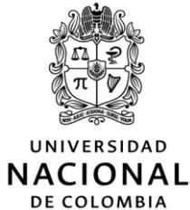

**VICERRECTORIA SEDE MANIZALES**

**RESOLUCIÓN 1977 de 2026**

(01 de octubre)

---

*“Por medio de la cual se vinculan dos estudiantes de posgrado y se registra un pago”*

---

**LA VICERRECTORA DE LA SEDE MANIZALES DE LA  
UNIVERSIDAD NACIONAL DE COLOMBIA**

en uso de sus facultades legales, estatutarias y en especial de las delegadas mediante la  
Resolución de Rectoría General Nro. 040 de 2001 y,

**CONSIDERANDO**

Que mediante oficio Mz.1.005-001-25 del 07 de enero de 2025 se solicita a la Oficina de Presupuesto, la apertura del proyecto de la Universidad Nacional de Colombia denominado **“Apoyo a estudiante de maestría para la investigación en el estudio de Neurociencia, dentro del Instituto de Epilepsia y Parkinson del Eje Cafetero en convenio con la Universidad Nacional sede Manizales”**, adscrito a la Dirección de Investigación y Extensión de la Sede de Manizales de la Universidad Nacional de Colombia.

Que el proyecto en mención tiene como objetivo general aplicar técnicas de analítica de datos en el campo de la neurociencia para mejorar la comprensión, detección temprana y el seguimiento de la enfermedad de Parkinson, con el fin de desarrollar estrategias más efectivas de tratamiento y proporcionar una mejor calidad de vida a los pacientes afectados por esta condición.

Que mediante Acuerdo 024 del 01 de noviembre de 2022 del Consejo Superior Universitario **“por la cual se reglamenta la figura de estudiante auxiliar en la Universidad Nacional de Colombia y se deroga el Acuerdo 012 de 2004 del Consejo Superior Universitario y sus modificaciones subsiguientes”**.

Que en concordancia con el artículo 7 del Acuerdo 024 de 2022 del CSU, la Dirección de Investigación de la Sede - DIMA el día 23 de septiembre de 2026, publicó a través de la página de convocatorias de la sede la Convocatoria DIMA 39 - 2026, para selección y vinculación de dos estudiantes de posgrado para apoyar las actividades de investigación del proyecto.

Que a través de oficio fechado el 30 de septiembre de 2026, suscrito por el profesor CESAR GERMÁN CASTELLANOS DOMÍNGUEZ responsable de la convocatoria para el proyecto **“Apoyo**

***a estudiante de maestría para la investigación en el estudio de Neurociencia, dentro del Instituto de Epilepsia y Parkinson del Eje Cafetero en convenio con la Universidad Nacional sede Manizales***”, se informaron los resultados obtenidos a los estudiantes que participaron en la convocatoria DIMA 39 – 2026.

Que, con base en la información aportada mediante el oficio y su necesaria comparación con los términos de la convocatoria hecha, se seleccionó de conformidad con el procedimiento establecido en las disposiciones vigentes, a los estudiantes de MAESTRÍA EN INGENIERÍA – AUTOMATIZACIÓN INDUSTRIAL de la Universidad Nacional de Colombia Sede Manizales OSCAR ANDRÉS GUTIÉRREZ ESTEPA identificado con cedula de ciudadanía No. 1006554210 y DAVID RAMÍREZ BETANCOURTH identificado con cedula de ciudadanía No. 1002636667.

Que mediante oficios fechado el 24 y el 27 de septiembre de 2026 dirigido a la Dirección de Investigación y Extensión los estudiantes en mención certifican que no reciben los beneficios económicos de que trata el artículo 02 del Acuerdo 024 de 2022.

Que el estímulo económico de los estudiantes auxiliares debe registrarse, y corresponden a la vigencia 2026.

Que por lo anterior se hace necesario solicitar un registro presupuestal que garantice los pagos a que haya lugar.

En mérito de lo expuesto,

**RESUELVE:**

**ARTÍCULO 1:** Vincular como Estudiante Auxiliar a los estudiantes relacionados a continuación, de acuerdo con las actividades, las fechas y el estímulo económico allí señalado, y solicitar a la Sección Financiera el registró presupuestal que garantice el pago de los estudiantes auxiliares; de la siguiente forma:

| Nombre                        | Identificación | Carrera                                            | Total, No Horas | Valor                                                                                                 | Valor Total                                                |
|-------------------------------|----------------|----------------------------------------------------|-----------------|-------------------------------------------------------------------------------------------------------|------------------------------------------------------------|
| OSCAR ANDRÉS GUTIÉRREZ ESTEPA | 1006554210     | Maestría en Ingeniería – Automatización Industrial | 20 horas semana | Dos pagos por \$2.500.000 mensuales c/u y un pago por 1.666.667 correspondiente a 20 días calendario. | 13.333.334 más 4x1000 53.333 para un total de \$13.386.667 |
| DAVID RAMÍREZ BETANCOURTH     | 1002636667     | Maestría en Ingeniería – Automatización Industrial | 20 horas semana | Dos pagos por \$2.500.000 mensuales c/u y un pago por 1.666.667 correspondiente a 20 días calendario. |                                                            |

**ACTIVIDADES:** Desarrolladas dentro del proyecto: **“Apoyo a estudiante de maestría para la investigación en el estudio de Neurociencia, dentro del Instituto de Epilepsia y Parkinson del Eje Cafetero en convenio con la Universidad Nacional sede Manizales”**, para apoyar las actividades durante 2 meses y 20 días calendario, así:

- • (Configuración y base): Apoyar el establecimiento de la arquitectura base del software definición de contratos de interfaz, preparación del entorno de integración y desarrollo del pipeline de ingesta inicial.
- • (Desarrollo y automatización inicial): Apoyar la implementación del flujo principal de ejecución automatización de tareas recurrentes de preparación de datos e inferencia inicial, y estabilización del pipeline.
- • (Escalamiento y orquestación): Apoyar el escalamiento a ejecuciones masivas de experimentos, implementación de almacenamiento estructurado de artefactos e integración de módulos desacoplados para gestión de estado.
- • (Optimización y despliegue en borde): Apoyar la adaptación y profiling del consumo de recursos para dispositivos restringidos (edge sensing), optimización de tiempos de respuesta y empaquetado/contenedorización inicial.
- • (Integración final y pruebas exhaustivas): Apoyar las pruebas end-to-end de carga y resiliencia ante pérdida de datos, refinamiento de interfaces externas y automatización de la generación de reportes de rendimiento.
- • (Documentación, congelamiento y entrega final): Apoyar la refactorización y congelamiento del código (code freeze), elaboración de documentación técnica y manuales, y transferencia del sistema consolidado.

**PERIODO DE VINCULACION:** Del 07 de octubre de 2026 al 27 de diciembre de 2026.

| Tutor: CESAR GERMÁN CASTELLANOS DOMÍNGUEZ | <b>CDP 100 empresa 4065 por valor de 13.333.334 más 4x1000 53.333 para un total de \$13.386.667</b> |
|----------------------------------------------|-----------------------------------------------------------------------------------------------------|
|----------------------------------------------|-----------------------------------------------------------------------------------------------------|

**ARTÍCULO 2:** Se realizarán dos pagos mensuales por valor de \$2.500.000 y un pago por \$1.666.667 correspondiente a 20 días calendario, a los estudiantes relacionados en la presente Resolución.

**ARTICULO 3:** El estímulo otorgado se pagará con cargo al proyecto **“Apoyo a estudiante de maestría para la investigación en el estudio de Neurociencia, dentro del Instituto de Epilepsia y Parkinson del Eje Cafetero en convenio con la Universidad Nacional sede Manizales”**, Código presupuestal 202010040691 **CDP 100**, de la empresa 4065, rubro servicios de investigación y desarrollo, recurso 20, por valor de 13.333.334 más 4x1000 53.333 para un total de \$13.386.667, expedido el 23 de septiembre de 2026.

**ARTICULO 4:** Liberar el saldo y/o registro presupuestal correspondiente al CDP No.100 de la empresa 4065 - 2026, si hay lugar a ello.

**ARTÍCULO 5:** Para el pago del estímulo económico, el estudiante deberá presentar el certificado de cumplimiento de las actividades asignadas, expedido por el profesor – tutor y/o quien haga sus veces.

**ARTÍCULO 6:** Notificar a los estudiantes el presente acto administrativo de conformidad con lo señalado en los artículos 67 y siguientes de la ley 1437 de 2011.

**ARTÍCULO 7:** La vinculación de los estudiantes al proyecto es de carácter académico y no constituye relación laboral ni contractual con la Universidad Nacional de Colombia.

**ARTÍCULO 8:** La presente Resolución rige a partir de la fecha de su expedición.

**NOTIFÍQUESE Y CÚMPLASE.**

**Dada en Manizales, al primer (01) día del mes de octubre de 2026**

**JOHNNY ALEXANDER TAMAYO ARIAS**

**Vicerrector de Sede**

Notificado: \_\_\_\_\_

Elaboró: Juliana Pérez