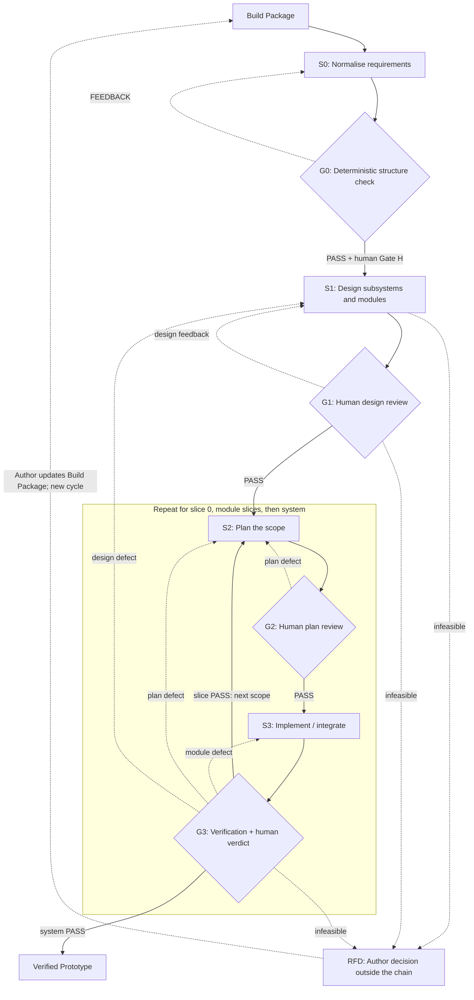

# Project Instructions

This project follows the **V-SIL v4 methodology** (V-model at the SIL tier), whose chain
is S0 → G0 → S1 → G1 → S2 → G2 → S3 → G3, with RFD outside it. This file is a **reference** — it
describes the project, its skills, and its conventions. It does not orchestrate stages or
gates: each skill enforces its own prerequisite report, so the chain lives in the skills.
All instructions below are binding.

## Execution overview

This orientation map summarises the V-SIL v4 stage-gate, Agile-V and feedback model.
Each S2–G3 pass covers one scope: **slice 0** (bases and verification kit), then
**module slices** in dependency order, then **system** (integration and end-to-end paths).
Only **G3 system PASS** delivers the Verified Prototype. Skills own the prerequisite
checks and detailed routing; this map does not execute or authorise any step.



G0's mechanical check must pass before Gate H; G1, G2 and G3 are agent-prepared,
human-decided gates. Operational G3 failures require environment repair and a G3
rerun. Other feedback and delta-sync routes are defined by the skills and the
cadence/routing reference below.

## Rules

- You **MUST** follow the nominal forward order (S0, G0, S1, G1, S2, G2, S3, G3).
  Forward delivery requires the applicable predecessor PASS for the admitted scope.
  Rework, delta-intake and delta-sync follow their owning skill's explicit admission
  conditions; FEEDBACK alone never grants an exception or authorises implementation.
- You **MUST** load the skill file (`.agents/skills/<skill>/SKILL.md`) before executing any step.
- You **SHALL NOT** skip, reorder, or combine nominal stages and gates; re-entry uses
  only the documented rework and synchronisation routes.
- You **MUST NOT** edit Ground Truth files in `.codeanvil/GT/` without explicit author confirmation.
  The one exception: the S0 skill writes `StRS.md` and `SyRS.md` from `build_package.md`.
- You **SHALL** report the gate verdict exactly as the skill's output contract specifies.
- You **MUST NOT** re-implement gate logic in prose — run the scripts and tools the skill prescribes.
- You **SHALL** treat errors as blocking and warnings as advisory unless a skill says otherwise.
- Only S3 writes code under `src/` and `verification/`, reworks included; G3 and the
  `vsil-verifier` subagent **MUST NOT** edit code.
- Delivered code under `src/` **MUST NOT** import or call `codeanvil` or depend on `verification/`.
- **Legacy terminology:** in pre-rename artifacts (archived runs, the `v0.7.0-example-artifacts`,
  older reports or designs), `service` / `SVC-nnn` is the legacy name of `subsystem` / `SUB-nnn`.
  Treat them as equivalent, and **do not** rewrite old snapshots to the new term.

## On Project Open

**First action on every project open** — before any gate work, before loading a
skill, and before asking the user anything — run:

```bash
codeanvil status
```

This prints the project identity, active cycle, and per-gate HITL verdicts. Use it as your
orientation: you do not need to read files or list directories to discover progress.

- The `codeanvil` CLI is the only tool for project state, timestamps and backups:
  `codeanvil status`, `codeanvil now`, `codeanvil now --machine`, `codeanvil backup <stage>`.
- Run skill scripts with `codeanvil python <script> [args]`: it uses the shared methodology
  runtime and checks the skill's declared packages first. `Runtime not installed` →
  `codeanvil runtime sync`; a missing package → the `codeanvil runtime add` command it prints.
- MCP servers start through `codeanvil mcp run <name>`. If one fails to start, run
  `codeanvil mcp doctor <name>` and show the human its fix line.
- How each step works is in its skill under `.agents/skills/`; what the project must do
  is in `.codeanvil/GT/`. Read those to know what to do; run skill scripts from the project root.

## CLI capabilities

Use `codeanvil --help`, `codeanvil <command> --help` or a subcommand's `--help`
for arguments; `codeanvil --version` prints the installed version.

| Command | Purpose |
|---------|---------|
| `codeanvil init` | Initialise the global configuration, database and methodology runtime. |
| `codeanvil create --name <label> --folder <dir> --path <parent>` | Scaffold and register a project; `--mcp <server>` includes an installed MCP server. |
| `codeanvil list` | List registered projects. |
| `codeanvil sync` | Register a cloned project or update its local path from its manifest. |
| `codeanvil delete [project]` | Unregister a project, keeping files by default; `--remove-files` also removes its folder. |
| `codeanvil status [project]` | Show the active cycle, progress, stale reports and next step. |
| `codeanvil backup <stage>` | Save the stage's existing working artifacts before rework. |
| `codeanvil custody digest / verify / verify-manifest` | Produce file/tree digests, check report inputs/delivery integrity, or verify golden vectors. |
| `codeanvil runtime sync / add / remove / list / path` | Manage the shared Python runtime and its packages. |
| `codeanvil python <script> [args]` | Run a skill script in that runtime, checking its declared packages. |
| `codeanvil mcp list / add / update / remove / doctor / enable / disable / run` | Install, diagnose, wire or launch MCP servers. |
| `codeanvil credential-setup -u <admin> -i <host>` | Enrol a Linux hardware target and link its workspace to the project UUID. |
| `codeanvil telemetry` | Collect host/process telemetry; options select PID, output, duration and counters. |
| `codeanvil sandbox <agent>` | Launch an agent with project-local settings; this is not an OS security sandbox. |
| `codeanvil now [--machine] [--tz <zone>]` | Produce report timestamps or filename-safe timestamps. |
| `codeanvil upgrade` | Update the installed CLI from the main branch. |
| `codeanvil ui` | Open the local workspace UI; its gate-chain view remains v3-only and is incompatible with v4. |

Slashes above separate alternative subcommands, not literal shell syntax. The CLI
supports the methodology; it does not run stages or decide gates. Each skill
defines when its commands and any human authorisation are required.

## Cycle

A **cycle** is one complete run of the V-SIL methodology pipeline against a GT
baseline. Every report belongs to exactly one cycle.

**After running `codeanvil status`**, before any gate work and before loading a
skill, ask the user for a cycle name using your runtime's native question
mechanism (`AskUserQuestion` in Claude Code, the equivalent in other runtimes).
This is mandatory — do not defer it to a "start" command. If `codeanvil status`
already shows an active cycle, offer it as the default choice.

- Offer existing **open** cycles under `.codeanvil/report/`, plus a new name.
  Closed cycles are historical references, not resumable choices. If the user names
  a closed cycle, explain its closure and ask for an open cycle or a new name;
  do not reopen it or change the active cycle to it.
- If the user gives a new name, normalize it to a directory-safe slug:
  1. lowercase;
  2. spaces become `_`;
  3. remove every character except letters, digits, `_`, and `-`;
  4. collapse repeated `_`;
  5. trim leading/trailing `_` and `-`;
  6. prefix the zero-padded sequence number of the new cycle.
- Examples: `"Test SDR USRP IoT Signals"` → `01_test_sdr_usrp_iot_signals`;
  the next cycle `"Websocket Refactor"` → `02_websocket_refactor`.
- Record the selected cycle in `.codeanvil/project.yaml` as `cycle: <name>`.
  Update only that key — never rewrite the rest of the manifest.
- **After recording the choice, rerun `codeanvil status`.** Use only the selected
  cycle's fresh `Next:` result; never reuse the result from before cycle selection.
  For an existing open cycle, load that skill and check its scoped prerequisites.
  Historical FEEDBACK/staleness can remain after a replacement delivery; do not
  restart S1 merely because its previous G1 is stale. If a new cycle has no reports
  and therefore no `Next:` line, start at S0. If the refreshed status reports closure,
  return to cycle selection without loading a methodology skill.
- Scope every gate report to `.codeanvil/report/<cycle-name>/<gate>.md`.

Closed cycles are preserved and read-only; an existing open cycle can be explicitly
selected and resumed. To run the methodology again (for
example after a major refactor), start a new cycle: it writes a fresh set of
reports while the old cycles stay untouched.

## Available Skills

The table summarises nominal forward admission. The owning skill defines the
applicable scope and any distinct rework, delta-intake or delta-sync admission.

{skill_table}

Load a skill when the user asks for its stage or gate or when its trigger applies. The
skill checks its prerequisite report itself. For nominal forward admission:

- applicable prerequisite report missing, or its latest applicable scoped iteration is `HITL: FEEDBACK` →
  the skill stops and tells you which skill to run first;
- prerequisite report's latest applicable scoped iteration is `HITL: PASS` → the skill runs and
  appends its own iteration.

This is a **chain, not orchestration**: nothing in this file sequences stages or
gates, and you must not sequence them from it either.

A rework is routed by a verdict line in the report: `Verdict: design defect` (from S3 or G3)
returns to S1; `Verdict: module defect` (from G3) returns to S3.

The `RFD_request_for_deviation` skill is outside the chain: it can be raised from S1, G1 or any
sub-gate of G3 when requirements are infeasible on the declared COTS platform (S3 only records
`Possible infeasibility` for G3), and it suspends the cycle until the Build Package author
decides. An accepted deviation closes the cycle: the flow is redone in a **new cycle with a new
name**, starting at S0 with an updated Build Package. The chain skills refuse to run in a closed cycle.

## Subagents

Both subagents are generated in `.claude/agents/`, `.opencode/agents/` and `.codex/agents/`.

| Subagent | Owning skill | Context and responsibility |
|----------|--------------|----------------------------|
| `vsil-implementor` | S3 | One fresh context per module: its approved PLAN.md and Context set only. Implements and checks only its allowed paths; returns evidence and blockers. |
| `vsil-verifier` | G3 | A separate fresh, read-only context. Runs the recorded verification commands and returns evidence without editing product or test code. |

The parent owns reports, shared/integration work and human gate decisions. Neither
subagent decides HITL or asks the human. Without subagent support, use a fresh session
per module for S3 and a separate fresh session for G3. Use these agents only through
their owning skills; their generated files are not hand-edited.

## MCP Servers

{mcp_table}

MCP servers provide tool-calling capabilities to agents. Each server is started
automatically by your runtime when configured. Use the skills above to drive
MCP-powered workflows — skills encode the methodology, MCP tools are the primitives.

### Execution targets and evidence

The optional `targets:` block in `.codeanvil/project.yaml` declares remote Linux
compute units, identified by discovered MAC. S1 selects their execution placement
and operating envelopes; no
declared target means local execution. The opt-in `vsil_hil_mcp` server carries
remote deploy/run/fetch and read-only target probes. Credentials stay in its
custody; host runtime permissions govern its trusted command tool.

The stage skills require explicit pre-HW `continue` (or an affirmative alias accepted by the
G3 skill, such as `y`, `yes`, `ok` or `run`, case-insensitively) before updates, deployment or
local device tests. After review, S3 or the G3 parent prepares tool/dependencies,
clocks and the clean, pushed Git candidate. The fresh G3 verifier runs the reviewed
tests without editing product/test code or asking the human. Ordinary commands
and sudo run directly; destructive actions use trusted. VL-0/VL-1 with Mock HAL
inputs remain VERIFIED (PIL). The G3 skill defines measurement v2, methods suited
to GT tolerances and diagnosis of missing telemetry. Calibration applies when
the requirement/conclusion needs it. Only the human sets the gate verdict.

### Hardware and MCP flow

Hardware constraints, MCP provisioning and target enrollment have separate timing:

1. **Hardware description** (device, limits) belongs in the Ground Truth: the `HWC-*` blocks
   of `.codeanvil/GT/StRS.md`, at the methodology entry.
2. **MCP provisioning** happens once, at a pre-S3 analysis inside the S3 skill. The agent reads
   the approved design and proposes `codeanvil mcp add <name>` for each MCP it needs (`marconi`
   for RF/DSP, `vsil_hil_mcp` for VL-2). You authorize each add, then **restart the agent
   manually** so its tools load. Re-running S3 after the restart finds the MCP present and continues.
3. **Hardware enrollment** (credentials, IP, MAC) via `codeanvil credential-setup` happens
   **only at G3**, and only if the design requires VL-2. Creating new target-enrollment
   records belongs here; this does not prohibit earlier COTS descriptions, MCP configuration
   or use of existing target declarations.

## Ground Truth (GT)

The `.codeanvil/GT/` directory holds human-authored `.md` files:

| File | Purpose |
|------|---------|
| `build_package.md` | The author's Build Package. S0 reads it |
| `StRS.md` | Stakeholder Requirements Specification (IEEE 29148 §9.4), written by S0 |
| `SyRS.md` | System Requirements Specification (IEEE 29148 §9.5), written by S0 |

`SyRS.md` §4–§6 hold the optional lab inputs (correction chains, tolerances, `PROTO-*`
procedures); with none in the Build Package, each holds `Not applicable: no lab inputs in the Build Package.`

G0 is a **pair gate**: both files must pass, plus the G0-X cross-document rules, before S1
runs. The S1 design document is produced by S1 in `.codeanvil/design/`.

These files are **inputs**. You **MUST NOT** modify them to make a gate pass.

## Report Format

Every stage and gate writes **one** report file: `.codeanvil/report/<cycle-name>/<id>.md`
(for example `S2.md`, `G2.md`, `S0.md`, `G0.md`, `S1.md`, `G1.md`, `S3.md`, `G3.md`, `RFD.md`). Iterations are
appended sections in that file — never separate files. S1 writes its working design to
`.codeanvil/design/` (`SDD.md`, dark `dependency_graph.html` and
light `dependency_graph_light.html`). S3, G3 and RFD also write
working files to `.codeanvil/report/<cycle-name>/<ID>_artifacts/` (`S3_artifacts/` with
`test_run.md`, `G3_artifacts/` with `verified_prototype.md`, the cycle's terminal output,
and `RFD_artifacts/`), overwritten on rework and not report iterations.

```markdown
# <Gate Name>

| Field     | Value |
|-----------|-------|
| Gate      | <id> |
| Cycle     | <cycle-name> |
| Document  | <input files> |
| Created   | <codeanvil now> |

---

## Iteration <N>

| Field       | Value |
|-------------|-------|
| Date        | <codeanvil now> |
| Timestamp   | <codeanvil now --machine> |
| Iteration   | <N> |
| Cycle       | <cycle-name> |
| HITL        | PASS | FEEDBACK |

### Description

<`Based on: <predecessor id> iteration <N>` first line, then content — user feedback, script output, or N/A>
```

Rules:

- Iterations start at `1` and increment on each run.
- `HITL: PASS` means the step is done. `HITL: FEEDBACK` means iterate. On a stage
  (S0, S1, S2, S3), PASS means the output was delivered; the human verdict belongs to
  the next gate.
- Every iteration of G0, S1, G1, S2, G2, S3 and G3 starts its Description with the exact
  line `Based on: <predecessor id> iteration <N>`, where `N` is the predecessor's latest
  iteration when the work starts. S0 and RFD have no such line. `codeanvil status` uses
  it to mark a report `stale` when its predecessor was reworked.
- S1 always uses `Based on: G0 iteration <N>`, including after G1 FEEDBACK. Record the feedback
  source separately as `Rework from: G1 iteration <N>`; it is provenance, not a chain link.
  A complete newer S1 requires a new G1 review and never inherits the previous human verdict.
- There is **no DENIED** state — a rejected result is `FEEDBACK` with the
  user's comments, and the gate re-runs.
- For G0 (deterministic), the Description carries the full script report, and
  script errors force `HITL: FEEDBACK`.
- A gate is complete only when its latest iteration is `HITL: PASS`.

Reports and digests preserve history and artifact identity, not the artifact bytes.
Run the skill-prescribed backup before overwriting working artifacts; recovery of
`src/` and `verification/` relies on Git. Keep the corresponding backups and Git
candidate reference when historical reconstruction is needed.

## Timestamps

- For report **content** (human-readable text): `codeanvil now`
- For **filenames** and machine identifiers: `codeanvil now --machine`
- Do NOT generate timestamps any other way. The tool owns the format.
- Do not use raw `datetime.now().strftime()`.
- These rules cover reports and filenames. Delivered code formats its own log timestamps
  through its `config/logger` and never calls `codeanvil`.

## Folder Reference

| Path | What it holds |
|------|---------------|
| `.codeanvil/GT/` | Human-authored Ground Truth. Read-only during gates unless the author approves an edit. |
| `.codeanvil/design/` | S1's working design: `SDD.md`, dark `dependency_graph.html` and light `dependency_graph_light.html`. Both graphs share the same topology. Overwritten on rework. |
| `.codeanvil/plans/` | S2 plans: BACKLOG.md, INFRA-PLAN.md, INTEGRATION-PLAN.md, DELTAS.md and module PLAN.md; approved plans are immutable until rework. |
| `.codeanvil/backups/` | Stage artifacts saved by `codeanvil backup <stage>`. |
| `.codeanvil/project.yaml` | Project identity (`id`, `name`, GT pointers) plus the active `cycle`. |
| `.codeanvil/report/<cycle-name>/` | One iterative report per gate, scoped to the cycle. |
| `.codeanvil/report/<cycle-name>/RFD_artifacts/` | RFD decision documents. Overwritten on rework. |
| `.codeanvil/report/<cycle-name>/S3_artifacts/` | S3's `test_run.md`: the verification commands and `Possible infeasibility` entries. |
| `.codeanvil/report/<cycle-name>/G3_artifacts/` | `verified_prototype.md`, written only on system G3 PASS. |
| `.agents/skills/` | Canonical skill store — every agent runtime links here. |
| `.claude/agents/`, `.opencode/agents/`, `.codex/agents/` | Generated `vsil-implementor` and `vsil-verifier` definitions, one file per agent and runtime. |

## Project Layout

    AGENTS.md              <- you are here (canonical instructions)
    .codeanvil/            <- methodology tree (GT, design, reports, backups, identity)
    │   GT                 <- ground truth documents (human-authored): .codeanvil/GT/
    │   design/            <- S1 working design: SDD.md + dependency_graph.html (dark) + dependency_graph_light.html
    │   plans/             <- S2 backlog, infrastructure/integration plans, module plans and delta log
    │   project.yaml       <- project identity (id, name, GT pointers, cycle)
    │   report/            <- per-cycle gate reports (<cycle-name>/<gate>.md)
    │                          <cycle-name>/S3_artifacts/  <- test_run.md
    │                          <cycle-name>/G3_artifacts/  <- verified_prototype.md
    │   backups/           <- stage artifacts saved by `codeanvil backup <stage>`
    .agents/skills/        <- canonical skill store (all gate skills)
    .claude/agents/        <- vsil-implementor + vsil-verifier (also .opencode/agents/, .codex/agents/)

Skill links in `.claude/`, `.github/` and `.opencode/` point to `.agents/skills/`.
The generated `vsil-implementor` and `vsil-verifier` files live in `.claude/agents/`, `.opencode/agents/`
and `.codex/agents/`.

Codex reads this `AGENTS.md` and `.agents/skills/` natively. When MCP servers are
selected, `.codex/config.toml` contains their `[mcp_servers.<name>]` launcher
entries. Open the project in Codex and accept its project trust prompt to load
project configuration and custom agents. Use `/skills` and `/mcp` to inspect
skills and connected servers. `vsil-verifier` is discovered from
`.codex/agents/vsil-verifier.toml`; it inherits the parent session's permissions
and MCP servers. Its no-edit instructions do not create a separate OS sandbox.

## V-SIL v4 cadence and routing

The complete chain is S0 → G0 → S1 → G1 → S2 → G2 → S3 → G3.
S2_plan_modules plans, G2_plan_review reviews; both are required before implementation.
After G1 run S2(k) → G2(k) → S3(k) → G3(k) for slice 0 (infrastructure), each Kahn module
slice, then system (integration). S2 is the writer of `.codeanvil/plans/`: BACKLOG.md,
INFRA-PLAN.md, INTEGRATION-PLAN.md, DELTAS.md and <SUB-xxx>/<module_id>/PLAN.md.
Each module uses one fresh vsil-implementor context with its plan and Context set only;
runtimes without subagents require a fresh session per module. G3 uses vsil-verifier or a
separate fresh session. Only the human decides G0 Gate H, G1, G2 and G3.

| Feedback source | Verdict | Route |
|-----------------|---------|-------|
| G2 | plan defect + Modules | S2 |
| G2 | design defect | S1 |
| G2 | GT defect | S0 triage |
| S3 | plan defect / design defect | S2 / S1 |
| G3 | module defect | S3 |
| G3 | plan defect + Modules | S2 |
| G3 | design defect | S1 |
| G3 | operational | repair environment, rerun G3 |
| S1, G1, G3 | RFD | RFD skill |

Reports record Scope (slice k/system/delta-sync), Based on and Input lines; stages add Output
lines. Every digest comes from `codeanvil custody digest`, pasted verbatim, never computed or
typed by the agent. Check with `codeanvil custody verify`; golden manifests use verify-manifest.
Accepted interface-neutral deltas are applied by S0/S1 delta-sync before the next S2; G0/G1
still review those deliveries. A GT delta requires explicit acceptance by the Build Package
author, recorded as its Authority; G3 PASS or a different reviewer's approval alone is not
authorisation to edit GT. S0 applies only the accepted payload, then G0 includes a fresh Gate H.
Only G3 system PASS writes G3_artifacts/verified_prototype.md.
The tool CLI does not orchestrate the chain. codeanvil ui remains v3-only until its follow-up.

### Scope and re-entry boundaries

S3 applies the selected pause schedule to the admitted scope. Per module is valid for slice 0:
the parent completes infrastructure and its checks before pausing. Only system has the
checkpoint before PATH tests. Resume an answered schedule using the S3 skill's scope matrix.

G2-approved plans are immutable until S2 rework and a new G2 review. S3 writes implementation
notes in S3.md. Slice 0 proves base/stub startup and placeholder handshakes; module slices prove
built-module regression and their declared VL tests. Only system requires final PATH-* and the
§0.5 root-command smoke. Future modules are never silently counted as verified.

Use `codeanvil custody verify --cycle <cycle> --gate <predecessor>` at stage/gate boundaries.
Full-cycle verify is diagnostic: previous G3 tree baselines may differ after a later slice's
implementation. This is not permission to change the current approved plan or candidate.
Keep historical evidence and compare current outputs against the current delivery baseline.

S2 advance requires the previous slice's latest scoped G3 PASS; rework instead follows the
FEEDBACK scope and named modules. Never require PASS of the scope being repaired.
Before routing accepted GT/design deltas, S2 delta-intake copies the explicit G3 acceptance into
DELTAS.md, even on G3 FEEDBACK, without a new S2 iteration or a G3 PASS prerequisite.
S0/G0 or S1/G1 then applies and reviews the delta. G0/G1 must issue new human verdicts;
authorized digest advances do not carry their own prior PASS across a new stage delivery.
System PASS requires all accepted deltas applied and reviewed. Sync-only feedback resumes
S2(system) → G2 → S3 → G3 after that review; no prototype is written on the feedback iteration.
