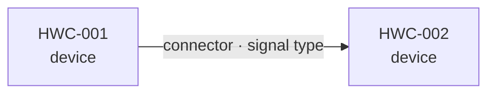
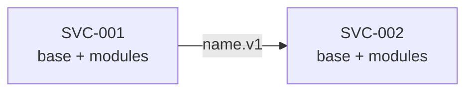
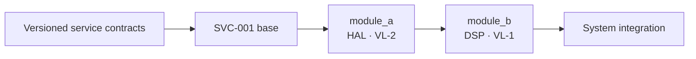
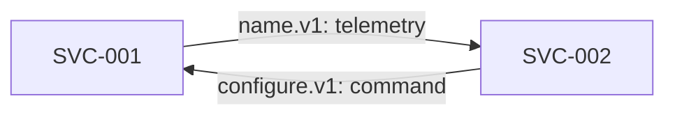

# S1 — Design of a System of Layered Services

<!-- V-SIL v3 · stage S1. Input: GT/G0_StRS.md + GT/G0_SyRS.md (passed G0 + Gate H).
     Output: this document, reviewed by a human at G1.
     Structure: arc42 §5 Building Block View, IEEE 1016 viewpoints, IEEE 29148 traceability,
     MADR decisions, plus COTS envelope, per-module verification profile and stub recipes.
     Replace every {{...}} and every comment. Section numbers are referenced elsewhere: keep them. -->

## Meta

| Field          | Value                                                       |
|----------------|-------------------------------------------------------------|
| Project        | {{project name}}                                            |
| Cycle          | {{cycle name}}                                              |
| Date           | {{YYYY-MM-DD}}                                              |
| Author         | {{name / role}}                                             |
| G0 approved    | {{SHA-256 of G0_StRS.md and G0_SyRS.md; information only}}  |
| Gate H         | {{date + who authorised, copied from G0.md}}                |
| Services       | {{service IDs; a single service is valid}}                  |
| ML model       | {{omit if not used; otherwise reference to the supplied package}} |
| Status         | draft / in G1 review / approved at G1                       |

---

## 0. COTS envelope

<!-- Each COTS device is a node of the physical architecture. Every physical connection is an
     interface whose measurable limits flow into the software contracts of §3
     (noise budget, clock accuracy, bus throughput, settling time). -->

### 0.1 Device inventory

| ID      | Device | Role | Key constraints |
|---------|--------|------|-----------------|
| HWC-001 |        |      |                 |

<!-- A COTS device is bought, not designed. "Key constraints" = what limits the software:
     frequency range, sample rate, ADC resolution, insertion loss, clock accuracy, bus
     throughput, RAM, available interfaces. Every ID traces to an HWC-* block of G0_StRS.md. -->

### 0.2 Physical topology

<!-- If a cable is unplugged, what breaks? Every edge names connector, signal type, direction. -->

### 0.3 Physical interfaces (HW ↔ HW contracts)

#### PHY-001: {{origin}} → {{destination}}

| Field            | Value |
|------------------|-------|
| Connector        |       |
| Impedance        |       |
| Band / range     |       |
| Expected loss    |       |
| Key constraint   |       |

<!-- Repeat PHY-NNN for every physical connection. "Key constraint" is what the software
     inherits, e.g. "IL ≤ 2.3 dB → the NF budget assumes it". Name the §3 contract it affects. -->

### 0.4 Deployment and links between services

| Service ID | Process / deployment target | HWC-* used | Links to other services | Restart / disconnected operation |
|------------|-----------------------------|------------|-------------------------|-----------------------------------|
| SVC-001    |                             |            |                         |                                   |

<!-- One machine may host several services; a service may have no HWC-* of its own. State the
     real process, network and failure boundaries. A module in the same process is not a service. -->

---

## 1. Building block view

<!-- Each service has: a base layer (orchestration + HAL + routing + interface contracts) and
     plug-in modules, one per responsibility. Modules talk ONLY through their service's base:
     no direct module → module call. Services talk through versioned contracts. -->

### 1.1 System service view (level 0)

| Service ID | Single responsibility | State it owns | External inputs / outputs | Deployment target |
|------------|-----------------------|---------------|---------------------------|-------------------|
| SVC-001    |                       |               |                           |                   |

**Motivation for the service boundaries:**

<!-- Why separate processes or deployments? What restarts independently? Who owns shared
     state, and what happens if the link drops? With one service, name it and omit the edges. -->

### 1.2 White box: each service (level 1)

<!-- Repeat 1.2–1.4 for every service. Whole-product integration is described by the
     cross-service contracts and paths of §3–4. -->

**Motivation for the decomposition:**

<!-- THE key design decision of S1. Why these modules and not others? Which partitioning
     criterion? Why do the boundaries sit where they do? This is what G1 evaluates. -->

### 1.3 Base layer

<!-- White box of the base layer OF EACH SERVICE. The HAL may be empty if no hardware is touched. -->

**Service ID:** {{SVC-xxx}}

#### 1.3.1 Orchestration

| Field            | Value |
|------------------|-------|
| Mechanism        | <!-- e.g. GNU Radio top block, asyncio event loop, ROS 2 executor --> |
| Execution model  | <!-- dataflow push/pull, event-driven, periodic --> |
| Timing           | <!-- hard real-time, soft real-time, best-effort --> |

<!-- Justify the mechanism: which project constraint imposes it? -->

#### 1.3.2 HAL (Hardware Abstraction Layer)

| Field               | Value |
|---------------------|-------|
| Devices it wraps    | <!-- HWC-* list --> |
| Exposed interface   | <!-- what the rest of the software sees: port, API, topic --> |
| Isolation           | <!-- if a COTS device is swapped, what changes and what does not --> |

<!-- The HAL is the ONLY point that touches hardware. If swapping a device changes more than the
     HAL, explain why. -->

#### 1.3.3 Data routing

| Input signal | Consumers | Mechanism |
|--------------|-----------|-----------|
|              |           |           |

<!-- Document every place where a signal forks or is routed conditionally. -->

### 1.4 Black boxes: modules

<!-- Each module is a black box: what it consumes, produces, its responsibility and how it will
     be verified. How it works inside is S2's business. -->

#### {{SVC-xxx/module_id}}

| Field            | Value |
|------------------|-------|
| service_id       | <!-- owning SVC-xxx; use SVC-xxx/module_id in traces --> |
| Functional layer | <!-- HAL / DSP / Decision / Output / Control / other --> |
| Responsibility   | <!-- ONE sentence --> |
| depends_on       | <!-- contracts it consumes --> |
| provides         | <!-- contracts it produces --> |
| hw_dependency    | <!-- true / false --> |
| required_vl      | <!-- VL-0 / VL-1 / VL-2 --> |

**Rationale for the required VL:**

<!-- hw_dependency = true → required_vl MUST be VL-2. Running on a computer does not count:
     the correctness must depend on that hardware.
     VL-1: which risk justifies going beyond VL-0 (e.g. behaviour only visible with realistic data)?
     VL-0: why is pure logic enough (e.g. a fixed threshold, checkable with deterministic vectors)? -->

<!-- REPEAT for EVERY module. -->

### 1.5 Supplied ML model (optional)

<!-- OMIT this whole section if no module uses ML. An outcome requirement does not oblige ML.
     If ML is chosen, the model is supplied as a controlled input, trained with Mock HAL data plus
     labelling or, failing that, real-hardware HAL data plus labelling. S1 designs its integration.
     Never train or select a model here. -->

| Field                    | Value |
|--------------------------|-------|
| Consuming module         | <!-- SVC-xxx/module_id --> |
| SYS-* it satisfies       | <!-- outcome requirements, not only a technical choice --> |
| Provider and provenance  |  |
| Artifact and weights     | <!-- controlled path/URI, format, version, SHA-256 --> |
| Training data and labels | <!-- Mock HAL or, failing that, real-hardware HAL; labelling procedure; dataset version, SHA-256 --> |
| Inference runtime        | <!-- version, dependencies, COTS compatibility --> |
| Inputs                   | <!-- shape, type, units, rate, exact preprocessing --> |
| Outputs                  | <!-- shape, labels, thresholds, confidence, postprocessing --> |
| Supplied performance     | <!-- metrics, dataset, size, conditions, limits --> |
| COTS budget              | <!-- p95/p99 latency, RAM, CPU/GPU, power if applicable --> |
| Verification profile     | <!-- required_vl and the environment where G2 will measure --> |
| Failure / wrong version  | <!-- safe response to absence, error or change --> |

**Inference contract and fake response:**

<!-- Concrete input → expected output, and a deterministic fake response for VL-0. The fake proves
     the module's integration, not the model's quality: G2 measures with the identified weights. -->

**Design decision:** {{DEC-NNN justifying this model and its location}}

---

## 2. Dependency view

<!-- Separate implementation dependencies from runtime interaction. The implementation DAG
     (contracts, bases, modules, hardware as source/sink, final integration) MUST be acyclic so
     S2 can build with stubs. Runtime interaction may be bidirectional between services; it is
     reviewed as a protocol and never orders the implementation. -->

### 2.1 Implementation dependency graph (DAG)

<!-- Hardware nodes go in a separate subgraph. Edges name contracts or build order. Each software
     node shows service, id, functional layer, required VL. A cross-service contract is defined
     before both services: never draw it as a mutual dependency. -->

### 2.2 Topological implementation order

<!-- Derived from the DAG; the order in which S2 implements modules after the bases. The first
     module of each service depends only on contracts, base and, if applicable, hardware. The
     last step integrates the real services. -->

| Step | Service | Module / integration | Depends on (contracts) | Rationale for the order |
|------|---------|----------------------|------------------------|-------------------------|
| 1    |         |                      |                        |                         |

### 2.3 Runtime interaction graph

<!-- A message loop is valid if every edge has a §3.4 contract. For each loop: who owns the state,
     what acknowledges a command, when does it time out, how are duplicate retries avoided, what
     happens when a service drops or reconnects? -->

---

## 3. Interface view

<!-- Four contract types: HW → SW (constrained by PHY-*), SW → SW (inside a service), SW → HW
     (commands), service → service (across processes or network). EVERY contract must be enough
     to write a deterministic stub without asking the designer. If you cannot write the stub
     recipe, the contract is incomplete. -->

### 3.1 HW → SW contracts

#### {{contract_id}}

| Field              | Value |
|--------------------|-------|
| Physical origin    | <!-- PHY-NNN (§0.3) --> |
| COTS device        | <!-- HWC-NNN --> |
| Consuming module   | <!-- module receiving this signal --> |
| Data type          | <!-- complex64, float32[N], record, enum --> |
| Shape / structure  | <!-- [4096], stream, {f_c, power, snr} --> |
| Units              | <!-- full-scale ±1, dBFS, MHz, bool --> |
| Rate / frequency   | <!-- 20 MS/s, 1 Hz, per event --> |
| Maximum latency    | <!-- ≤ 5 ms --> |
| Schema version     | <!-- v1 --> |
| Inherited budget   | <!-- limits coming from PHY-*, e.g. NF ≤ 4 dB --> |

**Stub recipe:**

<!-- CONCRETE description of a deterministic stub that replaces the hardware in VL-0 and VL-1:
     source type, exact data (values or how to generate them), simulated conditions (nominal,
     degraded, edge case). E.g. "8192 complex64 samples, tone at +1 MHz, 0.5 FS, AWGN, SNR ≈ 20 dB". -->

**Reference test vectors:**

| Input | Expected output |
|-------|-----------------|
|       |                 |

### 3.2 SW → SW contracts

#### {{contract_id}}

| Field              | Value |
|--------------------|-------|
| Producer           | <!-- SVC-xxx/module; same service --> |
| Consumer(s)        | <!-- SVC-xxx/modules; same service --> |
| Data type          |       |
| Shape / structure  |       |
| Units              |       |
| Rate / frequency   |       |
| Maximum latency    |       |
| Schema version     |       |

**Stub recipe:**

<!-- Same criterion: concrete, deterministic, reproducible. -->

**Reference test vectors:**

| Input | Expected output |
|-------|-----------------|
|       |                 |

### 3.3 SW → HW contracts

#### {{contract_id}}

| Field             | Value |
|-------------------|-------|
| Sending module    |       |
| Physical target   | <!-- PHY-NNN / HWC-NNN --> |
| Data type         | <!-- uint8, enum, struct --> |
| Meaning           | <!-- 0=FM, 1=ADS-B, 2=reserved --> |
| Latency           |       |
| Side effects      | <!-- e.g. "changing position invalidates the iq_acquisition buffer" --> |

**Stub recipe:**

<!-- E.g. "Mock GPIO that records calls and reports the current position; controls no real hardware." -->

### 3.4 Service → service contracts

#### {{contract_id}}: {{origin SVC}} → {{destination SVC}}

| Field                     | Value |
|---------------------------|-------|
| Producer / consumer       | <!-- SVC-xxx + port at each end --> |
| State owner               | <!-- one service; the other's replica is identified --> |
| Operation / message       | <!-- e.g. occupancy.v1, configure.v1 --> |
| Transport / direction     | <!-- HTTP, event, WebSocket... --> |
| Schema and version        | <!-- fields, types, vN/vN+1 compatibility --> |
| Units and time            | <!-- units, clock, timestamp, expiry --> |
| Order / rate / size       | <!-- guarantees, limits, backpressure --> |
| Latency / availability    | <!-- measurable budget and conditions --> |
| Authorisation             | <!-- who may read or issue commands --> |
| Acknowledgement / retries | <!-- timeout, idempotency, duplicates --> |
| Disconnect / restart      | <!-- safe state, queue, resynchronisation --> |
| SYS-* / NRM-* affected    | <!-- requirements crossing this boundary --> |

**Fake-peer recipe:**

<!-- Deterministic nominal and error responses, incompatible version, duplicate message, delay,
     disconnect and reconnect, as applicable. -->

**Contract and test vectors:**

<!-- Concrete message → expected response/state on producer and consumer. S2 uses the same vector
     for both ends of the contract in VL-0. -->

---

## 4. Traceability

<!-- Every SYS-* of G0_SyRS.md traces to a module or to a cross-service path with responsible
     modules. A SYS-* without a module is an uncovered requirement; a module without a SYS-* is
     orphan code (question it). -->

### 4.1 Requirements → services, modules and paths

| Requirement | Text (summary) | Service(s) | Module(s) | Path / contract(s) | Acceptance owner |
|-------------|----------------|------------|-----------|--------------------|------------------|
| SYS-001     |                |            |           |                    |                  |

### 4.2 Modules → requirements (inverse view)

| Service | Module (SVC-xxx/module_id) | Requirement(s) satisfied |
|---------|----------------------------|--------------------------|
|         |                            |                          |

### 4.3 Normative constraints → contracts

| Norm    | Constraint | Affected contract | Imposed value |
|---------|------------|-------------------|---------------|
| NRM-001 |            |                   |               |

### 4.4 System paths and end-to-end evidence

| Path ID  | SYS-* | Services and contracts, in order | Input → observable result | End-to-end budget | required_vl | Environment / acceptance criterion |
|----------|-------|----------------------------------|---------------------------|-------------------|-------------|------------------------------------|
| PATH-001 |       |                                  |                           |                   | VL-0/1/2    |                                    |

<!-- Every SYS-* that crosses services needs a PATH-* and a measurable budget. S2 tests the path
     with connected services and simulated external inputs in VL-0; VL-1 and VL-2 add the declared
     environment. Isolated per-service tests do not prove an end-to-end requirement. -->

---

## 5. Design decisions

<!-- Decisions a reviewer needs to question, in MADR format: module partitioning (DEC-001 is the
     partitioning decision), sizes and parameters, orchestration mechanism, service separation and
     shared-state ownership, the link and protocol behind the PATH-* paths. -->

### DEC-001: {{decision title}}

- **Status:** proposed / accepted / deprecated / superseded by DEC-NNN
- **Context:** <!-- what design problem is faced -->
- **Alternatives considered:**
  1. <!-- alternative A -->
  2. <!-- alternative B -->
- **Decision:** <!-- which one was chosen -->
- **Rationale:** <!-- why this and not the others -->
- **Consequences:** <!-- positive and negative -->
- **Requirements affected:** <!-- SYS-*, NRM-*, STK-* -->

<!-- REPEAT for every significant decision. -->

---

## 6. Risks and known infeasibilities

<!-- Anything that smells like a potential RFD is documented here BEFORE G2. An RFD from S1 means:
     "under any possible partitioning on this COTS envelope, this requirement cannot be met". That
     is a physical constraint of the hardware, not a design defect. A manageable risk is documented
     with its mitigation; an infeasible one is escalated as a formal RFD. -->

| ID      | Risk | Requirements / PATH-* affected | Evidence / estimate (`ANALYSIS (no VL)`) | Proposed mitigation | Potential RFD? |
|---------|------|--------------------------------|------------------------------------------|---------------------|----------------|
| RSK-001 |      |                                |                                          |                     | yes / no       |

<!-- An improvement for another version may be noted as future work only if it is outside the
     approved scope of the cycle. A current SYS-* that fails follows the defect or RFD route. -->
